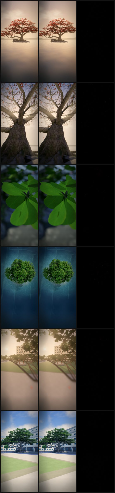
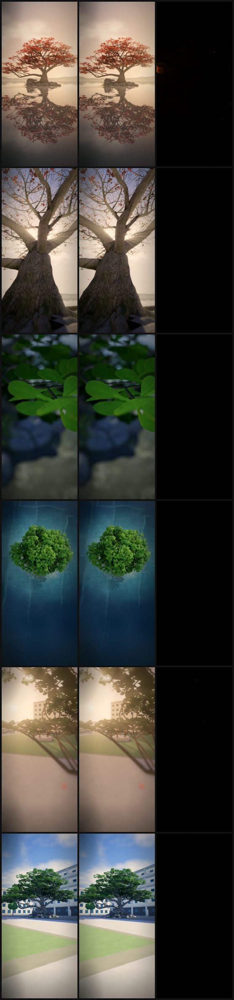

# Homepage bench: `baseline` (undefined) → `guarded` (undefined)

## Tier `low`

| still | PSNR (dB) | mean abs error (levels) | px > 2 levels | px > 8 levels |
|---|---:|---:|---:|---:|
| low-ch1.png | 58.3 | 0.025 | 0.01% | 0.005% |
| low-ch2.png | 61.7 | 0.023 | 0.02% | 0.007% |
| low-ch3.png | 64.9 | 0.015 | 0.03% | 0.004% |
| low-ch4.png | 59.8 | 0.016 | 0.06% | 0.019% |
| low-ch5.png | 62.3 | 0.027 | 0.01% | 0.003% |
| low-ch6.png | 63.7 | 0.028 | 0.00% | 0.000% |

## Tier `medium`

| still | PSNR (dB) | mean abs error (levels) | px > 2 levels | px > 8 levels |
|---|---:|---:|---:|---:|
| medium-ch1.png | 52.9 | 0.085 | 0.48% | 0.098% |
| medium-ch2.png | 65.1 | 0.020 | 0.00% | 0.000% |
| medium-ch3.png | 68.3 | 0.010 | 0.00% | 0.000% |
| medium-ch4.png | 62.3 | 0.020 | 0.11% | 0.011% |
| medium-ch5.png | 61.2 | 0.028 | 0.02% | 0.005% |
| medium-ch6.png | 63.7 | 0.028 | 0.00% | 0.000% |

