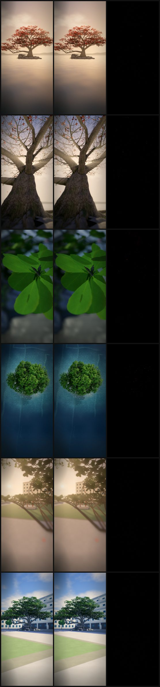
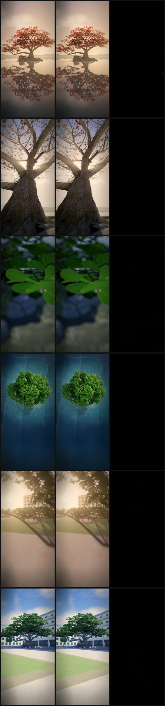

# Homepage bench: `baseline` (b7ad45d) → `optimized` (b7ad45d+dirty)

Environment: SwiftShader (software), 390x844 @3x, CPU throttle 4×, 4 cores.

> Software WebGL on a CI CPU. Timings rank work and show deltas; they are not phone frame rates.

## Tier `low`

| | before | after | Δ |
|---|---:|---:|---:|
| time to ready (ms) | 5906 | 6088 | 3.1% |
| scroll frame p50 (ms) | 3171 | 3091 | -2.5% |
| scroll frame p90 (ms) | 4995 | 4745 | -5.0% |
| scroll frame max (ms) | 6688 | 6808 | 1.8% |
| environment bakes during scroll | 39 | 14 | |
| environment bake time during scroll (ms) | 264 | 98 | -62.9% |
| simulation-only step p50 (ms, CPU-throttled) | 2 | 2 | 0.0% |
| textures / geometries | 35 / 42 | 35 / 42 | |
| JS heap (MB) | 8.7 | 11.3 | |

| chapter | frame p50 before | after | Δ | draw calls before → after | post passes before → after |
|---|---:|---:|---:|---|---|
| 1 | 1475 | 1526 | 3.5% | 16 → 14 | 5 → 3 |
| 2 | 2234 | 2225 | -0.4% | 22 → 15 | 5 → 4 |
| 3 | 2664 | 2577 | -3.3% | 16 → 21 | 5 → 4 |
| 4 | 2631 | 2429 | -7.7% | 14 → 12 | 5 → 3 |
| 5 | 3095 | 3051 | -1.4% | 24 → 18 | 5 → 4 |
| 6 | 4152 | 3968 | -4.4% | 19 → 22 | 5 → 3 |

| still | PSNR (dB) | mean abs error (levels) | px > 2 levels | px > 8 levels |
|---|---:|---:|---:|---:|
| low-ch1.png | 60.0 | 0.024 | 0.00% | 0.003% |
| low-ch2.png | 61.7 | 0.023 | 0.02% | 0.007% |
| low-ch3.png | 62.6 | 0.019 | 0.05% | 0.008% |
| low-ch4.png | 59.8 | 0.016 | 0.06% | 0.019% |
| low-ch5.png | 64.3 | 0.024 | 0.00% | 0.000% |
| low-ch6.png | 63.7 | 0.028 | 0.00% | 0.000% |

## Tier `medium`

| | before | after | Δ |
|---|---:|---:|---:|
| time to ready (ms) | 5554 | 5404 | -2.7% |
| scroll frame p50 (ms) | 9446 | 8842 | -6.4% |
| scroll frame p90 (ms) | 13929 | 12996 | -6.7% |
| scroll frame max (ms) | 18435 | 16345 | -11.3% |
| environment bakes during scroll | 39 | 14 | |
| environment bake time during scroll (ms) | 251 | 97 | -61.4% |
| simulation-only step p50 (ms, CPU-throttled) | 4 | 3 | -25.0% |
| textures / geometries | 47 / 42 | 47 / 42 | |
| JS heap (MB) | 11.1 | 12.3 | |

| chapter | frame p50 before | after | Δ | draw calls before → after | post passes before → after |
|---|---:|---:|---:|---|---|
| 1 | 8564 | 6801 | -20.6% | 40 → 44 | 6 → 4 |
| 2 | 8323 | 7685 | -7.7% | 46 → 39 | 6 → 5 |
| 3 | 8828 | 8737 | -1.0% | 40 → 45 | 6 → 5 |
| 4 | 11621 | 11440 | -1.6% | 41 → 34 | 6 → 4 |
| 5 | 9235 | 8968 | -2.9% | 46 → 50 | 6 → 5 |
| 6 | 14761 | 14396 | -2.5% | 51 → 44 | 6 → 4 |

| still | PSNR (dB) | mean abs error (levels) | px > 2 levels | px > 8 levels |
|---|---:|---:|---:|---:|
| medium-ch1.png | 61.2 | 0.023 | 0.01% | 0.005% |
| medium-ch2.png | 65.1 | 0.020 | 0.00% | 0.000% |
| medium-ch3.png | 62.8 | 0.022 | 0.04% | 0.006% |
| medium-ch4.png | 67.6 | 0.011 | 0.00% | 0.000% |
| medium-ch5.png | 61.9 | 0.026 | 0.01% | 0.003% |
| medium-ch6.png | 63.7 | 0.028 | 0.00% | 0.000% |

