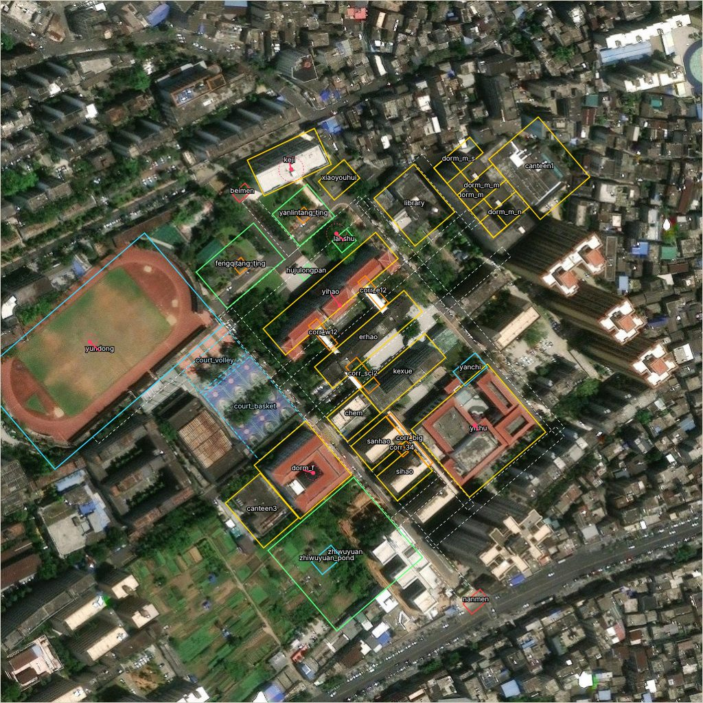

# HAIZ 校园空间真实性审计报告

2026-11-22 · 审计基线 `main@b7ad45d` · 工具 [`tools/campus-audit/`](../../tools/campus-audit/README.md) · 机器输出 [`audit-output.md`](audit-output.md)

## 一、结论

1. **仓库里没有任何实测数据。** 校园平面声称来自“UTM Measure 实测平面图导出 KML（no_project2.xml）”，但这份 KML 和坐标转换脚本都不在仓库中，`meta.verification.status` 也早已写明 `legacy-derived-unverified`。因此本审计没有给任何空间内容打 `surveyed` 标签，工具也会拒绝任何缺少原始文件的“实测”标注。
2. **整体布局和公开影像大致吻合。** 在仓库自带的 Esri World Imagery 影像（约 0.55 m/px）上人工判读了 6 个地物中心，做相似变换拟合：校园轴线**逆时针偏离真北 40.6°**（留一法范围 39.7–42.3°），与旧注释声称的 41.4° 相差不到 1°；模型比影像**小约 2.7%**（留一法范围 0.2–4.3%，说明比例只能粗略确定）；**残差 RMS 8.9 m**。可以说，楼与楼的相对位置、朝向和大致尺度是可信的，但精度只到“十米级”，不能用于测量。
3. **模型内部是一致的。** 三份数据副本、Blender V3 的 26 个锚点和生活场景的碰撞体全部一致；19 栋实体建筑互不重叠；路网连通；没有树点落在墙内或水中；跑道尺寸与标准 400 m 跑道相差不到 3%。
4. **工具给出 17 条警告，归并后是 9 类需要人工核实的问题和 6 处措辞问题。** 主要包括：砚池与艺术中心占地重叠 34 m²；按标准尺寸，六片篮球场放不进现有占地；科二连廊有 26% 伸进科学馆；两个食堂距离任何已建模道路 37–55 m；图书馆的门离建筑 15 m；“陶然亭”和“思园”只有导览文字，没有几何；以及 6 处把旧 KML 说成“实测”的措辞。
5. **历史材料的标注已经比较完善。** `lanren/roots/history.js` 中 13 个节点都带有分级（多源一致 5、单一来源待核 3、官网自述 1、照片推断 1、本站资料 1、留白 1、个人记忆 1），本审计只做汇总，没有改动。

## 二、空间数据清单

| 数据 | 内容 | 来源 | 可信度 |
| --- | --- | --- | --- |
| `assets/walk/campus.json` | 34 个要素的占地矩形、层数和层高，11 条道路，2 块球场，2 处水体，300 个树点，8 个镜头，7 个导览站点，2 个锚点 | 旧 KML 转换（原件缺失）；名称依据官网 | 位置和占地为 **estimated**；6 个地物的位置经影像佐证，标为 **public-map** |
| `assets/walk/campus-data.js` | 上一项的 `file://` 副本 | `scripts/build-campus-data.cjs` 生成 | 与源文件一致 ✓ |
| `data/buildings.json` | 较早的同一份模型（不含 anchors 和 sports） | 同上 | 几何与源文件一致 ✓ |
| `data/campus-sports.json` | 篮球场 3×2、排球场 3×1 | 公开仓库 HNZX-TUXUN 的俯视影像（@b75786e） | 片数为 **public-map**，尺寸为 **estimated** |
| `data/architecture.json`、`assets/walk/review.js` | 立面材质、窗、屋顶的观察记录 | 用户实拍和官网照片 | **estimated**（每条都带有 `limit` 说明） |
| `lanren/assets/campus-v3/architecture.glb` | Blender V3 建筑模型，`SITE_<id>` 锚点 | 由 campus 数据生成 | 锚点与数据一致 ✓；科技楼偏航角符号相反，加载时已被纠正 |
| `lanren/life/places.js` | 17 个门、33 个户外点位 | 创作：“面向最近道路的一侧” | **invented** |
| `assets/cinematic/aligned/*` | 六级 Esri 影像，以及高德坐标的 WGS84 近似反算 | Esri World Imagery；OSM way 1127981105 交叉核对 | **public-map**（拍摄日期不明） |
| `lanren/roots/history.js` | 校史节点和照片 | 新闻、维基、百科、官网 | 每个节点自带分级 |

完整的逐项标签见 [`audit-output.md`](audit-output.md) 末尾的可信度表（208 条，分属 54 个对象：public-map 10、estimated 143、invented 24、documented 31、surveyed 0）。标注规则保存在 [`data/campus-credibility.json`](../../data/campus-credibility.json)。

## 三、与公开影像比对

*黄色为建筑，橙色为连廊和亭，绿色为园林，青色为运动场和水体，白色虚线为路网；红线连接影像判读点与模型预测点，红色虚线圆表示判读不确定度。影像来源：Esri, Maxar, Earthstar Geographics；拍摄日期不明。*

| 控制点 | 判读依据 | σ | 残差 |
| --- | --- | --- | --- |
| 操场 `yundong` | 内场草坪四角的平均位置 | 6 m | 10.9 m |
| 一号教学楼 `yihao` | 长条红瓦楼两端的中点；影像中楼长约 118 m，模型为 116 m | 5 m | **12.1 m（超过 2σ）** |
| 科技楼 `keji` | 白色屋面中心（西北侧的深色部分可能是低层或阴影） | 10 m | 5.8 m |
| 百年榄仁树 `lanshu` | 两楼之间唯一的大树冠（依据位置推断） | 8 m | 8.5 m |
| 女生宿舍 `dorm_f` | 红瓦合院 | 6 m | 8.5 m |
| 艺术中心 `yishu` | 双合院红瓦组群 | 8 m | 5.1 m |

另外两项旁证：

- `anchors.center` 和 `anchors.southGate` 是**高德 GCJ-02 坐标**（见 `docs/descent-review.md`），换算成 WGS84 后偏移约 **511 m**，因此任何把它们直接当作 WGS84 使用的代码都会偏出校园。两点之间的距离与模型完全吻合（210.7 m 对 211.0 m，相差 0.1%），这恰恰说明它们很可能是从同一份平面推算出来的，不能算独立证据；由它们推出的轴线角为 38.3°。
- 比例误差 2.7% 处在留一法的波动范围之内。在增加控制点之前，**不要据此缩放模型**。

[`overlay-claimed.jpg`](overlay-claimed.jpg) 是按旧注释的 41.4° 和比例 1.0 摆放的对照图，和最佳拟合在肉眼上几乎看不出差别。

## 四、需要人工核实的问题

| # | 问题 | 依据 | 建议 |
| --- | --- | --- | --- |
| 1 | 砚池与艺术中心占地重叠 34.1 m² | `space` | 对照影像和照片确认砚池位置：影像上该处像是屋面或绿地。先把砚池标为“位置待核”，再决定移动哪一个 |
| 2 | 按 FIBA 28×15 m 加 2 m 缓冲区计算，六片篮球场放不进 47.4×66.6 m 的占地；三片排球场放不进 48.5×21.6 m | `scale` | 占地要么偏小约 10%（与影像拟合的比例方向一致），要么场地本身小于标准。数清影像中的场地边线后再改 |
| 3 | 科二连廊有 80.5 m²（26%）伸进科学馆 | `space` | 收短连廊，使它停在楼的外墙处 |
| 4 | 第一食堂、第三食堂距离已建模道路 37 m 和 55 m；图书馆、科技楼、食堂的门距离道路 25–73 m | `network` | 影像上能看到这些楼的通道，但路网里没有。补充道路时标为 estimated |
| 5 | 图书馆 0 号门距离图书馆占地 15.3 m | `network` | 很可能是大台阶前沿（V3 碰撞体也向外伸出 13 m），可以接受，但应在 `places.js` 中注明 |
| 6 | 南门距离路网 3.2 m | `network` | 影像上南门直接通向高登西街，路网末端可以延长 |
| 7 | “陶然亭”“思园”只有导览文字，没有几何 | `network` | 要么补充有来源的位置，要么在导览中注明“位置未建模” |
| 8 | 各类建筑高度完全统一（所有教学楼 19 m，所有实验楼 23.4 m） | `scale` | 这是建模规则，不是观测结果；对外展示时不能说成“实际高度” |
| 9 | 科技楼在 GLB 中的偏航角符号与数据相反 | `sources` | 加载时已被纠正；下次导出 Blender 模型时修正源头 |

## 五、措辞问题（把未经验证的内容说成“实测”）

工具在数据和代码中找到 6 处未加限定的“实测”说法：

- `assets/walk/campus.json` 和 `data/buildings.json` 的 `meta.source.plan`：“UTM Measure 实测平面图导出 KML”。
- 同一文件中 5 条连廊和植物园的 `note`：“由 KML 实测反解”。
- `assets/walk/world.js:1366` 和 `assets/js/three-campus.js:1546` 的注释：“来自 KML 实测形状”。
- 另外，`lanren/life/places.js` 的文件头写着“nearest surveyed path”，而道路实际上并没有经过测量。

建议改成“旧 KML（声称来自实测，原件缺失，未复核）”。这些文件属于渲染或场景代码，不在本线程的修改范围内，所以这里只记录，不直接改动。访客页面（`campus-3d.html`、`README.md`、`START-HERE.md`、`index.html`）的措辞已经正确。

## 六、改进建议（按价值排序）

1. **找回或重建原始数据。** 如果用户手里还有 `no_project2.xml` 或 UTM Measure 的导出文件，请提交到 `data/survey/`，工具就能把对应条目升级为 `surveyed`，并直接校验转换过程。这一步的价值超过下面所有建议。
2. **增加控制点。** 现在只有 6 个点。在影像上再判读 10–15 个低层建筑的角点（而不是中心），RMS 能更真实地反映误差，比例也能确定到 ±1%。
3. **引入 OSM 建筑轮廓。** 当前环境访问 Overpass 和 OSM API 被网络策略拒绝。有网络时可以下载 way 1127981105 周边的建筑轮廓（ODbL），作为第二个公开来源。轮廓保存为 `data/reference/osm-*.geojson`，比较方法与控制点相同，并注明署名。
4. **处理第四节的问题 1–3**（砚池、球场、连廊）。每项都应附上影像或照片截图作为依据，修改后重新运行审计。
5. **把审计接入 CI。** 推荐运行 `node tools/campus-audit/audit.mjs`（有 error 时失败）和 `node --test tools/campus-audit/test/*.test.mjs`。这一步由负责测试和工作流的线程决定，本线程没有修改 `package.json` 或 workflow 文件。
6. **新的三维重建应沿用这套标签。** 新模型的每栋楼都应在 `data/campus-credibility.json` 里登记位置、占地、高度、立面各自的依据。

## 七、验证记录

**实际执行过的验证**（2026-11-22，云端容器，Node v22.23.5）：

- `node tools/campus-audit/audit.mjs`：0 error、17 warning、14 info、19 pass，退出码 0。
- `node --test tools/campus-audit/test/*.test.mjs`：11 项全部通过。其中包括用合成数据验证重叠、断网、树点穿墙、缺少原始文件的 surveyed 标注、未知标签和措辞扫描都会被正确识别，也包括对真实仓库运行一遍无 error。
- `node tools/campus-audit/capture.mjs`：用 Playwright 和 Chromium 生成两张叠加截图，页面没有报错。
- GCJ-02 反算结果与 `manifest.json` 中已有的 WGS84 取景点相差 1.4 m，两次独立推导互相印证。

**没有条件执行的验证：**

- **现场测量**：无法进行，也没有原始 KML。
- **OSM 和 Overpass 数据下载**：网络策略返回 403，没有完成 OSM 轮廓比对。
- **影像拍摄日期、高楼屋顶视差的量化校正**：Esri 导出图没有附带元数据。
- **由第二个人独立判读控制点**：目前只有一人判读，σ 是判读者自己的估计。
- **未运行仓库原有的 `npm test` 和浏览器测试**：本线程没有修改任何被这些测试覆盖的文件。
