# 入画 · 自由共游 —— 走路、骑车、滑行、飞（2026-11-22）

> 从一座可以观看的校园，到一座可以生活的世界。这一轮不是给漫游加三个载具，而是让「入画」里的学生有几种各有性格的移动方式，让校园在他经过时回应他，并给他一些明天还想回来的理由。

**独立预览**：[`ruhua-free.html`](../ruhua-free.html)（新页面；不改动 `ruhua-alive.html`、`ruhua.html`、六幕首页与 V2 漫游——它们不引用任何新文件）
**代码**：[`lanren/free/`](../lanren/free/)（`main.js` 是 `lanren/life/main.js` 的分支副本，只多了几处挂接）
**测试**：[`tests/free/free-browser.cjs`](../tests/free/free-browser.cjs) · 截图：[`docs/free/`](free/)

所有画面来自开发环境的 Chromium + SwiftShader（软件渲染）逐帧截图，不是实机录屏；**没有任何真机帧率数据**，手机部分只在模拟的 390×844 触控视口里验证过交互。

---

## 操作

| | 桌面 | 手机 |
| --- | --- | --- |
| 换移动方式 | `1` 步行 `2` 单车 `3` 滑板 `4` 竹扫帚（再按一次回到步行），或点底部的「步 骑 滑 飞」 | 点底部的四个字 |
| 单车 | `W` 蹬 · `S` 刹 · `A/D` 转向 · `Shift` 站起来蹬 · `空格` 打铃 · 下车后走近按 `E` 再骑 | 左手摇杆；推到边是冲刺；右手「铃」「疾」 |
| 滑板 | 按住 `W` 一脚一脚蹬 · `S` 拖脚刹车 · `A/D` 压板转弯 · `空格` Ollie | 左手摇杆；右手「跳」「疾」 |
| 竹扫帚 | `W` 向前 · `S` 悬停 · `A/D` 倾斜转弯 · `空格` 升 · `C` 降 · `Shift` 疾飞 | 左手摇杆；右手「升」「降」「疾」 |
| 视角 | 拖动环顾，滚轮远近，`V` 第一人称 | 右手拖动环顾 |
| 去哪儿 | `N` 或点罗盘 | 点罗盘 |
| 速写 | 出现「此处可入画」时按 `F` | 点「画下来」 |

---

## 一、研究

### 1. Petalwake：读源码，而不是看截图

克隆了 [jjcm/petalwake](https://github.com/jjcm/petalwake)（MIT，最新提交 2026-11-10），逐个读了 `player/flight.js`、`player/camera.js`、`fx/vortex.js`、`fx/wake.js`、`world/meadow.js`、`fx/windfx.js`、`player/rider.js`、`core/pipeline.js`、`audio/audio.js`、`game/hud.js`。一个需要说明的事实：它的 README 第一行是作者的自述 *“Complete slop. I haven't read a single line of this repo.”*——这是一个由 AI 生成、作者没有逐行审阅的项目。所以下面是我们自己读出来的实现逻辑，不是作者的设计说明；借鉴的是思路，没有照搬代码。（在线版 `petalwake.non.io/v2` 首次加载约 95 MB，本环境无 GPU，没有实际游玩，只读源码与仓库内截图。）

**它为什么好看、好玩——哪些来自系统，哪些来自设计：**

| 效果 | 实现（读源码所见） | 性质 |
| --- | --- | --- |
| 飞行的手感 | 街机模型：转向速率随速度下降（`1.28 / speed^0.42`），倾斜角跟随转向速率；俯冲时重力把高度换成速度（`-sin(pitch)·17`）；松手时低空**自动保持离地高度、跟随地形**，高空自动改平；俯冲时搜索「最温和的一条圆弧」自动拉起，触地时有阻尼弹簧的回弹；撞墙不是失败，而是顺墙滑开、正面时抬头 | 物理近似 + 大量「替玩家着想」的设计：没有失败状态 |
| 摄像机的速度感 | 追尾相机：偏航/俯仰/横滚都有不同的阻尼；**慢时贴近，快时拉远**（指数曲线）；FOV 随速度与加速变宽 11°+7°；高速时极轻的抖动、碰撞时一下踢动；相机在飞行器自己倾斜的坐标系里取位，俯冲仍然构图；永不入地、不进建筑 | 纯设计 |
| 草与花为什么「活」 | 扫帚身后模拟一对**尾涡**（256 个截面，涡核互相驱动、遇地面分开、随年龄变胖变弱、随风漂移）；每帧把尾迹画成一条带子到一张**跟随玩家的世界空间纹理**（风场），草、花、树、水全部读这一张纹理决定倾倒与扰动 | 物理（简化的涡动力学）+ 一个关键架构：**一个共享场，而不是每株植物各自知道玩家** |
| 花瓣被卷起 | 根据脚下是什么（花、草、水、岩）释放粒子进入同一套涡的速度场；飞过的花会「少几片花瓣」（另一张全岛纹理记账） | 系统 |
| 画面质感 | HDR + MSAA → 相机运动模糊（深度重投影）→ 骑手与粒子清晰叠加 → bloom → 体积光 → 镜头畸变、色散、暗角随速度增强 | 后期设计 |
| 声音 | 全部合成：粉噪声风声随速度变亮，掠过花/水/岩的不同沙沙声；作者明确避免任何持续音高（「会听成啸叫」） | 设计原则 |

**取什么：** 飞行模型的骨架（转向速率随速度下降、高度换速度、低空自动贴地、地面缓冲与回弹、顺墙滑开）；追尾相机的「慢近快远、FOV 随速度、横滚跟随倾斜」；最重要的是**一个共享风场驱动所有植被**的架构；声音不留持续音高的原则。
**不取什么：** 它的世界、人物、美术资产、送包裹任务、种子收集、全屏后期链（我们的画面语言是「入画」的绘画化光照，不是电影镜头）。它的尺度（巡航 33 m/s，全岛几公里）也不适合校园：我们巡航 10 m/s、可以悬停、建筑是实体但可以落在屋顶、树冠可以穿过。

### 2. 《网上南宁》：如实说明，没能核实界面

本环境的网络策略屏蔽了 `nanningol.com`、`bilibili.com`、`afdian.com` 与 `chinadaily.com.cn`（代理返回 403 / DNS 失败），所以**没有看到任何实际运行画面、视频或可体验版本**。能确认的只有搜索摘要里的信息：基于 three.js 的南宁开放世界网页游戏，可步行、骑电单车、开车与卡丁车，有单人剧情与多人模式；官网版本 0.8.1，测试阶段需邀请码。**它的驾驶界面长什么样（小地图形状、导航线、速度表位置），本文不做任何断言。**

因此 HUD 的设计依据换成了对「驾驶界面在做哪几件事」的分析——这是这类游戏共有的职能，不依赖任何一个具体作品：①我在哪（随视角旋转的小地图、玩家标记）②往哪走（路线线、目的地标记、屏幕边缘的方向）③多快、什么状态（速度、与交通工具有关的读数）④我经过的是哪里（街道名）⑤不需要时退场。然后用「入画」自己的材料重新做这五件事（见第四节）。

---

## 二、艺术判断：为什么建立在「入画」之上

- **一个世界，一套光**：新页面直接用「入画 · 校园活着」的世界、绘画化光照、天气、人物、钟和活点地图。没有为任何交通工具另建校园、渲染器或坐标系；车、板、扫帚都用同一个 `cel()` 材质（同一个太阳、阴影图、天空环境光、空气透视）和同样的反向外壳描边。
- **画质不降**：默认仍是 High、完整渲染比例；没有为了帧率降分辨率或删场景细节。新增的 GPU 成本只有一张 384² 风场纹理（每帧一次全屏 pass，循环 48 个尾迹点，没有尾迹时整个跳过），以及最多 760 片叶子的一个实例化绘制。CPU 侧，新系统（骑行物理、姿态、风场采样、粒子、罗盘绘制）在测试环境里约 **0.5–0.65 ms/帧**。
- **出现的方式也是「入画」的**：单车、滑板、扫帚不是凭空弹出，而是像画里的人那样**被画出来**——世界空间的笔触碎裂，边缘带一道墨色，0.6 秒里从无到有；收起时同样被抹去。下车后单车停在原地（支架放下，车身微倾，车把歪着），走近按 E 再骑。
- **竹扫帚**：飞行器不是西式扫帚，是海中校园里真实存在的**竹扫帚**——吴伯每天早上扫榄仁树落叶的那一把。竹竿有节，枝条一束束扎在一起，扎口系着一条红布条：它是一条 12 段的 verlet 链，被速度和风拉在身后，是飞行速度最直接的「量表」。吴伯看到你飞过会喊「哎——我的扫帚！用完记得还回来。」

---

## 三、四种移动方式，各自的性格

不是一个控制器配四个速度。每一种都有决定手感的那部分物理，身体、相机、世界都回应它（`lanren/free/ride.js`）。

**单车**——校园生活的那种车：深绿菱形车架、后拉的城市车把、前面一个藤编车筐、后货架、挡泥板、支架。
- 转向产生曲率 κ = tan δ / 轴距（1.08 m），车把可转的角度随速度减小（0.62 rad / (1 + 0.32v)）；车身倾斜到重力与转弯的平衡角 tan φ = v²κ/g（上限 0.5 rad），**慢半拍**，像真的单车。
- 蹬车时曲柄按车轮转速与传动比（2.3）转动；不蹬时曲柄停在水平位置（右脚在前），花鼓**嗒嗒嗒**地响。踏频写在罗盘旁边。
- 草地阻力是路面的 6 倍，速度上限也低；Shift 站起来蹬，车在身下随每一脚左右摆；停下时左脚落地、车身倾向那只脚。空格打铃（两下，非谐泛音合成），附近的同学会让路或回一句。
- 巡航 5.4 m/s（约 19 km/h），冲刺 8 m/s。

**滑板**——推出来的，不是马达：
- 每一次蹬地是一个 0.62 s 的动作阶段：后脚落到板侧前方，沿地面向后推（只在推的那一段加速），抬起，回到板尾。按住 W 就一脚接一脚。读数里写「第 7 蹬」。
- 路面上滑得很远（阻力 0.06 m/s²），草地上几乎滑不动（3.2 m/s²）。S 是后脚拖地刹车。
- 人压板、板面横滚、桥转向：偏航速率 ∝ v·tan(横滚)；停着时压板就以板尾为轴转（kick-turn）。
- Ollie：下蹲 0.14 s → 起跳（板头先翘起再被前脚压平）→ 空中收腿 → 落地屈膝缓冲，配「啪—咔」两声。

**竹扫帚**——学 Petalwake，但属于校园：
- 转向速率随速度下降（悬停时可以原地转），倾斜角由速度与转向速率决定；俯冲把高度换成速度，爬升花掉速度。
- 松手：低空时**贴着地形保持离地高度**（掠过草地，靴子碰到草尖），高空时保持高度；前推加速，后拉悬停，什么都不按就慢慢滑行成 3.5 m/s 的漂移。
- 地面缓冲永不坠毁：俯冲撞向地面会被托住并回弹一两下。建筑是实体（用 Blender V3 的准确平面轮廓 + 校园数据的楼高），顺墙滑开；正面冲向矮墙时自动抬升越过；**可以落在任何屋顶上**。连廊可以从下面飞过。树干在低处挡路，**树冠可以穿过**——而且树会回应（见第六节）。
- 天花板 56 m（再高就看到地平线外的布景了），校园边缘的风会把你转回来。巡航 10 m/s，疾飞 19 m/s。

**步行**——就是「校园活着」的步态与相机，原样保留。

| | | |
| --- | --- | --- |
| 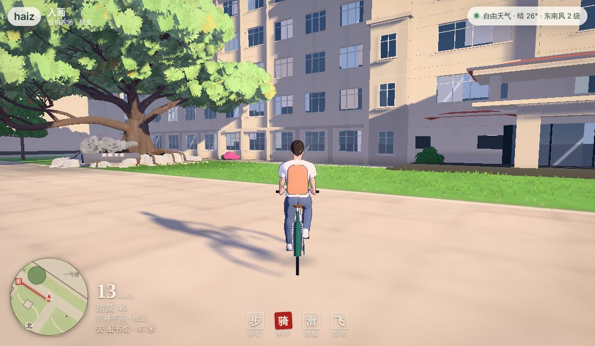 单车：罗盘、速度、踏频、所在位置、路线 | 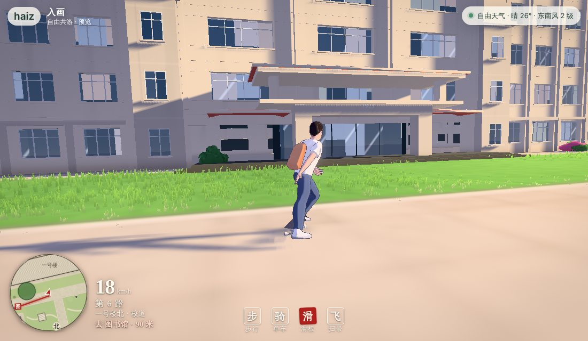 滑板：压板转弯，「第 6 蹬」 | 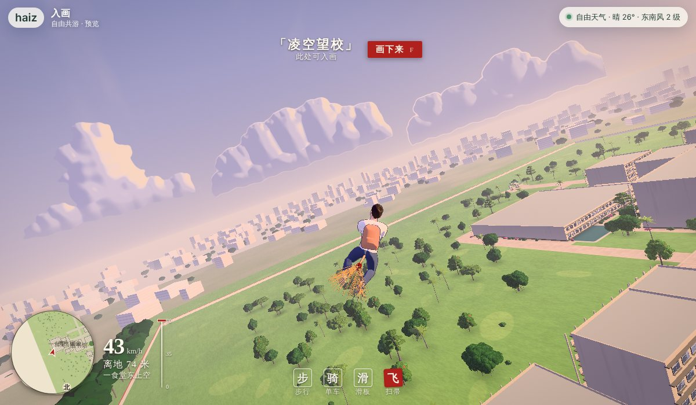 扫帚：倾斜转弯，相机随之横滚 |

---

## 四、人与车：一个身体

步态库（三-procedural-locomotion）在骑行时不再适用——腿不再承重。所以骑行时由 `lanren/free/rig.js` 每帧直接摆骨骼：

- **骨盆落在车给出的位置**（车座、板面、扫帚杆），身体的根节点据此放置；
- **躯干**（髋、腰、胸、颈、头）按几个角度整体弯曲（前倾、扭转、侧弯），头部保持水平视线；
- **四肢是世界空间的两段 IK**：大腿—小腿到踝的目标（踏板、板面、扫帚后方），上臂—前臂到车把；一个「极向量」决定膝盖、肘部朝哪。每根骨头按「它的方向 + 极向量」构成的标架去对齐**静息姿态里测得的同一个标架**——所以不假设导出骨架的任何轴向约定，骨头也不会自己扭转；
- **上车、下车是连续的**：屏幕上那一刻的姿态（逐骨局部旋转 + 根节点变换）被保存，新姿态在 0.45 s 里 slerp 进来；下车时步行者被放在车的左侧，骨骼经同一个混合交还步态库；相机也从骑行视角用 0.9 s 缓入步行视角。

具体到每一种：单车——脚踝跟着踏板走圆，踝关节随踏位俯仰（ankling），手握车把并随转向移动，站起蹬时骨盆前移上抬、躯干前压；滑板——侧身站（regular，左脚在前），头转向板头，蹬地时身体转向前方、后脚落地后推，刹车时后脚拖地，转弯时重心移向内侧、手臂张开保持平衡，Ollie 时收腿；扫帚——跨坐，双手一前一后握杆，悬停时双腿下垂轻晃，飞起来后腿收向后方，速度越快身体越压低。

**测试里的精度**：骑行中脚踝距踏板 8.3 cm、手腕距车把 6.1 cm（目标点本身就在踏板轴上方 7.5 cm、握点后方约 6 cm——即 IK 完全到位）。手臂够不到时，躯干会自动再前倾一些。

| 单车（站姿 / 骑行 / 站起蹬 / 转弯，四个机位） |
| --- |
| 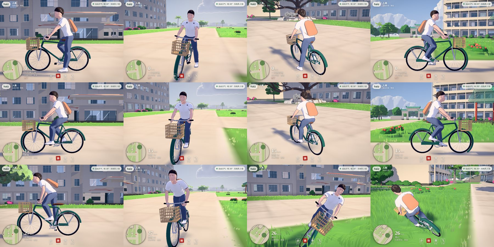 |
| **滑板**（站上、蹬地、Ollie、转弯） |
| 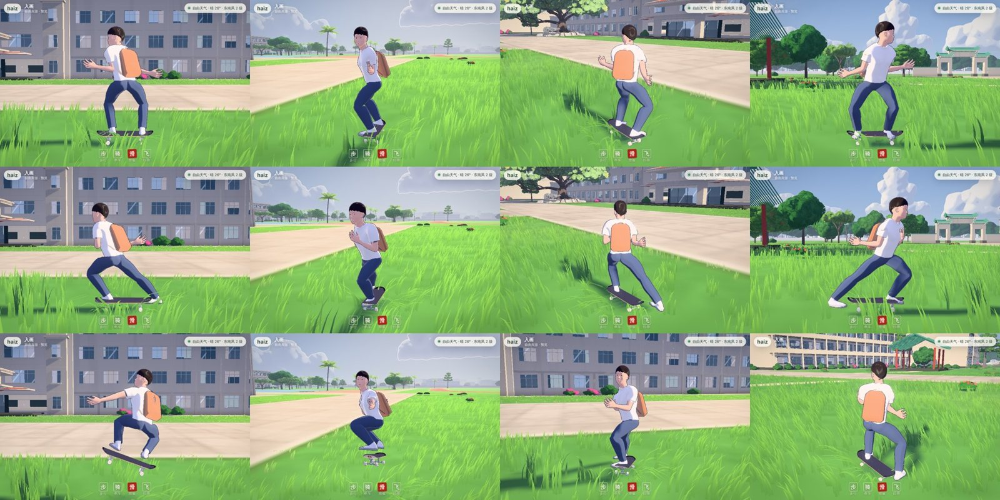 |
| **竹扫帚**（悬停、飞行、转弯） |
| 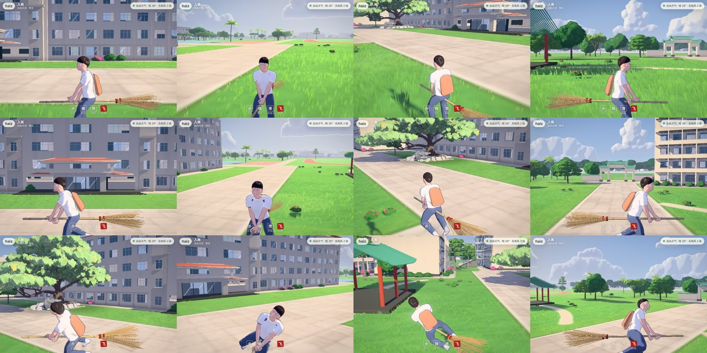 |

---

## 五、摄像机

每种方式一套参数，不是同一个镜头（`ride.js` 的 `PARAMS`）：单车视点在肩后、略高，慢近快远、轻微随倾斜横滚；滑板视点低（1.25 m），贴近，FOV 更宽，转弯横滚更明显——让地面的速度占满下半画面；扫帚是追尾相机：在飞行器倾斜的坐标系里取位（俯冲仍然构图），偏航有滞后，FOV 56→68°，疾飞时极轻的抖动（6 mm 量级）；进入树冠时相机拉近一半，避免叶团挡在中间。所有模式：拖动可以环顾，移动时 1.6 s 后视角慢慢回到身后；相机不入地、不进建筑；`V` 第一人称（从头部看出去，扫帚上尤其好玩）。

---

## 六、世界的回应

学 Petalwake 的架构，但为手机和每种移动方式重做（`lanren/free/wake.js`）：

- **尾迹**：每走半米（悬停时每 0.12 s）放下一个截面：位置、离地高度、方向、强度、半径。强度来自速度和移动方式——步行只拨开脚边的草，单车梳出一条小道，扫帚低飞时压倒一大片，悬停时向四周吹出一圈；离地越高，对地面的影响越小（1/(1+(h/2.6)²)）。
- **风场**：一张跟随学生的 384² 纹理（192 m 见方，0.5 m 一个像素，对齐到像素防止「游动」）。每个像素对尾迹点求和：在半径处达到峰值的向外推力 + 沿路径被带走的空气；每个截面随年龄**振荡衰减**（草被压倒、弹回越过直立、再平息）。xy = 地面风，z = 扰动，w = 制造它的空气的高度。
- **读者**：草叶（倾倒 + 扰动处的抖动）；草坪的画面笔触（被压倒的一条显得更亮，像被风梳过的草坪露出叶背——从空中能看到自己的航迹慢慢消失）；校园树木的树冠（只在风场高度与叶子高度相符时被摇动：从树冠里穿过会摇动它，从高空飞过不会）；百年榄仁树用它自己的 V4「触碰」代码——飞行路线被当作一条射线，叶团沿它被推开再回弹。
- **被带起来的东西**（`particles.js`）：树冠下的榄仁落叶（绿、黄、将落的红）、花坛里的三角梅苞片、草坪上的草屑；飞进树冠时撞落的叶子；悬停时从扫帚下向外吹散的叶子。每片都在同一个风场里翻滚，按叶子的阻力飘落（会滑翔、侧滑），落地后停一会儿再淡去。**不移动就什么都不发生**：世界是回应，不是装饰。（另外，风大时树冠会偶尔落下一两片叶子。）

| | |
| --- | --- |
| 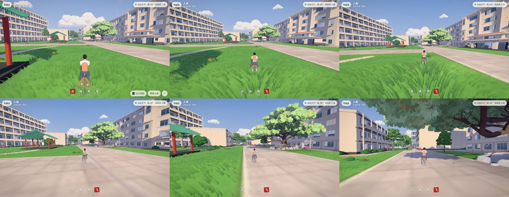 | 扫帚低飞掠过草坪：身后的草被压倒并弹回，落叶被卷起（上排），疾飞穿过校道（下排） |

---

## 七、画边：罗盘、读数与路线

画面首先属于世界，所以没有一张浮在场景上的玻璃卡片（`hud.js`、`route.js`）：

- **罗盘**（左下）：一张纸做的圆盘，上面是**校园地面本身的那张绘画纹理**（世界里的草坪与小路就是从它画出来的），叠上像活点地图一样描线、排线的建筑。它随视角旋转（上方就是你看的方向），「北」字沿边缘走（校园坐标的北门方向）；你是中心一枚红色的箭头印。校园里的人是他们各自墨色的小点；停着的单车是一个小单车符号；路线是一道朱红的笔画；目的地是一枚小印章，跑出圆盘时贴在边缘指方向。骑扫帚时越飞越高，罗盘容纳的校园越多。
- **读数**：手写感的速度（km/h，像码表），一行属于这种移动方式的字——单车「踏频 46 / 滑行 / 一只脚点地」，滑板「第 6 蹬」，扫帚「离地 14 米 / 贴地 / 悬停」（另加一条墨线刻度、一个红色指针）——以及**你正经过的地方**（「图书馆南 · 校道」「一食堂北上空」「百年榄仁树下」），像驾驶游戏写街名。
- **去哪儿**：按 N 或点罗盘，弹出一张纸条（14 个地方）。地面上用活点地图的人物走的**同一张寻路格网**找路，并把路线**画在路上**：前方 2.5–45 m 的校道上一串朱红笔触，一道脉冲朝目的地流去；离开路线 8 m 以上会重新规划。空中则是直线，目的地上方立起一道柔和的光笔画，整个校园都看得见。到达后写「到了」。
- **退场**：步行、站着、没有目的地时，整个画边在 2.5 s 后淡出；一动、一骑、一要路线，它就回来。

---

## 八、为什么明天还想回来

不堆任务、积分和成就。这座校园已经有自己的钟、天气和人；这一轮在它上面加了三样东西：

1. **海中八景**（`vistas.js`）：八处只在特定地点、时辰、天气或移动方式下才「打开」的景色——「榄仁听风」（骑扫帚停进老树的树冠）、「凌空望校」（飞到比所有楼都高）、「屋顶小憩」（把扫帚停在屋顶上）、「砚池晚照」（傍晚骑车经过砚池）、「北门晨光」（清晨从北门进校）、「连廊听雨」（下雨时躲进一二号楼之间的连廊）、「跑道追风」（在跑道上骑车或滑板跑出最快速度）、「灯下夜读」（晚自习时在教学楼前抬头看亮着的窗）。走进其中一处，画面上方会写「此处可入画」，按 F 就把**此刻屏幕上的画面**变成一页水墨淡彩的速写（墨线来自画面的明暗边缘，淡彩是画面的颜色向纸色退去，边缘留白、有纸纹），落款是名字的印章和「11 月 22 日 17:12 · 海口 晴 26°」。速写本里还没画的那几页写着朋友式的提示。因为天气默认跟着海口此刻，「连廊听雨」可能要等一场真的雨。速写只保存在这台设备的浏览器里，不上传。
   ——「入画」是从画下那棵树开始的；这是它的延续：你在画里的校园里，再去画下你发现的校园。
2. **人会注意到你怎么经过**：每个虚构人物对单车、铃声、滑板、头顶飞过的扫帚有各自的反应（陈屿「比比谁先到篮球场？」，符老师「升力从哪儿来的？下来跟我讲讲。」，王一苇从书里抬起头，吴伯认出了他的扫帚）。同一句话 90 秒内不重复，全场 9 秒内最多一句。
3. **一辆会等你的单车**：下车的地方，车就停在那里，罗盘上有它的符号。

| | |
| --- | --- |
| 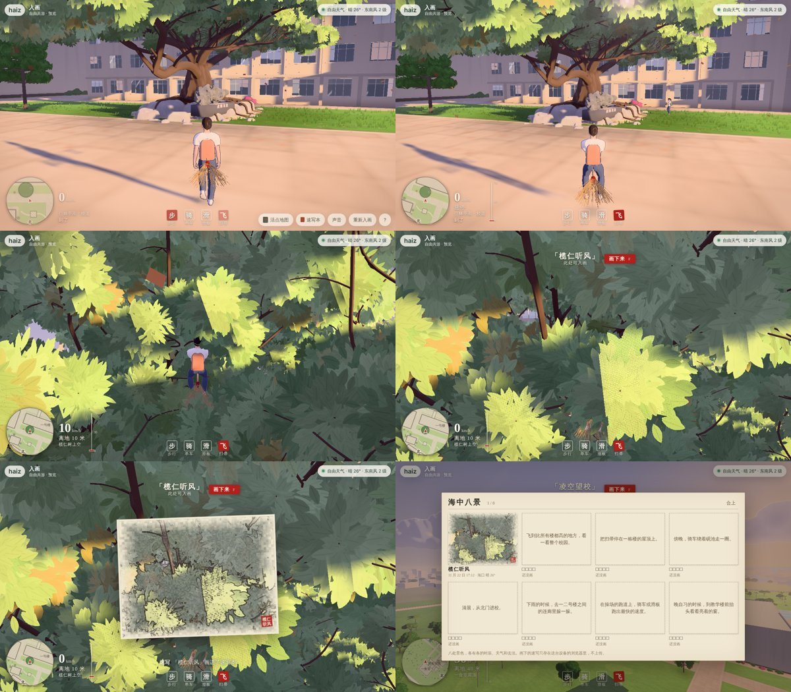 召唤扫帚 → 升进榄仁树冠 →「榄仁听风 · 此处可入画」→ 画下来 → 速写本（1/8） | 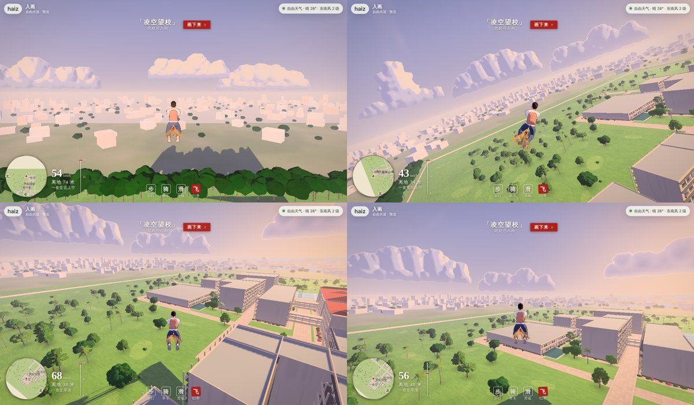 「凌空望校」：傍晚飞过校园，倾斜转弯，俯冲，掠过教学楼 |

---

## 九、手机

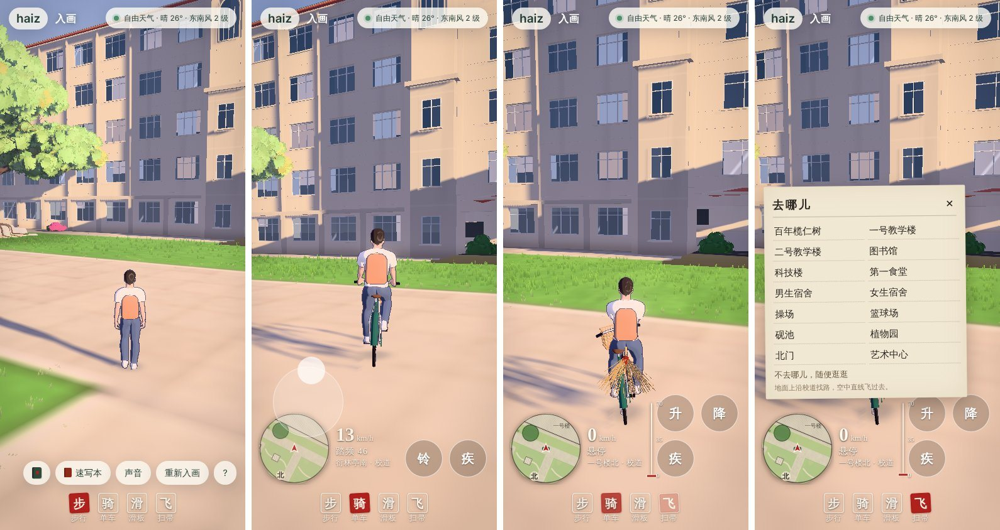

左手摇杆（漂浮式，按下处即中心；推到边是冲刺），右手按钮随移动方式变化；罗盘在骑行时上移，给摇杆让位；点罗盘出「去哪儿」纸条。以上在模拟的 390×844 触控视口里验证（截图从左到右：步行、单车、扫帚、去哪儿）。**真机的帧率、触控手感、发热都没有测过。**

---

## 十、共游（多人）预留

这一轮没有实现多人。但为它留了接口：`free.ride.snapshot()` 返回一个很小的状态（方式、位置、朝向、速度、倾斜、车把角、曲柄相位、俯仰），足以让另一端用同一套 `vehicles.js` + `rig.js` 把一个骑车的同学完整地画出来（踏板、车把、倾斜都由这几个数决定，不需要传骨骼）。

---

## 十一、验证

- `node tests/free/free-browser.cjs`（Chromium + SwiftShader；结果写入 `tests/free/free-browser-results.json`）：**2026-11-22 23/23 通过**。第一次运行有 4 项没过，都是真问题或测试问题，已修正：①扫帚在屋顶上方时高度从屋顶算起，可以爬到「屋顶 + 56 m」（最高测到 71 m）——天花板改为从地面算；②单车静止时左脚落地，测试误把它当成 IK 失误——改为骑行中测量，同时发现**手够不到车把**（差 17 cm），于是加了「够不着就再前倾一点」的第二遍姿态，现在手腕正好在握点（6 cm，就是设计的掌心偏移）；③单车起步加速太软，改为起步有力、接近巡航时收力；④测试地点在草坪上，单车和滑板本来就慢——改到铺装地面。检查项：风场的读者（草、草坪、树冠）在编译前打上补丁；三种载具都能召唤、骑上、达到各自的巡航速度区间、右转向右倾、下车回到步行且不在墙里；单车上脚踝距踏板、手腕距车把 < 12 cm；单车全速冲向建筑永远不会进入建筑；扫帚不超过天花板、不出校园；扫帚降落到一号楼屋顶而不穿过；树冠里悬停时「榄仁听风」打开，速写被画出并保存；去图书馆的路线在校道上找到并写在画边；手机上骑车时「铃」「疾」出现；桌面与手机都没有页面错误。
- 原有 `node tests/life/alive-browser.cjs`（`ruhua-alive.html`）在本分支重新运行：**11/13 通过，2 项未过**——「一个人按日程走、地图画在同一处」（身体离日程位置 5.35 m）与「活点地图按 M 合上」。这一页在本分支与 `main` 完全相同，也不加载任何新文件，所以这两项与本轮改动无关；更可能是本环境（软件渲染、单机多进程）下对时间敏感的检查，需要在正常环境复核。仓库里的结果文件保持原样（2026-11-21，12/12），没有被这次运行覆盖。
- 人工检查：四机位姿态截图（第四节）、风场与草（第六节）、飞行（第八节）、手机（第九节），以及上车、下车、模式之间切换的连续性。

## 十二、还没做好的

- **真机**：没有 GPU、没有手机，帧率与手感全部未经真机验证。风场 pass 的成本在中低端手机上需要实测；如果需要，可以把它降到 256²（只影响草的倒伏细节，不影响画面分辨率）。
- **姿态**：（站姿与扫帚腿部已在第十四节改进）手臂的平衡动作是程序化的近似；没有手指逐指握把，只是整体弯曲。真正的动捕素材（有授权的骑行/滑板片段）可以作为下一步的叠加层。
- **单车**：（前灯已在第十四节加上）下坡、台阶等地形起伏只做了俯仰，没有颠簸动画。
- **滑板**：不能上台阶、不能沿边缘滑（grind）；空中没有招式。
- **扫帚**：没有速度线、没有运动模糊（刻意没有加全屏后期，以免破坏「入画」的画面语言）；落在屋顶后下车的位置是屋顶本身，人可以站在屋顶上，但走下来需要再骑扫帚。
- **路线**：（第十四节起单车与滑板走铺装路面）路线的起止点常在门口或草地上，这一小段仍会离开铺装。
- **网上南宁**：没能看到实际界面，第一节已说明。
- **多人**：只有接口，没有同步。

## 十四、第二轮打磨（2026-11-22 下午）

上一轮自己列出的四处不足，逐个改掉；改动只在 `lanren/free/` 内。

- **车轮的路**（`lanren/free/wheelpath.js`，新文件）：在同一张步行格网上（同样的墙、同样的地面类型，不重建）用车轮的代价再搜一次：校道、球场、校门最便宜，跑道与连廊稍贵，园中小径与草坪贵好几倍。骑单车或滑板时 HUD 用它规划，步行与飞行不变；换移动方式会重新规划。在 3 个起点 × 14 个目的地的 42 条路线上（开发环境实测），路线落在草坪/园路上的比例从 **29% 降到 16%**，平均长度只多 **8%**（最多 1.7 倍）。剩下的 16% 主要是起止点本身就在门口或草地上的那一小段。每次规划在 SwiftShader 下约 10–16 ms，每 4 秒或偏离路线时才重算一次。
- **单车前灯**（`vehicles.js`、`free.js`）：车筐前一盏圆灯，夜里有人骑时随天色亮起（停着的车不亮）。灯头一圈柔光，前方路面上一片暖色的光——画出来的一片淡彩，边缘随纸纹碎开，随车把转动，不是会投影的实时灯光，所以只多一个透明面片和一个光晕。
- **滑板站姿**（`ride.js`、`rig.js`）：原来把骨盆关节放在「腿长」高度，而骨盆关节其实在髋臼上方，所以腿总是弯着，看起来像蹲。现在髋高从髋臼算起：双脚分开约一肩宽（前脚在前桥、后脚在板尾），腿几乎伸直、膝盖微屈；膝盖朝向脚尖并略微分开；上身前倾减半。
- **扫帚上的腿**（`ride.js`）：腿是挂在扫帚下的一个阻尼摆：加速时向后摆，减速时向前，转弯时被甩向外侧，爬升时拖在后面，然后略带过冲地停下来。悬停时膝盖放松、一只脚在前、脚尖下垂，两条腿交替慢慢晃；飞行时向后收起，脚尖绷直，两膝略分。

| 滑板：站上 / 骑行 / 转弯（侧面、正面、斜前） | 扫帚：悬停 / 飞行 / 转弯 |
| --- | --- |
| 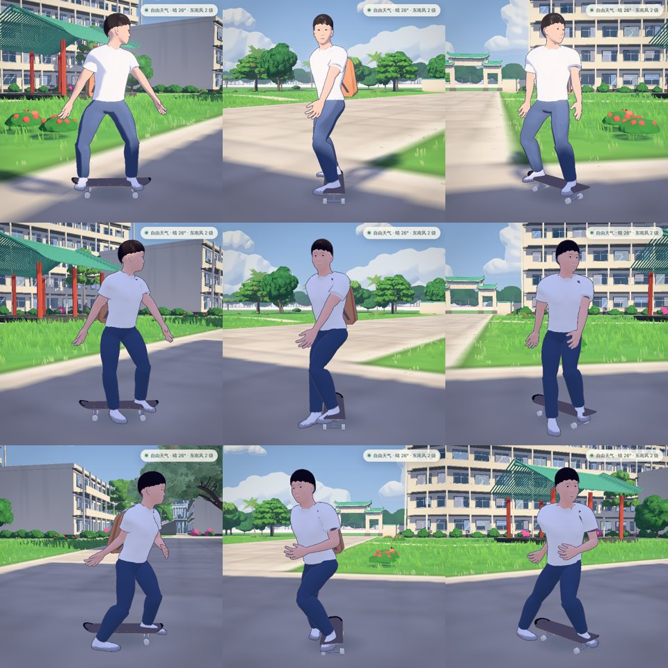 | 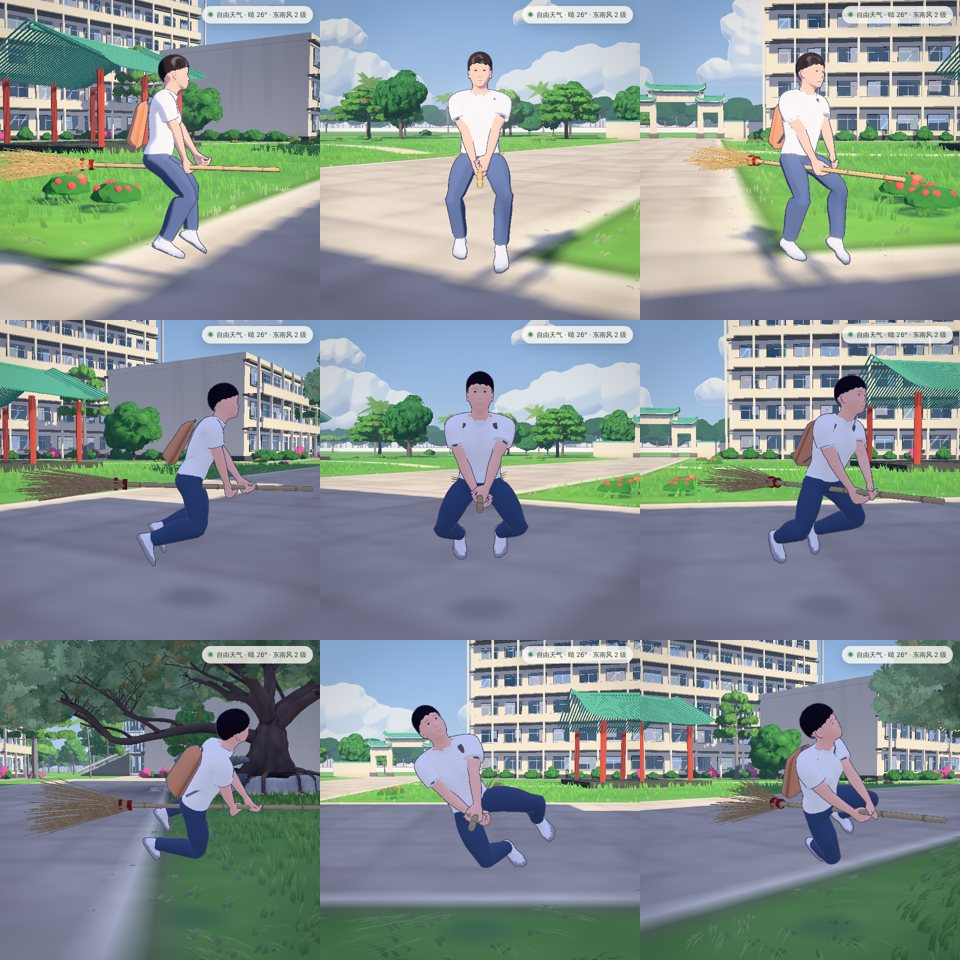 |

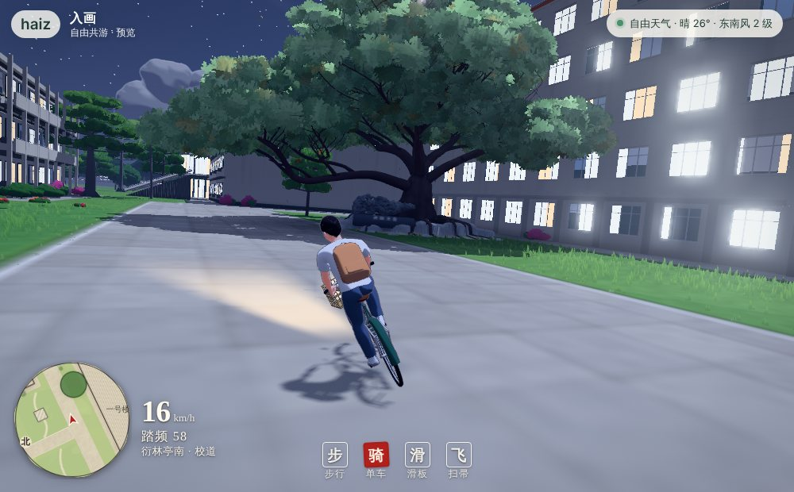
*夜里（21 时）骑车转弯，前灯照在校道上。*

**验证**：`node tests/free/free-browser.cjs` 重新运行 **23/23 通过**（测试文件与结果文件未改动）；以上截图均来自开发环境的 Chromium + SwiftShader。真机仍未测试。

## 十三、署名与许可

- 飞行模型、追尾相机与「共享风场驱动植被」的思路参考 [jjcm/petalwake](https://github.com/jjcm/petalwake)（MIT License, Copyright (c) 2026 Jacob Miller）。HAIZ 中没有复制它的代码或资产；`lanren/free/ride.js` 与 `wake.js` 的注释中标明了来源。
- 人物模型与步态沿用上一轮（MakeHuman CC0 数据；three-procedural-locomotion，MIT）。
- 单车、滑板、竹扫帚、路线笔触、罗盘、速写滤镜与声音全部为本项目程序化生成的原创内容。
- 人物均为虚构；「海中八景」的名字与提示为创作，不代表学校官方景点。
