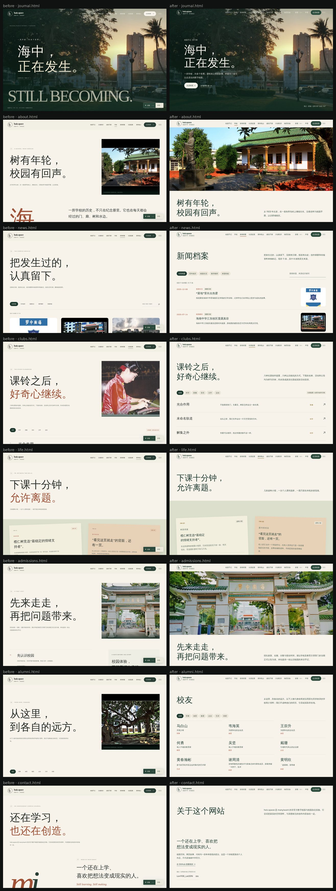
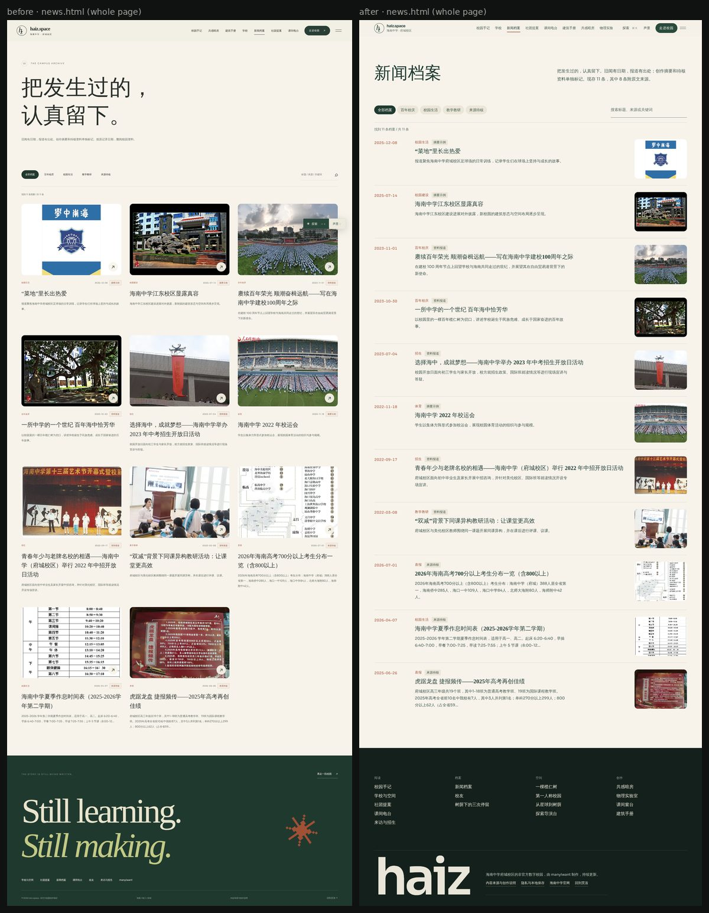
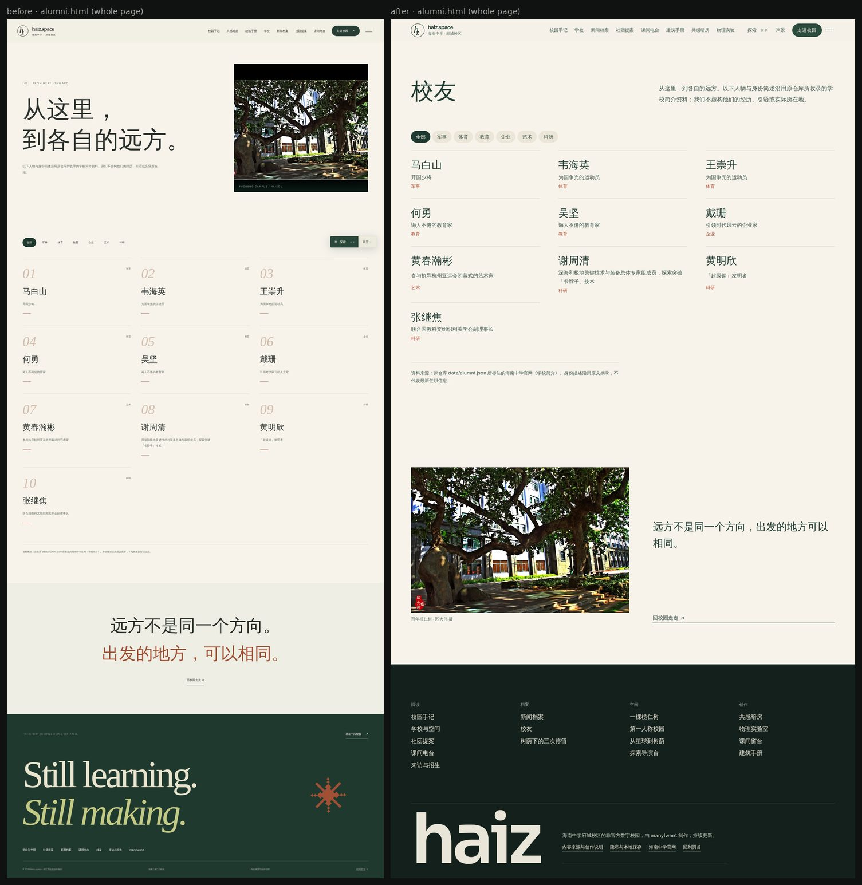
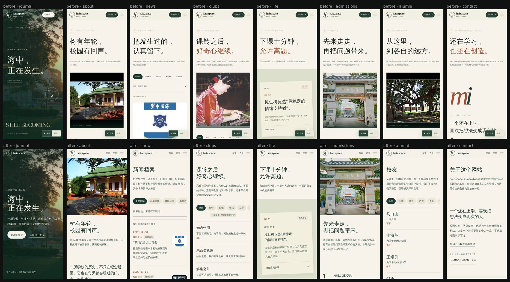

# HAIZ 全站艺术方向（2026-11-05）

主页采用榄仁树 V4（已在 `main`）。本文是全站视觉审计的结论、HAIZ 的视觉语言，以及分阶段重构的顺序。审计截图来自 Chromium 实际渲染（桌面 1440×900、手机 390×844），工具为 `tests/site-audit.cjs`。

## 一、审计结论

### 值得保留的

| 页面 | 为什么好 |
|---|---|
| 主页（榄仁树 V4） | 有明确的视觉主张：一棵树、六个镜头、从树走进各个板块 |
| 第一人称校园 `campus-3d.html`、降落 `descent.html` | 第一屏就是内容本身：校门实拍、地球；标题与操作克制 |
| 课间窗台 `windowsill/` | 一扇画出来的窗，工具在它旁边，有自己的世界 |
| 物理练习 `physics-lab-practice.html` | 真正的工具界面：章节、实验、读数，信息层级清楚 |
| 登录灯光页 `login/` | 夜里一盏灯照着砖墙，私人入口的气氛对了（另一位开发者刚保留它） |
| 树荫下的三次停留 `memory-walk.html` | 正文 16 px，是全站最好读的内容页 |

### 拉低全站品质的

1. **字太小，而且大多是灰的。** 八个内容页（学校、新闻档案、社团提案、课间电台、校友、来访与招生、关于、校园手记）有 75–87% 的文字小于 13 px，8–9 px 的文字占 30–45%，样式表里甚至有 6–7 px。约一半文字是浅灰绿。中文在 11 px 以下几乎无法阅读。这一条比任何颜色或装饰都更伤品质。
2. **同一个模板复制了八次。** 每页第一屏都是「编号 + 英文小字 + 两行宋体大标题（第二行变成锈红色）+ 一小段灰字 + 右上角一张照片」。单页看还算精致，连起来看就是模板。
3. **装饰性英文。** 「A SCHOOL. MANY WORLDS.」「THE STORY IS STILL BEING WRITTEN.」「Still learning. Still making.」「STILL BECOMING.」「LIGHT, SALT & CURIOSITY」：都是没有信息的英文标语，每页页脚都有一句。
4. **把内容装进格子。** 校友是一组编号方框（01–10），名字很小、留白很大；新闻档案是一排排相同的卡片。档案的本质是日期、出处和标题，不是卡片。
5. **照片带着黑边。** `lanshu-1600.jpg`、`fengqitang-1600.jpg` 是带黑色相框和印章的作品图，被直接当成版面照片，看起来像排版错误。
6. **浮动按钮压在内容上。** 「探索 ⌘K / 声景」是全站搜索和声音，功能很好，但在内容页上固定在右下角，手机上会盖住正文。主页把同样的功能放在顶栏里。
7. **工具页字号也偏小。** 共感暗房、探索导演台、建筑手册 74–84% 的文字小于 13 px。
8. **其他。** 账户页 `src/account/` 在确认登录状态时是一张无样式的白页（另一位开发者的新功能）；Pocket 是 Flutter 网页，中文字体运行时从 Google 下载，在被屏蔽的网络里显示成方框（构建问题，不属于本轮）。

## 二、HAIZ 的视觉语言：树下的纸页

主页是一棵树。其余的页面，是在这棵树下读的纸页、做的笔记、用的仪器。不必每页都有树，但每页都应该像是在同一片树荫下做出来的。

### 共通的部分（每一页都一样）

- **纸与墨。** 阅读的底色是暖白纸色（`#f4f1e8`），墨色是树荫里的深绿（`#1f3a30`）；正文用全墨色，不用浅灰。夜色（`#0f1714`）只给沉浸的空间和私人的入口。
- **颜色来自树的一年。** 强调色不是装饰，它说明内容属于哪个季节：
  - 红叶（`#a8482c`）——记忆：新闻档案、校史、校友；
  - 新叶（`#8f6a1f` 铜，`#c9cf8f` 嫩黄）——新做的东西：社团提案、共感暗房、课间窗台；
  - 深绿（`#2a4a3c`）——结构与行动：导航、按钮；
  - 每页只用一种强调色，而且只用在行动和一两处标记上。
- **中文优先的排版。** 标题与长文用宋体（系统 Songti / Noto Serif CJK），界面用系统黑体（PingFang / 微软雅黑），拉丁字母与数字用 Sora。字号只有五级：正文 17 px / 行高 1.85（手机 16 px），小字 14 px，注释最小 13 px，二级标题 28–36 px，大标题 48–72 px。行长 32–40 个汉字。
- **不用的东西。** 英文眉标、编号装饰（01 / 02，除非真的是顺序）、标题里变色的半句、渐变、发光、装饰粒子、相同卡片排成网格、作为装饰的玻璃。英文只用于真实名称和术语。
- **照片。** 用真实校园照片，裁好、铺开；图注写地点和作者，不在图上压字。
- **顶栏与收尾。** 内容页共用一条顶栏：字标、六个主要栏目（14 px，读得清）、「探索」与「声景」收进顶栏右侧、「走进校园」。页脚是一个设计过的收尾：栏目按「读 / 存 / 走 / 做」分组，加一行出处与创作说明，不再有英文标语。
- **动效。** 只回应用户的动作：按下 120 ms，展开 200–250 ms，统一的强 ease-out 曲线 `cubic-bezier(.23,1,.32,1)`。页面内容从可见状态开始，不做逐段淡入。尊重「减少动态效果」。从树走进各页的转场（V4）继续保留。

### 每类页面有自己的性格

| 类别 | 页面 | 性格 | 表现方式 |
|---|---|---|---|
| 读 | 校园手记、学校、社团提案、课间电台、来访与招生、关于 | 校园杂志：安静、可以慢慢读 | 纸色、宋体、大照片；每页第一屏放它自己最有代表性的东西，不共用模板 |
| 存 | 新闻档案、校友、校史 | 阅览室的目录：准确、可查 | 按日期和领域排的目录，等宽数字、细线只用于表格；红叶色 |
| 走 | 主页、第一人称校园、降落、三次停留、探索导演台 | 空间与影像：沉浸 | 全屏影像或三维；界面退到四角（已经做得好，保持） |
| 做 | 共感暗房、物理实验、课间窗台、建筑手册 | 一件件仪器：精确、可操作 | 各自的世界；只统一最小字号、焦点、按钮反馈 |
| 自己的 | 登录、账户、Pocket | 夜里的一盏灯：私密、安静 | 夜色与灯光的暖黄；账户页的等待状态也要有样子 |

跨页面的连续性靠的是同一套纸、墨、字和节奏，以及从树出发的转场，而不是每页都放玻璃面板。

## 三、重构顺序

| 优先级 | 范围 | 原因 |
|---|---|---|
| 1 | 内容页共用的系统：顶栏、字号、页脚、标题、照片、浮动按钮（八页） | 影响面最大、问题最严重，而且是全站可读性的底线 |
| 2 | 新闻档案（目录）、校友（名录）、校园手记首页（去掉英文大字）、学校（第一屏） | 模板感最重、内容最适合换一种表现方式 |
| 3 | 工具页的最小字号与按钮反馈（暗房、导演台、建筑手册） | 功能完整，只需提高可读性，不必改世界 |
| 4 | 账户页等待状态 | 与另一位开发者协调后再做 |
| 5 | Pocket 中文字体随包提供 | 需要重新构建 Flutter 应用 |

第 1、2 项在本轮完成，见下方「本轮完成」。

## 四、本轮完成

### 内容页的共用系统（八页）

- **字号与颜色。** 新的 `assets/css/paper.css`（最后加载，只作用于这八页）：正文 17 px / 行高 1.85，引言 18 px，小字 14 px，注释最小 13 px；正文用全墨色。旧样式表 `journal.css` 与共用的探索面板 `experience.css` 里所有小于 13 px 的字号统一抬到 12–14 px。小于 13 px 的文字占比从 75–87% 降到 12–26%；剩下的是 12 px 的短标签（如字标下的校区名、快捷键提示），页面上已没有小于 12 px 的文字（校园手图里的 SVG 标注按地图比例缩放，不计在内）。
- **每页有自己的开头。** 生成器 `scripts/build-pages.mjs` 不再共用同一个标题模板：学校与来访以一张铺满的照片开场，新闻档案和校友直接以名称和目录开场，课间电台以便笺开场，关于以说明开场。去掉了所有装饰性英文、编号眉标和「第二行变锈红」的标题写法；中文标题按词组断行。
- **顶栏与收尾。** 八个栏目 14 px；「探索 ⌘K」与「声景」从压在正文上的浮动按钮收进顶栏右侧（`experience.js` 在页面提供位置时挂进去，其他页面不变）。页脚按「阅读 / 档案 / 空间 / 创作」列出全站页面，以全宽的 haiz 字标收尾，不再有英文标语。
- **照片。** 校园照片原文件带黑色相框，导致「黑边」。为用到的照片做了裁好的副本（`assets/images/web/*-crop-1600.jpg`、`assets/images/campus/crop/`），原图不动；摄影者印章保留在画面里，图注注明作者。

### 换了表现方式的两页

- **新闻档案** 从三列卡片改为阅览室目录：日期在前（等宽数字、红叶色），类别与来源标记、标题、摘要，图片退到右侧。筛选、搜索、待核分离、详情对话框照旧。

- **校友** 从带编号的方框改为名录：名字是主角，身份紧随其后，领域在右侧。筛选照旧。

手机（390×844）：

### 验证

- `tests/journal.cjs`（筛选、搜索、空结果、详情、收藏、课间选择、便笺、校园手图热点、菜单、校友筛选、照片查看、本地数据清除）、`tests/site.cjs`、`tests/lanren.cjs`、`tests/home-browser.cjs`，以及 `npm test` 列出的其余测试均通过；`tests/cinematic-runtime.cjs` 在未改动的 `main` 上同样失败，与本轮无关。
- 浏览器检查（`tests/site-audit.cjs`）：八页桌面与手机均无控制台错误；390 px 宽度下没有横向溢出；顶栏里的「探索」能打开面板并搜索。
- 修复了构建脚本的一个隐患：`scripts/build-experience.cjs` 以前会把别人手动调高的资源版本号改回旧值（例如 `campus-3d.html` 的 `app.js?v=28` 被改成 `v=25`），现在只会调高、不会调低。
- 中文字体在 Linux 测试环境中使用回退字体，真实设备上会是苹方 / 宋体 / 微软雅黑，字形与截图略有不同。
