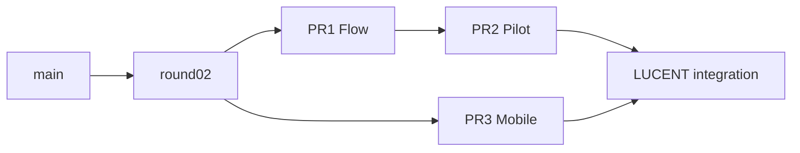

# HAIZ LUCENT 集成基线 · 2026-10-24

本轮通过GitHub API重新读取分支、开放PR、发行资产及QA运行，不将任务书快照当成修复证明。

| 分支/PR | 核对HEAD | 依赖 |
|---|---|---|
| main | 55638e8ad1d35bc5f9e480ccf33061d33ecbc9fc | 现有公开站点 |
| feat/haiz-round02-classroom | 318a99e6eb2348369dbf9eefdba307398534783c | 主站+课堂/移动端基础 |
| PR #1 feat/haiz-flow-handoff | 5e53933720ed60fec3f4fcb66d8f008a19dd597c | → round02 |
| PR #2 feat/haiz-pilot-hardening | f8e94ba4f0c300d45bec446947e9a3c4c89ee481，补齐CI文档后9990fbc | → Flow |
| PR #3 fix/mobile-startup-icons-v040 | 199168705a379dc50c9155760ead66e633f51c19 | → round02 |
| 本轮 feat/haiz-lucent-integration | 集成merge caf9b35cddbed45714199cc5bdac951c18d0e60c | Pilot + PR3，后续修复提交在此 |

合并前比较了PR3相对round02的17个变动文件。它主要改mobile与release/QA；Flow/Pilot改独立界面、HTTPS服务与tests。实际本地no-ff合并没有文本冲突。语义冲突仍必须验证：移动复制器是否纳入新Flow/STILLROOM/影片且排除服务器源码；原生禁用SW是否覆盖不同模块；旧移动底栏是否暴露教师功能；两个版本信息来源是否一致；QA通过与发行产物是否来自同一SHA。新PR叠加PR2，包含PR3合并记录，PR1/2/3保留，不单独直接合并main、不改变默认分支。

许可证/资产：保留原main365个文件、校园照片、历史/文学、Three.js、windowsill与AGPL对应源码和声明。STILLROOM来自用户附件，保留SOURCE说明，不额外宣称为MIT。新图标、影片原创另列来源，新增依赖按版本审查。

已核实旧Release haiz-v0.4.0-preview.2仍指向probe，APK/IPA为旧文件。PR3 QA40053212104：web-assets、iOS simulator job success；Android assemble/install success但job failure，emulator boot480891ms、am start timeout、shell if被逐行执行报expecting fi。旧iOS job缺少可交互断言，success不能作为完整启动验收。

验证矩阵：资源manifest与APK/IPA内部比对 → 浏览器启动/缺资源/存储保留 → Android33及较新API冷热/离线/返回/重开 → iOS当前模拟器UI交互 → 主题与Dock压力/视口/减少动效 → Flow权限/冲突/撤回 → 影片失败/跳过/无网 → candidate资产版本SHA/签名/哈希。真实vivo S10、iPhone、希沃/ClassIsland宿主、学校授权、Apple分发签名均单独列为NOT_TESTED或BLOCKED，不以CI替代。
