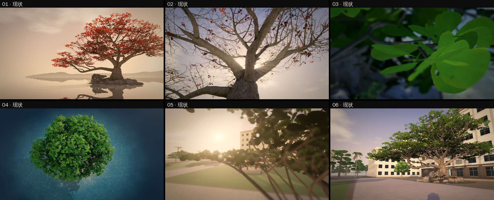
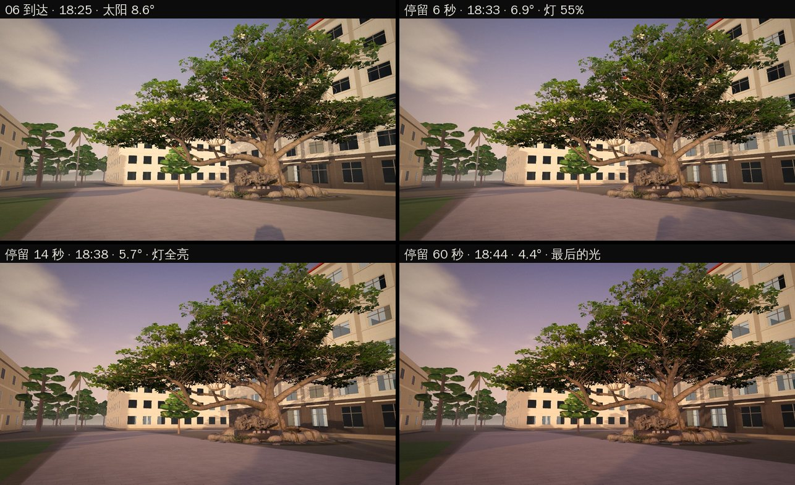
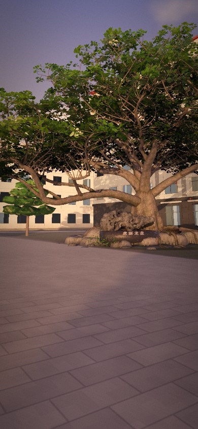
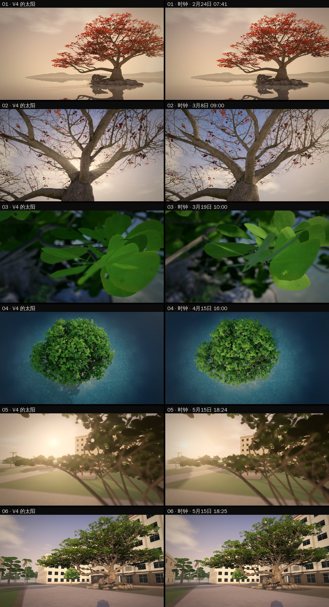
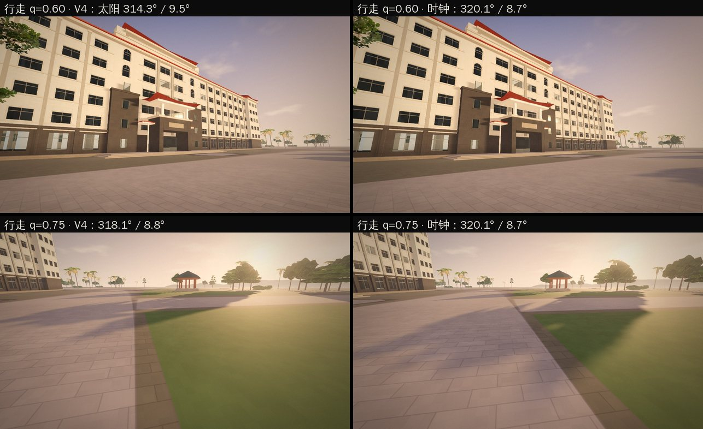
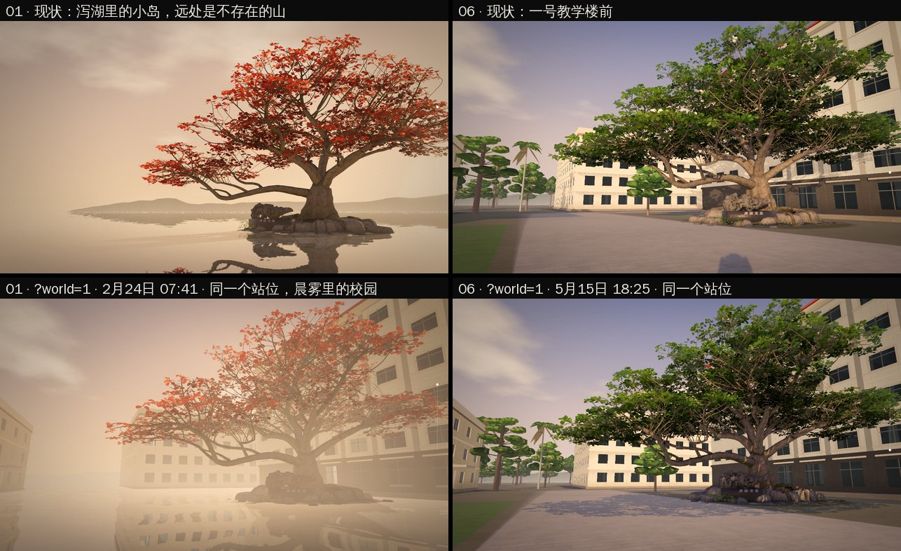
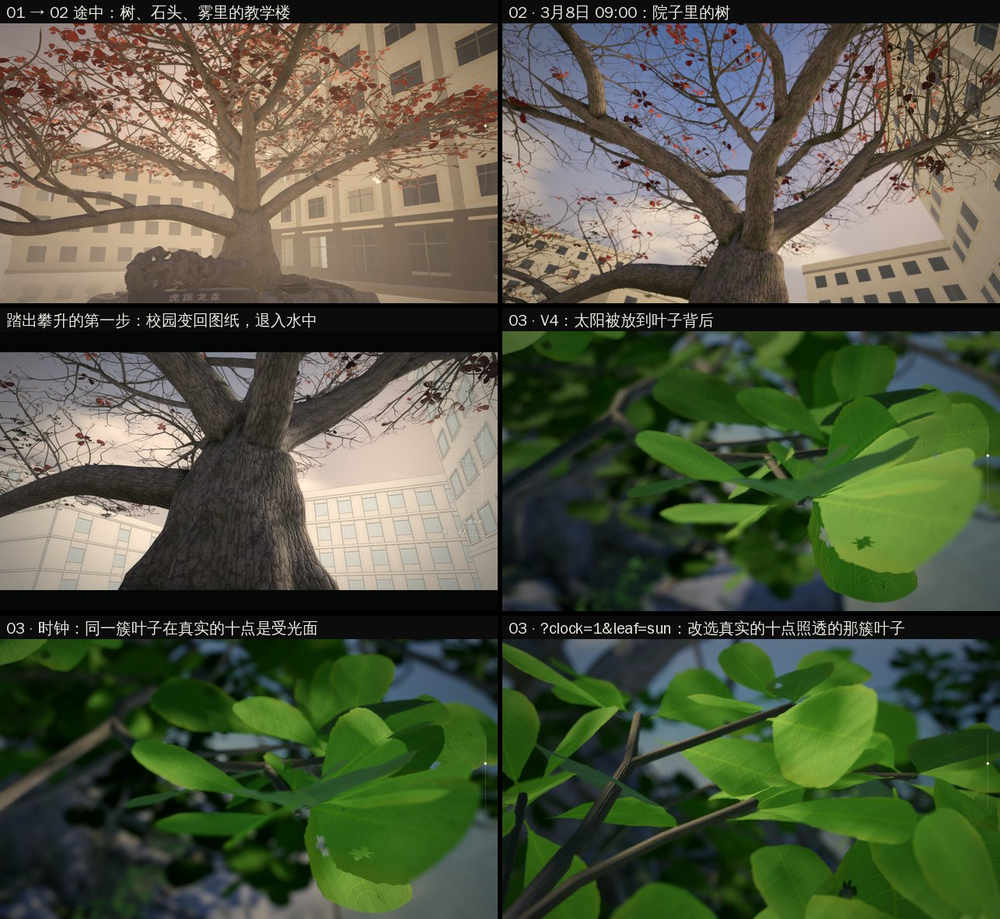
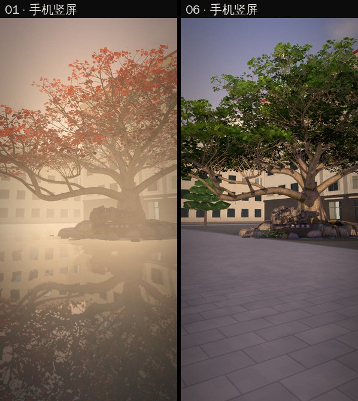

# HAIZ · 连续性审查与「世界时钟」技术验证（2026-11-11）

分支 `claude/admiring-noether-5vgqfz`。它是最新 `main`（`23da027`）与第五轮美术分支 `claude/youthful-davinci-c31244`（`149c9df`）的无冲突合并，再加上本文描述的工作。没有改动 `main`。

**一句话结论**

> HAIZ 有一条连续的镜头轨道，却没有一个连续的世界。
> 六幕之间真正共享的只有那棵树的网格。「此刻是何时、太阳在哪、校园在不在」没有任何独立于镜头的答案：它们都是滚动进度 `p` 的副产品，由每个镜头各自摆放，再被当时持有相机的模块各自改写。

这就是为什么每一幕单独测试都通过，而整体无法被证明是「同一个地方的同一天」：没有任何一处代码能回答这个问题，所以也没有任何测试能检查它。

本文先给证据，再说明选择的架构，然后是已经实现并可复现的验证版本，最后是没做到的事和后续路线。

---

## 0. 怎么看

```bash
python3 -m http.server 8080
```

| 看什么 | 地址 |
|---|---|
| 现状（V4 的六个太阳，默认，没有变化） | `http://localhost:8080/index.html` |
| 世界时钟 | `http://localhost:8080/index.html?clock=1`（本标签页内记住；`?clock=0` 关闭） |
| 第六幕的傍晚 | 时钟模式下到 06，停手看 15 秒以上：太阳下沉，影子伸向树，教室的灯亮起；进入漫游再「回到第六幕回望」，傍晚不会重来 |
| 右下角导航上方的「海口 · 5月15日 18:25」 | 时钟模式下每一帧所对应的真实日期与时刻 |
| **同一个地方**（第二次推进，§10） | `http://localhost:8080/index.html?world=1`（包含时钟；`?world=0` 关闭）：第一幕与第六幕站在同一个位置，校园从第一帧起就在晨雾里 |
| 被真实的太阳照透的叶子（仅供审看） | `http://localhost:8080/index.html?clock=1&leaf=sun`，到 03 |

```bash
node tests/world-clock.cjs                         # 纯函数：审计 + 10 项检查，约 1 秒
node tests/world-clock-browser.cjs                 # 真实浏览器：默认、时钟、同一个地方、手机、减少动态，约 6 分钟（软件渲染）
node tests/world-clock-browser.cjs clock shots     # 同时重拍 docs/lanren/continuity/ 下的截图
```

回退：不带 `?clock=1` / `?world=1` 时，新模块不参与任何计算，镜头、光照、校园的出现方式都是 V4 与第五轮的。默认路径上只有两处行为改变，都是缺陷修复（§4.4）。

---

## 1. 证据

每一条都能从源代码或测试复现。「实测」指在 Chromium 里跑出来的数；「计算」指 Node 里由源数据算出来的数。

### 1.1 一棵树，十五个太阳

| 太阳 | 在哪里 | 谁决定它的位置 |
|---|---|---|
| 6 个 | `lanren/js/chapters.js` `LIGHT` | 每个镜头各自的艺术指导 |
| 1 个 | `lanren/js/home.js` `aimStudy()` | 页面加载时，按第三幕选中的那簇叶子，把太阳放到它背后 28° |
| 1 个 | `lanren/world/compose.js` `sun6`，`world.js` `light()` | 构图 B 为了让影子指向树，把 06 的太阳转到 320° |
| 5 个 | `lanren/canopy/directions.js` `temper.sunAz` | 进入作品树冠后，每个创作方向一个太阳 |
| 1 个 | `lanren/canopy/canopy.js` `lightHook()` | 选中一片叶子时，太阳转到那片叶子背后 |
| 1 个 | `lanren/map/layer.js` `shadowDir` | 第四幕平面图上烘焙的树影方向，取自 `LIGHT[3]` |

太阳是一盏追光灯：镜头到哪，它跟到哪。这在有剪辑的电影里是常规做法，但 HAIZ 自己的承诺是没有剪辑（`camera.js`：「No cuts: every move is continuous」）。一镜到底里，观众看到的是布景在镜头前被重新摆放。

### 1.2 六个太阳里有三个在海口不存在（计算）

`tests/world-clock.cjs` 的审计部分：把六个太阳换算成校园上的罗盘方位（构图 B，校园北 337°），与海口全年每一个真实太阳位置比较。

| 镜头 | 方位 / 高度 | 离最近的真实太阳 | |
|---|---|---|---|
| 01 | 81° / 8° | 0.2° | 存在（约 4 月 18 日 07:00） |
| 02 | 42° / 34° | **26.9°** | 不存在：东北方 34° 高的太阳 |
| 03 | 185° / 26° | **20.3°** | 不存在：正南方最低也有 46°；且加载时被改写 |
| 04 | 112° / 28° | 0.3° | 存在（上午 8:40） |
| 05 | 305° / 12° | **13.3°** | 不存在：海口的日落最北到 295° |
| 06 | 287° / 8.5° | 0.2° | 存在（5 月 15 日 18:25） |

- 滚动全程，太阳的方位一共走了 **440°**，来回折返 **2 次**。真实的一天只朝一个方向走，最多约 230°。
- 时间顺序也不成立：04 的太阳是上午 8:40 的，却排在「上午晚些时候」的 03 之后。
- 没有任何一个罗盘方向能让这六个太阳成为同一天，因为 01 → 02 → 04 的方位先增后减。

### 1.3 一个长镜头里，太阳以 179 倍速移动（计算）

第五轮把 05 → 06 做成了「一个人的时间」：45.4 秒，一个镜头，不快进（`film.js` `DURATION`）。同一段里：

- 太阳从 302° 转到 320°，从 12° 降到 8.5°，最快 0.75°/秒，是真实太阳的 **179 倍**；
- 仅行走的 15.5 秒里，地上所有影子转了 **9.9°**。

人物按真实时间走路，世界按另一个时间转动。两者在同一个画面里。

### 1.4 傍晚会重来（实测，改动前的代码）

第五轮让 06 停留时教室的灯逐渐亮起。它是一个帧计数器（`world.js` 的 `evT`），不是世界的状态：

| 时刻 | 亮灯程度 |
|---|---|
| 到达 06 | 0.03 |
| 停留 9.5 秒 | 1.00 |
| 进入漫游 | 1.00 |
| 菜单 →「回到第六幕回望」 | **0.01** |
| 3 秒后 | 0.34（第二次亮起） |

在亮着灯的校园里走了一圈，回到出发点，整栋楼的灯瞬间熄灭，然后重新亮一遍。`world-browser` 现有的检查只验证「06 停留期间亮灯程度在上升」，所以它通过。

### 1.5 「影子落在树干上」在几何上不成立（计算）

第五轮说明与 `compose.js` 都写着 06 的太阳让「人物的影子落在树干上」。06 的站位距树干 26.5 m，太阳高 8.5° 时人的影子长 11.7 m：它指向树，在离树 **14.8 m** 的地方结束；而且方向偏开树干 2.6 m。

### 1.6 罗盘本身有两个互相矛盾的值

- `lanren/js/sun.js`：校园北的真实方位是 337°（北偏西 23°）。
- `assets/walk/campus.json` `meta.source.plan`：「校园整体相对真北旋转约 41.4°」。
- 同一文件 `meta.verification`：方向未独立复核，原始 KML 缺失。

另外，仓库里其实已经有一套真实时钟的零件：`sun.js` 的星历与 `sunVector()`、`season.js` 的物候曲线。它们来自 V4 之前的版本，六幕电影没有使用（`sunVector` 与 `campusNorthBearing` 在 `lanren/` 里除测试外没有任何调用）。V4 用六个镜头的太阳换掉了它；校园和它的罗盘是之后加进来的。

### 1.7 地点：同一棵树，两个地方



- 第一幕的文字是「海南中学府城校区一号教学楼前」；画面是一座泻湖里的小岛，远处是不存在的山。
- 第六幕回望的是一号教学楼前铺装广场上的同一棵树。
- 校园是否存在由 `compose.js` `campusAt(compose, p)` 决定：也是 `p` 的函数。两个世界在第四幕接合，那恰好是六幕里最不具体的一幕（俯视水面）。
- 「初遇」与「回望」是整部作品的首尾呼应。现在它靠树形完成（两幅画面里长枝都伸向左侧，这是前几轮做对的事），但观众无法从画面知道这是同一个地方。
- 校园立起之后，泻湖的远山仍在地平线上（`ab-film.jpg` 下排，凉亭后面）：校园是泻湖里的一块 620 × 580 m 的地面。两个世界没有融合，是叠在一起。

地图与世界的对应：

| 项 | 第四幕地图 | 三维世界 | 状态 |
|---|---|---|---|
| 一号教学楼 | 地点卡片：「5 层 · 模型高 19 m」（`campus.json`） | 6 层，22.6 m（`campus3d.js` `OWN.yihao`，依三张照片） | **本次修复**：卡片写模型实际的层数，并注明与共享数据不同 |
| 太湖石「虎踞龙盘」 | 在一号楼中轴线上 | 在榄仁树脚下的小岛上，两者相距 **36.2 m**（计算） | 未改。第五轮参考文档 §1.1 已记录：真实的太湖石在中轴线上；V4 把它和树放在一起是第一幕以来的设计 |
| 朝向 | 北朝左（构图 B 把校园绕树转了 90°） | 同一坐标系 | 一致，但这是为了镜头而转动世界的又一个例子 |

### 1.8 恢复

- 刷新与返回恢复的是章节编号（`home.js`：`sessionStorage 'haiz.home' = { c, t }`），不是世界状态。电影中途刷新回到 05 的开头。
- 第二、三、四幕各自有地址路由（`#roots/…`、`#leaves/…`、`#map/…`），这部分是完整的。
- 漫游保存位置和朝向（`haiz.walk`），不保存时间。

---

## 2. 为什么这是最深的问题

前几轮的每一次修正都是对的，也都是同一个动作：**为了镜头移动世界**。

- 05 的视线撞上一号楼 → 把整座校园绕树转 90°（构图 B）。
- 06 的影子不指向树 → 把 06 的太阳转到 320°。
- 03 的叶子不够通透 → 加载时把太阳放到叶子背后。
- 06 的树装不下 → 机位从 37 m 改到 21 m 再到 27 m。

每一次都让一个镜头更好，也都多了一个只为那个镜头存在的事实。镜头是固定的，世界围着它转。只要「时间」和「地点」是镜头的属性而不是世界的属性，下一轮美术精修还会再加一个太阳。

它同时是工程问题：光照在 `home.js` `step()` 里由 `lightAt(p)` 产生，然后被 `life.light()`、`map.light()`、`roots.light()`、`canopy.light()` 依次就地修改。结果取决于调用顺序和每个模块闭包里的状态（`evT`、树冠里缓动中的太阳角度、航拍过渡的进度）。没有任何一个值可以被称为「现在的世界」。

---

## 3. 架构决定：不重写，补上缺的那一根轴

**判断：现有架构不需要重建，但缺一个一等公民——时间。**

应该保留的（读过源码后的判断）：

| 模块 | 为什么保留 |
|---|---|
| `world/film.js` | 05 → 06 是 `q` 的纯函数，前进、后退、跳转得到同一帧。这是全仓库最好的一块设计，时钟照它的样子做 |
| `world/state.js` | 相机与输入的所有权（`scroll / hold / play / pocket / menu / map / transit`）互斥且有测试 |
| `map/geo.js` `makeFrame` | 平面、模型、标签、拾取、碰撞共用一个坐标框架。空间上的「一个事实来源」已经存在 |
| `js/chapters.js` 的镜头轨道与 GSAP 滚动 | 稳定，02 的攀升与电影的节拍都挂在上面 |

缺的东西：`p` 同时是「镜头在轨道上的位置」和「现在几点」。把这两件事分开，只需要一个新模块和一个接入点。

依据：

- **依赖**：太阳方向只在一处产生（`home.js` `step()` 里的 `lightAt(pl)`），在所有模块修改之前。在这一点替换太阳，下游四个 `light()` 钩子、阴影、天空、水面、大气全部自动跟随。实际改动：`home.js` +52 行，`world.js` +31 / −5 行，新模块 `clock.js` 约 170 行。
- **故障**：§1.3、§1.4、§1.5 三个可观察的缺陷出自同一个原因，用同一个模块消除。
- **测试成本**：时钟是纯函数，Node 里 1 秒跑完；浏览器检查约 4 分钟。重写六幕的状态管理则要重跑 `world-browser`、`campus-map-browser`、`canopy-browser`、`roots-browser`、`home-browser` 全部场景，并且没有任何新增的保证。
- **未来**：地点问题（§1.7）的解法需要时间作为输入（见 §7 第 3 步）。先有钟，才谈得上雾什么时候散。

仍然需要重构的（按价值排序，本次未做）：

1. 光照的就地修改链 → 有序的三层：世界（时钟）→ 镜头的调色 → 所有者的调色。
2. 作品树冠的 6 个追光太阳（§7 第 2 步有替代方案）。
3. `campusAt(p)`：校园的存在不应是镜头进度的函数。
4. 恢复：保存 `{ p, held, owner }` 而不是章节编号。

---

## 4. 已实现：世界时钟

### 4.1 规则

`lanren/world/clock.js`，纯函数，不依赖 DOM 与 three.js。

一个时刻是校园上一个真实的瞬间（海口时间）。依赖时间的东西都是它的纯函数：

```
p, held  →  whenAt()   →  瞬间（日期 + 时刻）
瞬间      →  solarAt()  →  太阳在这座校园上空的位置（sun.js 星历 + 校园罗盘）
太阳高度  →  eveningAt() →  多少间教室亮着灯
```

两种速度，由一条规则分开：

- **树的时间**：镜头看着树的时候（01 → 05，以及 06 停留时），时间是延时摄影。每一幕是同一个春天里更晚的一天、更晚的一个时刻。日期跟随物候（`season.js` 的抽叶曲线），时刻跟随一天。
- **人的时间**：从画面里有身体的那一刻起（05 → 06），一秒就是一秒。电影的 45.4 秒是同一个傍晚的 45.4 秒，太阳移动 0.18°。

| 幕 | 瞬间 | 太阳（世界方位 / 高度） |
|---|---|---|
| 01 | 2 月 24 日 07:41 | 144° / 7.9° |
| 02 | 3 月 8 日 09:00 | 139° / 28.2° |
| 03 | 3 月 19 日 10:00 | 135° / 44.1° |
| 04 | 4 月 15 日 16:00 | 341° / 40.5° |
| 05 | 5 月 15 日 18:24:15 | 320° / 8.8° |
| 06 | 5 月 15 日 18:25:00 | 320° / 8.6° |

06 的日期不是随手选的。构图 B 需要太阳在 320°、8.6° 高。星历给出的答案是 5 月 15 日 18:25：那一刻真实的太阳正好在那里，与 V4 相差 0.0° / 0.1°。**同一幅画面，不是把太阳搬过去，而是选了它本来就在那里的那一天。** 那时榄仁树已经满叶，与物候一致。

### 4.2 第六幕：回望成为一段时间

06 停留时回到树的时间：看一秒，傍晚起初过去 96 秒，逐渐停在最后的光（18:44，太阳 4.4° 高）。

- 太阳下沉，影子变长：到达时 11.7 m，最后 22.7 m。站位离树干 26.5 m，树脚的石头从 8.5 m 处开始：**影子的头落在树下的石头上**，离树干 3.8 m。
- 傍晚停在 4.4° 而不是更低，是看过渲染之后的决定：太阳再低，地面得到的直射光太弱，影子在铺装上已经分辨不出来。
- 教室的灯是太阳高度的函数（8.5° 时无，5.6° 时全亮），不是帧计数。
- 天色随太阳加深（`home.js` `duskGrade()`）：太阳更红更弱，天顶更深。
- 进入漫游，傍晚继续；回到 06，是同一个傍晚。向上滚回电影，停留的那段时间连续地倒回去。
- 减少动态效果：直接显示傍晚结束时的样子，没有延时过程。

**站位由太阳推出，而不是反过来。** 时钟模式下，06 的站位绕树干转 4.1°（距离不变），落在「最后的光把影子投向树干」的那条线上。V4 的影子从树干旁 2.6 m 处经过；现在它落在树干的轴线上。整个画面随人一起转，树在画面里的位置不变。

这是对「第六幕的回望是否配得上前五幕的铺垫」的一个回答：它不再是一张静止的图加一组逐渐亮起的窗，而是你站着不动，直到自己的影子够到那棵树。这个画面没有被设计出来，它是 5 月 15 日傍晚的几何结果。



手机竖屏（390 × 844 视口模拟，停留 14 秒后）：



需要说明画面实际的样子：几何是对的（有测试），但在软件渲染的截图里，影子是一条很软的长带，到达石头的那一刻很淡。可能的原因在 `pcss.js`：软阴影按真实太阳的张角计算（这是对的），但遮挡物的搜索范围是按「上方约 16 m 以内」设定的（`searchUV`），而傍晚的影子要在 20 m 以外找到投下它的人。这只是读代码后的推测，没有验证；我没有在看不到真实屏幕的条件下去改这个参数。

### 4.3 六个镜头的对比（同机位，实测）



诚实的逐幕结论：

| 幕 | 结果 | 说明 |
|---|---|---|
| 01 | 保持 | 太阳偏开 22°，本来就在画外；逆光的雾和剪影不变 |
| 02 | **失去标志性的画面** | V4 的太阳从树杈正中射出，那个位置在海口没有太阳。真实的上午九点，太阳在镜头左后方：树皮受侧光，纹理更清楚，但光芒没有了 |
| 03 | **性质改变** | V4 是逆光透叶（文案写的也是「逆光里能看见每一条叶脉」）。真实的十点，这簇叶子在树的南侧，镜头也在南侧：叶子是受光面，明亮但不通透 |
| 04 | 更好 | 下午四点，树冠的影子完整地落在水面上，可见；V4 的影子大部分藏在树冠下。文案「树影落在浅水上，像一张摊开的地图」现在在画面里 |
| 05 | 略弱 | 同一个傍晚只能有一个太阳。它在画面左缘而不是左三分之一处，光晕弱一些 |
| 06 | 保持，并获得 §4.2 | |

电影中段（同一个 `q`，时钟模式下行走路线因站位不同略有偏移，所以不是严格同机位）：



所以时钟**不是默认**。02 和 03 的画面是被一个不存在的太阳照出来的，要在真实的光里拿回它们，需要重新安排这两个镜头的位置（§7 第 2 步），那是需要你来看过才能决定的美术改动，不应该混在一次技术验证里。

### 4.4 默认路径上的两处修复

不带 `?clock=1` 也生效，因为它们是缺陷：

1. **傍晚不再重来**（§1.4）：从漫游回到 06，灯保持亮着。只有把电影滚回最后一帧之前，它才熄灭。`world.js` `tick()`。
2. **地图卡片与模型一致**（§1.7）：一号教学楼的卡片写「6 层 · 模型高 23 m（按照片推断；共享数据仍记 5 层 / 19 m，非测量）」。`map/ui.js`。

另外 `index.html` 里 `home.js?v=2` 改为 `?v=3`（生成脚本同步）：五轮美术精修都没有更新过这个版本号。

### 4.5 一个没有预料到的结果：真实的太阳更便宜

校园有自己的阴影图：把每一栋楼和每一棵校园树画进一张 2048² 或 4096² 的深度图（`section.js` `renderShadow()`），太阳方向变化时重画。天空烘焙成环境贴图也一样（`scene.js` `setStage()`）。

按源码自己的缓存键，数 05 → 06 的 2724 帧（60 fps）里太阳导致的重画次数：

| | V4 的光 | 时钟 |
|---|---|---|
| 整座校园的阴影图重画 | **449 次** | **5 次** |
| 天空重新烘焙为环境贴图 | 45 次 | 21 次 |

电影是手机上最重的一段（人物、整座校园、树、后处理同时在场）。太阳不动，每秒少画约 10 遍整座校园。这是数缓存键得到的次数，不是帧率测量；真机上的收益需要实测。

---

## 5. 导演视角的审查

只写结构性的问题。每一幕做得好的地方前五轮的记录里已经有了。

**01 · 初遇。** 六幕里最好的一幅画面，但它的美来自一个不是这所学校的地方。可以停留的理由是真实的：落下的红叶可以接住，卡片记下的是海口此刻的真实时间。问题不在这一幕里，在它与第六幕的关系里（§1.7）。

**02 · 根脉。** 沿树干向上走过一百年，是全片对「时间」最好的一个想法：同一棵树上的第二个时钟。它现在与当天的光没有关系。树杈里的那团光很美，也在和历史照片争夺同一块画面；第四轮为此专门把照片移到后处理之后绘制。真实的侧光下树皮的起伏更清楚，投影更容易读，但这一幕失去了它的标志。这是一个需要取舍的美术决定。

**03 · 青春生长。** 「我的作品成为这棵树的一部分」现在只能用标明为虚构的样本验证，这一点记录得很诚实。结构问题是光：进入树冠后每个创作方向有自己的太阳，选中一片叶子太阳就转到它背后。如果我的叶子有一个只属于它的太阳，它就不在别人的叶子所在的那个上午里。归属感来自「同一棵树、同一个时刻」，而不是来自被单独打光。

**04 · 场域。** 「平面是同一套三维几何的剖面」是全片最强的结构性想法，测试也最完整。认知转变被三件事削弱：平面出现在一片此前一直是泻湖的水面下，所以它读起来像另一层现实，而不是这个地方的图；北朝左；地图上的太湖石离观众从第一幕看到现在的那块石头 36 m。

**05 · 远方。** 人物在 `q > 0.004` 时出现在离地两三米的长枝上（`film.js`：`show: q > 0.004`），之前四幕没有任何人的痕迹，镜头在第四幕还在 40 m 高空。跃下没有动机，只有目的地。但 02（贴着树干向上）、03（进入树冠）、05（从叶丛里向外望）的机位高度本来就是一个爬树的人的高度；只有 04 不是。如果身体从第二幕起就被暗示，第五幕就是认出自己，而不是凭空出现一个人。这是提议，没有实现。

**06 · 回望。** 第五轮让它成为一段可以停下来的时间，方向是对的，实现是一个会重来的计数器。时钟把它变成了世界的状态，并给了它一个结尾：影子到达树（§4.2）。

---

## 6. 真实感：什么是证据，什么是推断，什么是表达

| 对象 | 类别 | 依据 |
|---|---|---|
| 一号教学楼 6 层、花岗岩底层、拱窗、红瓦 | 照片证据 | 三张照片互相印证（`docs/haiz-campus-reference-20261108.md` §1.4） |
| 一号教学楼总高 22.6 m、背面、室内 | 推断 | 按层数推算；没有照片 |
| 其余建筑 | 推断 | 平面矩形 + 通用造型，没有按照片重做 |
| 校园平面坐标 | 继承、未复核 | KML 转换结果，原始文件缺失（`campus.json` `verification`） |
| 校园朝向 | 估计，且有两个不同的值 | §1.6 |
| 太阳的位置（时钟模式） | 物理计算，条件于上面那个朝向 | `sun.js` 星历，精度远好于 1° |
| 太阳的位置（默认） | 艺术表达 | 三个在海口不存在 |
| 榄仁树 | 艺术表达 | 依物种特征的概念模型，不是这棵树的测绘（`tree.json` `note`） |
| 太湖石 | 形状依照片重建；位置是艺术表达 | 真实位置离树约 35 m |
| 泻湖与远山 | 艺术表达 | 不存在 |
| 抽叶日期 | 推断 | `season.js` 自己标注为「推演」 |

时钟把「朝向」变成了一个常数（`sun.js` `SITE.campusNorthBearing`，只在 `clock.js` 读取）。找回 KML 之后改这一个数，世界里每一道影子都跟着改。

第一人称的尺度感：眼高 1.62 m、步幅 0.68 m、巡航 1.44 m/s 都是人的数值，有测试。可信度的短板不在比例，在地面：`world.js` 的 `ground()` 在小岛 8.5 m 之外是一个平面，铺装没有高差、路缘和排水坡。本次未改。

---

## 7. 后续路线

每一步都能单独验证，都保留回退。

**第 1 步（本次已完成）：时间成为世界的属性。** `clock.js`，开关，06 的傍晚，由太阳推出的站位。

**第 2 步：从世界推出镜头，拿回 02 和 03。** 把时钟设为默认的前提。03 的做法已经验证可行（§10.4）；剩下的是把第二幕后半段的站点移到同一侧。
- 02：把机位移到树干的另一侧，让真实的上午太阳从树杈里出来。第二幕的攀升轨道从 02 的机位出发（`roots/path.js`），会跟着走；各年代站点的取景需要逐个复查。
- 03：`aimStudy()` 现在是「选一簇叶子，再把太阳放到它背后」。反过来：把十点钟真实的太阳作为输入，选那簇真的被它照透的叶子。
- 作品树冠：五个创作方向不再各有一个太阳，而是各有一个**时刻**。朝东的枝是上午的枝，朝西的枝是傍晚的枝；选一个方向，移动的是钟，太阳因为时间流逝而转动。气质保留，世界只有一个。
- 验证：`world-clock.cjs` 的审计表从「3 / 6 不存在」变成「0 / 6」。

**第 3 步：校园从未离开。** 这一步挑战一个已确认的设计（V4 的泻湖）。**第一版已实现为 `?world=1`（§10）**：首尾同一站位、晨雾里的校园、随第一步退去。下面是它还没有做到的部分。
- 命题：世界不改变，改变的只有空气和读图的方式。
- 第一幕的泻湖是雨后积水的前庭，在晨雾里。远处的不是山，是雾里的一号教学楼。「一号教学楼前」从第一帧起就是真的，初遇仍然是孤立的。
- 雾随时间散去（这就是为什么先要有钟）；第四幕的平面是正午从正上方读这个地方的方式（剖切是读图约定，不是世界的状态）；傍晚是清晰的校园。
- `campusAt(p)` 由「空气的能见度（时间的函数）」和「读图方式（平面 / 空间）」取代。
- 第六幕回望时，观众认出的是第一幕雾里的那个轮廓。
- 地平线上的远山（§1.7）也在这一步处理：校园之外是什么，需要一个诚实的答案。

**第 4 步：身体。** 02 起暗示爬树的人（§5 的 05）；动机是这一天结束了，该下来了。

**第 5 步：状态与恢复。** 保存 `{ p, held, owner }`；光照的修改链改为有序的层。

**第 6 步：真实。** 找回 KML 定罗盘；真机、GPU、Safari。

---

## 8. 第五轮美术分支与 `main`

- 合并：37 个提交，92 个文件，代码 +2649 / −373，对 `main` 的 5 个提交（授权、溯源、仓库清理）**零冲突**。`tests/provenance.cjs` 在合并结果上通过。
- 第五轮的全部成果保留：06 取景、一号教学楼 v2、电影的时钟与看点、物种树形、分级植被、第二幕的印相、跨页过渡修复。历史资料、署名、作品样本数据没有改动。

应保留并已保留的：全部。

有回归风险、本次处理了的：
- 06 的亮灯计数器在往返后重置（§1.4）。
- 模型按照片改为 6 层，地图卡片仍读共享数据的 5 层（§1.7）。
- `home.js?v=2` 从未更新。

有风险、本次没有处理的：
- 测试每次运行都会改写 `tests/*-results.json` 里的日期，产生无意义的差异。
- `compose.js` 与第五轮说明里「影子落在树干上」的描述与几何不符（§1.5）；默认路径下仍然如此。
- 中低档植被的三角形数比第三轮多约 17%，第五轮自己标注为未经真机验证。

---

## 9. 验证记录与没有做到的

**通过**（本分支最终代码）：

- Node：`world-clock`（10 项）、`world-film`（14 项）、`lanren`、`campus-map`、`campus-model`、`roots`、`canopy`、`provenance`。
- 浏览器（`world-clock-browser`，结果见 `tests/world-clock-browser-results.json`）：
  - 默认：五个机位的太阳与 V4 一致；没有时钟、没有时刻显示；往返后傍晚保持。
  - 时钟：六个机位的太阳等于所示瞬间的真实太阳；电影全程太阳在 0.08° / 0.24° 之内；06 的站位在最后的光的线上；停留时太阳下沉、灯只增不减；进入漫游再回来是同一个傍晚；滚回电影后太阳回到电影自己的时刻。
  - 手机视口（390 × 844）：无横向溢出，时刻显示不出屏。
  - 减少动态效果：直接显示傍晚的结束状态。
  - 同一个地方（`?world=1`）：01 的眼睛在 06 的站位上；校园在 01 与 02 开场时立在水中（不铺地面、不降水面），第一站之前退去；它在场时镜头离任何建筑体量不少于 7.9 m；04 与 06 不变；不带开关时 01 是 V4 的机位。
  - 无页面或 WebGL 错误。

**没有测试，必须说明的：**

- **没有 GPU。** 全部在 Chromium + SwiftShader 软件渲染下完成。截图是真实的 WebGL 输出，但帧率、发热、内存没有任何数据。§4.5 是数缓存键，不是测量。
- **没有 Safari / WebKit**，没有真机，没有真实触摸。手机一项是视口模拟。
- **没有重跑** `world-browser`、`campus-map-browser`、`canopy-browser`、`roots-browser`、`home-browser` 的完整场景（软件渲染下各需十几分钟到更久）。默认路径的改动只有 §4.4 的两处；`world-browser` 里「06 停留期间亮灯程度在上升」的检查与修复后的行为一致，但没有在本分支上实际跑过。
- 时钟模式下的作品树冠内部仍是 V4 的追光太阳（§3 第 2 项）。
- `?world=1` 下的直达航线（第一幕导航直接跳到其他幕）、第二幕各站、作品树冠、地图往返没有逐项跑过；只检查了滚动轨道 `p` 0 → 3 与 04、06 两个机位。
- `?clock=1&leaf=sun` 只看过 03 的一帧，是审看开关。
- 黄昏调色（`duskGrade`）与影子的软硬只在软件渲染的静帧上看过，需要在真实屏幕上调（§4.2）。
- §1.8 关于刷新恢复的描述来自读源码，没有在浏览器里逐项复现。
- 截图为 1280 × 720，`medium` 档；`docs/lanren/continuity/` 只保留合成后的对比图，单张可用 `node tests/world-clock-browser.cjs clock default shots` 重拍。
- 地图卡片的修复在浏览器里单独确认过（`#map/oblique/yihao`：「6 层 · 模型高 23 m（按照片推断；共享数据仍记 5 层 / 19 m，非测量）」），没有加入自动测试。

---

## 10. 第二次推进：同一个地方（`?world=1`）

（在 §1–§9 完成并推送之后，按「可以大胆改」的授权做的。它处理 §1.7：第一幕与第六幕不是同一个地方。）

### 10.1 做了什么

1. **第一幕站在第六幕的位置。** 同一个眼睛的位置，同一个画面，同一棵树，相隔一个春天。V4 的 01 在 39 m 外用长焦看一座孤岛；现在 01 就是 06 回望时的那一帧。
2. **校园从第一帧起就在那里。** 一号教学楼立在水里，在晨雾里，倒映在水面上。文案「海南中学府城校区一号教学楼前」从第一帧起是画面里的事实。
3. **雾是时钟的读数。** 日出时最浓，上午十点散尽（`home.js` `morningAir()`）。水面里的倒影和它映出的东西一样被雾遮住（`environment.js` 水面着色器的 `uReflMist`，为 0 时与 V4 完全相同）。
4. **踏出走进历史的第一步，今天的校园变回图纸，退入水中**（`p` 1.00 → 1.07，在 1923 年那一站之前）。第二幕的年代画面里没有今天的建筑。校园从第四幕起回来，与现在一样。



### 10.2 一个没有设计出来的结果

06 的站位是由「最后的光」推出来的（§4.2）。把 01 放在同一个站位之后，星历给出：

- **2 月 24 日 07:41，太阳在树的正后方升起**：与「站位 → 树干」这条线只差 5.0°。
- **5 月 15 日 18:44，太阳在人的正后方落下**：与同一条线相差 180.0°。

所以第一帧是逆着晨光看树，树的影子朝你来；最后一帧是背着夕阳看树，你的影子朝它去。这不是摆出来的：二月的日出方位（103°）与五月的日落方位（288°）在海口恰好几乎相对，而站位在那条线上。`tests/world-clock.cjs` 检查这两个角度。

需要说明的物理缺口：07:41 的太阳只有 7.9° 高，现实里它会被 11–18 m 外、22.6 m 高的一号教学楼挡住，树在楼的影子里。引擎里树只接收自己那张阴影图（V4 的 48 m 范围），不接收校园建筑的阴影，所以画面里树仍被直射光照到。未处理。

### 10.3 为什么校园没有一直站到第三幕

这是测试发现的，不是事先想到的。`world-clock-browser` 检查「镜头轨道不进入任何建筑体量」，第一版（校园站到 03 之后）在 `p = 1.9` 失败：镜头在一号教学楼体量内 1.0 m。

原因是一个更基本的空间冲突（计算，`rosettes.bin` 对 `campus3d.js` 的模型；已写入 `tests/world-clock.cjs` 的审计）：

| | |
|---|---|
| V4 榄仁树的冠幅 | 半径最大 18.3 m，约 36 m 宽 |
| 校园平面里这棵树的占地 | 14.7 × 11.9 m（`campus.json`） |
| 一号教学楼朝树的立面 | 离树干 10.9 m（校园坐标的南侧） |
| 落在一号教学楼体量**之内**的叶簇 | 175 个（10947 个的 1.6%） |
| 离立面 2 m 以内的叶簇 | 755 个 |
| V4 第三幕的机位 | `x = 12.44`：在楼的体量内 1.4 m |
| 第二幕最后四站的机位 | 离立面 0.5 – 3.6 m |

树比它在校园平面上的占地大一倍多，朝楼一侧的枝梢伸进了楼里。第四到第六幕里这件事被机位避开了（都在前庭一侧）；第二、三幕的后半段恰好在朝楼的一侧。

所以这一版的范围是：校园在 01 和 02 开场时在场，随第一步退去。让它一直站到第四幕，需要把第二幕后半段的站点和第三幕移到前庭一侧（§7 第 2 步），或者决定树的尺度。

### 10.4 第三幕：被真实的太阳照透的叶子（审看用）



`?clock=1&leaf=sun`：`aimStudy()` 不再「选一簇叶子，再把太阳放到它背后」，而是把十点钟真实的太阳作为输入，选那簇真的被它照透的叶子（在长枝一侧）。逆光透叶回来了，叶脉可见，而且是真的（上图右下；左下是同一个时钟下 V4 原来那簇叶子，受光面）。

它只是审看开关，没有进入 `?world=1`：第二幕的攀升终点还在树冠的另一侧，接到这簇叶子要横穿整个树冠。把第二幕的后半段移过来之后，它们会在同一侧：第二幕文案写的本来就是「顺着长枝……走到枝梢，就是今天正在长出的新叶」。

### 10.5 手机竖屏



### 10.6 代价与判断

- **绘制代价**（实测，`medium` 档，01 的一帧）：V4 38 次绘制 / 210 万三角形；world 48 次 / 330 万。校园从第一帧起被绘制、被镜像、有阴影。真机上是否可接受没有数据。
- **美术上不是无条件更好。** V4 的 01 是一幅更干净、更有标志性的图：长焦、孤岛、清晰的剪影。world 的 01 更近、更雾、画面里的东西更多，树本身也被雾遮去一部分。它换来的是：这是一个真实的地方，而且是最后回望的那个地方。这是需要你来做的取舍，所以它是开关，不是默认。
- 第一幕的文字没有改。V4 的 01 → 02 之间的路径在这个模式下换成了从新站位绕过太湖石南侧走到树下。
- 校园之外的远山仍在（雾里看不见，02 之后看得见）。
