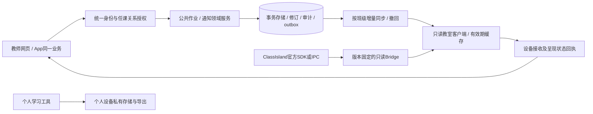

# HAIZ 经营与校园落地审查

审查日期：2026-10-25。审查基线15793e3。依据：仓库与实际测试、官方资料；没有新增教师访谈或真实校内观察。结论中的需求和收益须由试点验证，不能称为调研事实。

## 决策结论

HAIZ有可运行的功能原型，但还不是可交付的校园基础设施。当前应批准一个小范围验证项目，而不是全校部署或继续扩张“智慧校园”功能。最值得验证的交易是：教师在办公室输入一次班级作业，两节晚修在正确班级显示；学生不用携带手机，教师能修订和撤回，服务器关闭不影响授课。

第一批只保留三个主任务：班级公开作业、必要公共通知、个人学习思路的保存与恢复。校园漫游、三主题、品牌影片与社团内容保留为可选模块；在核心链路与设备稳定性验收前，暂停扩充。已有功能不删除，动画不作为登录和首屏依赖。

不把“使用人数、发布条数、学习时长、打卡天数”当成效果；它们可能意味着更多负担。先证明少录一次、少问一次、少漏一项准备、少一次重头找思路。

## 从老板、校方与使用者看，谁承担什么

|角色|希望得到的结果|当前问题|试点需确认的责任|
|---|---|---|---|
|校方决策者|不打断教学，有明确管理与退出机制|无校内负责人、真实验收、运行费用和故障责任承诺|谁选用、谁审核、谁停用|
|信息中心/设备管理员|部署少、可回滚、设备可撤销|插件未宿主验收，账号/班级为固定演示数据|安装授权、版本维护、终端清单、备份恢复|
|任课教师|沿用现有渠道，录一次就够|Flow与作业台分开；同一人跨班、代课、代发流程未完整|本人作业权限；代理人、修订与交接责任|
|班主任/值班教师|识别缺漏，能手动让屏幕退场|空清单与“无作业”语义不清；缺设备接收证据|班级汇总和出错时纸质/黑板回退|
|学生|不拿手机也能看清要求，私有思路不丢|公开作业与个人学习入口复杂，环境场景价值未实证|不强制装App，不做已读排名和个人追踪|
|家长|不额外承担录入、截图和监督任务|没有证据证明需要独立家长端|首期不新增家长端或强制使用要求|

## 缺陷清单与严重程度

|优先级|仓库证据|实用性后果|处理决定|
|---|---|---|---|
|P0|pilot/server.mjs只托管Flow；classroom-server.mjs另存作业与通知|HTTPS教师试用不等于远程作业发布，演示链路容易被误认为正式三端系统|先统一公共作业领域服务及身份适配，再扩校|
|P0|HomeWorkService.cs仅请求127.0.0.1；README注明未通过编译/宿主验收|办公室电脑和教室不是一台机器；目前无法据此交付远程发布|保持实验标识；授权Windows环境固定一个ClassIsland版本做加载、禁用和异常隔离验证|
|P0|固定roles/SCOPES/accounts、JSON文件、无通用学期班级任课关系|转班、调课、跨班教师、多校边界和人员离岗无法作为生产系统运转|建立稳定实体ID、任课范围、设备绑定与会话撤销；不以角色字符串替代关系授权|
|P0|新建作业没有幂等记录；前端发布按钮无并发锁|超时不知是否保存，重试可能重复，教师只能再确认|本轮已补作业请求幂等、持久化与按钮锁，限本地演示服务|
|P0|作业编辑器只有内存draft；preview无返回修改|切换/刷新丢输入，增加使用成本|本轮已补按教师/班级/条目隔离草稿、恢复和返回修改|
|P0|bridge.write把POST成功后pull失败视作整个发布失败|误导教师重新发布|本轮已区分已保存/本机待同步；仍不声称教室收到|
|P0|没有设备对消息版本的接收/展示确认|“发布成功”无法证明大屏呈现，离线撤回也有传播窗口|必须建设设备回执；首期UI明确未确认，不能用SSE连接冒充展示回执|
|P1|工作台固定02节，空作业文案称老师未发布|课表未连仍显得联动正常；断网空列表被当作无作业|本轮改实际识别数量、所选日期计数与保守空状态|
|P1|upsertAssignment全局500条slice|新增可能静默挤掉旧记录，影响审计和跨班数据|本轮改满容量拒绝新增并提示归档；正式版需数据库归档策略|
|P1|不同界面分别保存study/Flow/STILLROOM记录|用户不知道哪里是主入口，备份与退出语义不同|下一步统一导航与私有记录目录，不强制迁移或清空已有记录|
|P1|原生QA有通过也有CDP超时；IPA、签名、真机门禁尚未完整闭合|应用可构建不代表可发给师生长期使用|旧失败保留；正式发行与功能开发分离验收|
|P2|影片30MB量级，空间资产为低采样概念场景|包体、维护和美术成本高；无法证明学习收益|可选按需播放、低耗电默认可用；暂停新片和建筑扩张|
|P2|界面入口多，部分功能文案带叙事，假设未访谈|“功能多”掩盖找不到、不会用、没必要用|试点只暴露当前角色所需任务，其他模块保留次级入口|

P0/P1表示经营风险顺序，不是所有条目已在本轮完成。代码路径供定位，不代表某个文件单独承担全部责任。

## 真正的校园系统如何构建

核心应是组织与责任模型、数据可信来源、送达闭环及运行保障，不能等同“一个App+一块大屏+几套动画”。首期选择模块化单体，减少多服务运维；先统一契约，再考虑拆服务。

图为目标架构，**不是当前全部实现**。教室屏不承载学生成绩、身份和私人笔记。学籍系统已有的数据优先由授权接口或脱敏导入取得，不让教师重复录班级名单。官方OneRoster可供理解学校/班级/课程/任课关系与交换契约，但本项目未实现、未认证，也不需要为首期公共作业收集全体学生档案。

建议最小实体：School(id)、Term(id, schoolId)、Class(id, schoolId, termId)、TeachingAssignment(teacherId, classId, subjectId, validity)、Device(id, schoolId, classId, credentialVersion, revokedAt)、PublicMessage(id, classId, authorId, version, review, validFrom, expiresAt)、Delivery(deviceId, messageId, version, receivedAt, renderedAt, suppressedReason)、Audit(actorId, action, targetId, at)。时间用UTC保存，学校时区明确配置；中文班名只是展示字段。

接收、呈现、人工隐藏、课时不匹配、过期分别记录状态。收到不能推断学生看过；设备回执不能统计个人注意力。推送负责提示新版本，客户端恢复连接主动拉取快照/差量并处理撤回墓碑，不依赖“推送永远不丢”。写入和outbox同事务，幂等键按操作者与业务命令隔离，版本冲突由教师核对，不静默覆盖。

班级公开作业、全校活动的审核可以不同：授权任课教师在自己的班级发布普通作业，跨班代发和紧急信息走明确授权。是否允许直接发布由学校配置，不把所有日常小事都交管理员逐条审批，也不能由客户端角色开关赋权。

班主任能暂停展示；设备失联保留最后有效公开内容，过期退出；服务器故障不影响ClassIsland课表、白板和纸笔上课。回退流程必须由教师能操作，而不是要求临时找开发者。

## 学校试点与经营门槛

阶段按结果推进，不承诺未经估算的交付日期：

1. 场景确认：访谈3名不同学科教师、1名班主任、1名设备管理员及自愿学生；跟踪现有作业发布流程，记录重复录入与解释耗时。先问现有工具能否解决，不默认大家需要新系统。
2. 普通Windows台架：同一服务、两个班、两台设备，至少覆盖多教师修订、错班拒绝、晚修调课、离线过期、撤回、重启与停用。插件正式宿主加载不通过就用外置浏览器演示。
3. 获许可后，一至两个班、自愿参与、两周试点；保留黑板/纸质清单。不上线新社团、排名、家长端和复杂AI建议。
4. 复盘后再决定是否扩大、继续修复或停用；没有节时证据时不继续购买视觉与硬件复杂度。

|建议门槛（待验证目标）|测量方法|失败决定|
|---|---|---|
|中位数发布流程不慢于原流程，重复录入减少|对同一类任务计时，包含登录、纠错和审批，不只计按按钮|改流程或放弃替代现有渠道|
|普通作业编写后60秒内可完成发布|教师实际使用计时；只是建议目标，非承诺已达到|减少字段与审批环节|
|在线设备95%版本更新5秒内接收|按消息版本记录服务写入到设备接收；不采集学生行为|修同步；不能以浏览器83ms样本代替|
|错班、未经授权修改、静默丢稿均为0|故障注入与两周问题登记|任何一项立即停止扩班|
|3米外能正确复述作业要求|自愿后排阅读测试，不拍摄/追踪学生|改版面、字数和轮播方式|
|故障后能退回正常授课，教师不必重装|断服务、关闭插件、白板切换的实际走查|停止正式设备部署|

不默认宣称学习成绩提升。个人思路工具单独做自愿的“中断前后找回下一步”实验，与普通便笺比较恢复耗时及输入负担；无效则简化为普通便笺。

经营成本至少计入：服务器/证书、备份与恢复演练、每校配置和培训、设备与签名维护、第三方许可、审核客服、安全更新。月度净收益可先按“教师实际节省分钟×使用教师数−支持/录入新增分钟”评价；没有基线就不编造ROI或报价。指定学校业务负责人、管理员与开发维护负责人；约定故障反馈、停用、数据导出和终端解绑的责任。

## 本轮实际优化与剩余工作

已实施：作业草稿恢复、预览返回、重复点击锁、可持久化的作业幂等重试、保存后读回失败的状态区分、真实晚修计数、空列表提示、容量保护，以及失败落盘回滚。现有作业/通知字段与本地数据格式向后兼容；不清除私人记录。

仍未实施：HTTPS Flow与作业领域合并、组织/学期/任课关系数据库、学校SSO、设备展示回执、正式ClassIsland加载、稳定移动签名、真实学校部署。这些是下一阶段前置工程，不用本轮改动冒充已落地。

## 研究依据与适用边界

- [教育部等八部门指导意见（网信办官方转载）](https://www.cac.gov.cn/2019-09/05/c_1569218551238246.htm)：重视学校选用责任和减轻使用负担。本审查据此采用少入口、无强制学生App的产品方向；正式使用仍需校方核对当地现行要求。
- [1EdTech OneRoster 1.2](https://www.imsglobal.org/spec/oneroster/v1p2/)：学校系统间可有明确的数据交换合同。这里只借鉴组织/课程关系及互操作边界，不移植学生成绩数据，不声称认证。
- [ClassIsland官方开发文档](https://docs.classisland.tech/dev/)：官方插件与IPC是扩展路径；文档涉及版本变化，必须锁定实际宿主验证。本项目不采用修改本体或注入。

核查过程有部分教育部站点及插件子页访问超时，使用可读的官方转载/开发总览，没有把失读页面当作已全文核验。以上是资料与代码审查，不是校内调研报告。

## 审查后的实施更新

同日后续开发已将公共作业接入既有HTTPS试用身份，共用作业规则并增加绑定版本的客户端状态回执。此更新修补了上表“HTTPS教师发布无法到达该服务的作业客户端”和“完全没有客户端回执”的一部分缺口。完整事实、测试和未完成项见[HTTPS链路](HTTPS-CLASSROOM.md)。这没有完成学校组织目录、正式设备身份、ClassIsland宿主或真实校园部署；原审查中的全校投产结论不变。
