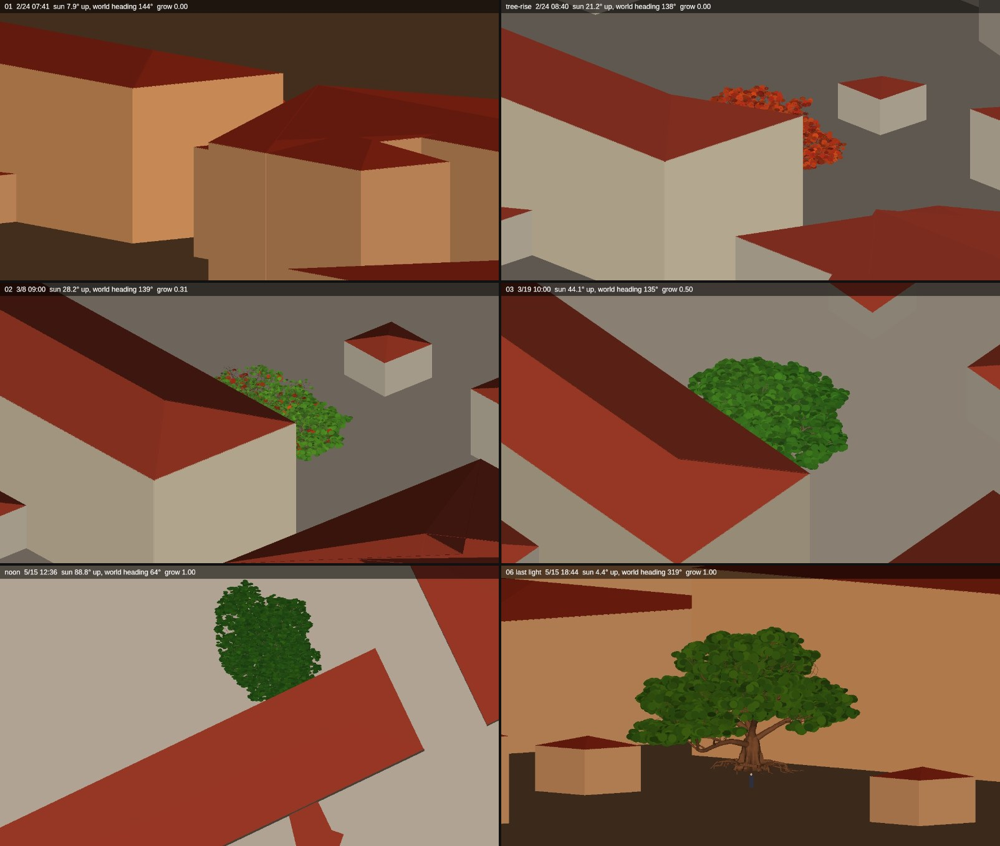
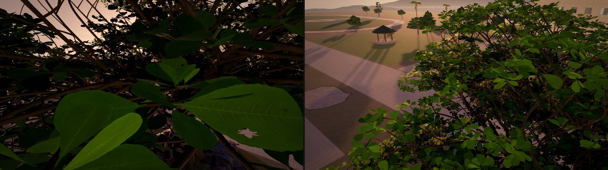
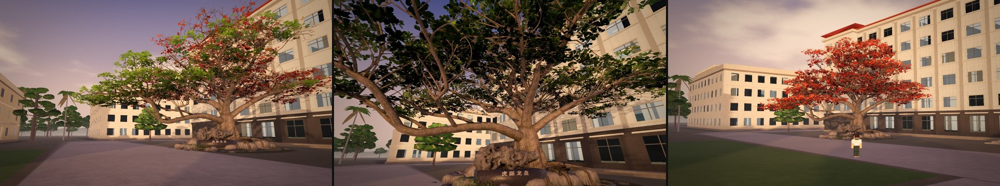
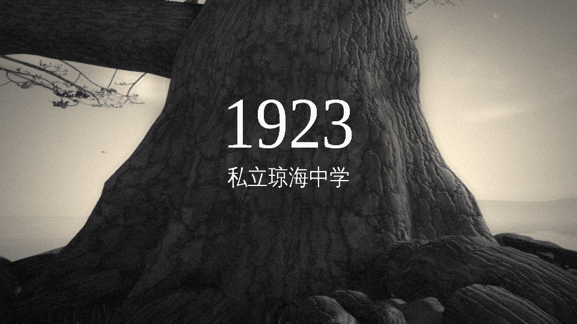
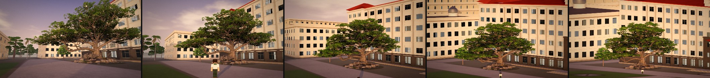
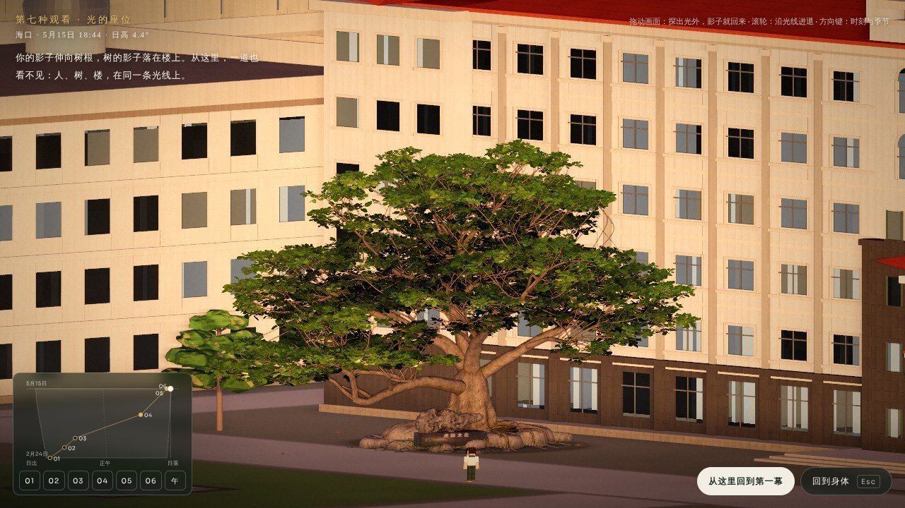
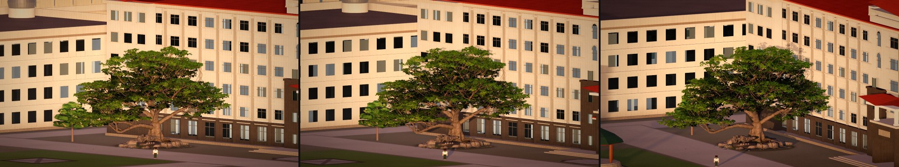
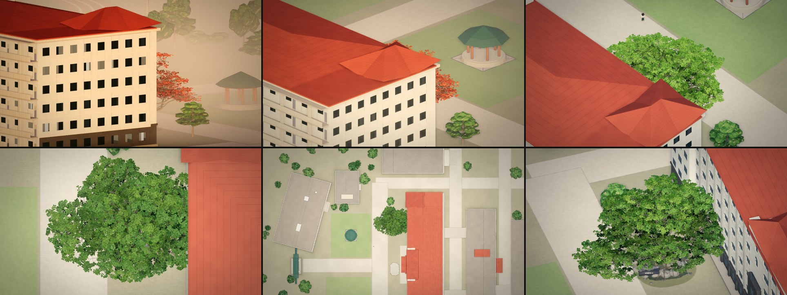
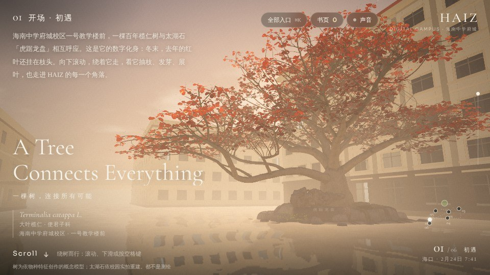
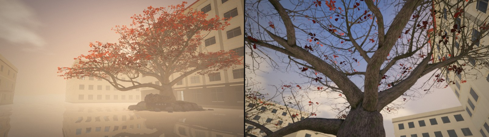

# HAIZ · 第七种观看（2026-11-13）

分支 `claude/haiz-seventh-view-yz8yqq`：最新 `main` 与「世界时钟 / 同一个地方」分支（`claude/admiring-noether-5vgqfz`）的无冲突合并，加上本文的工作。没有改动 `main`；不带 `?seventh=1` 时六幕与合并前完全一致（§6）。

**一句话**

> 六幕里每一个镜头都被同一样东西照亮，而它自己的视角从来没有被拍过。
> 第七种观看不是第七个机位，是光的座位：沿着你自己的影子退后，退进太阳里。
> 从那里看，世界上没有一道影子——影子，是你站的地方与光的座位之间的差。

这不是添加的一章。它用的是六幕已经有的同一个场景、同一棵树、同一座校园、同一只时钟，只多了一个事实：给太阳一台摄影机。

---

## 0. 怎么看

```bash
python3 -m http.server 8080
```

| 看什么 | 地址 |
|---|---|
| 第七种观看（从第六幕进入） | `http://localhost:8080/index.html?seventh=1`，滚到 06，停着看到傍晚的最后一道光（约 15 秒），画面下方出现「第七种观看」；或按 `7` |
| 直接到光的座位 | `http://localhost:8080/index.html?seventh=1#seventh` |
| 关闭（本标签页内会记住开关） | `…/index.html?seventh=0` |
| 方向 C 的可走动试验（慢光） | `http://localhost:8080/index.html?seventh=1&cone=34`，到 06 后「走进校园」，朝树走近、走远 |

在座位上：

| 操作 | 作用 |
|---|---|
| 拖动画面 | 探出光外。影子从每样东西背后出来；松手，回到光里，影子收回去 |
| 滚轮 / 双指 | 沿光线进退：向内回到身体，向外到座位，再向外是更宽的视野（正午时就是整张校园平面） |
| 左下角的小图 | 这一个春天的「时间地图」：横向是一天里的时刻，纵向是日期。点或拖到任何位置，座位跟着太阳走，世界在下面转 |
| `01`–`06`、`午` | 每一幕自己的那一刻，以及最后一天的正午。实心点是太阳看得见的机位，空心点是看不见的 |
| ← → / ↑ ↓ | 时刻 / 季节；`1`–`6`、`0` 同上面的按钮 |
| 「从这里回到第一幕」/ `Home` | 从光里落回第一幕的站位、第一幕的时刻，把控制权还给六幕的滚动 |
| 「回到身体」/ `Esc` | 回到第六幕的回望 |

```bash
node tests/seventh.cjs            # 纯函数：本文每一条关于校园的陈述，约 2 秒
node tests/seventh-browser.cjs    # 真实浏览器（软件渲染）：默认路径不变；进入、探出、时刻、退出、回到第一幕
```

---

## 1. 研究：四个方向

每个方向都在真实的场景数据上做了实验（真实的树网格与叶簇、`campus3d.js` 的校园模型、`clock.js` 的星历），不是概念图。

### A · 光的座位（选中）

**想法。** 六个镜头看树，或者从树里往外看。六幕之外还有一个视角一直在场：光自己的。引擎每一帧都在用它（阴影贴图就是「太阳看见的画面」），观众从第一帧起看到的每一道影子，都是那台看不见的摄影机拍下、再投回世界里的。把眼睛放到那台摄影机的位置上，会发生一件只在那里发生的事：**所有的影子都正好躲在投下它的东西背后。**

**先用几何验证**（不经过 WebGL：把真实的树皮网格、一万零九百个叶簇、建筑体量沿太阳方向做平行投影）：



这组图在动手写引擎之前回答了三个问题：傍晚最后一道光里，人、树干、一号教学楼确实在同一条视线上；第一幕的时刻，太阳在一号教学楼背后，从它那里看不见树；上午，树冠是从屋脊后面一点点「升起来」的。

**从真实的星历和模型里算出来的事实**（`tests/seventh.cjs` 逐条断言，数字见 `tests/seventh-results.json`）：

| | |
|---|---|
| 六幕的机位，在各自的那一刻 | 01、02、03 的机位都在一号教学楼的影子里；04、05、06 的机位在光里 |
| 第一幕（2月24日 07:41） | 楼的影子边缘在树干上方 19.2 m 处掠过（树冠顶 15.2 m），在站位上方 15.1 m：整棵树和看它的人都在楼的影子里。V4 原来的 01 机位同样在这道影子里 |
| 上午 | 影子边缘沿树下降：02 时在离地 12.8 m 处，03 时 6.8 m。树干的根部要等太阳升到约 60° 才照得到（第一天是 13:07） |
| 最后一天的正午（5月15日 12:36） | 太阳高 88.76°，几乎在天顶。全校最高的楼（25.2 m）影长 0.55 m。光的座位在这一刻正对着地面往下看，画面的朝向与第四幕的平面相同 |
| 最后的光（5月15日 18:44，4.4°） | 从座位看，人与树干的轴线重合（偏差 0.00 m，站位本来就是按这道光推出来的）；树干后方 16.5 m 是一号教学楼 |
| 影子为什么消失 | 离轴线 20 m 的东西，它 200 m 长的影子：从座位看只露出 0.20 m；探出光外 7° 露出 24 m；从人自己的眼睛看是 133 m |

也就是说，「人物的旅程藏在光和影子的关系里」在这个模型里是可以计算的事实：**六幕是一段走出树荫的路。** 前三幕，你在学校的影子里看一棵也在学校影子里的树；第四幕升到光里；第五幕在长枝上面朝着光；第六幕你背着光站着，自己的影子伸到树根，树的影子落在楼上。前人栽树，后人乘凉——到最后，投下影子的人是你。这句话没有写在画面里，它是太阳、楼、树、站位四者的几何关系。

**它为什么被选中**：它回答了题目本身（一个位置，让人、树、楼、时间在视觉上成为一个关系；离开就消散）；它是真实的光，不是设定；它直接接在「世界时钟」之后——那一轮让太阳成为世界的属性，这一轮坐到它的位置上；并且它需要观众自己动：退后、探出、拨动时间，截图呈现不了。

### B · 反打：教室的窗

**想法。** 第六幕的回望从来没有反打镜头。被回望的不只是树，还有树后面那栋楼里亮着灯的窗。第七种观看是从教室里往外看：正在离开的人回头，还坐在里面的人抬头，两道视线在树里相遇。

**实验。** 把摄影机放到一号教学楼朝树一侧的窗口，傍晚最后的光，朝站位看：



**结论。** 三楼的窗外，叶子就在一臂之内（模型里树冠伸进了楼的体量，上一轮审查已记录），几乎看不到别的；五楼越过树冠能看到前庭和迎面而来的长影，但看不到站在那里的人——树正好挡在中间。作为一个事实它很动人（学校看不见那个回望的人，隔着一棵树），作为画面它是一团逆光的枝叶，撑不起结尾。它更适合成为方向 A 里「探出光外」走到尽头的那一端，而不是独立的第七种观看。

### C · 慢光：距离就是过去

**想法。** 「回望」在物理上本来就是看见过去：光走过来需要时间。把光速放慢到人的尺度——每一米远，看到的树就早一点。离得远，看到的还是初遇时的那棵红树；走近，它才长满叶子。

**实验。** 在真实的叶片着色器里加了一个量（`uCone`，默认 0，不影响任何现有画面）：每片叶子的生长进度减去它到眼睛的距离乘以一个比率。下面是同一个傍晚、同一棵树，只换了站的地方：



**结论。** 这是四个方向里单张画面最美的一个：站在回望的位置，树靠近你的一侧已是新绿，远离你的一侧还挂着去年的红叶——一棵树里装着一整个春天，而且随你的走动像潮水一样移动。它也给了第一幕一个很重的重读：初遇时树是红的，也许不是因为那是二月，而是因为你还离它很远。

没有选它，原因有三：它是一个设定（放慢的光），不是这个世界里真实的光；它不涉及校园、树荫与人的关系，回答不了「六幕是同一个世界的六种阅读」；六幕现有的生长与机位距离并不单调对应，所以它重读第一幕是比喻，不是结构。**但它是我最希望你亲自走一走的备选**（地址见 §0），它与 A 不冲突：A 属于回望的终点，C 可以属于终点之后的漫游。

### D · 一点重组（你提出的例子）

**想法。** 分散的树枝、历史影像、建筑轮廓、作品叶片，在一个特殊视角拼成完整的图像，离开就散。

**发现。** 这已经是第二幕自己的语言。`lanren/roots/roots.js` 的注释与实现：每一站的年份或照片是「从摄影机自己的位置」投到树干、枝条、叶子和地面上的，在那一站读起来完整，摄影机一走就沿着树的真实深度散开，到下一站再聚拢。



**结论。** 把同一个手法放大成结尾，是重复而不是发明；而且拼出来的「图像」可以换成任何素材，这正是你不想要的技术演示。方向 A 保留了它最好的部分——只在一个位置成立、离开即消散——但成立的不是一张贴上去的图，而是世界本身的一个性质（没有影子）。

---

## 2. 原型：做了什么

### 2.1 沿着影子退后

第六幕停留到最后的光，影子伸到树脚。这时可以进入：眼睛离开人的头，沿着影子所在的那条线向后、向上退，镜头同时收窄（沿光线的滑动变焦），树在画面里的大小不变。退的过程里透视合拢：人缩回到真实的大小，树后面的楼长到真实的大小；影子一点点滑到投下它的东西背后。



到了座位（20 km 外、0.08° 的镜头，等同于平行投影），画面里只剩三样东西叠在一条视线上：人，树，学校。



### 2.2 探出光外

拖动，就离开了光线。影子立刻从背后出来：人的影子在地上，树的影子爬上楼的立面。松手，回到光里，它们收回去。这是整个原型里最需要亲手做的一个动作，也是「离开那个视角，关系自然消散」的实现：没有任何一层贴图在显示或隐藏，变的只有你与光的夹角。



### 2.3 坐在太阳里，看这一个春天

左下角是一张小小的时间地图：横向是一天，纵向是从 2月24日到 5月15日的这个春天，六幕是上面的六个点，连成电影自己走过的那条线。拖到哪里，座位就跟着太阳到哪里——六幕里是太阳围着镜头转（上一轮审查数出的「十五个太阳」），这里反过来，镜头坐在唯一的太阳里，世界在下面转，树随日期抽叶或退回冬天。



- **第一幕的时刻**：看到的是一号教学楼的背面。树在楼后面，只从墙角露出几片红叶；第一幕里站着看树的人在更后面。界面上的那句话是当场算出来的：「太阳在一号教学楼后面。整棵树都在楼的影子里，第一幕里你站的地方也是：光看不见第一幕。」
- **上午**：红色的树冠从红瓦的屋脊后面升起来。对学校来说是日出；对太阳来说，是树出。
- **最后一天的正午**：立竿无影。座位正对着地面，每一道影子都压在自己脚下；向外滚动，就是整张校园——第四幕那张平面，原来是这一刻从光里往下看。
- 界面上的句子全部由当时的几何算出（`seventh.js` `lineFor()`），不是预先写好配给某个时刻的字幕。

### 2.4 回到第一幕

「从这里回到第一幕」：时间拨回 2月24日 07:41，眼睛沿同一条路落回同一个站位（`?world=1` 已经让 01 与 06 站在同一处），然后把控制权还给滚动。落地时就是第一幕自己的页面、自己的标题。



---

## 3. 最后一个镜头怎样重新解释第一个镜头

第一次看第一幕：一棵逆光的红树，雾，水，雾里有一栋楼。一幅好看的画。

看过第七种观看之后，同一幅画里有三样原来就在、但读不出来的东西：

1. **太阳在哪。** 就在树干正后方（偏 5°）、楼的背后。画面里所有的亮都是从楼的轮廓后面漫出来的。
2. **你在哪。** 你站在树的影子里，树站在学校的影子里。光看不见这一帧。整部作品最有标志性的那张剪影，原来是「光的座位」的反打：一个只能看到背光面的位置。
3. **接下来会发生什么。** 影子的边缘就在树冠顶上 4 米。往第二幕走的时候，第一道直射光会先落在最高的那几片旧叶上，然后沿着树一路退下去——第二幕贴着树干往上爬的那段路，是在学校的影子里往光里爬。

为了让这三件事真的在画面里（而不只是在说明里），带 `?seventh=1` 时有两处物理补全，都来自上一轮审查记为「未处理」的缺口：

- **一号教学楼的影子落在树上。** V4 的太阳只给树画它自己的影子，所以离树 11 米、22.6 米高的楼从来没有遮过它。现在楼的体量（只是体量，到檐口）被画进同一张阴影贴图。
- **晨雾里的影子是有体积的。** 太阳照得到的雾亮一些，楼影里的雾暗一些，分界面就是檐口投下的那个斜面。第一幕的画面里，这是一道很轻的、从楼顶斜向左下的明暗——第一次看是雾，第二次看是学校的影子。



需要诚实说明的是程度：这是「看懂了」的重读，不是画面里藏了一个彩蛋。第一帧的像素与 `?world=1` 相比只多了楼影（树没有直射光、雾里多一道明暗）。我认为这是对的方向——反转来自空间和光的结构，而不是一句台词——但它是否足够「忍不住重看」，需要你在真实屏幕上判断。

---

## 4. 历史与作品

这一阶段只把它们接到了概念和一个可测试的函数上，没有做界面，原因写在后面。

- **作品。** 第三幕里每件作品有一个不可转让的地址（`lanren/canopy/address.js`：哪一枝、第几个叶位）。地址解析出来是树上一个真实的叶簇，叶簇有朝向。于是每件作品除了位置，还可以有一个**时刻**：这个春天里，太阳越过学校、最正对着这簇叶子的那一瞬（`seat.js` `hourOfLeaf()`，纯函数，有测试）。从光的座位去到那一刻，你看到的就是那片叶子的正脸。它不改变作品的任何内容、归属与位置，只是从树和星历里读出来的。用仓库里标明为虚构的 11 个开发样本的**地址**算出的结果在 `tests/seventh-results.json`（例如 `words:0` 是 5月4日 07:04，太阳与叶簇轴线只差 3.2°）。也有不理想的：有的叶簇朝向在这个春天里太阳到不了附近（偏差 60° 以上），那一行如实写着偏差。
  没有做界面，是因为作品树冠本身还没有公开作品，现在给它加入口等于给虚构样本做功能。函数在 `__haizHome.seventh.hourOf(address)` / `goWork(address)`，等真实作品上线时再接。
- **历史。** 第二幕的历史沿树干与东侧的长枝向上。上面 §1 的事实给了它一个此前没有的位置关系：1923 所在的树根，是整棵树上最晚被上午的太阳照到的地方（要到正午前后）；第二幕向上爬过的每一个年代，都比前一个更早见到光。这在座位上已经能看到（上午拨动时间，影子的边缘沿树干退下去），但历史的光影投映本身没有接进座位：那需要把十四个站点同时投在树上，我没有把握它在平行投影下读得清，不想在看不到真实屏幕时做这个美术决定。

---

## 5. 艺术上的自我评估

- **成立的**：进入的那一段（退后、合拢、影子滑到背后）和探出光外，是只有实时三维和观众自己的手才能有的东西。正午的无影平面与第四幕的对应、上午的「树出」，是从数据里发现的，不是安排的。
- **不够的**：座位上的静帧是一张被正面光照平的立面。正面光本来就是最不讨好的光，而这座校园的建筑模型是近似体量。它安静，但称不上「视觉震撼」；震撼如果有，在运动里，而我在这里只能逐帧渲染，没有看过它连续运动的样子（§7）。
- **需要你决定的**：座位上的那一句话。它是算出来的，但它仍然是字。可以按 `H` 之类把它收起来（未实现），或者只在第一次出现。
- **比题目更远的一步**（没有做）：如果「六幕是一段走出树荫的路」成立，它应该回到六幕本身——让带楼影的光成为前三幕的默认，让第二幕的攀升真的是从影子里爬进光里。那会改变已经确认过的画面，属于下一阶段要你点头的事。

---

## 6. 工程

**新增**

| 文件 | 内容 |
|---|---|
| `lanren/seventh/seat.js` | 纯函数：座位的相机（沿光线的滑动变焦）、春天里的任意时刻、太阳能看见什么（建筑遮挡、叶簇遮挡、影子边缘的高度）、六幕在光里的样子、一片叶子的时刻。不依赖 DOM 与 three.js |
| `lanren/seventh/seventh.js` | 在 V4 自己的世界里的实现：所有权（`state.js` 的 `seventh`）、进入与两种退出、输入、界面、楼影体量、逐棵隐藏朝向太阳一侧的校园树、look-dev 自由机位 |
| `lanren/seventh/seventh.css` | 界面 |
| `tests/seventh.cjs`、`tests/seventh-browser.cjs` | 见 §7 |

**改动现有文件（全部在开关之后，或默认值为 0）**

| 文件 | 改动 | 默认路径 |
|---|---|---|
| `lanren/js/home.js` | `?seventh=1` 开关；加载模块；`step()` 里五个可选钩子（`tick / grow / light / camera / after`） | 不带开关时 `seventh` 为 `null`，钩子不执行 |
| `lanren/js/scene.js` | 大气通道三个新量：`uSkip`（雾从镜头前多远开始算，长焦不该隔着 20 km 的霾）、`uOppose`（顺光的增亮）、`uShade`（一栋楼在雾里的影子体积）；导出 `atmosphere` | 三者默认 0，着色结果不变 |
| `lanren/js/foliage.js` | 叶片生长里的 `uCone`（方向 C 的慢光） | 默认 0，不变 |
| `lanren/world/state.js` | 新的所有者 `seventh` | 没有人声明它 |
| `lanren/world/world.js` | 导出人物模型与地面函数；所有者为 `seventh` 时电影不写相机 | 不变 |
| `lanren/map/map.js` | 建筑升降时询问 `W.cull`（座位画面外、朝太阳一侧的建筑整栋不画，连同它的影子） | `W.cull` 不存在时不变 |
| `tests/world-film.cjs` | 所有权词表里加入 `seventh` | — |

**几个实现上的决定**

- 座位用的是同一台透视相机，退到 20 km、视角 0.08°，而不是换成正交相机：后处理链（深度重建、雾、景深）不需要第二套路径，进出没有任何切换。
- 「从座位看没有影子」不是关掉了阴影，阴影贴图照常工作；它们只是都在遮挡物背后。探出光外时看到的影子就是同一张贴图。
- 座位的调色不是新的一套：按太阳高度在六幕自己的六组光之间取位置（`gradeP`），所以进入时与 06 相同、落回时与 01 相同，没有接缝（有测试）。
- 4.4° 的光线上，任何更靠近太阳的东西都会挡在所有东西前面。画面从人身后 7 米开始；更远处朝向太阳一侧的校园树被逐棵缩为零（它们的影子一并不画），建筑整栋不画，而不是被切开。

---

## 7. 验证记录，与没有做到的

**通过**

- `node tests/seventh.cjs`：10 组检查（相机路径、影子隐藏的量、六幕的遮挡、上午的影子边缘、正午、最后的光、调色与生长无接缝、画面起点、叶子的时刻、默认关闭），数字写入 `tests/seventh-results.json`。
- 既有的 Node 测试在本分支上：`lanren`、`world-clock`、`world-film`、`campus-map`、`campus-model`、`roots`、`canopy`、`provenance` 通过。`cinematic-runtime` 在这个环境里因缺少 `linkedom` 依赖无法运行（与本次改动无关，未安装依赖是为了不替换预装的 Playwright）。
- `node tests/seventh-browser.cjs`（Chromium + SwiftShader，结果在 `tests/seventh-browser-results.json`）：不带开关时模块、界面、楼影体量、剔除钩子都不存在，大气的新量为 0；带开关时从 06 的停留进入，座位上相机与太阳光线的夹角 0.0000°、镜头 0.081°、人物以全身可见；拖动 0.2 弧度离开光线 11.4°；最后一天正午相机垂直向下；01 的时刻生长为 0、句子为「光看不见第一幕」；退出后回到 06 的停留、同一个傍晚、V4 自己的近远裁面；「回到第一幕」后所有者为 `scroll`、`p = 0`、眼睛在 06 的站位、时刻 2月24日 07:41。无页面或 WebGL 错误。

**没有验证，必须说明的**

- **没有 GPU，没有连续画面。** 全部在 Chromium + SwiftShader 软件渲染下完成，每帧 7–20 秒。本文所有图片都是真实的 WebGL 输出，但都是单帧；退后、探出、时间拨动的**运动手感、缓动、帧率，我一次也没有实时看过**。速度与阻尼参数是按计算设定的，需要在真机上调。
- **没有 Safari / WebKit，没有真机，没有真实触摸。** 双指进退、手机竖屏布局只写了代码，没有截图验证。
- 20 km 外的透视相机依赖 32 位浮点精度；在软件渲染下画面稳定，真实 GPU（尤其移动端的中精度着色器）上是否有抖动没有数据。
- 默认路径的浏览器回归只做了 `seventh-browser` 的 `default` 一项（模块不存在、大气新量为 0）；`world-browser`、`canopy-browser` 等完整场景没有重跑。
- 进入按钮要等傍晚走到最后的光才出现；在「减少动态效果」下直接出现。两种情况都只在逐帧模式下触发过。

**模型本身的限制（影响本文结论的适用范围）**

- 校园朝向是估计值（`sun.js` 的 337°，原始 KML 缺失）；构图 B 把校园绕树转了 90°；树是物种概念模型，树冠比平面图上的占地大一倍。所以「01–03 在楼的影子里」「正午无影」「人、树、楼一线」是**这个模型**里的事实。正午无影只取决于纬度和日期，对真实的府城校区同样成立；其余几条在找回 KML 之后需要重算，`tests/seventh.cjs` 会直接给出新的答案。
- 楼影用的是到檐口的方盒，没有屋顶的坡形；太阳低于约 12° 时真实的影子边缘会高 1 米左右。
- 引擎里校园的树不向人物和榄仁树投影（既有的近似）。按物理，傍晚站位朝太阳一侧若有树，人会在它的影子里；座位上把那一侧的树隐去，是与这个近似一致的处理，不是物理。
- 第一幕在 `?seventh=1` 下树没有直射光，是物理正确的，也因此比 V4 那张逆光剪影少了叶片的透光。我认为新的更统一，但这是美术取舍。

---

## 8. 建议的下一步

1. **在真实屏幕上看一遍，先回答一个问题**：退后的那一段和探出光外，是否有我期望的分量。如果没有，这个方向应当止于此。
2. 如果有：把「走出树荫」放回六幕（楼影成为前三幕的默认；第二幕的攀升与影子边缘同步），这是让结尾真正改变开头的一步。
3. 方向 C（慢光）值得单独做成漫游里的一层；它与 A 不冲突。
4. 作品的时刻：等第三幕有真实作品后接入界面（「找到我的叶子」→ 太阳正对它的那一刻）。
5. 声音完全没有做。座位上应该是近乎无声的；探出光外时影子回来，也许值得有一点点风。
