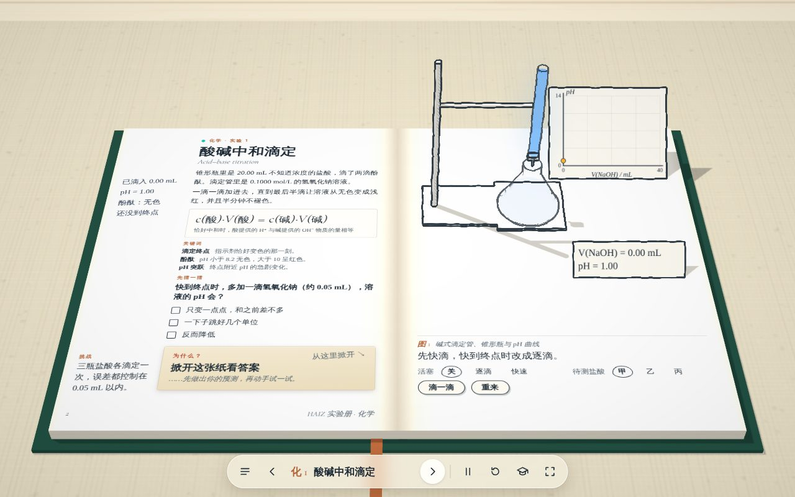
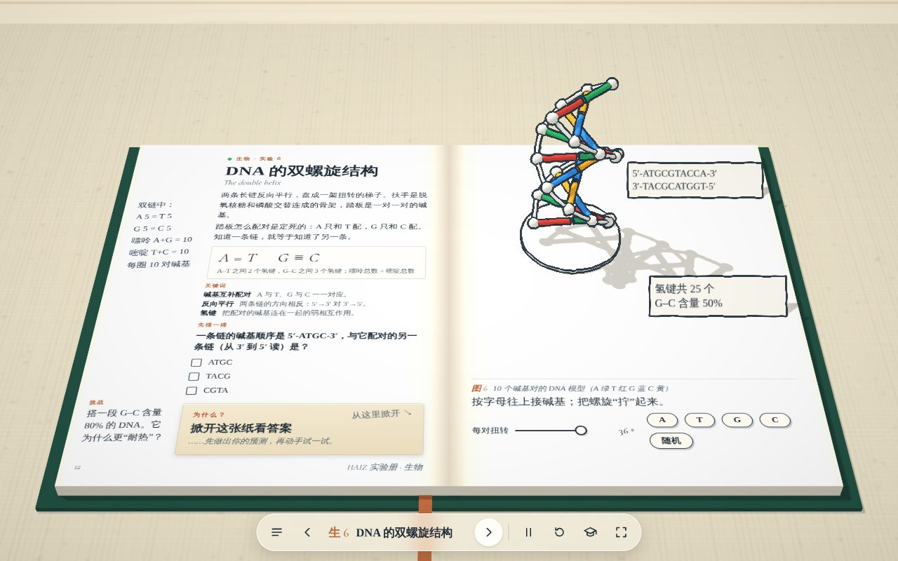

# HAIZ 实验册（lab/）· 设计与来源说明

> 2026-11-11 · 入口：[`lab/index.html`](../lab/index.html) · 测试：`npm run test:lab`

一本摊开在桌上的立体实验书：左页是正文、公式、关键词、“先猜一猜”和可以掀开的答案；右页是从纸面立起来的白模墨线装置，量用发光的颜色表示；下方是图注和控件。面向教师课堂投影（全屏、← → 翻页、空格暂停、教师备课抽屉），手机竖屏时装置在上、书页在下。

## 目录（34 个）

| 学科 | 实验 |
| --- | --- |
| 物理 9 | 单摆与重力加速度、平抛运动、加速度与力和质量、弹簧弹力与形变、气体等温变化、电源电动势和内阻、双缝干涉、折射与全反射、电磁感应与楞次定律 |
| 化学 6 | 酸碱中和滴定、原电池、化学平衡的移动、反应速率的影响因素、焰色试验、电解水 |
| 生物 6 | 质壁分离与复原、酶的活性、光照强度与光合作用、性状分离比的模拟、种群数量的增长、DNA 双螺旋 |
| 地理 4 | 地球公转与昼夜长短、热力环流与海陆风、等高线地形图、月相 |
| 数学 5 | 圆周运动到正弦曲线、圆锥曲线、高尔顿板与二项分布、割线到切线、正方体的截面 |
| 信息技术 2 | 排序算法、二进制与编码 |
| 通用技术 2 | 梁的弯曲与截面、开环与闭环控制 |

语文、英语、政治、历史没有“实验”形态的内容，本册未涉及。

## 结构

- `lab/js/stage.js`：桌面、书、光影、翻页，以及墨线后期（上色 → 实体法线/深度 → 玻璃法线/深度 → 合成描边与排线）；书页 DOM 用 CSS 3D 矩阵贴在纸面上。
- `lab/js/ink.js`：搭实验用的积木（杆、弹簧、玻璃筒与发光液体、卡片、坐标图、表头、气泡、流动光点等）。
- `lab/js/exp/*.js`：每个实验一个对象：页面文字 + `controls` + `build(k)`；在 `catalog.js` 登记。新增实验只需照此添加。
- 依赖仓库已有的 `lanren/vendor/three`（MIT）与 `lanren/fonts` 的 Cormorant Garamond；中文使用系统宋体/楷体，不新增字体文件。

## 来源与画风

画风致敬 Techartist 的 *Every Joule*（立体墨线课本）。制作时只观看了原作运行时的画面，**没有阅读、复制或改写原作的代码、模型、文字、字体文件与音频**；原作的离线包也没有进入本仓库。本目录的程序、模型（全部由代码生成）、文字为 HAIZ 自制，代码由项目负责人提出需求并确认方向、借助 AI 编程工具（Claude Code）编写，按 [LICENSING.md](../LICENSING.md) 的原则如实记录。相似的是“书 + 墨线白模 + 发光颜色”的表现手法；是否需要就风格相近与原作者沟通，由项目负责人决定。

## 真实性边界

- 数值由公式实时计算，是理想化模型，每页“教师备课”里写明了做了哪些简化；不能代替真实实验与安全规范。
- “对应内容”按人教版教材的章节名称填写，未逐页核对版次，请教师使用前自行确认。
- 自动化测试在 Chromium + SwiftShader（软件渲染）下通过：34 个实验逐一打开、269 次控件操作无报错、排版不溢出、手机布局正常。**未在真实 GPU、Safari、真机和教室投影上验收**；系统缺少楷体时手写批注会退回其他字体。
