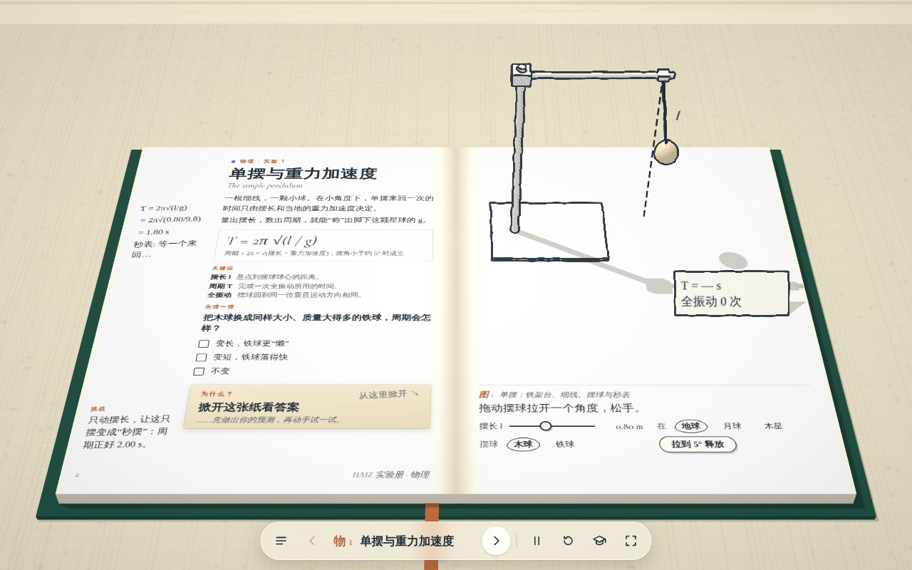
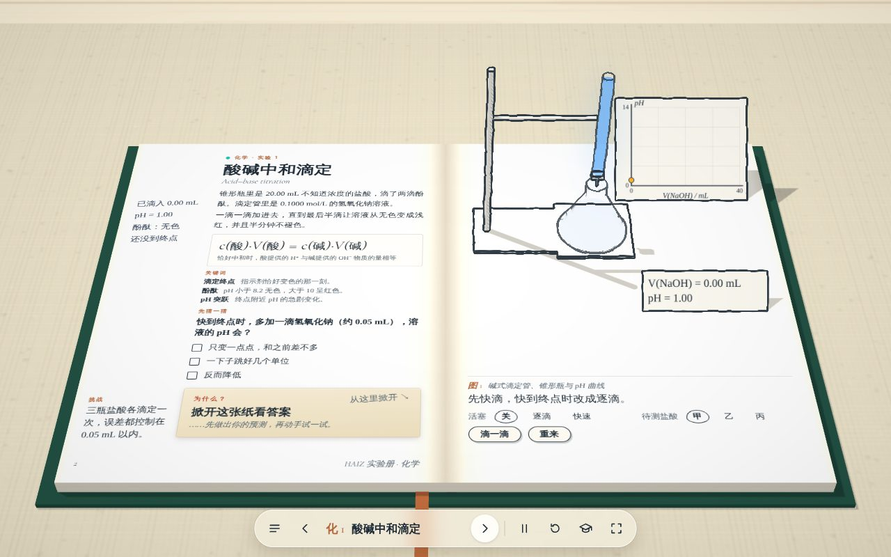

# HAIZ 实验册 · 第二代（书本、翻页与渲染重构）

> 2026-11-12 · 入口 [`lab/index.html`](../lab/index.html) · 测试 `npm run test:lab` · 分支 `claude/adoring-ritchie-2m9wmp`（未合入 `main`）
> 上一版说明见 [`lab-book-20261111.md`](lab-book-20261111.md)。本文记录这次重构：对标观察、差距、设计决定、验收结果与没有验证的部分。

| 翻页中 | 酸碱中和滴定 | 活字印刷：揭纸翻面 |
| --- | --- | --- |
|  |  |  |

运行录像（软件渲染逐帧录制，按 60 帧/秒回放）：[`lab/gen2-turn.mp4`](lab/gen2-turn.mp4)（方向键翻页、拖页角半途放手弹回、拖过书脊翻完）、[`lab/gen2-phone.mp4`](lab/gen2-phone.mp4)（手机竖屏滑动翻页）。

## 一、这次交付了什么

1. **一本真的书**：布面精装封板与铜箔线、书脊与堵头布、两叠随页码增减厚度的书芯、斜切的书口纸边、订口的弧度与暗部、丝带。纸面是带纤维起伏的漫反射材质，文字印在纸上——会跟着纸弯，会被装置的影子盖住。
2. **新的翻页系统**：书页本身是交互对象。
   - 指针靠近页边，纸角微微翘起，露出下一页；轻点页边翻过去。
   - 抓住页边或页角拖动：纸沿可展面卷起、跟手，背面是下一页的正文；松手时按进度与速度翻完或弹回。中途取消不改变页码、装置与交互状态。
   - 键盘 ← → / PageUp PageDown / Home End、目录跳转、触控板横向滑动、底栏按钮仍可用；系统设置“减少动态效果”时直接换页。
   - 手机竖屏：书在上方只取右页一页，文字与控件按正常文档流排在下面；在书页上横向滑动翻页。
3. **装置与翻页的联系**：翻页前装置像立体书的纸雕一样朝书顶放倒、压扁，成为印在纸上的一幅正立面线稿（版画）；这幅图随纸翻走。下一页的线稿先在纸上，纸翻过去后装置从图上立起来。
4. **渲染**：线性光照 + 房间环境反射 + 柔和日光阴影 + 屏幕空间接触遮蔽；金属、陶瓷、木、卡纸、玻璃各有反射差异（玻璃映出窗子的高光）；墨线与排线在显示空间落墨，光照变化不影响线条可读性。
5. **三个样板**：单摆（铁架台、软木夹、米尺、量角板、秒表，累积法计时与模拟的按表误差）、酸碱中和滴定（滴定管夹、带刻度的碱式滴定管、乳胶管与尖嘴、锥形瓶、白瓷板、读数放大镜）、活字印刷（依《梦溪笔谈》八步工序：设板、排字、炀之、按平、刷墨、覆纸、揭纸翻面、拆版）。
6. **其余页面**：原有 39 页不改内容，全部迁到新书、新材质、新翻页与新光照下（共用工具箱升级为 PBR 材质，玻璃、金属、木头自动获得新质感）。新增 3 页高一基础内容：力的合成、配制一定物质的量浓度的溶液、函数的单调性与奇偶性。**共 45 页、11 个学科。**
7. **课程定位与记录**：目录可按学段（必修 / 选择性必修 / 拓展）、活动性质、关键字检索；每页都有“实验记录”——理科是数据表（记录一组、重复测量、平均值与标准偏差、与参考值比较、误差来源、导出 CSV），历史等是“证据 → 解释 → 比较”三栏笔记（导出文本）。历史时间尺修掉了“公元 0 年”。

## 二、对标观察：Every Joule

**方法**：在开发容器里离线运行项目负责人提供的原作离线包（未进入本仓库），阻断全部外部请求，用无头 Chromium（SwiftShader 软件渲染，约 0.3 帧/秒）配合“虚拟时钟”逐帧慢放，截图观察画面并发送真实的鼠标、键盘、滚轮与触摸事件。**只观察运行时的画面与行为，没有阅读、反编译或复制原作的代码、模型、文字、字体与音频。**

### 实际观察到的

| 方面 | 观察 |
| --- | --- |
| 开场 | 书是合着的，封面掀开进入第一个跨页；封面有压凹线框、缝线和嵌入的插图。 |
| 书的构造 | 黄色封板在书芯四周露出一圈；书芯有厚度，右侧书口能看到一条条纸边；订口处纸面向下弯并变暗；蓝色丝带穿过订口垂到桌面。桌面是浅木纹加一块灰绿色垫子，画面边角有柔和的窗影。 |
| 文字 | 整页文字画在 WebGL 的纸面上（不是浮在画布上的 DOM），随纸透视、受光。另有一份读屏用的文字版，手机上有一张可上拉的文字卡片。 |
| 指针分工（离线快照，鼠标） | 悬停在左页正文上光标是“放大”，有一枚放大镜看字；悬停在装置和题目选项上是手型；在页面上按住拖动是**转动视角**，松手后弹回原位。 |
| 翻页的触发 | 底栏的上一页 / 下一页、方向键、滚轮向下可以翻页。**在这份离线快照里，用鼠标点击页边、拖动页边或页角都没有翻页**（拖动只转视角）；手机尺寸下的触摸横滑同样是转视角。 |
| 翻页的过程（方向键，约 3.2 秒） | ① 约 0.5 秒：立体装置“沉”进纸里，墨线变淡，成为纸上一幅平面线稿；② 约 1.1 秒：右页那张纸带着这幅线稿抬起、翻过去，纸略有弯曲，**背面就是下一页的左页正文**，纸在两页上投下影子，底下露出的新右页上已经印着新装置的线稿；③ 约 1.5 秒：新装置从线稿上分批立起（先底座，再轨道、架子、罐子），线条由淡转实。 |
| 为什么像一本书 | 任何时刻纸上都有印刷内容；装置与纸之间有“平面图 ↔ 立体”的连续变化；新页的内容不会在纸翻过去之前出现。 |
| 空间感 | 白模几乎不上色，靠粗细有变化的墨线轮廓、背光面的排线、落在纸上的长而软的投影和接触处的暗部站住；发光的颜色只用在“能量”上。 |
| 节奏 | 有“Watch”演示模式：镜头拉近、剖开、低机位，配一行字幕；运动有明显的缓入缓出，装置分批出现。 |

### 推测（没有验证）

- 文字是预先排版后渲染到纹理或直接用几何绘制的，所以能随纸弯曲；具体做法未知。
- 负责人印象中的“直接拖书页翻页”，可能来自线上的其他版本或触屏设备；这份离线快照没有复现，这里不下结论。
- 帧率极低说明后期处理较重（可能有屏幕空间遮蔽、玻璃质感的界面折射等）；未验证。

### HAIZ 自己的设计决定（不是照搬）

| 问题 | HAIZ 的做法 |
| --- | --- |
| 谁是翻页的主角 | 书页本身：悬停翘角、点击页边、拖动跟手、可逆。原作快照里拖动是转视角；HAIZ 把“拖页边 = 翻页，拖空白 = 转视角，拖装置 = 操作装置”分开。 |
| 纸怎么弯 | 一张 41×27 的网格，按“不可拉伸”的可展面变形：折线一侧的纸卷在半径随进度变化的圆柱面上，卷过半圈后平铺；折线不得越过书脊两端，所以纸始终连在书上。抓住的点由指针射线与抬升后的纸面求交、二分求解折线位置，尽量停在指针下。纸有厚度、有纸边、两面各一张贴图。 |
| 文字怎么上纸 | 不重写排版引擎：页面先用真实 CSS 在隐藏的“排版间”排好，再逐字读回浏览器排版后的位置画到画布上成为纸张贴图，与 DOM 版面逐像素一致；并补一点“油墨扩散”，抵消线性光下细笔画发灰。 |
| 控件怎么办 | 静止时，滑块、选项、答案纸片等“会动的部分”用真实 DOM 贴在纸面上（正片叠底，纸上的阴影能透上来），读屏与键盘可用；翻页一开始就把它们此刻的状态印到纸上，DOM 隐去，翻完再换回。 |
| 装置怎么回到书里 | 整个装置朝书顶放倒并沿进深压扁（硬纸片式的纸雕），同时把它此刻的正立面用正交相机拓成“铅笔线 + 淡彩”的版画印在纸上；立起时反向，带一点回弹。 |
| 书的厚度 | 两叠纸的厚度随读到的位置变化：越往后翻左叠越厚、右叠越薄。 |
| 手机 | 不照搬桌面：书只取一页，文字与控件是普通文档流（可读的字号），滑动书页翻页。 |
| 视觉身份 | 深绿布面、象牙白纸、墨黑线、铜色箔线与丝带；浅白蜡木桌面，不用垫子；不开场合书动画，打开就是摊开的一页。 |

## 三、与上一版相比，最根本的差距在哪里

| 上一版 | 问题 | 现在 |
| --- | --- | --- |
| 文字是浮在画布上的 DOM | 字不受光、不被影子盖住，翻页时只能整页淡出 | 字印在纸上；DOM 只留给交互 |
| 翻页是一个 12 段的平面绕书脊转 180°，白纸一张 | 没有正反面，新页内容在纸落下前就出现 | 两面印刷、可卷曲、可拖动、可逆 |
| 装置换页时沿 y 压扁后消失 | 像网页组件，与纸无关 | 放倒成版画 → 随纸翻走 → 从图上立起 |
| 伽马空间 Lambert + 一盏方向光 | 材料没有差别，影子硬 | 线性流程、环境反射、接触遮蔽、材质分类 |
| 书是三个盒子 | 没有订口、书口、厚度变化 | 见上 |
| 只有底栏箭头和方向键 | 书页不是交互对象 | 点击、拖动、滑动、键盘并存 |

## 四、结构

| 文件 | 职责 |
| --- | --- |
| `lab/js/book.js` | 书：桌面、封板、书芯、丝带；翻动的纸及其变形；纸张材质（可叠印版画） |
| `lab/js/stage.js` | 摄影机与取景、光照与环境、后期（墨线、排线、接触遮蔽、色调）、装置折叠、版画烘焙、指针分工、自适应分辨率 |
| `lab/js/print.js` | 把排好版的 DOM 印成纸张贴图 |
| `lab/js/app.js` | 跨页的生命周期、翻页状态机（自动 / 拖动 / 回弹 / 页角提示）、目录筛选、教师备课、主循环（按需渲染） |
| `lab/js/notebook.js` | 实验记录：数据表、统计、导出 |
| `lab/js/ink.js` | 搭装置的工具箱；新增回转体、带壁厚与液面的玻璃器皿、铁架台、尺寸线、材质分类 |
| `lab/js/curriculum.js` | 每页的课程定位与核对状态 |
| `lab/js/exp/gen2.js`、`base.js` | 三个样板与三页高一基础内容；其余实验文件未改内容 |

新增一页仍然只需要写一个对象（文字 + `controls` + `build(k)`），在 `catalog.js` 登记；可选 `record`（数据表）或 `inquiry`（三栏笔记）。

### 性能上的取舍

- 没有为帧率删掉材质、阴影或几何细节。做的是：按需渲染（没有动画、没有交互时不重画）、自适应渲染分辨率（帧时间持续偏长时降到最低 60%，宽裕时升回）、三档画质（阴影贴图尺寸、多重采样、遮蔽采样数；手机默认中档）、纸张贴图只在换页与翻页时重印、相邻页贴图缓存而模型即用即建。
- 地址栏参数：`?q=0|1|2` 指定画质，`?fixed=1` 关闭自适应分辨率，`?still` 关闭动画。
- 图形环境被系统回收（`webglcontextlost`）时给出提示，恢复后重新载入当前页。

## 五、验收

### 自动化（`npm run test:lab`，结果见 [`tests/lab-browser-results.json`](../tests/lab-browser-results.json)）

环境：Chromium + SwiftShader 软件渲染。覆盖：

- 45 页逐一打开、建模、把两页印成贴图、版面不溢出；每个滑块、选项、按钮都操作一遍，无报错，且**不会误触翻页**。
- 贴在纸面上的 DOM 与印刷的纸在四条边上的偏差小于 2.5 像素。
- 方向键翻页；悬停页边翘角、点击页边前翻与回翻；拖页角一小段后放手弹回（页码、装置、DOM 均复原）；拖过书脊放手翻完；页面上的按钮优先于翻页。
- 目录按学段筛选、搜索、跳转；手动改地址栏 `#id` 跳页；教师备课。
- 单摆：计 10 次全振动写入记录本，T 与 2π√(l/g) 相差小于 0.06 s，导出 CSV；滴定：初读数、末读数、用量与浓度互相一致，终点落在理论值之后一两滴内；时间尺：公元前 1 年的下一格是公元 1 年。
- “减少动态效果”下深链接与换页；手机（390×844）竖屏布局、无横向滚动、触摸滑动翻页。

### 人工看图

用真实浏览器截图与逐帧录像检查了：纸张卷曲形状与背面内容、翻页时的投影、装置放倒与立起、三个样板的器材结构、手机布局。截图与录像在 `docs/lab/`。

### 没有验证的部分（如实记录）

- **真实 GPU**：全部运行都在软件渲染下。帧率、自适应分辨率的实际表现、阴影与遮蔽在真实显卡上的观感都没有验证。软件渲染下 1440×900 约 1 帧/秒，不能代表真实设备。
- **Safari / iOS / 真机触摸**：没有 WebKit 运行。风险点：`mix-blend-mode` 叠加三维变换的 DOM、半浮点渲染目标与多重采样深度的解析、`inert`。若 Safari 上控件颜色异常，可先去掉 `#css3d` 的 `mix-blend-mode`。
- **课堂投影**：没有在投影上看过字号与对比度。双击某一页可以把镜头凑近，但没有在教室距离上验证。
- **教材与课标原文**：见下一节。

## 六、课程定位的核对状态

本次制作环境只能使用检索摘要，**打不开**教育部、出版社和高校站点上的课程标准原文（例如 `bksy.ecnu.edu.cn` 上的课标 PDF 需要在会话的网络设置里放行）。因此：

- 只有检索到明确条目的页面附了来源链接：力的合成（课标必修 1 学生实验、人教版必修第一册 3.4）、用单摆测量重力加速度（人教版选择性必修第一册 2.5）、配制一定物质的量浓度的溶液（课标“学生必做实验”，据摘要）。
- 只有附了来源的页面才会标成“课标学生必做实验”；其余理科实验标为“教材实验”或“演示与探究”，教师备课里显示“待核对”。测试里有一条断言守着这条规则。
- 其余页面的学段、年级与章节按人教版 / 统编版（2019 年起使用）的通行编排填写，没有对照原书。

## 七、后续优先级

**课程与内容**

1. 打开课标原文后，逐条核对物理 21 个、化学、生物的学生必做实验清单，补全 `curriculum.js` 的来源，把确属必做的页面改标。
2. 继续补高一基础：物理“测量做直线运动物体的瞬时速度”、化学“离子反应”、生物“使用高倍显微镜观察细胞”。
3. 英语五种基本句型：对照教材补上 There be 句型与“主系表”的常见系动词分类，说明五种句型是教学归纳而不是语法的全部。
4. 近体诗平仄：补充“一三五不论”的适用边界、拗救与入声字在普通话里的归并说明，请语文教师审校例诗。
5. 经济学两页：在页面上（不只是教师备课里）标明曲线与数据是示意，补一组可查来源的真实基尼系数区间作对照。
6. 记录表：目前只有单摆、滴定、力的合成、配制溶液四页有专门设计的数据表与误差分析，其余理科页用的是通用的参数记录；按“教材实验”优先逐页补上。

**模型的专项美术**（新架构下逐学科做，样板之外的页面目前只是材质与光影升级）

7. DNA 双螺旋：标出 5′→3′ 方向、反向平行、氢键数目（A–T 两个、G–C 三个）和大沟小沟。
8. 电学：导线接线柱、电表表盘与量程；光学：光具座与刻度。
9. 化学其余页面改用带壁厚的玻璃器皿与真实液面（工具箱已有 `vessel`）。
10. 数学：圆锥曲线、导数等改用函数页那种“立在纸上的坐标平面 + 空间变换”的语言。

**书与交互**

11. 真实 GPU、Safari、真机、投影四项验收，并据此调阴影柔和度、遮蔽强度与分级画质阈值。
12. 跨多页跳转时连续翻过几张纸；合书 / 开书的封面动画；翻页与落纸的轻微声音（默认关闭）。
13. 重要实验跨页展开、结构穿过书脊的版式（现在的版画只覆盖右页）。
14. 读屏：把装置的实时读数同步到一个 `aria-live` 区域。

## 八、来源与权利

画风致敬 Techartist 的 *Every Joule*。本次为对标在开发容器里运行了项目负责人提供的原作离线包（负责人说明系经原作者授权取得，授权范围以双方约定为准），**只观察画面与交互行为，没有阅读、复制或改写原作的代码、模型、文字、字体与音频；原作文件没有进入本仓库**。本目录的程序、模型（全部由代码生成）、文字为 HAIZ 自制，代码由项目负责人提出需求并确认方向、借助 AI 编程工具（Claude Code）编写，按 [LICENSING.md](../LICENSING.md) 的原则如实记录。沿用仓库已有的 `lanren/vendor/three`（MIT）与 Cormorant Garamond 字体。

《梦溪笔谈》引文为古籍原文；活字页的器具造型没有实物依据，页面上已注明是示意。数值由公式实时计算，是理想化模型，不能代替真实实验与安全规范。
