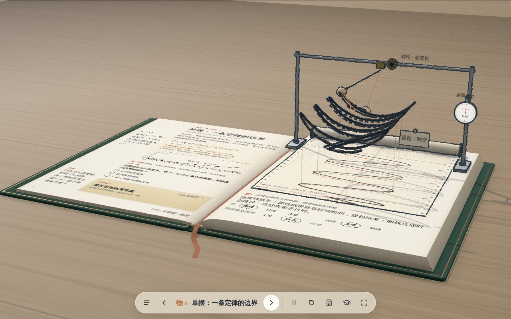
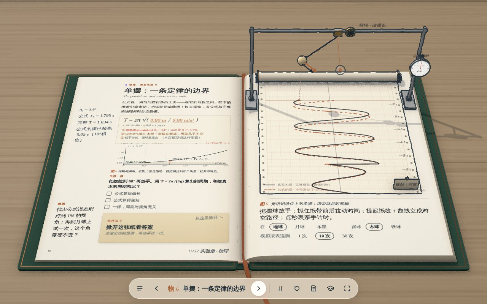
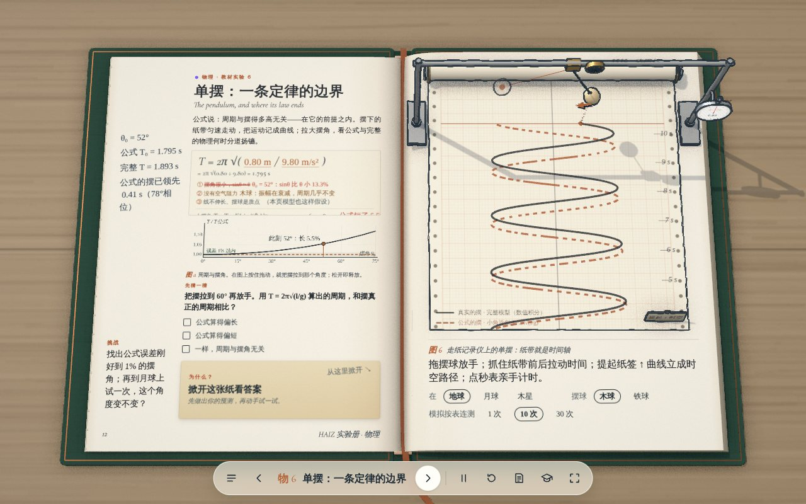
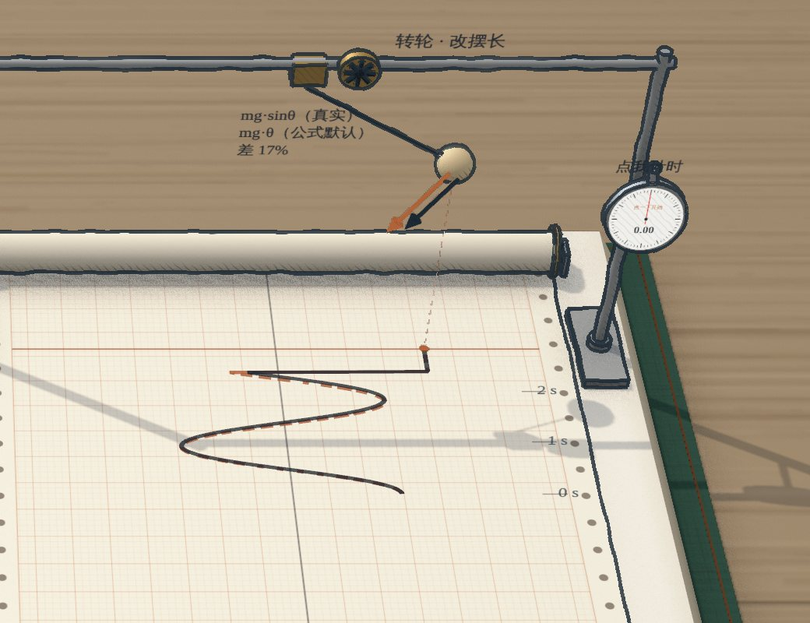
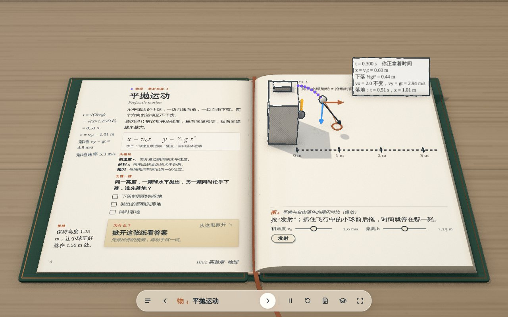

# HAIZ 实验册 · 第三代：书页之外

> 2026-11-13 · 入口 [`lab/index.html#phy-pendulum`](../lab/index.html#phy-pendulum) · 测试 `npm run test:lab` · 截图与录像 `node tests/lab-capture.cjs gen3` / `gen3video` · 分支 `claude/tender-davinci-cwddbd`（未合入 `main`）
> 上一代见 [`lab-book-gen2-20261112.md`](lab-book-gen2-20261112.md)。本文只写第三代新增的东西：一个完成的样板、它依赖的通用能力、验收结果和没有验证的部分。

| 摊开的一页：两只摆、两条记录 | 俯视：两条记录在纸上分开 | 手里的回复力 |
| --- | --- | --- |
|  |  |  |

录像：[`lab/g3-pendulum.mp4`](lab/g3-pendulum.mp4)（拖摆球到 55° 松手 → 推纸带让时间倒流、再拉回 → 提起纸签 → 放低镜头看时空路径 → 升到俯视 → 放下纸签）。软件渲染、虚拟时钟逐帧录制，按 30 帧/秒回放。

---

## 一、样板：一页单摆，一条定律的边界

**一句话**：摆的下面铺着一条匀速走动的记录纸，摆把自己的运动写在纸上；纸就是时间。

读者在这一页上做的事，全部发生在物体本身上，没有新增一个按钮：

| 动作 | 结果 |
| --- | --- |
| 拖摆球 | 设定初始摆角；拿着不放时，球上出现两根回复力箭头：墨色是真实的 mg·sinθ，铜色是公式默认的 mg·θ，并写出差了百分之几。 |
| 松手 | 两只摆同时出发：实体的“真实的摆”（完整模型）和只有铅笔轮廓的“公式的摆”（严格按 T = 2π√(l/g)）。小角度时它们重合；大角度时公式的摆越跑越靠前，纸上的两条记录慢慢错开。 |
| 抓住纸带往远处推 / 往近处拉 | 时间倒流 / 快进。摆精确地回到那一刻（不是倒放动画，而是取回那一刻记录下来的完整状态）；松手后从那一刻继续。 |
| 提起纸带近端的纸签，或者把镜头放低 | 纸上的 x–t 曲线每一点升到摆球当时真实的高度，成为摆在时空中走过的路径（世界线），从摆球身上一直延伸到读者面前。从正前方看，它是摆来回的弧；从正上方看，它就是纸上的图像；纸上的图像是它的影子。 |
| 转动画面上方的绕线轮，或拖公式里的 l、g | 改摆长、改重力加速度；公式、装置、纸上的曲线是同一个系统，改哪里都一样。 |
| 在左页的“周期–摆角”图上按住拖动 | 摆被拉到图上那个角度，松开即释放：图像也是控件。 |
| 点门架上的秒表 | 你亲手计时（反应时间是真实的），结果作为一个实心点落到“周期–摆角”图上；记录本里的“记录一组”则是模拟的手（±0.1 s 随机误差），画成空心点加误差棒。 |
| 翻到别的页再翻回来 | 这一页的世界还在：记录、摆长、摆角都没丢；你离开的那段时间它一直在摆，纸带上写着“你离开的 57 秒里，它一直在摆”，木球的摆幅因阻尼已经变小。 |

左页的公式是活的：`T = 2π√( 0.80 m / 9.80 m/s² )` 里的两个数可以左右拖；下面列出公式的前提，**被打破的前提会被红笔划掉并注明原因**（“θ₀ = 55°：sinθ 比 θ 小 14.7%”），并给出更完整的大摆角周期与公式的误差。

### 这页想让学生发现的事

1. 公式不是错的，它有**边界**：误差 1% 的边界在 θ₀ ≈ 22.8°；5° 时只有 0.05%。
2. 边界的**原因**看得见：大角度时真实回复力 mg·sinθ 比 mg·θ 小，摆回来就慢。
3. 测量误差与模型误差是两回事：模拟按表的随机误差多测几次能摊薄；大摆角带来的偏差是系统误差，多测也消不掉（记录本的小结里会单独指出）。
4. 图像是运动的另一种视角，而不是另一件东西：同一条世界线，正看是轨迹，俯看是 x–t 图像。

---

## 二、研究：参考作品解决了什么问题，HAIZ 拿来做了什么

**说明**：本次会话的网络策略不允许访问 `ciechanow.ski`、`worrydream.com` 等站点（请求在解析阶段被拒绝），下表关于这些作品的分析来自我已有的了解，**本次没有重新打开原页面核对**。Every Joule 的离线包按第二代的做法重新在容器里运行观察（只看画面与行为，不读、不复制其代码与素材）。

| 作品 | 它解决的问题 | 转化成的 HAIZ 设计 |
| --- | --- | --- |
| Every Joule | 让知识从纸面“站起来”：平面线稿 ↔ 立体装置连续变化，书始终是书。 | 第三代把同一个动作用在**抽象**上：站起来的不只是器材，还有图像——纸上的 x–t 曲线升成世界线，放下又印回纸上。 |
| Bartosz Ciechanowski（Mechanical Watch 等） | 从一个熟悉的物体出发，一次只加一个概念；每个图都能直接拖动，读数写在图里。 | 从一只普通的摆出发，依次露出回复力、两个模型、时间、边界；读数都在物体旁边或公式里，不在面板上。 |
| Bret Victor《Up and Down the Ladder of Abstraction》 | 在具体实例与“对时间/对参数抽象”之间连续上下：把整段时间、整个参数范围一次画出来，再指着其中一点回到具体。 | 纸带 = 对时间抽象（整段历史一次可见，指着纸带任一点就回到那一刻）；周期–摆角图 = 对参数抽象（指着图上一点就把摆拉到那个角度）；镜头高度 = 在阶梯上走动。 |
| Nicky Case《LOOPY》 | 学生亲手搭因果关系并让模型跑起来。 | 本次没有做模型搭建（见“下一步”）；但页面已经允许学生改变条件后**在过去的某一刻重新出发**，这是搭建器需要的底层能力。 |
| NASA Eyes | 真实数据、时间轴与三维空间结合，时间可以拖、可以快进。 | 可逆时间线：任何时刻的状态可取回、可从任一刻继续、可快进 30 秒；离开页面后世界按真实流逝的时间继续演化。 |
| Dynamicland | 计算对象像纸和工具一样被摆放、组合、共同操作，房间就是界面。 | 交互放在对象上：摆球、绕线轮、纸带、纸签、秒表、公式里的数、图像，每一个都是控件；页面上没有新增按钮。 |

---

## 三、第三代的设计语言

第二代的书已经足够像一本书。第三代不再加厚书的质感，而是让书里出现**现实中不可能、但一旦出现就觉得理所当然**的东西。整页只有一个超现实的设定：**纸就是时间**。由它推出了下面几条，它们也是之后其他学科页面可以复用的语言。

1. **纸就是时间轴。** 物体在纸上方运动，纸匀速走过，物体把自己写在纸上。这正是教材里“沙摆描出振动图像”的道理，HAIZ 把书本身的纸当成了记录介质。
2. **投影就是抽象。** 同一条世界线，正面投影是运动，俯视投影是图像；镜头放低，曲线自己立起来，镜头抬到俯视，它躺回纸上。转动视角，就是在具体与抽象之间走动。
3. **两个世界同台。** 公式的世界和更完整的模型共用一个悬点、一条纸带，**只差一个假设**（sinθ → θ；阻尼两边相同），所以两条曲线的每一点分离都可以归因于那一个假设。
4. **知识的笔法。** 每一笔都说明“我们是怎么知道的”：铜色虚线 = 理论公式；墨色实线 = 数值模型；空心圆 + 误差棒 = 模拟测量；实心圆 = 你亲手的测量；实心方块 = 真实观测（预留，须注明来源）；铅笔淡线 = 示意。理论的摆只画轮廓，模型的摆是实体。
5. **对象就是控件。** 不加按钮、开关和浮层；交互发生在知识对象上。
6. **世界不随翻页消失。** 每页的世界跨翻页保留，并按离开的真实时长继续演化。

### 与第二代相比，新在哪里

| 第二代 | 第三代 |
| --- | --- |
| 装置演示一个结果，滑块改参数 | 装置、公式、图像是同一个系统，三处都能直接改 |
| 时间只能播放 / 暂停 | 时间是纸带上的位置：可抓、可倒回、可快进、可从过去重新出发 |
| 一个理想化模型 | 公式与完整模型并排运行，差异可见、可归因、可量化 |
| 图像画在卡片上 | 图像是运动的投影：可以从纸上立起成为世界线 |
| 数据只有一种来源 | 数据按来源分笔法：理论 / 模型 / 模拟测量 / 亲手测量 |
| 翻页后模型销毁重建 | 翻页后世界保留，并在你离开时继续演化 |

---

## 四、可复用的能力（`lab/js/gen3/`）

| 模块 | 能力 | 本次使用 |
| --- | --- | --- |
| `timeline.js` | `Timeline`：定步长记录的可逆历史；`at(t)` 取回任一刻状态（插值），`truncate(t)` 从过去改写，`snapshot/restore` 跨翻页保存。 | 单摆 |
| `tape.js` | `recorder()`：走纸记录仪——纸卷、齿孔、秒刻度、“此刻”线；任意条印迹 `traces: [{ kind, fn(t) → [x, y, s?] }]`；`update(t, lift)` 让印迹立成世界线（带落到纸面的垂线）；`tOf/zOf` 纸面位置与时刻互换。印迹的线型由 `kind` 自动决定，虚线按纸面路程分段。 | 单摆 |
| `know.js` | `KIND`：知识来源的笔法表；`kindTag()`；`ellipK`、`periodFactor`（单摆精确周期比）、可复现随机数。 | 单摆、平抛 |
| `scrub.js` | `scrubbable()`：公式里可拖动的数（指针左右拖、键盘 ← →，读屏为 slider）。 | 单摆 |
| `handle.js` | `nearestT()`：时间把手——把指针位置换成轨迹上最近的时刻（轨迹折回时不跳）。 | 平抛 |

书本层（`app.js`、`print.js`）新增的通用接口：

- 实验对象可声明 `law`（左页的活公式区）和 `figure`（左页的活图，画布）；二者是 `data-live` 区域，翻页时连同画布内容一起印到纸上（`print.js` 新增画布印刷，`syncLive` 复制画布像素）。
- `inst.bindPage(leafL, leafR, signal)`：模型可以把自己写到书页上；页面卸载时用 `AbortSignal` 解绑。
- `kit.memory`（跨翻页保留的页面世界）、`kit.away`（离开了多少秒）、`inst.save(mem)`；参数也保存在页面世界里。“重置”清空该页的世界。
- `kit.stage`（读镜头状态，用于“投影就是抽象”）、`kit.dirty()`。

复用验证：**平抛运动**页只用了 `handle.js` 与 `know.js`：抓住飞行中的小球前后拖，时间停在那一刻，频闪点只画到“此刻”，vx（铜）、vy（蓝）、合速度（墨）与读数同步，理论轨迹用“公式”的笔法。

---

## 五、科学模型与教材

### 模型

| 对象 | 方程与方法 | 核对 |
| --- | --- | --- |
| 真实的摆（完整模型） | θ″ = −(g/l)·sinθ − γθ′；四阶龙格–库塔，步长 1/240 s；木球 γ = 0.035 s⁻¹，铁球 0.012 s⁻¹ | 无阻尼、60° 释放积分 40 s：周期 1.926572 s，与精确解相对误差 8.7×10⁻¹⁰；能量漂移 4×10⁻¹⁰ |
| 公式的摆 | θ″ = −(g/l)·θ − γθ′（与完整模型只差 sinθ → θ） | 有阻尼时周期 2π/√(g/l − γ²/4)，与 2π√(l/g) 相差 < 10⁻⁵ |
| 周期–摆角图 | T/T₀ = 2K(sin(θ₀/2))/π，K 用算术–几何平均计算 | K(0.5) = 1.685750354813（与标准值一致）；5° → 1.000476，30° → 1.017409，60° → 1.073182；1% 边界 22.8° |
| 模拟按表 | 读数 = 模型时间 + N(0, 0.1 s)，可复现的伪随机序列 | 4° 时 10 次全振动：与 2π√(l/g) 相差 < 0.06 s（自动化测试） |
| 你的计时 | 真实的按表时刻；全振动次数按“数对了”计算（取该时段内摆实际过零的平均周期反推 N） | — |
| 纸带 | 速度 1 书本单位/秒，示意比例；1 m 摆长 = 3.2 书本单位 | — |

**不做的简化说明**写在“教师备课 → 模型做了哪些简化”里：线无质量、不伸长，摆球视为质点，阻力只取一次项；页面上的“前提③”也标明“本页模型也这样假设”。

### 教材对应（按通行编排填写，**未对照原书逐条核对**）

- 人教版物理 选择性必修第一册 第二章 机械振动：简谐运动的图像（用匀速移动的纸带 / 沙摆描出 x–t 图像）、单摆（小角度条件与周期公式）、实验：用单摆测量重力加速度（`curriculum.js` 中已有来源链接）。
- 人教版物理 必修第二册 第五章 抛体运动：平抛运动的规律。

---

## 六、验收

### 自动化（`npm run test:lab`，结果见 [`tests/lab-browser-results.json`](../tests/lab-browser-results.json)）

环境：Chromium + SwiftShader 软件渲染。原有的 45 页全部检查保留（建模、印刷、版面、控件、翻页、目录、手机、减少动态效果）。第三代新增断言：

RESULTS_PLACEHOLDER

### 人工看图

用真实浏览器截图检查了：默认视角、60° 时两条记录的分离、提起后的世界线（默认 / 低机位 / 俯视）、拿着摆球时的回复力箭头、左页活公式与被划掉的前提、翻页时装置的放倒与印刷、离开 57 秒后回来的状态、手机竖屏、平抛的时间把手。截图在 `docs/lab/g3-*.jpg`。

在看图中发现并修掉的问题：左页活公式区与印刷文字错位（改为固定高度）；尺寸线被误认成第二根摆杆（改为只在调摆长时出现）；秒表被裁出画面（移到立柱上）；纸卷挡住记录笔落点（后移、缩小）；“公式的摆”不带阻尼时，一分钟后振幅与相位都和真实的摆无关，掩盖了要说明的那一个假设（改为同阻尼）；陡峭处的虚线碎成乱块（改为按纸面路程分段）；`<s>` 默认删除线让未被打破的前提看起来也被划掉了。

### 没有验证的部分

- **真实 GPU、Safari / iOS、真机触摸、课堂投影**：同第二代，都没有条件运行。软件渲染下约 1 帧/秒，不能代表真实帧率。世界线每帧重写约 3000 个顶点、两条纸带印迹，预计在集显上没有压力，但未实测。
- **手指操作的细节**：绕线轮、纸签、秒表都有放大的触控范围，但没有在真实手机上试过；手机上书只显示一页，纸带拖动与竖向滚动的冲突未在真机上确认。
- **参考作品**：本次网络无法访问除 Every Joule 离线包以外的参考站点，见第二节说明。
- **教材原文**：同第二代，教材章节按通行编排填写。

---

## 七、下一步

按价值排序，每一项都直接复用本次的模块：

1. **把“纸就是时间”推广到其他随时间变化的页面**：弹簧振子、电磁感应（电流–时间）、反应速率（浓度–时间）、种群增长。只需提供 `fn(t)` 和一条 `Timeline`；“两个世界”可以是“理想气体 vs 范德瓦尔斯”“指数增长 vs 逻辑斯谛”。
2. **跨学科的共享量**：让地理页的太阳高度角成为生物页光合作用模型的输入，在同一条纸带上记录“光照强度–时间”与“净光合速率–时间”；连接必须带单位和适用范围，用 `KIND` 区分实测数据与模型。
3. **可进入的叶片**（跨尺度）：在同一个对象上连续推近，镜头与模型细节随尺度切换，不做淡入淡出；需要一个多尺度相机与按尺度加载的模型层，是下一阶段最大的一块。
4. **学生搭建的模型**：从“在过去某一刻改变条件、重新出发”开始，逐步开放为可组合的模块（函数、力、因果变量），用同一套纸带观察结果。
5. **史料与证据链**（历史、政治、语文）：沿用“知识的笔法”区分史实 / 解释 / 推测 / 价值判断，让证据卡片与结论之间的支持关系可以被拖动、检验。
6. **真实数据**：为 `KIND.measured` 接入经许可的观测数据（例如学生用手机测得的单摆周期），与模型同图比较，界面上标明来源。
7. 第二代遗留的真实 GPU / Safari / 真机 / 投影四项验收。

---

## 八、来源与权利

本页的程序、模型（代码生成）、文字为 HAIZ 自制，代码由项目负责人提出需求、借助 AI 编程工具（Claude Code）编写。Every Joule 离线包只用于观察画面与交互行为，没有阅读、复制或改写其代码、模型、文字、字体与音频，文件没有进入本仓库。Bartosz Ciechanowski、Bret Victor、Nicky Case、NASA Eyes、Dynamicland 只作为设计思想参考，没有使用其任何素材。数值由公式与数值积分实时计算，是模型，不能代替真实实验；“你的计时”中被计时的摆仍是模型。
