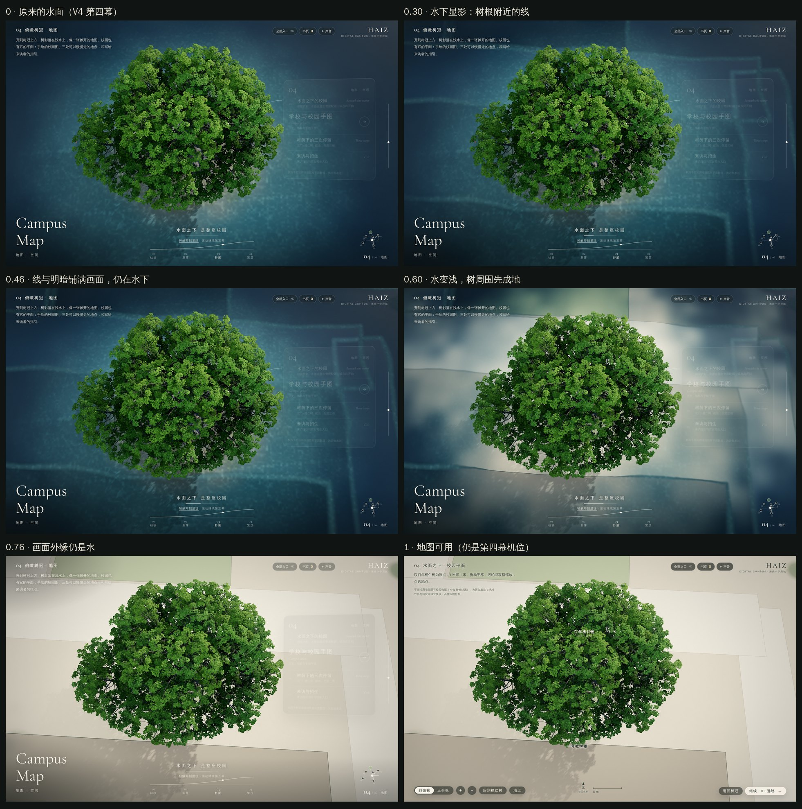
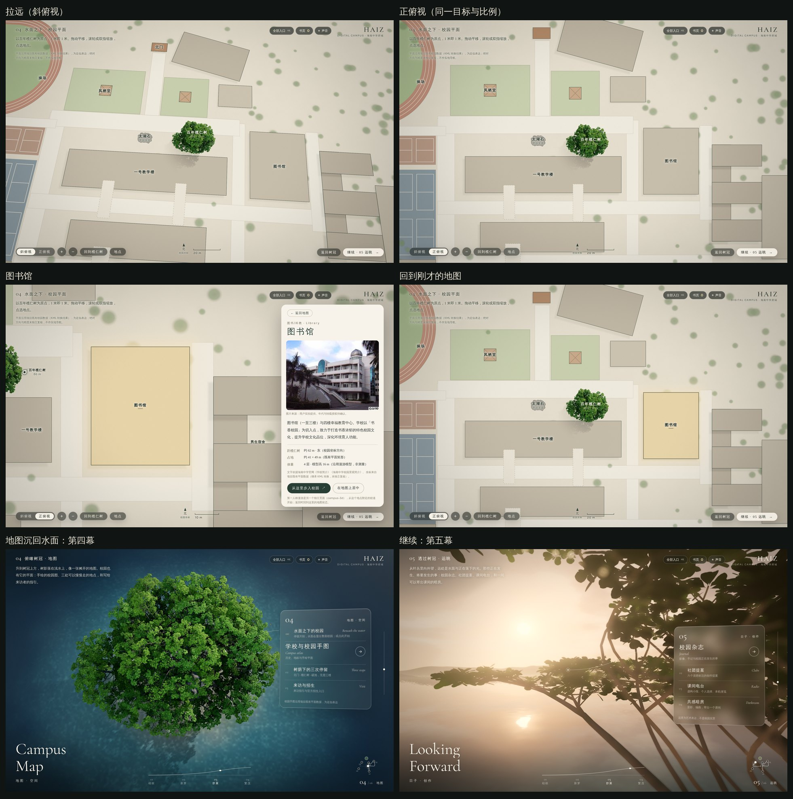
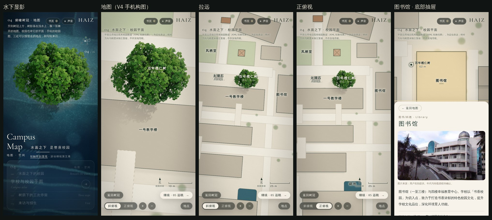
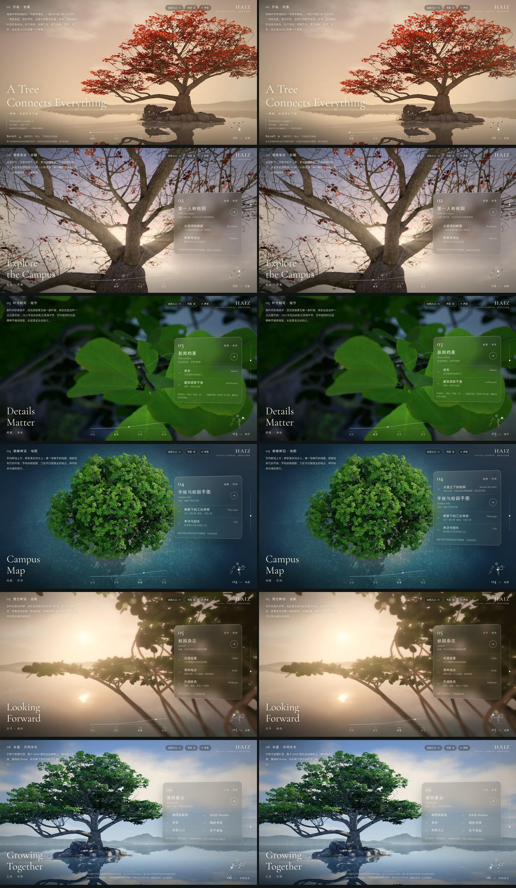

# 第四幕 · 水面之下的校园（2026-11-05，原型，待视觉验收）

> **检查点提交：** 本文中的截图与浏览器测试结果正在整理，下一次提交补齐；在那之前，文中关于浏览器测试的描述以 `tests/campus-map-browser-results.json` 为准。

> 不是在榄仁树旁边弹出一张地图，而是让人发现：整座校园原本就在这棵树的脚下。

本轮在 V4 榄仁树主页上完成第一条完整的空间路线：

**V4 第四幕 → 水面从水下显影成校园平面 → 缩放、平移、正俯视 → 图书馆 → 回到刚才的地图 → 地图沉回水面 → 回到第四幕 → 继续第五幕。**

工作在分支 `claude/haiz-continuous-spatial-world-fl9mw9`，基于 `main`（`93a4e96`，已含 V4 `9caa250` / 合并 `4dc3b80` 与后端）。**没有合并或推送 `main`。** 所有截图都是 Chromium 中的实时 WebGL 渲染（SwiftShader 软件渲染），不是合成图或视频效果。







## 1. 同一个世界：没有第二个场景

- **同一个渲染器、同一棵树、同一台相机。** 地图不是新页面、不是 iframe、不是覆盖在画面上的图片：V4 自己的水面着色器多了第二种读法。显影、地图、拾取、标注都在 V4 的 WebGL 世界里进行；退出时没有任何东西重新加载，树的生长值（第四幕 0.70）、滚动位置、落叶书页都保持原样（浏览器测试逐项断言：渲染器、树冠与树皮对象是同一个实例）。
- **V4 保护边界。** 树、叶簇、树皮、岛、太湖石、六个镜头、光照关键帧、`chapters.js`、`camera.js`、`scene.js`、`environment.js`、所有 GLB/纹理**一字未改**（与 `9caa250` 的 SHA-256 相同）。唯一改动的 V4 文件是 `lanren/js/home.js`：七处挂钩（加载地图模块、`tick / light / post / camera / overlay` 每帧挂钩、`#map/...` 深链接进入第四幕、静态回退时画平面），全部写成 `map?.…`，地图模块加载失败时主页与 V4 完全相同（`?nomap` 可强制关闭）。
- **水面着色器的改法。** 不改 `environment.js`；`lanren/map/layer.js` 在场景建好、首帧之前取到 V4 的水面材质，在其片元着色器末尾插入一句 `if (uReveal > 0.0) c = hzSurface(...)`。`uReveal = 0` 时这一分支不执行，像素与 V4 完全相同，所以其余五幕和刚到第四幕时的画面不变（第 7 节有同机位对照）。
- 新增的全部代码在 `lanren/map/`：`geo.js`（坐标、要素、地点、显影到达场，纯函数）、`reveal.js`（显影时序）、`tone.js`（颜色反演）、`view.js`（地图相机数学）、`hash.js`（历史记录）、`layer.js`（着色器与场景处理）、`ui.js`（标注与面板）、`map.js`（状态机、输入、历史与恢复）、`static.js`（无 WebGL 的平面）、`map.css`。

## 2. 坐标：榄仁树是地图的原点

| 坐标系 | 说明 |
|---|---|
| plan（像素） | 原校园平面图像素，`campus.json` 的 `rect` / `p` |
| campus（米） | 校园本地坐标，与第一人称漫游 `world.js rectWorld` 完全相同：`x = (px − 900) × 0.167`，`z = −(py − 784) × 0.167`；−Z 指向北门，**不是复核过的真北** |
| world（米） | V4 主页场景（Y 向上）。树根在原点（`tree.json`：tree base at origin），水面 y = −0.85 |

**变换：** 百年榄仁树占地矩形的中心 campus (49.098, −78.098) 放在 V4 树根正下方 world (0, 0)，地面在 V4 水面 y = −0.85。只平移、不旋转、不缩放：V4 场景原本没有地理朝向，所以直接采用校园本地轴，第四幕相机朝 −Z 看，校园"北"（北门方向）在画面上方。**树不移动，也不缩放；是校园被放到树下，1 米就是 1 米。** 同一个变换用于着色器里的要素、标注、点击拾取、相机聚焦、漫游入口（`geo.js makeFrame`，有往返测试）。

相对榄仁树的位置（与资料包 `tools/export_campus_origin.py` 独立导出的结果一致，误差 < 1 cm）：

| 地点 | x（东+） | z（南+） | 方位 · 距离 |
|---|---|---|---|
| 百年榄仁树 | 0 | 0 | 原点 |
| 一号教学楼 | −34.9 | 24.5 | 西南 43 m（北立面在树南约 11 m） |
| 太湖石「虎踞龙盘」 | −38.6 | −0.5 | 西 39 m |
| 图书馆 | 60.0 | 14.5 | 东 62 m |
| 凤栖堂 | −74.3 | −38.0 | 西北 83 m |
| 北门 | −36.1 | −80.5 | 西北 88 m |
| 砚池 | 9.5 | 140.5 | 南 141 m |

**尺度如实：** V4 的树冠约 30 × 24 m，数据中「百年榄仁树」占地矩形 14.7 × 11.9 m（更像树池/铺装范围）。两者都按米绘制，没有为了好看放大树或缩小校园；所以树冠在地图上会盖住北侧校道的一半、贴近一号教学楼北立面。第四幕默认只看到树周围约 80 × 46 m；拉远可见全校（地图纸面 620 × 580 m）。树拉远变小时，用锚定在树根的定位标记指路。

**资料可信度：** 全部来自项目既有数据（`assets/walk/campus.json` 几何与文字，`data/buildings.json` 照片），原 KML 与转换脚本缺失，绝对方向和精度未独立复核（`meta.verification = legacy-derived-unverified`），地图上与每个地点详情里都注明"近似表达，不作实地导航"。

**一处需要现场核对的矛盾：** 项目自己的照片（`assets/images/web/lanshu-1600.jpg`）里，「虎踞龙盘」石就在榄仁树长枝下方（V4 也按照片把石头放在树旁 4.4 m）；而 `campus.json` 把它放在树以西 38.6 m。KML 转换时主轴角由「北门—太湖石—一号教学楼正中」三点共线反解，所以石头的位置可能是可靠的，而榄仁树的数据位置可能偏了——也可能照片里是另一块石头。本轮不改数据，按数据绘制，留待用户确认。

## 3. 水面如何变成地图

### 3.1 地图本身：着色器里的矢量平面

47 个要素（34 个建筑/园林/水体占地、11 条校道、2 片球场）全部是矩形（科技楼带旋转，旋转方式与漫游相同），所以在着色器里用有符号距离场逐像素绘制：任何缩放下边线都是 1 像素锐利（`fwidth` 抗锯齿），可以按要素做悬停、选中、光晕、阴影。300 棵校园树按数据位置画成柔和的树冠（一张 2048² 的画布纹理，只有它允许柔软）。

- 建筑：暖灰屋面、深墨绿描边，按模型高度略深；**短投影的方向与第四幕太阳一致**，和真实的树影同向——树影是 V4 阴影系统投在地图上的真实阴影，建筑影是制图式的短影，二者组成同一套光的语言。
- 砚池、植物园水景：**终态里仍然是水**（保留 V4 的反射与波动，略带青色）——湖水退回到校园真实的水体里。
- 400 米跑道、六片篮球场、三片排球场按数据的颜色与分格画出场线；园林是浅鼠尾草绿，凤栖亭、衍林亭画成歇山顶的平面符号；连廊用虚线。
- 颜色按"屏幕上最终看到的样子"定稿，再通过 V4 自己的成像链（ACES 色调映射 @ 第四幕曝光 0.86 → sRGB → Finish 调色）反算成场景线性值（`tone.js`，24 个颜色往返误差 0/255），所以地图不会被电影调色意外改色。纸色接近浅水下的沙底：显影时，原来泻湖透出的浅沙底就"成了"校园的地面。

### 3.2 显影：沿着校园自己的路，而不是一个圆

`geo.js computeArrival` 在 2.5 m 网格上从树的占地出发做一次 Dijkstra：沿校道代价 1.0，球场/水面 1.25–1.3，园林 1.45–1.5，空地 1.7，建筑 1.85。得到每一点的"到达时间"——显影从树根出发，**先沿铺装路面流出去，再漫进园林，最后才覆盖屋面**；边缘再加一点小尺度噪声，没有完美的圆，也没有扫描光环。

两个前沿在到达场中向外推进（`reveal.js`，单调 Hermite 曲线；总长 6.4 s）：

| 阶段 | T | 画面 |
|---|---|---|
| 原来的水面 | 0 | 与 V4 完全相同。到第四幕后静止 1.5 s 才开始，滚动经过不会触发 |
| 水下显影 | ≈0.2–0.45 | 树根附近先出现极淡的线：铺装路面在泻湖底显得更亮，屋面更暗，边线像沙底上的细光；**被缓慢的大尺度水波折射**，并随水深略微模糊。水面的反射与焦散仍占主导 |
| 水化为地 | ≈0.5–0.8 | 水"变浅"：平面本身的颜色逐渐透出，青色的水体吸收与镜面反射一起退去；刚退水的地方略暗（湿痕，而不是发光线）。树周围先干，画面外缘仍是水。此时岛与太湖石**沉入平面之下** |
| 清晰的地图 | 1 | 无折射、无反射、无雾（第四幕的雾与薄雾随显影降到 0，泛光阈值提高、暗角减轻，纸面不会发光）；水面反射渲染关闭（省掉一次整场景渲染）。界面淡入，地图立即可用，**不需要再点"进入地图"** |

第四幕画面只覆盖到达场的前 10%，所以两个前沿在穿过画面时走得慢、出画后迅速扫完全校：画面里的每一刻都在变化，到 T≈0.85 画面已全部成地，最后一秒在画外完成整个校园。

### 3.3 艺术化岩岛的处理

V4 的岩岛（含树旁 4.4 m 的太湖石与草丛）不是校园真实地貌。显影到"水化为地"时，岛、草、灌丛一起平滑下沉 2.7 m（太湖石最高 1.59 m），落到地图平面之下；平面是不透明的地面，所以它们被"地面"盖住，而不是淡出。榄仁树原地不动，树根直接立在地图上的树池里；水面上漂的落叶在这期间暂不显示（落叶会落回原来不存在的岛面上）。退出时一切按原路升回，T=0 时位置与 V4 完全一致（测试断言）。

## 4. 两种视角

- **默认 = V4 第四幕斜俯视（这是决定，不是建议）。** 地图打开时，相机就是第四幕的机位（俯角 73.5°、镜头 50°；手机用 V4 自己的竖屏构图）。显影过程中镜头不动。
- **正俯视由用户主动切换**（按钮或 `T` 键）：相机绕当前目标点转到正上方（北门方向朝上），同时镜头从 50° 收到 20°，**距离按 `d = s / tan(fov/2)` 同步拉远**，所以目标点处的地面比例在整个过程中不变（比例尺始终同一个数），只是透视逐渐变平——树冠从"立体"收拢成接近它在平面上的投影（20° 时树冠顶部只放大约 1.18 倍）。这是 flat-to-3d「03 Open Section」的相机原则（截面保持尺寸、镜头张开）在这里的反用：HAIZ 自己的实现，没有复制代码。比较过正交相机：正交会让树冠失去体积、切换时出现无法解释的比例突变，而且 V4 的雾、景深、光束都依赖透视深度，所以采用窄视场透视。
- 缩放：滚轮/双指以指针下的地面点为中心（任何俯角下该点都精确停在原像素，测试断言）；平移：拖动"抓住"地面；双击放大；键盘方向键、`+ / −`、`Home`（回到树）。镜头离地至少 21 m（不会钻进树冠），最远显示整个校园。
- **世界坐标不随相机改变**：两种视角下地图、树、标注、点击拾取用的都是同一个变换。

### 平移范围：两种方案供验收（未定）

用户尚未决定是否允许树离开画面，所以没有把任何一种当成定论，两种都可直接试：

1. **自由（默认）**：目标点限制在校园纸面内，树可以离开画面；树离开画面时，屏幕边缘出现指向树根的定位标记和距离，点一下回到树。
2. **榄仁树保持可见**：目标点离树不超过当前视野半高的 0.85 倍，树根始终在画面内。

在「地点」面板底部切换（或 URL 加 `?pan=tether`）。建议验收时两种各用一分钟再决定。

## 5. 地图是能用的

- 悬停：建筑描边加粗、屋面轻微提亮、名称浮现；没有名字的校道也会给出描边反馈。点击树冠本身选中「百年榄仁树」。
- **标注分级**：按地点重要性（1 级：榄仁树、一号楼、图书馆、操场、北门、南门、砚池、凤栖堂、太湖石）和屏幕上的占地大小显示，按优先级去重叠；大楼只露出一部分时，名字放在**可见部分**的中心；被树冠挡住的地点不标。一打开地图只有寥寥几个名字。
- **地点详情**（桌面右侧的一张纸，手机底部抽屉）：类别、名称、项目已有照片（注明来源，"年代与转载授权待确认"）、`campus.json` 的原文介绍、距榄仁树的距离与方位、占地、模型层数/高度（注明"沿用漫游模型，非测量"）、文字与坐标出处。衍林堂的照片在数据中被标为身份存疑，这里也不显示。地点详情里滚动只滚动正文，地图不动。
- 选中时相机飞到该地点（远距离时中途略微升高，保持方位感），宽屏把地点放在面板左侧的空处；其余校园稍稍退暗。
- 「从这里步入校园 ↗」进入**现有的第一人称漫游**（`campus-3d.html?focus=<地点>`，从该地点附近的校道开始）。**这是两个独立页面之间的跳转，不是跨渲染器的无缝下潜**——页面上也这样写明；离开前把地图状态（视角、相机、选中地点、打开前的视角）存入 `sessionStorage`，返回时恢复（测试覆盖了真实的返回）。连续下降镜头属于后续阶段（第 9 节）。

## 6. 控制权、返回与历史

| 状态 | 滚轮 / 触摸滑动 | 拖动 | 点击 | 键盘 |
|---|---|---|---|---|
| tree（V4） | 走六幕 | 环顾 | 接落叶 / 拨叶 | 空格、翻页、方向键走六幕 |
| reveal（显影中） | **任何滚动都会取消显影**，水面合拢，照常走到下一幕 | 环顾 | 「轻触即刻显现」加速 | 同 V4 |
| map | 缩放地图（页面不滚动、第五幕不会被触发） | 平移 | 选地点 / 点空白处取消 | 方向键平移、`+ −` 缩放、`T` 视角、`Home` 回树、`Esc` 逐级返回 |
| 地点详情 | 详情面板内滚动正文；面板外仍缩放地图 | 平移 | 同上 | `Esc` 关闭详情 |

- 进入地图时，第四幕面板与绕树导航设为 `inert`（淡出的链接不会再被点到或 Tab 到），画布 `touch-action: none`；V4 的拖动环顾暂停。退出时一一归还。滚动位置被锁定，任何意外滚动立即复位。
- **返回是一段空间恢复：** 关闭详情 → 相机回到打开详情前的那个地图视角（目标点与缩放误差 < 5 cm），地点仍保留标记；「返回树冠」→ 相机先回到第四幕机位，地图再沿到达场**由外向内**沉回水面，岛升回原位，V4 接回相机——树不重新加载，生长值不变，可以直接滚动到第五幕；「继续 · 05 远眺」= 返回树冠后自动走到第五幕。
- **浏览器历史：** `#map`（第四幕镜头）→ `#map/oblique` 或 `#map/top`（地图）→ `#map/<视角>/<地点>`（详情）。后退逐级退出；前进重新进入；刷新或从漫游返回时恢复同一视角与地点；直接打开深链接（如 `index.html#map/top/library`）会直接进入第四幕地图，不重放六幕，并补齐可以逐级后退的历史。
- **减少动态：** 显影压缩到 0.6 s，相机移动 ≤ 0.25 s，过渡动画关闭，内容不缺。
- **没有 WebGL**（或 `?static`、省流量模式）：第四幕里出现同一份数据、同一原点的 SVG 平面图和全部地点列表（文字、照片、漫游链接）。

## 7. 验证

自动化测试（本分支新增，均在本机通过）：

```
node tests/campus-map.cjs            # 坐标、地点、到达场、显影时序、颜色反演、相机数学、历史
node tests/campus-map-browser.cjs    # 真实浏览器中的完整路线（见 tests/campus-map-browser-results.json）
```

浏览器测试的内容：静止于第四幕后自动显影并进入地图（默认即第四幕机位）；滚轮缩放时 `p` 与 `scrollY` 不变；拖动平移；`T` 切到正俯视且目标与比例不变；在地图上真实点击图书馆打开详情（照片、文字、漫游链接）；`Esc` 回到打开前的视角；浏览器后退回到树——同一渲染器与树对象、相机在第四幕原机位 (3.00, 40.0, 12.0)、生长 0.70、岛回到原位；`PageDown` 继续到第五幕；显影中滚动会取消；第四幕面板入口立即显影、「继续 · 05」；深链接 `#map/top/library`；进入 `campus-3d.html?focus=library` 再返回，视角与地点恢复；后退逐级退出；减少动态；`?static` 平面；手机 390×844 无横向溢出、控件在屏内、轻触图书馆打开底部抽屉。

V4 原有测试：`tests/lanren.cjs`（六个镜头、生长、光、18 个入口与 `index.html` 一致）通过；`npm test` 中各项单独运行均通过，**唯一失败的 `tests/cinematic-runtime.cjs` 在未修改的 `main` 上同样失败**，与本轮无关。

**V4 同机位对照**（`tests/lanren-capture.cjs`，1280×720，高画质；左：开发前在未修改的代码上截取，右：本分支，地图模块已加载但未显影）。V4 的画面本身每次都不完全相同（风吹叶动、胶片颗粒、相机呼吸、随机落叶），所以另从未修改的 `main`（`93a4e96`）再截一次作为噪声基准：

| 镜头 | V4 ↔ V4 重拍（噪声） | V4 ↔ 本分支 | 结论 |
|---|---|---|---|
| 01 初遇 | 3.09 / 3.46 % | 2.60 / 2.81 % | 在噪声内 |
| 02 苏醒 | 7.94 / 9.40 % | 8.60 / 10.41 % | 在噪声内（与重拍 V4 相比 1.89 / 1.09 %） |
| 03 细节 | 5.92 / 6.34 % | 3.53 / 3.09 % | 在噪声内 |
| 04 俯瞰 | 0.37 / 0.20 % | 2.24 / 2.40 % | 差异 94% 在面板一列：面板多了「水面之下的校园」一行；面板以外 0.2 %，等于噪声 |
| 05 远眺 | 2.50 / 2.09 % | 2.12 / 1.67 % | 在噪声内 |
| 06 全盛 | 4.45 / 5.09 % | 4.92 / 5.80 % | 在噪声内 |

（每格：平均绝对差 / 差值 > 24 的像素比例。）也就是说，到达第四幕、显影开始之前，水面与树与 V4 一致；其余五个镜头没有可测的变化。



**没有验证的：** SwiftShader 只能证明流程和画面，不能代表真实 GPU 的帧率；没有在真机手机、iOS Safari、低端安卓上测过性能与手势；地图模式的着色器每个水面像素最多遍历 47 个要素（有包围盒提前跳过），在高端 GPU 上应很轻，但低端手机需要实测；没有屏幕阅读器实测。

## 8. 参考与许可

- flat-to-3d（Sam Aing，MIT，资料包内 `d7b9b69`）：研究了 02「Section Sweep」（按世界坐标逐像素混合墨线与真实材质）、03「Open Section」（`距离 = 画幅 / tan(视场/2)` 的相机）、06「Card Model」（同一套几何的两种材质、由一点向外扩张的前沿）。HAIZ 只采用了方法，**没有复制任何代码或资产**；前沿由校园路网驱动、方向相反（从三维树与水到二维真实平面）。
- Casa Serra：只研究其公开仓库的思路（同一套三维几何经由剖切与长焦成为图纸）。该仓库没有明确的源码许可，未引入任何代码。
- 照片：项目既有资产，注明"年代与转载授权待确认"。没有新增字体与第三方图片。

## 9. 待用户决定 / 下一步

1. **平移范围**：自由（树可离开画面，边缘有定位）还是榄仁树始终可见？两种都已可试。
2. 显影速度（现 1.5 s 静止 + 6.4 s 显影）、纸面/墨线配色、建筑短影是否保留。
3. 太湖石位置的矛盾（第 2 节）需要现场或原始 KML 核对。
4. 从地图镜头连续下降进入第一人称漫游：需要资源复用（或在同一渲染器中按需加载漫游的建筑分块）、相机交接与状态恢复的设计；本轮只做了"带恢复的页面跳转"，没有声称已完成无缝下潜。
5. 其余五幕仍是 V4 原样；第四幕的方法（同一世界的另一种读法、控制权移交、空间恢复）可以推广到它们。

## 10. 预览

```bash
python3 -m http.server 8080
```

打开 `http://localhost:8080/index.html`，向下滚动到第四幕并停留；或直接打开 `http://localhost:8080/index.html#map/oblique`。`?pan=tether` 试第二种平移范围，`?nomap` 关闭地图（纯 V4），`?static` 看无 WebGL 版本。
