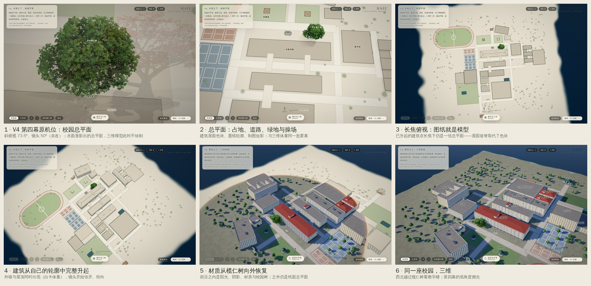
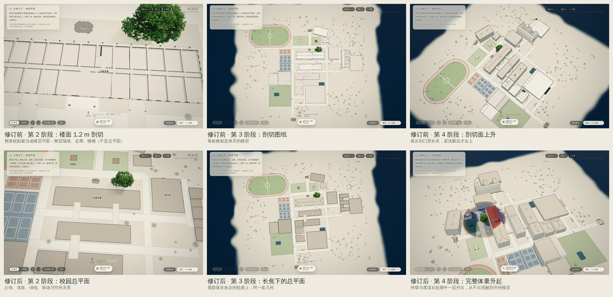
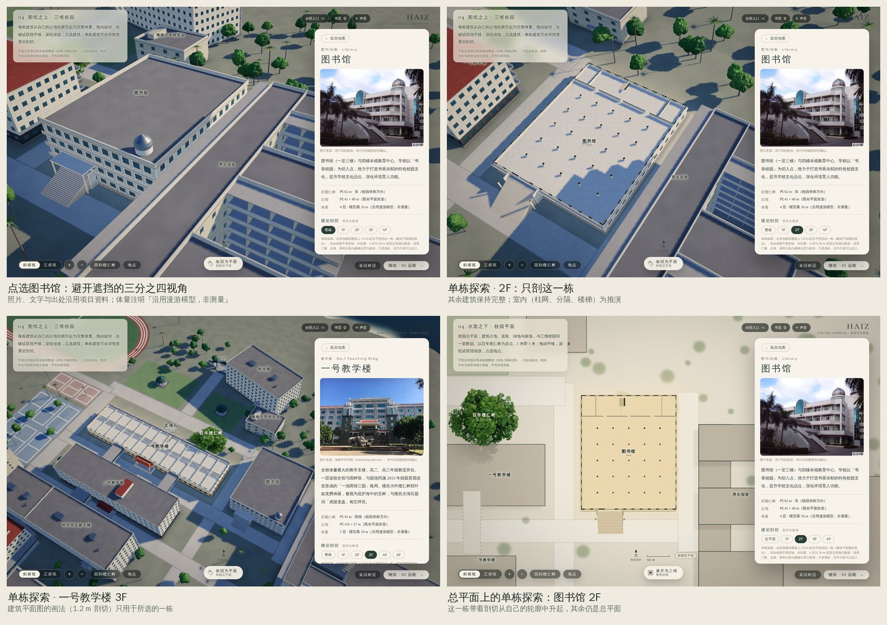
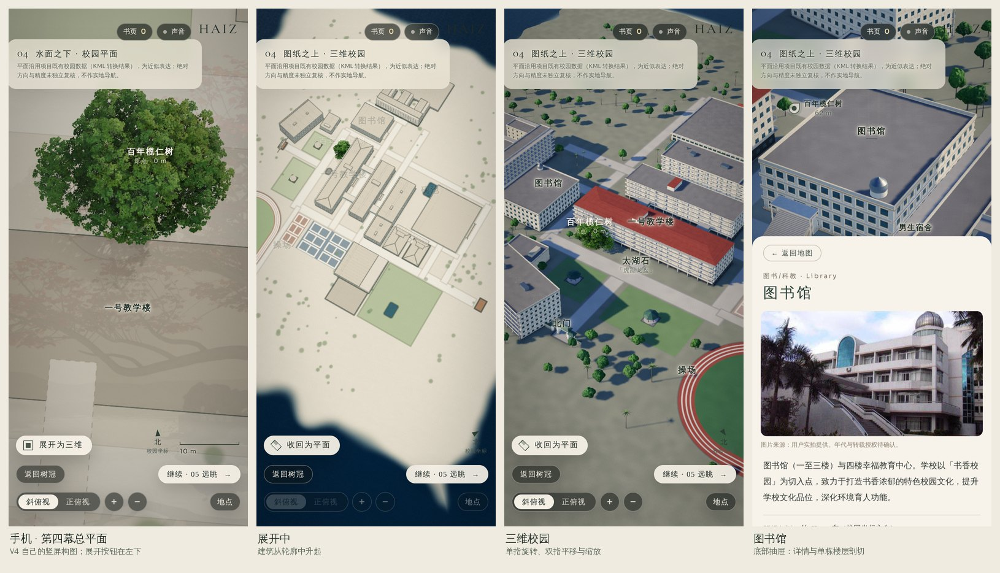

# 第四幕 · 从校园总平面到三维校园（2026-11-06，第一阶段原型）

> 总平面上的每一个建筑轮廓，都是一栋真实体量的「脚印」。按下「展开为三维」，建筑从各自的轮廓里完整地升起——外墙、屋顶，然后是阳光与材质。

本轮是「一座连续世界」的第一阶段：**第四幕真正的 2D → 3D 校园展开**。在已有的水面显影地图（`docs/lanren-campus-map-20261105.md`）之上继续，没有推倒重做：V4 第四幕斜俯瞰机位、水面显影、榄仁树原点与真实坐标、缩放 / 平移 / 正俯视、地点详情、关闭后恢复树与机位、浏览器历史，全部保留。

工作分支 `claude/vibrant-wozniak-rsrttr`，基于 `787b7d3`「Merge continuous spatial world into main」。**没有合并或推送 `main`。** 文中所有图都是 Chromium 中的实时 WebGL 渲染（SwiftShader 软件渲染），不是合成图、视频或示意图。

> **需要你确认的仓库状态：** GitHub 上的 `origin/main` 目前停在 `1fb630c`（11 月 1 日，Pocket 1.5.5），**不包含 `lanren/`（V4 主页）与第四幕地图**；那次「合并到 main」的提交 `787b7d3` 只存在于本工作分支上，没有出现在远端 `main`。本轮按约定没有动 `main`；是否以及何时把 V4 + 第四幕（含本轮）合入 `main`，请你决定。









## 0. 本轮中途的设计修正（按你的意见）

第一版把整座校园在每栋楼的楼面上 1.2 m 处水平剖切，第二阶段露出了教室隔墙、内走廊和楼梯，第三阶段是「掀开屋顶的白模」。这是对 Casa Serra 的机械照搬：**它的 1.2 m 剖切服务于单栋住宅的室内平面图；第四幕看的是整座校园，应当是总平面（Site Plan）。** 现在：

- **二维 = 校园总平面**：建筑占地（屋面色块、墨线轮廓、制图短影）、道路、园林、绿地、操场、球场、水体与校园树冠，由水面着色器从同一套要素绘制（即上一轮已认可的平面语言）。三维模型在这一阶段完全不绘制。
- **二维 → 三维 = 每栋建筑从自己的轮廓里完整升起**：建筑始终以完整体量出现——外墙和屋顶，封闭实体——像一块模型从图纸上自己的切口里被推上来；从不出现「被剖开的楼层」。
- **借鉴的是空间思想，不是剖切高度**：Casa Serra 的核心是「图纸就是长焦镜头下的同一套三维几何」。在第 3 阶段，镜头升高、收窄到接近正俯视的长焦，此时已经升起的建筑在画面里仍然是一张总平面——屋面的坡脊线取代了平面上的色块；镜头张开、降低时，才看出它们一直是体量。
- **1.2 m 水平剖切保留为单栋建筑的可选探索**：在地点详情的「楼层剖切」里，只剖所选的那一栋；在总平面状态下选某一层，只有这一栋带着剖切从自己的轮廓里升起，其余校园仍是总平面。

保留不变：相机路线、统一空间坐标、水面显影、白模过渡、材质从榄仁树向外恢复、校园树、阴影、交互与历史。

## 1. 研究结论：从 Casa Serra 与 Flat to 3D 借什么

- **Casa Serra**（未见源码许可，只研究公开说明与演示，未引入任何代码或资产）：平面是同一栋房子的三维模型经长焦正俯视呈现；滚动让镜头张开、材质从墨线过渡到光照。可借的是**同一套几何、同一个坐标空间、长焦即平面**，不是 1.2 m 这个数字。
- **Flat to 3D**（MIT，资料包内源码）：
  - *02 Section Sweep*：墨线与真实材质按世界坐标逐像素混合。
  - *03 Open Section*：`距离 = 画幅 / tan(视场/2)`，镜头张开时画幅不变——平面「恢复」空间深度。
  - *06 Card Model*：同一份构件表、两种世界（白卡模型与真实房子），由一点向外扩张的球面前沿切换材质与光照。
- **HAIZ 的做法**（自己的实现）：总平面由水面着色器绘制；同一批要素生成三维体量；体量从轮廓中升起（不是缩放拉伸，立面比例始终正确）；06 的前沿改为**从榄仁树树根出发**，与水面显影从树根沿校道流出是同一种叙事；03 的镜头原则用在展开路线上。

## 2. 同一套权威数据：总平面与三维是同一个东西

| | 来源 | 总平面 | 三维 |
|---|---|---|---|
| 位置、尺寸、旋转 | `assets/walk/campus.json` 经 `geo.js` | 水面着色器的 47 个要素 | `campus3d.js` 直接读取同一批要素的矩形 |
| 层数、模型高度 | 同上（`floors`、`size[1]`） | 详情面板 | 每层楼板、总高度严格等于数据高度 |
| 立面事实 | 漫游模型 `world.js` / `atelier.js`（已按实拍校正） | — | 教学楼 -Z 外廊、+Z 门廊与红色坡顶、二号楼平顶女儿墙、楼梯间位置、图书馆圆顶与室外大台阶、北门四柱三间、亭的六柱攒尖顶 |
| **推演** | — | — | 墙厚、开窗节奏；单栋剖切时看到的内走廊、房间分隔、楼梯 |

- `tests/campus-model.cjs` 逐栋断言：18 栋建筑的中心、尺寸、旋转与总平面绘制的要素**完全相同**（误差 < 1e-9 m）；5 条连廊在碰到教学楼的面上停下、男生宿舍三翼从主楼东墙开始（平面矩形本身有重叠，实体不能重叠），都仍在各自矩形之内。
- 每栋楼的顶层恰好结束在数据给出的模型高度；屋顶、女儿墙、设备在其上。
- 详情面板写明「外轮廓、层数、高度沿用项目数据；墙厚、门窗、走廊、房间分隔与楼梯位置为推演，不是测绘，也不代表可以进入」。地图原有的「近似表达，不作实地导航」继续保留。

## 3. 建筑如何从轮廓中升起

- `lanren/map/campus3d.js`（纯函数，Node 可测）：26 栋建筑、约 24.4 万个三角形、13 MB，浏览器中约 0.3 秒生成，不下载任何模型文件。墙有真实厚度、窗洞是真的洞（窗台、窗间墙、过梁、玻璃），屋顶是封闭实体（四坡顶、女儿墙平顶、穹顶、攒尖顶）。
- **升起**：每栋楼有一个「抬升量」（`section.js` 的 `uLift`），从「整栋埋在平面之下」到 0。着色器把整栋楼向下平移这个量，并丢弃平面以下的部分——所以看到的永远是**这栋楼完整的上部**：先是屋顶落在自己的轮廓上，然后外墙沿着轮廓线从平面里升出。不缩放，立面比例和窗的节奏在整个过程中都是真实的。
- 升起的先后沿用水面显影的到达场：一号教学楼与图书馆等离树近的先起，远处的后起（一般错开约 2 秒，交叠进行）。
- 白模阶段：屋面、墙面是纸色卡片，墨线描出每个面的边（由面的局部坐标在着色器里画，不额外绘制线框），与总平面的墨线同一种笔触。
- **单栋剖切（可选）**：剖切高度在建筑自己的坐标里计算，所以被剖的楼升起时剖口随它一起升起；剖到的墙体、楼板以背面涂黑（poché）。时间线上的剖切会**跨过**楼板与台基（剖切面恰好落在楼板里会把整层涂黑），测试逐 13 mm 扫描每栋楼验证。

## 4. 展开：一个进度值 u 控制的、可逆的电影

`lanren/map/unfold.js`（纯函数）。u 从 0 到 1：

1. **相机**：先升高、收窄镜头（约 26°、接近正俯视），整张校园总平面入画；再张开到 36°、俯角降到 37°，转向从西北越过榄仁树看教学楼——第四幕的低角度侧光从左侧照来。路线是 u 的连续函数，没有硬切（Node 测试检查 0.1 % 步长的连续性；浏览器测试记录每一帧，u 单调增长）。
2. **升起**：建筑按到达顺序从轮廓中升起为完整的白卡体量。
3. **材质前沿**：从榄仁树根部扩张的球面，内部是真实材质、阳光、校园自己的阴影、玻璃、红瓦与绿琉璃、真实地面（由总平面同一个绘制函数换成材质色板）与 300 棵校园树；外部仍是纸面总平面；交界处一道暖金色细线。

- **收回为总平面**（按钮、`U`、`Esc`、浏览器后退）是同一部电影倒放：材质退回纸面，建筑沉回各自的轮廓。展开到一半就收回，会沿刚才的路线原路返回；从自己转过的三维视角收回时，回到正下方同一片地面的总平面。
- 已经展开时，「返回树冠」与「继续 · 05」会先收回总平面，再让水面合拢，所以第五幕与 V4 完全一致（测试断言：模型隐藏、水面 `uReveal = 0`）。
- 减少动态效果：整个变化压缩到 0.7 秒，内容不缺。

## 5. 在三维里能做什么

| 操作 | 电脑 | 手机 |
|---|---|---|
| 旋转 | 拖动 | 单指拖动；双指旋转 |
| 平移 | 右键拖动 / Shift 拖动 / 方向键 | 双指拖动 |
| 缩放 | 滚轮（以指针下的地面为中心）/ `+ −` | 双指捏合 |
| 转向 | `Q` `E`（或 `[` `]`）；点「北」回到北向 | 点「北」 |
| 正上方 / 斜看 | 「斜俯视 / 正俯视」按钮、`T` | 同左 |
| 选择建筑 | 点击建筑的立面或屋顶 | 轻触 |
| 单栋逐层剖切 | 详情「楼层剖切」：整栋 / 1F … nF | 同左 |
| 回到总平面 | 「收回为平面」/ `U` / `Esc` / 后退 | 「收回为平面」/ 后退 |

- 选择建筑时，相机寻找**没有其他建筑挡住**的三分之四视角（优先正立面 +Z 与受光一侧），宽屏把建筑放在详情纸页左侧；其余建筑略微退暗；地面上有被选中建筑的淡金色光晕（与总平面同一个着色器）。
- 三维中的地点名标在屋顶上方；被建筑挡住的地面地点（园林、水池）不标。
- 浏览器历史：`#map/oblique|top`（总平面）→ `#map/3d`（三维）→ `#map/3d/<地点>`。深链接 `index.html#map/3d/library` 直接进入三维并打开图书馆；刷新或从漫游页返回时恢复三维状态与视角。

## 6. 与 V4 的关系（保护边界）

- **同一个渲染器、同一棵树、同一台相机。** 三维校园只在第四幕地图打开、且建筑开始升起后才绘制；总平面状态和其余五幕都不绘制它。
- 本轮**没有修改任何 V4 文件**（`lanren/js/*` 未改动）；全部改动在 `lanren/map/` 内：新增 `campus3d.js`、`section.js`、`unfold.js`，修改 `map.js`、`layer.js`、`ui.js`、`view.js`、`geo.js`、`hash.js`、`map.css`。
- 三维模型加载失败时，第四幕自动退回上一轮的总平面（所有新功能隐藏）。
- 光照：用 V4 第四幕自己的太阳。建筑与地面另有一张**校园自己的阴影贴图**（2048²，高画质 4096²，只在建筑升起、剖切或镜头范围改变时重绘），不改 V4 的 PCSS 树影。

## 7. 性能（如实）

- 一次绘制调用画全部建筑（约 24.4 万三角形），一次画地面，两次画实例化的 300 棵校园树；阴影贴图一次深度绘制。
- 总平面状态下三维模型不绘制；白模阶段用不计算光照的「墨线材质」，材质前沿开始后才切换到受光材质；三维着色器在打开地图时就在后台预编译（`compileAsync`），避免第一次展开时卡顿。
- **没有在真实手机或独立显卡上测过帧率。** 本机只有 SwiftShader（CPU 软件渲染），1280×720 低画质约 1 帧/秒，只能证明流程与画面。展开过程中每帧重绘校园阴影是最重的部分；如真机测量需要，可以降低重绘频率，而不是删掉阴影。

## 8. 验证

```
node tests/campus-model.cjs              # 模型与总平面同源、实体封闭、层数高度、剖切跨层、时间线（6 组）
node tests/campus-unfold-browser.cjs     # 真实浏览器中的完整路线（见 tests/campus-unfold-browser-results.json）
node tests/campus-map.cjs                # 上一轮的坐标、显影、相机数学
node tests/campus-map-browser.cjs        # 上一轮的 17 项浏览器检查
```

结果（本机 Chromium + SwiftShader；`tests/*-results.json` 是本轮代码上的完整运行记录）：

- `campus-model.cjs`：6 组全部通过。
  - model: 26 buildings, 488868 vertices, 244068 triangles, 13.2 MB, built in 273 ms; all finite, indices and ids in range, unit normals
  - one source with the plan: 18 buildings share centre, size and rotation with the features the plan shader draws (Δ < 1e-9 m); bridges and dormitory wings are trimmed inside their own rectangles; every vertex stays on its footprint (porches, galleries, the library's stair excepted by a few metres) and within its height
  - storeys and heights: every building has the data's storeys; the top storey ends exactly at the data's model height; roofs, parapets and plant sit above it
  - closed solids: beimen, yihao, library, fengqitang_ting, corr_w12, dorm_m, yishu have no open edge (every directed edge has its reverse)
  - cuts: swept through every building in 13 mm steps, a timeline cut never rests inside its plinth or a floor slab (which would fill the whole plan with ink); the plan's own 1.2 m cut is never moved
  - timeline: every building rises 0 → 1 monotonically (near the tree first); the material front only grows and ends without its seam; the camera starts at the plan camera and ends at the campus view, continuous at 0.1 % steps (worst 3.68); a fold starts at the 3D view and ends in the plan look over the same ground
- `campus-unfold-browser.cjs`：11 项全部通过，没有页面错误或 WebGL 错误。
  - the plan is a site plan: all 26 buildings of the model wait whole beneath it (nothing of the model drawn, no storey cut); 18 of them share position, size and rotation with the footprints the plan draws (Δ < 1e-6 m)
  - 展开为三维 (real click): 7 frames, u rises monotonically 0 → 1, the camera leaves from the plan's own position and travels 344 m along one continuous path (no cut); every building has risen out of its own footprint whole (walls and roof, no cut); material front 459 m from the tree; hash #map/3d
  - in 3D a drag turns the campus (yaw 34° → 68°, target kept), a right-drag pans, the wheel zooms (135 → 52 m) and the page stays at 04
  - a real tap on 图书馆 in 3D opens its sheet (#map/3d/library); 2F cuts it 1.2 m above its second floor (y 4.69) while the rest stands whole; the sheet states the interior is inferred
  - Esc closes the sheet (building whole again); 收回为平面 folds the campus back into the site plan: every building sinks whole into its footprint, #map/oblique, the plan look of chapter 04
  - browser Forward unfolds the campus again, Back folds it: the same film both ways
  - on the site plan, a storey is an optional look at one building: 图书馆 2F rises out of its footprint already cut at its second floor while the rest stays a site plan; 总平面 sends it back
  - from the campus in 3D, 继续 · 05 folds it back, the water closes and the walk continues to 05; the model is hidden and V4's water untouched (#days)
  - the deep link #map/3d/library opens the campus in 3D with the library's sheet; Back steps down: sheet → 3D → plan
  - reduced motion: the change is 0.7 s of animation by design and completes (43.8 s of wall time here, at about one software-rendered frame per second); nothing is skipped
  - phone 390×844: 展开为三维 sits clear of the other controls; a tap unfolds the campus; a tap on 图书馆 opens its sheet (library); no horizontal overflow
- `campus-map-browser.cjs`（上一轮的路线）：在本轮代码上 17 项全部通过；`campus-map.cjs`、`lanren.cjs`（V4 六幕）、`open-assets.cjs` 通过。
- 没有运行：`tests/site.cjs` 需要本容器未安装的 `linkedom`（安装仓库锁定的依赖会替换预装的 Playwright 浏览器），与本轮改动无关。

**已知、但不是本轮引入的问题：** 第四幕平面右侧有一个淡粉色的榄仁树「残影」（像旧的水面倒影）。在本轮改动之前的 `787b7d3` 上用同一机位截图，残影完全相同，所以不是回归；推测是深链接直达第四幕前，水面反射贴图里留下的第一幕红叶画面。留待单独修正，本轮没有改 V4 的水面。

## 9. 下一步（按价值排序）

1. **04 → 05 的连续三维**（设计已确认、本轮未做）：已展开时，滚动前往第五幕不再收回总平面，而是让 V4 第五幕的远眺镜头看向真实的三维校园；仍在总平面状态时，在 04→05 的镜头运动中让建筑随滚动升起。需要先和你确认第五幕远景里「泻湖与远山」与「三维校园」的构图关系——这会改变 V4 第五幕的画面，本轮刻意没有动。
2. 真机测量（iPhone Safari、中端 Android Chrome）：展开过程的帧时间、内存、发热；据测量决定阴影重绘频率与几何分块。
3. 立面与材质深化：窗框与玻璃、屋面瓦的尺度、立面线脚，参照建筑观察手册的实拍；校园树种的树形差异。
4. 室内只在有资料的地方做：若学校提供平面图，替换单栋剖切中的推演分隔。
5. 第一人称漫游与这套模型的统一（第三阶段）：漫游使用同一个 r170 校园模型，从第四幕选中的建筑出发。

## 10. 预览

```bash
git fetch origin claude/vibrant-wozniak-rsrttr && git checkout claude/vibrant-wozniak-rsrttr
python3 -m http.server 8080
```

打开 `http://localhost:8080/index.html`，滚到第四幕停留，水面显出总平面后点「展开为三维」；或直接打开 `http://localhost:8080/index.html#map/3d`、`#map/3d/library`。`?quality=high` 用高画质，`?nomap` 关闭地图（纯 V4）。
