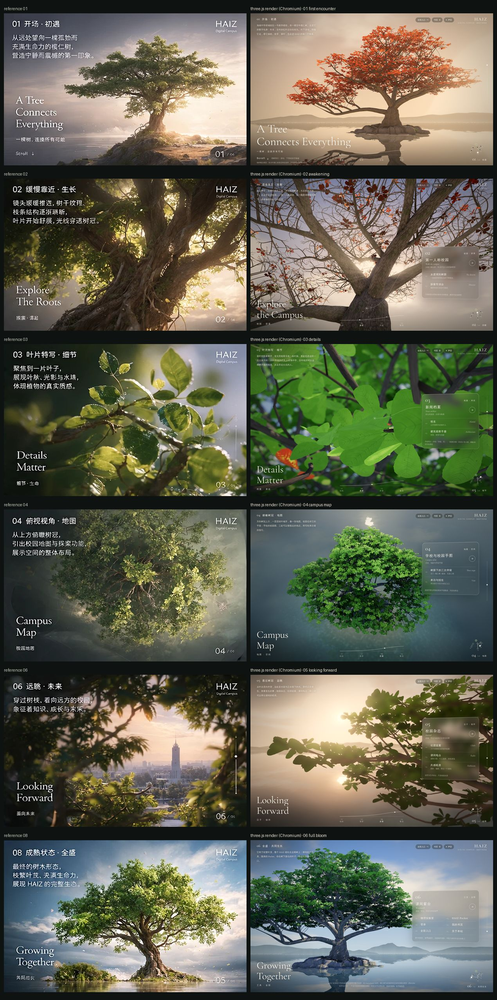
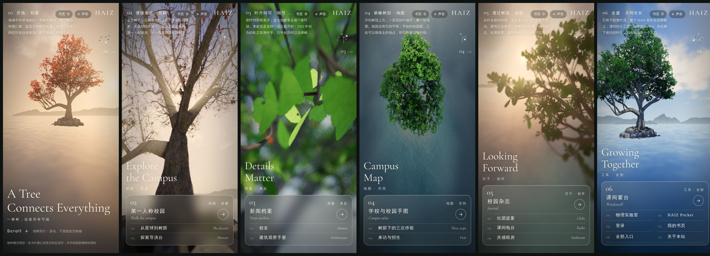

# 主页 v3：活的榄仁树（2026-11-04）

取代 [v2 记录](lanren-homepage-v2-20261104.md) 中的树、镜头与界面。`index.html` 仍是这棵树；原降落镜头在 `descent.html`，杂志首页在 `journal.html`，所有已有页面、书页（接住落叶）、声音、全站搜索、帷幕转场与「返回原视角」照常可用。

验收依据是用户提供的九宫格视觉参考。下图左列为参考，右列为本页在 Chromium 中的实时 Three.js 渲染（1440×900，2× 像素密度，SwiftShader 软件渲染），不是离线渲染：



手机（390×844，低画质档）：



## 针对上一版问题的改动

| 上一版问题 | v3 做法 |
|---|---|
| 树冠扁平，像盆景 | 树冠改为分层的穹顶：枝叶团聚成「叶团」，叶团再聚成挂在每根主枝末端的「叶块」，层与层之间露出天空 |
| 分枝过于规律 | 细枝用空间殖民算法（Runions 2007）从主枝长向叶团，每一根都不同；半径按管道模型，分叉处平滑膨大 |
| 叶片材质单薄 | 叶脉感知的透光、逆光前向散射（看向太阳时叶片发亮）、叶团体积法线、树冠遮蔽；近景用全分辨率叶片图集 |
| 雾太重 | 雾密度降到原来的约 1/5；远处换成自然岛屿与山影，用空气透视而不是浓雾拉开层次 |
| 树在部分机位太小 | 六个镜头逐一构图：开场与终幕树占画面高度约 60–75% |
| 排版遮挡主体 | 文字退到四角（参考图的版式秩序），链接放进钉在场景里的玻璃面板，手机端用镜头平移把树抬到画面上部 |

## 美术迭代（第二轮）

按用户提供的创意指导技能包（frontend-design、design-taste、impeccable 的评审方法）做了一轮「指出三个最影响成品的问题，再逐一解决」，全部用浏览器实时截图验收：

| 问题 | 解决 |
|---|---|
| 树基像 CG 模型：直筒树干插在一圈相同的「面包形」石头里，根像细绳，小岛光秃 | 七条板根从带纵沟的树干下部展开，贴着岩石的起伏向外延伸、分叉；树干纵沟与板根方位对齐，粗枝有大尺度瘤结；岩石改为高低错落、带节理裂缝的风化花岗岩（大块、中块、水边卵石），颜色压暗，让树成为主角；土壤上长出常绿灌木 |
| 树冠像散落的纸片：叶子同一大小、同一种绿，边缘像贴纸，下方露出很多细长的「铁丝」枝 | 叶簇内小叶大叶分明；每个叶团有自己的色调（偏黄或偏蓝），向阳面略浅；叶面有更锐利的阳光反光；远处叶片不再整体放大；结构枝按管道模型加粗（指数 2.3 → 2.12） |
| 全盛镜头的光缺少通透感 | 太阳改为从右前方侧照，天空更深、云更白，高光更暖，整体曝光与饱和度提高 |

另外加了三处让画面「活」起来的细节，都很克制：
- **阵风翻叶**：风的前沿在树冠上滚过时，叶片沿中脉翻转，露出浅色的叶背，一波一波掠过树冠。
- **开场落叶**：冬末的开场里，去年的红叶不时脱离枝头，飘落到水面。
- **逆光中的微尘**：树下空气里的尘埃和花粉，只在面向太阳时才被照亮（苏醒、远眺两个逆光镜头里可见），平光下看不见。

俯瞰镜头改为更斜的航拍角度和低角度逆光，能看见树冠层次与水面的太阳反光。

为保证六个镜头的构图不变，小岛与板根使用独立的随机数流，树本身与上一轮完全相同（35580 个枝节点、11514 个叶簇）。

## 树：Blender 制作流程（`scripts/lanren/build_tree.py`）

1. **主干与主枝（美术设定）**：短而粗、带板根的主干在约 3 m 处分出五根共主干的主枝，外加一根低而长、下探又昂起的横枝。每根主枝先斜升、后近水平伸展、末端上翘（榄仁树的分层习性），带噪声弯曲。
2. **树冠包络**：顶部略平的不对称穹顶（朝长横枝一侧更宽）。每根主枝末端生成一个「叶块」，叶团用泊松盘采样分布在叶块内并偏向外壳和若干层高，叶块之间留空。
3. **空间殖民**：约 1.4 万个吸引点让细枝从主枝长出；限制垂直方向，避免「吊线」；去掉直接长在粗枝上的短桩；之后在每个梢端加一到两级合轴短枝扇（榄仁树叶簇生枝顶）。
4. **生长数据**：每个顶点写入出生时间与环半径（TEXCOORD_1）。梢端最后 0.3–1 m 是当季新梢，滚动时从梢端伸出、随后加粗。叶簇记录萌发时间；去年的红叶挂在新梢起点，带各自的脱落时间。
5. **烘焙与导出**：Cycles 把环境光遮蔽烘进顶点色；叶簇的天空遮蔽用体素光线步进计算；gltfpack（meshopt）压缩。
6. **可复现**：`mathutils.noise.noise_vector` 依赖会话随机状态，曾让每次构建的树都不同；现在用 `noise.seed_set` 固定。树种子 2611（可用 `TREE_SEED` 试其他种子，`--skeleton` 只出三视图预览）。所有可调参数集中在脚本顶部的 `P` 字典。

产物：树皮与板根 26 万顶点（4.6 MB），11514 个叶簇（2924 个带去年红叶），高画质约 11.7 万片叶子；花岗岩小岛 2.5 万顶点。

**资产检查**（用户提供的 `blender-asset-qa` 技能，render 档）：小岛通过。树皮报告「共面重叠」：合轴短枝扇在同一节点、同一半径起始，改为侧枝首环略小于母枝后由 286 对降到 195 对；加入板根后为 216 对（约 47 万三角形中，占 0.05%），都在 1–2 cm 粗的同节点兄弟短枝起点与侧根起点，网页尺度不可见，记为已接受；没有法线朝内的部件（板根的绕向问题已修正）。其余警告属有意设计：可平铺树皮 UV 重叠、梢端封口零面积 UV、管口开放（藏在母枝内）、主干沉入小岛低于 z=0、小岛为程序化着色无 UV。

纹理（`scripts/lanren/textures.py`，全部由数学生成）：新的树皮为纵向裂纹分隔的纤维状板块，带地衣与苔藓；叶片图集叶脉更收敛，导出全分辨率（近景）与半分辨率（低画质）两版。

## 六个镜头

同一棵树、同一个相机，一条样条曲线串起六个停留点；每个镜头有自己的焦距、景深与光线。朝向按偏航/俯仰插值，所以大角度转身是平滑摇镜。

| 镜头 | 参考 | 构图 | 生长 | 板块（真实页面） |
|---|---|---|---|---|
| 01 开场 · 初遇 | 01 | 远景低机位，黎明逆光，冬末满树红叶 | 0 | 开场（Scroll） |
| 02 缓慢靠近 · 苏醒 | 02 | 贴近树干仰望主枝，光束穿过枝杈，24 mm 广角 | 0.31 | 第一人称校园、从星球到树荫、探索导演台 |
| 03 叶片特写 · 细节 | 03 | 85 mm 微距，从下方看逆光的新叶，背景散景 | 0.5 | 新闻档案、校友、建筑观察手册 |
| 04 俯瞰树冠 · 地图 | 04 | 树冠上方的航拍视角，薄雾笼罩的浅水礁湖 | 0.7 | 学校与校园手图（`about.html#campusAtlas`）、树荫下的三次停留、来访与招生 |
| 05 透过树冠 · 远眺 | 06 | 树冠里向外望，叶丛框住远方的水面、山影与落日 | 0.86 | 校园杂志、社团提案、课间电台、共感暗房 |
| 06 全盛 · 共同生长 | 08 | 远景，蓝天白云，侧光下的完整树冠与倒影 | 1 | 课间窗台、物理实验室、HAIZ Pocket、登录、我的书页、全部入口、关于本站 |

- 参考 06 中的城市楼房只是层次示意：这里换成远处的岛屿山影，不出现建筑。
- 镜头之间的过渡都经过逐帧检查：01→02 推近后抬头，02→03 沿主枝抬头看进树冠，03→04 升到树冠上方，04→05 从侧面落进叶丛，05→06 退出树冠、转身，树从画面一侧进入。
- 太阳在世界坐标中移动（像一段延时），而不是绑在相机上。
- 03 的微距会在加载时对准一处真实的半展开新叶；排名第 5 的叶簇是为当前树挑选的构图（`?study=k` 可预览其他候选）。

## 生长（参考 07）

滚动进度驱动生长值 g（0 → 1），所有变化都是结构性的：

1. **g = 0 冬末**：去年的叶子转红，挂在每根新梢的起点，树冠是一片稀疏的红。
2. **g ≈ 0.03–0.34 落叶**：每片红叶有自己的脱落时间，越过即离枝，翻转飘落到岩石或水面；倒着滚动时叶子回到枝上。
3. **g ≈ 0.1–0.4 抽梢**：新梢从梢端伸出（未出生的环收拢到枝轴），随后加粗。
4. **g ≈ 0.2–0.62 展叶**：古铜色的芽先出现，对折、直立，再打开、放平、长到全尺寸，颜色经嫩黄绿转为深绿。
5. **g = 1 繁茂**：所有叶片成熟；苔藓与草也随生长转绿。

底部的生长线显示四个阶段（枯枝 · 新芽 · 舒展 · 繁茂），圆点沿曲线随 g 移动。

## 界面

- 版式参照参考图的秩序：左上为章节号与中文标题、两三行说明；右上为 HAIZ 标识与工具（全部入口、书页、声音）；左下为英文展示标题与中文副题；右下为站号「02 / 06」。
- **玻璃面板（参考 05）**：每个板块的真实入口放在一块半透明玻璃面板里，面板钉在场景中的一个锚点旁（树杈、微距叶簇、树冠、远方的岛、树），有引线、轻微透视倾斜，镜头移动时随场景跟随，停稳后完全静止，链接可以稳定点击。首要入口占面板首行，带圆形箭头。
- **路径导航（参考 09）**：右下角是相机真实路径的俯视图（径向对数缩放，让远景和近景机位都看得清），六个站点可点击，亮点是此刻相机的位置。
- 右侧细竖线显示整段滚动进度。
- **手机**：竖屏使用镜头平移（不是俯仰），把树抬到画面上半部；文字和链接收拢在底部的玻璃面板里；路径导航移到右上。

## 渲染（Three.js r170，自写着色器）

- 叶片：独立实例（高 / 中 / 低 = 1.0 / 0.7 / 0.45 密度），生长、风、触碰在顶点着色器中；叶团体积法线；树冠遮蔽（烘焙）与外壳深度；叶脉感知透光；逆光前向散射；远处叶片略微放大以保持覆盖（不影响阴影）。
- 天空：带自阴影的程序化云层；远处岛屿山影由大气通道按距离雾化。
- 水面：`Reflector` 倒影，小岛周围有浅水礁湖与焦散（俯视时可见）。
- 后期：场景渲染到 MSAA + 深度纹理 → 大气（高度雾、只在太阳周围采样的光束）→ 景深（36 个随机旋转采样）→ 辉光 → ACES → 饱和度/对比度/分离色调/暗角/颗粒。HDR 链路对 NaN 有保护（一处背面叶片法线曾在俯视时产生 NaN，被辉光放大成黑块）。
- 画质档：阴影图在中/低档每 2/3 帧刷新；帧时持续过长时自动降低像素比。不支持 WebGL2、开启省流量或加 `?static` 时，主页成为可读的静态页，全部 18 个入口可用；无 JavaScript 时同样如此。

## 验证

- `node tests/lanren.cjs`：生长单调；相机路径连续（每 0.5% 进度 ≤ 0.54 m）、始终在水面以上、不穿过树干、六个镜头精确；光照参数有限且雾保持轻薄；18 个入口存在且与生成的 HTML 一致；Blender 资产的生长数据、叶团、遮蔽与去年红叶。
- `node tests/home-browser.cjs`（Chromium + SwiftShader）：原生滚动进入 03 且生长值正确、路径导航站点跳到 05、End 键到 06 且满叶、接住飘落的叶子并夹进书页、点击面板条目经帷幕跳转、返回后回到原视角且书页仍在、静态回退列出全部 18 个入口、390×844 手机无横向溢出。
- `node tests/site.cjs` 通过（主页链接检查接受同页锚点，如 `about.html#campusAtlas`）。
- **未在真实 GPU 与真机上测帧率。** 软件渲染只代表画面，不代表流畅度。高画质（约 11.6 万片叶 + 倒影 + 4096 阴影 + 后期）面向桌面独显；集成显卡与手机默认中 / 低画质，实际帧率需真机确认。
- 既有 `tests/cinematic-runtime.cjs` 在未改动的主干上同样失败，与本次无关（v2 记录已注明）。

## 来源与边界

- 榄仁树形态（分层平展侧枝、叶簇生枝顶、落叶前转红、新叶带红铜色）依植物学资料；本场景是依这些特征创作的概念模型，不是校园那棵树的测绘，页面上同样标注。
- 「百年校庆报道以百年榄仁树开篇」：《海南日报》2023-10-30（项目既有资料，本会话未重新核对原文）。
- 岩岛、远山、光照与生长节奏都是艺术表达。

## 维护

```bash
python3 scripts/lanren/textures.py                          # 叶片、树皮纹理
python3 scripts/lanren/build_tree.py --skeleton             # 只看三视图（几秒）
python3 scripts/lanren/build_tree.py                        # 树、岛、叶簇（PyPI bpy 或 blender -b --python）
./scripts/lanren/pack.sh                                    # gltfpack 压缩
node scripts/lanren/build-home.mjs                          # 由 chapters.js 生成 index.html
node tests/lanren.cjs && node tests/home-browser.cjs
VW=1440 VH=900 DSF=2 node tests/lanren-capture.cjs tests/artifacts/v3 0 1 2 3 4 5   # 六个镜头
HIDEUI=1 node tests/lanren-capture.cjs tests/artifacts/path P0.5 P1.5 P2.5 P3.5 P4.5    # 过渡中间帧
HIDEUI=1 node tests/lanren-capture.cjs tests/artifacts/look "L,-6.3,5.5,7.4,-42,4.5,20,4,54"   # 自定机位：eye,look,p,fov
```

镜头、光照、生长与界面锚点都在 `lanren/js/chapters.js`（`KEYS`、`LIGHT`、`GROW`、`CHAPTERS[].ui`）；`?quality=low|medium|high` 固定画质，`?static` 查看静态页。
