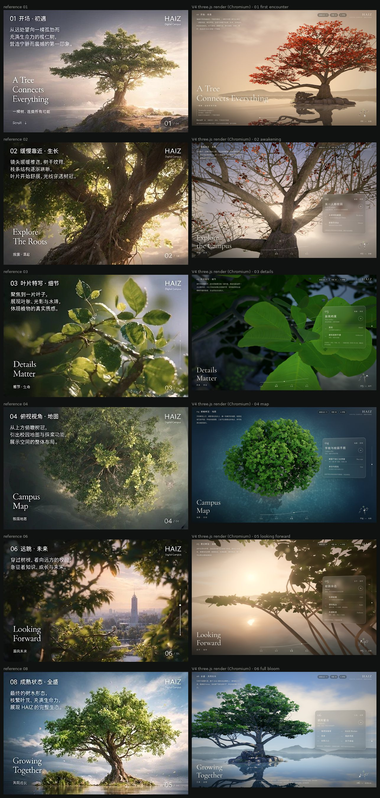
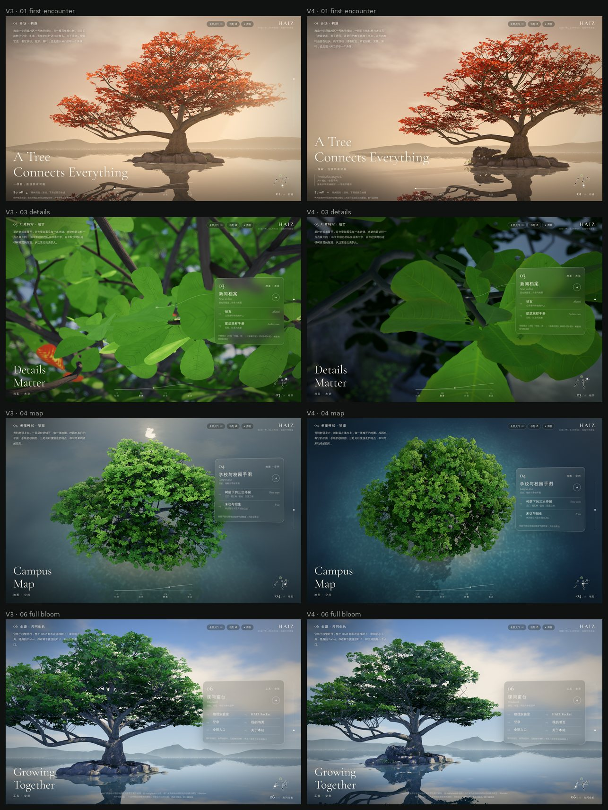
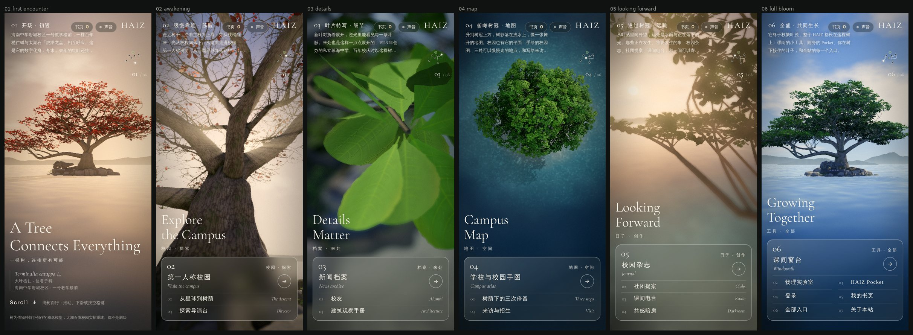
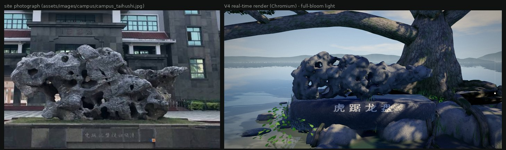
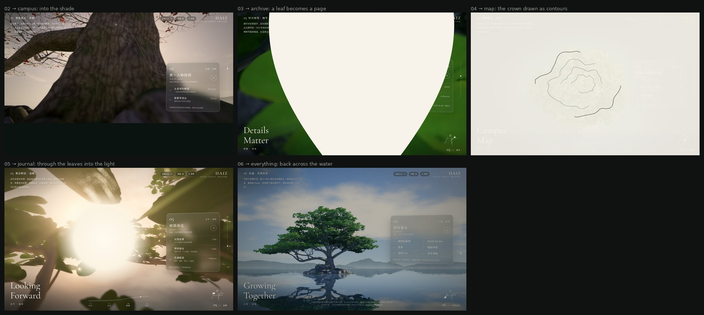

# 主页 V4：视觉艺术深化（2026-11-04）

本轮只提高画面，不加功能。页面结构、18 个入口、滚动 / 键盘 / 路径导航、书页（接住落叶）、声音、全站搜索、静态回退与 [v3](lanren-homepage-v3-20261104.md) 相同；生长、界面与渲染管线的说明仍以 v3 为准，本文只记 V4 改了什么、为什么。工作在分支 `claude/beautiful-wozniak-zldp2a` 上完成，没有合并 `main`。

所有图片都是 Chromium 中的实时 Three.js 渲染（SwiftShader 软件渲染，不是离线渲染）。左列为九宫格参考，右列为 V4（1440×900，2× 像素密度）：



V3 → V4（同一机位的四个镜头）：



手机（390×844，低画质档）的六个镜头单独构图：



## 改了什么

| 问题 | V4 做法 |
|---|---|
| 叶片不像真叶，第 3 个微距镜头最明显 | 叶片纹理按榄仁叶的解剖结构重画：倒卵形叶片，互生、间距不等的侧脉在叶缘前弯拱连成边脉，侧脉之间是梯状细脉和网眼，叶面在脉间微微鼓起，逐片有色调差，个别叶片有虫孔。微距镜头里的那一簇换成「主角叶」：更细的网格、向上微卷、叶缘起伏、沿中脉扭转。新叶是更深、更亮的绿，叶缘带一点铜红；透过叶片的光偏黄、逐片不同，并在叶脉处被挡住 |
| 树仍像 CG：分枝规整，轮廓是整齐的半球 | 主枝在合轴分枝处像肘一样转折，细枝偶尔折出角度（参照校园那棵树的照片 `assets/images/web/lanshu-1600.jpg`）；树冠留出透光的「天窗」，少数叶团突出穹顶之外。树冠下的树皮受叶片反射的暖色环境光，不再泛天空蓝 |
| 光与材质缺层次 | 树冠内部是叶片反射的暖绿，外层是阳光；叶片透光只在逆光处出现，正面保留反光。太湖石是深灰的石灰岩，基座是更暗的抛光花岗岩，与小岛上风化的花岗岩区分开。没有额外加雾、辉光或粒子 |
| 俯瞰镜头像一团绿球 | 从正上方看，浅水下的沙底透出来（短光程，只对陡视角生效，低机位仍是暗色镜面）；太阳改到画面右上方，树冠的影子斜落在左下方的浅水上，树冠的起伏按「光从上方来」的习惯读出凸起，像一张航拍地图 |
| 手机上的树又高又窄 | 这是一个缺陷：竖屏用的镜头平移（`setViewOffset`）会把相机的宽高比改成 1 : 1.32，画面因此被横向压缩约 2.2 倍，此前所有手机截图里的树都偏瘦长。修正后画面保持屏幕的真实比例（浏览器测试检查投影矩阵）；开场、俯瞰、全盛三个手机镜头按真实比例重新构图 |
| 校园身份不够明确，又不能放粗糙的建筑模型 | 不建楼。加入一号教学楼前的太湖石（见下节）；开场写明「海南中学府城校区一号教学楼前，一棵百年榄仁树与太湖石『虎踞龙盘』相互呼应」，并配一张标本签：*Terminalia catappa* L. · 大叶榄仁 · 使君子科 |

## 太湖石：依校园实拍重建

依据是用户实拍的 `assets/images/campus/campus_taihushi.jpg`，没有凭想象建模。从照片里读出的特征：

- 一块**横卧**的长石，长度约为高度的 2.5 倍，而不是常见的竖立峰石；
- 左边三分之二是厚重的石块，顶部破碎但大致平齐；右边逐渐变薄，成为一块抬离基座、尖端向右伸出的石板；
- 深灰色的石灰岩（项目的校园资料也记为「宽扁横卧、多孔洞、深灰黑」），表面是「皱、漏、透」：棱角分明的褶皱、贯通的孔洞，底部有几个深的洞口；
- 石下是**低矮的暗色基座**，正面横刻一行字（照片里看不清）。项目的校园资料记这块石的题词为「虎踞龙盘」，这里把这四个字刻在基座正面。

在 Blender 中按照片的轮廓逐段给出高度、底边和厚度，用正元球连成一整块，再用 75 个负元球挖出洞口和蜂窝状孔洞（部分贯通）；表面用脊状噪声和分级的台面位移做出棱角与蚀坑，Cycles 烘焙遮蔽让孔洞变暗。第一版用一排圆润的团块拼成，近看像一串面团，和照片差得远，这一版重做了。下图左为实拍，右为浏览器中的实时渲染（不同光线、不同环境，只比较形体）：



尺寸（约 3.6 × 1.4 × 1.2 m）按照片比例估计，**不是测量值**；刻字使用访问者设备上的楷体（无楷体时用宋体 / 衬线体），所以字形并非原石的书法。石头放在榄仁树长枝的下方，开场与全盛两个远景里都能看见树与石的关系。

## 从树到各个功能页：转场

点击面板里的入口时，不用统一的淡出，而是让这一节的树「把人带进去」。每种转场都取自树本身已有的东西，最后落到目标页的底色上（深色页面用深色帷幕）：

| 板块 | 去往 | 转场 | 想法 |
|---|---|---|---|
| 02 苏醒 | 第一人称校园、从星球到树荫、探索导演台 | **沉入树荫**：相机沿树干下沉，望向树脚的阴影，帷幕从下往上合拢 | 校园探索从「走到树下」开始 |
| 03 细节 | 新闻档案、校友、建筑观察手册 | **一片叶成为一页**：从面板锚定的那片新叶的位置，一张叶形的纸长大，铺满屏幕 | 档案像夹在书里的叶子，与「书页」接住落叶的玩法同源 |
| 04 地图 | 学校与校园手图、三次停留、来访与招生 | **树冠化为等高线**：相机升高、对准树冠中心向下看，纸面慢慢浮起，同时用树冠的真实轮廓（由叶簇投影算出）在渐隐的树冠上一圈圈画出等高线 | 俯瞰的树冠本身就是一张平面图 |
| 05 远眺 | 校园杂志、社团提案、课间电台、共感暗房 | **穿过叶隙进入光**：相机向前穿过叶隙，曝光升高，暖光从太阳方向扩散成页面底色 | 「将要发生的事」在光里 |
| 06 全盛 | 课间窗台、实验室、Pocket、登录、书页、全部入口、关于 | **退后过水面**：相机后退、升高，整棵树变小，画面淡出 | 从整体走进目录 |

开启「减少动态效果」时直接跳转；从目标页返回（浏览器往返缓存）时，帷幕与相机复位到原来的镜头。

下图为五种转场的中段定格：在浏览器里点击入口后暂停 GSAP 时间线，把转场推进到约 0.95–1.5 秒，并把相机推进同样的时间（软件渲染跑不出实时动画，所以只能逐帧取样）：



## 六个镜头

| 镜头 | 桌面 | 手机 |
|---|---|---|
| 01 开场 · 初遇 | 低机位远景，树偏右，长枝伸向左边的标题；太湖石在长枝下方 | 单独构图：退远到约 42 m，整棵树横跨屏幕宽度，树与倒影在上半部，标题与标本签落在水面上 |
| 02 缓慢靠近 · 苏醒 | 贴近树干仰望，光从主枝的分叉间透出，枝头挂着去年的红叶 | 沿用桌面机位，视角按屏幕加宽，镜头平移把树干留在上半部 |
| 03 叶片特写 · 细节 | 看进树冠的阴影里，主角叶在掠射光中显出叶脉与微鼓的叶面，背景是树枝与散景 | 沿用桌面机位，叶簇在上半部 |
| 04 俯瞰树冠 · 地图 | 正上方略斜的航拍，浅水沙底与斜落的树影 | 单独构图：升到约 70 m，透视更弱、更像平面图，整个树冠与树影在上半部 |
| 05 透过树冠 · 远眺 | 叶丛与枝框住水面上的落日 | 沿用桌面机位 |
| 06 全盛 · 共同生长 | 完整的树、太湖石与倒影，蓝天白云 | 单独构图：整棵树与太湖石在上半部，倒影延伸到底部的玻璃面板后面 |

## 验证

- `node tests/lanren.cjs`：生长单调；相机路径连续（每 0.5% 进度 ≤ 0.6 m；手机路径 ≤ 1.3 m，因为俯瞰升得更高）、在水面以上、不穿过树干、六个镜头精确；光照参数有限；18 个入口与生成的 HTML 一致；Blender 资产：33774 个枝节点、192 个叶团、10947 个叶簇（其中 2789 个带去年的红叶）。
- `node tests/home-browser.cjs`（Chromium + SwiftShader）：滚动进入 03、路径导航跳到 05、End 键到 06、接住落叶夹进书页、点击入口经转场跳转后返回原视角、静态回退列出 18 个入口、390×844 无横向溢出且画面比例与屏幕一致。
- `node tests/site.cjs` 通过。
- **没有在真实 GPU 与真机上测过帧率。** 软件渲染只能说明画面，不能说明流畅度。高画质（约 11.1 万片叶 + 倒影 + 阴影 + 后期）面向桌面独显，集成显卡和手机默认用中 / 低画质，实际帧率需要真机确认。
- 转场只做了定格检查，没有在真实设备上看连续播放的节奏。

## 来源与边界

- 树是依大叶榄仁的物种特征创作的概念模型，不是校园那棵树的测绘；太湖石依校园实拍重建，尺寸为估计。页面上同样注明。
- 太湖石只有一张正面照片可依，背面和顶面是推断的。如果能补拍一组绕石一周的照片（20–40 张，阴天、每张重叠一半以上），可以用摄影测量重建真实的形体。
- 叶片解剖（叶形、侧脉在叶缘前联结、叶面微鼓、新叶带红铜色）依植物学资料；具体纹理是程序生成的。

## 维护

```bash
python3 scripts/lanren/textures.py                 # 叶片、树皮纹理
python3 scripts/lanren/build_tree.py               # 树、岛、太湖石、叶簇（PyPI bpy 或 blender -b --python）
./scripts/lanren/pack.sh                           # gltfpack 压缩
node scripts/lanren/build-home.mjs                  # 由 chapters.js 生成 index.html
node tests/lanren.cjs && node tests/home-browser.cjs
VW=1440 VH=900 DSF=2 node tests/lanren-capture.cjs tests/artifacts/v4 0 1 2 3 4 5     # 六个镜头
VW=390 VH=844 DSF=2 Q=low node tests/lanren-capture.cjs tests/artifacts/phone 0 1 2 3 4 5
node tests/lanren-exits.cjs tests/artifacts/exits 1@1.0 2@1.1 3@1.5 4@0.95 5@1.4   # 转场中段定格：板块@秒
```
