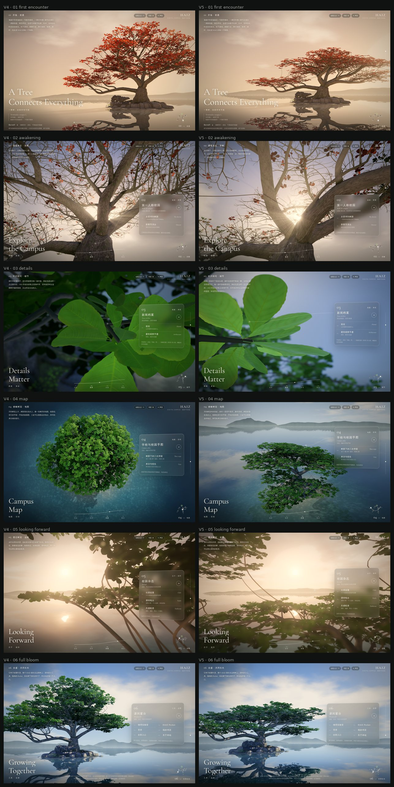
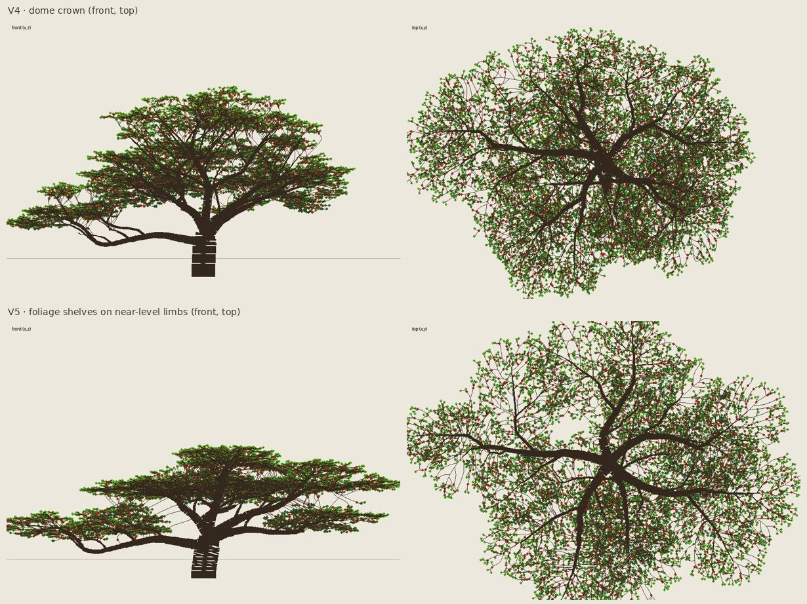
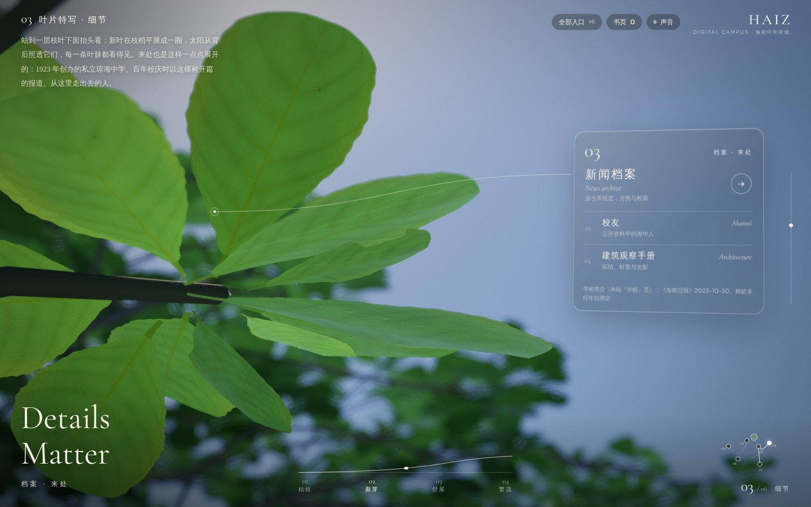
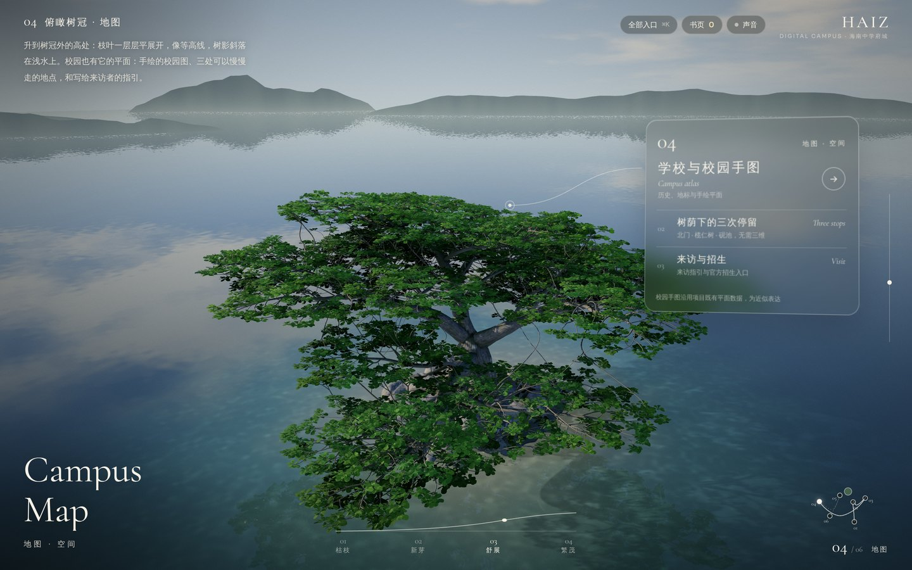
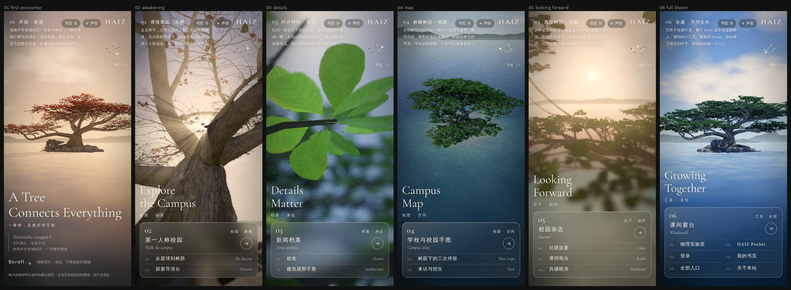

# 主页 V5：从技术作品到自然影像（2026-11-05）

V5 是一轮美术重构，不加功能。页面结构、18 个入口、滚动 / 键盘 / 路径导航、书页、声音、各板块的转场、静态回退都与 [V4](lanren-homepage-v4-20261104.md) 相同。工作在分支 `claude/beautiful-wozniak-zldp2a` 上完成，没有合并 `main`。

所有图片都是 Chromium 中的实时 Three.js 渲染（SwiftShader 软件渲染，1440×900，2× 像素密度），不是离线渲染。



## 先审视 V4

动手之前，逐张看了 V4 的六个画面，并和校园那棵树的照片（`assets/images/web/lanshu-1600.jpg`）对照：

| 镜头 | 好在哪里 | 问题 |
|---|---|---|
| 01 初遇 | 长枝伸向标题，红叶有冬末的气氛 | 红色树冠是一个对称的蘑菇形穹顶；逆光被一层米色薄雾抹平 |
| 02 苏醒 | 六张里最接近摄影的一张，光从枝杈间透出 | 所有枝干是同样的平滑圆管；树皮是一张重复的鳞片纹理，树干和细枝一样大 |
| 03 细节 | — | 最弱。叶片像平的绿纸片，一种绿；叶脉像画在表面的浅线，不是被光照出来的；背景是一片灰暗，没有焦点 |
| 04 地图 | 浅水与沙底 | 从上看是一颗西兰花：均匀的圆形绿团，看不出枝层，也看不出光从哪里穿过 |
| 05 远眺 | 暖色远景 | 主要靠雾、景深和光晕撑起气氛；树冠只剩一根斜枝和一团剪影 |
| 06 全盛 | 树与石、倒影 | 像游戏里的树：伞形树冠匀称，叶团均匀受光，内部没有阴影 |

靠后期掩盖模型不足的是 01（薄雾）、05（雾、景深、光晕）和 03 的背景（景深糊成一片）。

根本原因是树的结构错了，而不是细节不够。V4 的叶团在一个穹顶形的壳层里采样，主枝起始仰角 50–76°，结果必然是圆的。照片里的老榄仁是另一种样子：短而倾斜的粗干，在低处分成几根近乎水平、带肘状转折的巨枝，其中一根几乎垂到石头上又抬起来；叶子只在枝端平铺成一层层「叶架」，叶架之间能看见天空，树冠底面是暗的、通透的。

## 树：从穹顶到枝层



- **骨架**（`scripts/lanren/build_tree.py`）：榄仁树按 Aubréville 模型生长，主干分层轮生出水平侧枝；老树的这些侧枝长成少数几根巨大的平展枝。V5 的树干更短、更粗、略向一侧倾斜，在 2.75 m 处分叉成四根起始仰角 26–40°、随后几乎水平延伸 9–13 m 的主枝；那根长枝向太湖石下垂再抬起；一根领导枝托起上层。
- **叶架**：每个枝系的末端是一块扁平、中间略隆起的叶架（共 27 块），沿枝的方向铺开，高度就是枝本身的高度，所以树冠自然分成几层，层与层之间是空的。叶架内部的叶团仍做泊松盘间隔，并留出透光的空窗。细枝仍由空间殖民算法长向这些叶团。
- **叶簇**：榄仁的叶子在枝梢平展成一圈星形。V3 起为了避免「平板」，每个叶簇随机倾斜、叶片上翘 46°；V5 改回物种本来的样子：近乎水平的一圈，内侧叶稍抬，外侧叶平展。从上往下看，一个个星形叶簇正是叶架呈层的原因。
- 数据：30481 个枝节点、379 个叶团、10028 个叶簇（其中 2550 个带去年的红叶）；树冠约 33 m 宽、11.5 m 高。

## 光与材质

- **叶片**：远处的叶片不再把法线大幅换成叶团的平滑法线（那会让每个叶团像一团棉花）；每片叶子保留自己的朝向和自阴影，树冠因此在远处也读得出是叶子。叶面的蜡质层重新反射天光（顶层泛银绿），树冠内部的遮蔽加深；去掉了把颜色推向荧光绿的几处提亮。
- **树皮跟着树龄走**：着色器按每一圈的半径判断枝龄。细枝是平滑的灰褐色，纹理淡、起伏小；越老的枝，树皮块越大，并沿枝的方向拉长成纵向裂纹，起伏也越深。老枝朝上和侧面的地方有浅灰绿色的地衣斑，朝上的面有苔藓。
- 没有增加雾、辉光或粒子。

## 第三幕：叶片微距



重新设计为一张植物摄影：站在一层叶架下面抬头看，中午的太阳从叶簇后面、透过上层叶架的空隙照下来。叶片被照透，叶脉在透射光里显出来，叠在一起的叶片更暗；背后是上层叶架暗的底面和天空的空隙，在景深里化开。

- 机位是在加载时自动选出来的：对每个刚展开的叶簇，试 12 个太阳方位，要求太阳到叶簇的光路是空的、视线周围有枝叶、镜头前没有叶子挡住，再选得分最高的。
- 主角叶簇在每个画质档都以全密度生成（手机的低画质档也一样），用单独的材质：不用带虫孔的叶片变体，透光约为树冠的 4 倍且偏暖黄，叶脉透过的光更少。
- 像摄影师修剪前景那样，移走了镜头与叶簇之间一个小胶囊范围内的几片叶子（只影响这个机位）。
- 桌面上叶簇在画面左侧，让开右侧的玻璃面板；手机上居中。

## 第四幕：高机位斜拍



不再垂直俯视。像无人机悬在浅水上方约 18 m、离树 36 m：能同时看见顶层叶架、透过空隙看见中层和树干、最下层的枝，以及主枝怎样从分叉处托起整个树冠。太阳压低到 22°，从相机左侧掠过叶架顶面，上层叶架在下层上投下阴影，树影斜落在浅水上。手机上机位更高更远，整棵树在上半部。

## 其他镜头

- **01 初遇**：视角略放宽，整棵树的分层轮廓与下垂的长枝完整入画。
- **02 苏醒**：机位不变；主枝的树皮现在有纵向裂纹和地衣，细枝光滑。
- **05 远眺**：相机放进两层叶架之间的空当（离树干约 3.5 m、高 5.2 m）：上层叶架的底面框住画面上方，下层叶架和拱起的枝条框住下方，落日与远岛在中间。
- **06 全盛**：树移到画面左侧，让开玻璃面板；分层的树冠、太湖石与倒影。

手机（390×844，低画质档）：



## 验证

- `node tests/lanren.cjs`：相机路径连续（每 0.5% 进度 ≤ 0.6 m；手机路径 ≤ 1.3 m）、在水面以上、不穿过树干、六个镜头精确；生长单调；18 个入口与生成的 HTML 一致；Blender 资产检查通过。
- `node tests/home-browser.cjs`（Chromium + SwiftShader）：滚动进入 03、路径导航、End 键到 06、接住落叶夹进书页、点击入口经转场跳转并返回原视角、静态回退、手机无横向溢出且画面比例正确。
- `node tests/site.cjs` 通过。
- **没有在真实 GPU 与真机上测过帧率。** 叶片数比 V4 略少（高画质约 10.2 万片），微距多了一组主角叶（只在这一处，每档都按全密度生成），其余渲染开销与 V4 相同。转场只做了定格检查。

## 来源与边界

- 树形依大叶榄仁的物种特征（Aubréville 模型、枝端轮生叶簇、老树平展的大枝）和校园照片创作，是概念模型，不是测绘。
- 第三幕的机位每次加载都由同一组数据算出，结果固定；`?study=k` 可以预览排名第 k 的其他候选。

## 维护

```bash
python3 scripts/lanren/build_tree.py --skeleton    # 正视、侧视、俯视骨架预览（几秒）
python3 scripts/lanren/build_tree.py               # 树、岛、太湖石、叶簇
./scripts/lanren/pack.sh
node scripts/lanren/build-home.mjs
node tests/lanren.cjs && node tests/home-browser.cjs
VW=1440 VH=900 DSF=2 node tests/lanren-capture.cjs tests/artifacts/v5 0 1 2 3 4 5
VW=390 VH=844 DSF=2 Q=low node tests/lanren-capture.cjs tests/artifacts/phone 0 1 2 3 4 5
```
