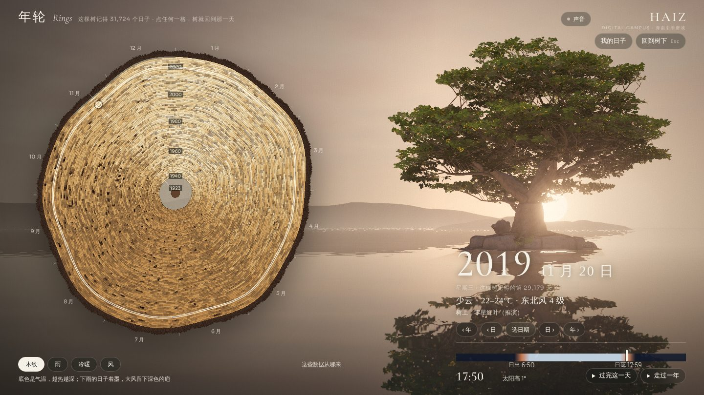
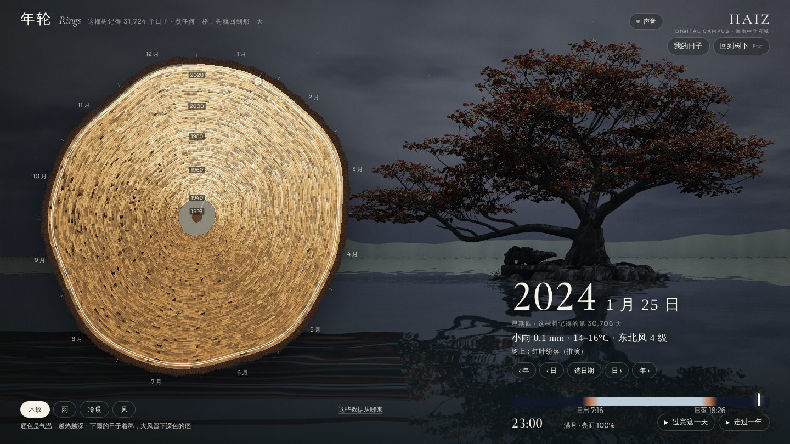
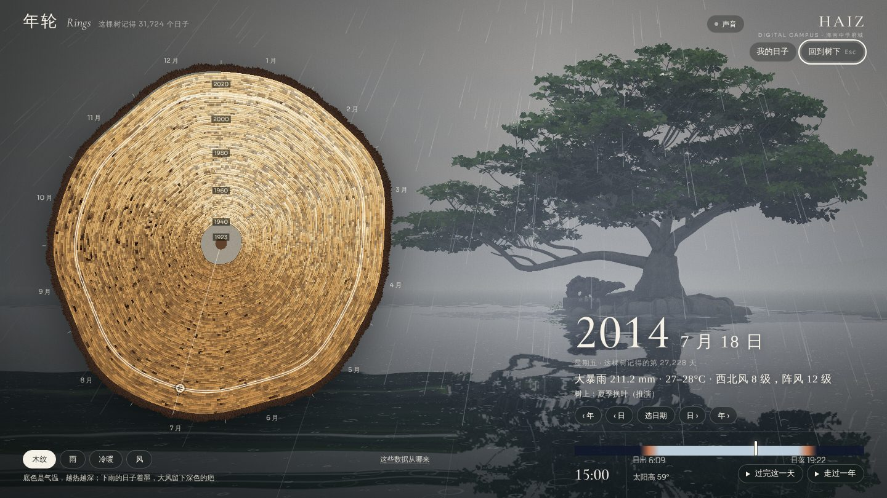
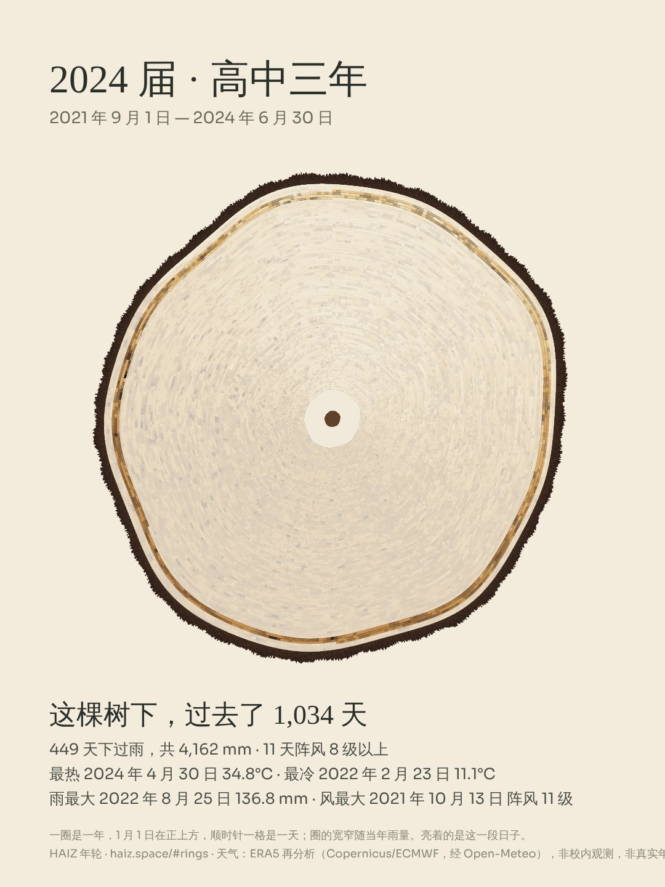

# 年轮 · 这棵树记得每一天（2026-11-14）

> 第七种站在树下的方式。把 1940 年至今 **31,724 个真实的日子**画成一圈圈年轮，放在榄仁树旁边；点任何一格，树就回到那一天。

入口：首页右上角「年轮」、第二幕「根脉」面板里的「年轮」、全站搜索，或直接链接 `#rings/2014-07-18/1500`（日期/时刻）。
代码在 [`lanren/rings/`](../lanren/rings/)，数据说明见 [`lanren/rings/data/SOURCE.md`](../lanren/rings/data/SOURCE.md)。

| | |
| --- | --- |
|  |  |
| 2019-11-20 17:50 · 日落正在树后（真实太阳方位，绕到树的东侧看） | 2024-01-25 23:00 · 满月，红叶纷落 |
|  |  |
| 2014-07-18 15:00 ·「威马逊」那天：大暴雨 211 mm，阵风 12 级 | 「2024 届 · 高中三年」导出的海报 |

以上为开发环境软件渲染（SwiftShader）的逐帧截图，不是实机录屏。

## 它是什么

| 部分 | 做了什么 |
| --- | --- |
| **年轮盘** | 一圈是一年：1923（建校）在树心，今年在树皮下。每一圈的宽窄随当年降水量；沿着一圈走是这一年，1 月 1 日在正上方，顺时针一格一天。1923–1939 年没有数据，留白；今年还没到的日子也空着——每周数据更新后，年轮会自己长出新的几格 |
| **四种画法** | 木纹（气温为底色、雨天着墨、大风留疤）、雨、冷暖（相对 1961–1990 年同一天的距平）、风。同一批日子，换一种读法 |
| **那一天的树** | 选中一天后，三维场景里的同一棵树变成那一天：叶的物候（转红、落尽、抽新叶、浓荫）、太阳与月亮在校园上空的真实方位、当天的云量、风向风力与雨；夜里有星，雨天水面有涟漪。可以拖动画面绕树走一圈去找太阳和月亮 |
| **时间** | 一条 0–24 时的轴（标出日出日落）；「过完这一天」24 秒走完一昼夜；「走过一年」一天一天翻过去，看季风和物候 |
| **我的日子** | 输入一个起始日期，或选「哪一届」的高中三年，这段日子在年轮上亮起来，并给出天数、下雨的天数、最热/最冷/雨最大/风最大的一天（点一下就回到那天），可存成一张海报。日期只存在本机 `localStorage` |
| **与校史相连** | 年轮停在有校史记载的年份时，显示第二幕「根脉」里对应的条目并可跳转 |
| **接住那天的叶子** | 在年轮模式里点住一片落叶，标本页的日期就是年轮所指的那一天 |
| **没有 WebGL 时** | 年轮盘、当天的事实、我的日子与海报照常可用（只是没有三维的树） |

## 什么是算的、什么是读的、什么是推演

这部分沿用项目一贯的边界，界面里的「这些数据从哪来」写的是同一件事。

- **读来的：天气。** ERA5 再分析（Copernicus/ECMWF，经 Open-Meteo），逐日。它是模式重建，网格约 25 km，**不是校内气象站，也不是台站观测**，极端值常被低估；一天之内不分时刻，风雨全天同一强度。
- **算出来的：日月。** 太阳、月亮的方位与月相用低精度星历计算（与 `lanren/js/sun.js` 同一套公式），误差远小于 1°。测试用 2000-01-21 月全食（满月）、2024-04-08 日全食（新月）和海口两至日的日出日落时刻校验。
- **推演的：物候。** 叶的状态来自 `lanren/js/season.js` 的物种物候模型，不是对这棵树的逐年观察；每一年的物候日期相同，不随当年天气变化。
- **艺术表达：天空的颜色。** 按太阳高度取色（白天的三组取自 V4 六幕既有的光），再按云量、雨量压灰；不是测量。星星是随机星点，不是星图。
- **年轮是数据的画法，不是这棵树真实的年轮。** 「圈宽随雨量」借用了年轮气候学的直觉，但没有任何木芯取样；`DESIGN.md` 关于「不把虚构年轮当成校史证据」的要求在这里同样适用，界面和海报上都写明了。

## 怎么接进六幕

- 年轮是一个需要主动进入的模式，和第三幕的作品树冠、第四幕的地图一样向 `lanren/world/state.js` 申请镜头与输入（新 owner `rings`）；正常滚动的六幕不受影响，Esc 或「回到树下」原样交还。
- 叶片着色器新增「全年物候」通道（`uYear / uTurn / uFlushG`），**默认关闭**，关闭时与 V4 的 `uGrow` 生长完全一致；天空着色器新增 `uCloudLit`（默认 1）让云在黄昏、夜晚和风暴里可以不被照亮。除此之外没有改动 V4 的材质、镜头和六幕的光。
- 物候一年里有两次「看不见的重置」（5 月 1 日旧叶时钟归零、11 月 2 日新叶变成旧叶），测试断言重置前后每片叶子的状态一致，所以「走过一年」可以无缝循环。
- 数据 349 KB（gzip 后约 207 KB），只在第一次打开年轮时加载。

## 年轮会自己长

`.github/workflows/rings-climate.yml` 每周运行 `scripts/rings/fetch-climate.mjs --update`：重读最近 120 天（再分析的近期数值还会被修订）并追加新到的日子，跑一遍 `tests/rings.cjs` 后提交。请求里只有校园坐标和日期范围。

本地：

```bash
npm run rings:update   # 追加最近的日子
npm run rings:build    # 从 1940 年全量重建（约 9 次请求，间隔 25 秒）
npm run test:rings     # Node 检查 + 真实浏览器检查
```

## 验证了什么、没验证什么

- `tests/rings.cjs`（Node，11 项）：编码往返、档案完整无缺日、三次登陆海南的台风日在档案里确有大风暴雨、日历与闰年、距平基线、月相与日出日落、白天/夜晚/风暴的舞台参数、物候闭环、年轮几何（每一天恰有一格、点格能找回那一天）、圈宽随雨量。
- `tests/rings-browser.cjs`（Chromium + SwiftShader，11 项）：从按钮进入、台风日/夜晚/春天的场景状态、键盘换日、点年轮选日、校史条目、四种画法、高中三年与海报导出、接住带日期的落叶、「走过一年」、退出后镜头/叶片/滚动原样恢复、手机竖屏布局不重叠、`#rings/…` 直达链接、无 WebGL 降级。
- 改动后原有的 `tests/lanren.cjs`、`tests/home-browser.cjs`（六幕首页）与 `tests/provenance.cjs` 仍全部通过。
- **没有验证：** 真机 GPU 上的帧率与观感（开发环境是软件渲染，只能逐帧截图）；iOS Safari / 微信内置浏览器里的日期选择器与海报下载；雨声合成的听感。这些需要在真实设备上看。
