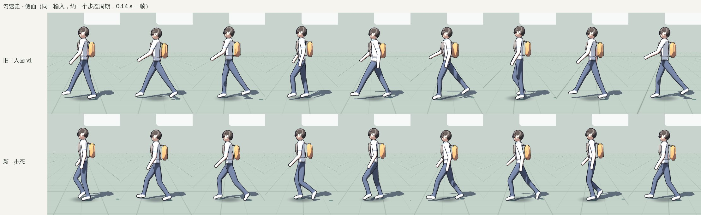
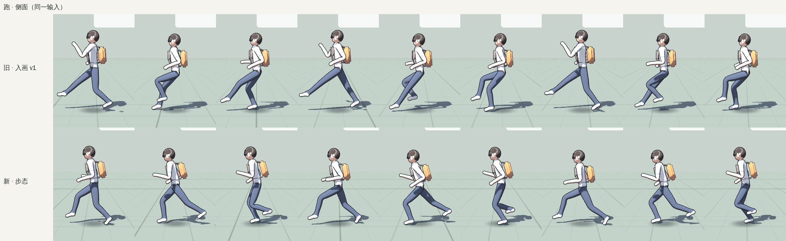
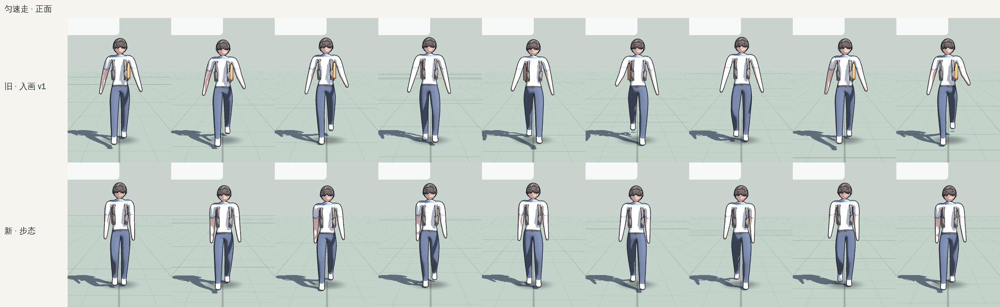
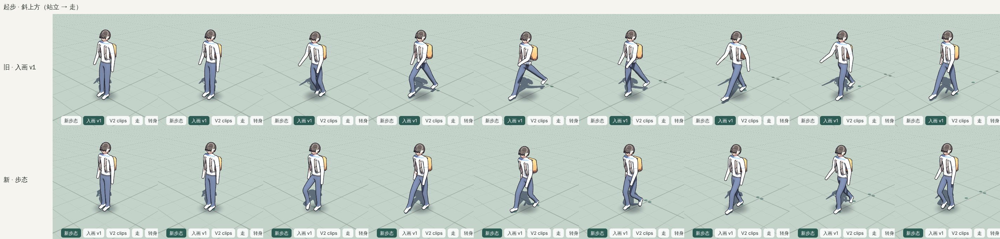

# 校园活着 · 人物动作、海中活点地图与「入画」（2026-11-17）

> 我们画下了一棵树，走进了一座画里的校园。这一轮，让校园里出现真正的生活：一个走路像人的身体，几个按自己的作息生活的人，一张记录他们脚步的地图——三者共用同一个世界、同一只钟、同一场雨。

**独立预览**：[`ruhua-alive.html`](../ruhua-alive.html)（不改动 `ruhua.html`、六幕首页、V2 漫游；`ruhua.html` 保留为对照）
**动作实验室**：[`walker-lab.html`](../walker-lab.html)（`?figure=new|v1|v2`，`?seq=walk|turn|run|jump|start`）
代码：[`lanren/life/`](../lanren/life/) · 第三方：[`lanren/vendor/procedural-locomotion/`](../lanren/vendor/procedural-locomotion/) · 截图与视频：[`docs/life/`](life/)

所有画面来自开发环境 Chromium + SwiftShader（软件渲染）的逐帧截图与按固定步长录制的视频，不是实机录屏；不声称任何真机帧率。

---

## 一、人物动作：先看清楚，再动手

### 1. 怎么看：动作实验室

人物动作不能靠读代码判断。[`walker-lab.html`](../walker-lab.html) 把人物放在 0.5 m 网格的地面上，用和漫游**同一个控制器**驱动，同时从侧面、正面、背面、斜上方四个机位看；输入是一段固定脚本（站立 → 起步 → 走 → 急停 → 左转 90° → 回正 → 掉头 180° → 原地轻点转向 → 走到跑 → 跑到走 → 停 → 原地跳 → 助跑跳 → 落地继续跑），对每个人物逐帧完全相同。下方是步态图：两只脚最低接触点的高度、接触期、骨盆高度、速度。

还有一个最常见的「怪」的量化：**支撑期滑步**。每只脚取脚跟（踝下）与前掌（趾关节下）两个随脚运动的接触点；某个点贴地且不在下落中，就算这只脚在支撑。正常的脚跟—全脚掌—前掌滚动，总有一端钉在地上；两端同时在地上移动才是滑步。超过 12 cm/s 记为「在滑」（地上画出红线）。录制脚本：`node tests/life/lab-capture.cjs --figure v1|new|v2 --seq all`。

### 2. 旧版到底哪里怪（入画 v1，`lanren/ruhua/walker.js`）

从四个机位逐帧看，问题不是单一的 IK 错误，而是**没有一处在表现重量**：

| 现象 | 来自哪里 |
| --- | --- |
| 手臂像两根棍子从肩上前后甩，向前甩到近 45°，肘几乎不弯；正面看双臂外张成 A 字 | 手臂只按对侧脚的前后位置转肩关节，没有肘的摆动和滞后，绑定姿态的外展没有被收回 |
| 走路时两条腿在双支撑期都伸直，像圆规；摆动腿几乎不折 | 骨盆只降 2.5 cm，摆动足走对称的正弦弧（离地 7 cm），膝盖只是 IK 被动结果 |
| 跑步时身体**向后仰**、前脚伸直踢出去落在身体很远的前方 | 落脚点 = 半步 + 速度预测（跑步时约 0.8 m 在髋前），前倾量在这个骨骼的局部坐标里不足以抵消；结果是「踢正步」式的过跨步 |
| 起步、急停、原地转身、跑步时脚在地上滑 | 身体速度由控制器在约 0.3 s 内给到 1.85 m/s，脚只能事后追赶；转身先转根节点，脚再跟上 |
| 头总是微微后仰 | 前倾被头部反向补偿 |

滑步指标（同一脚本，支撑帧中「在滑」的比例）：

| 片段 | V2 片段混合 | 入画 v1 | **新步态** |
| --- | --- | --- | --- |
| 起步 · 走 | 100% | 19.5% | **2.6%** |
| 急停 | 21.5% | 7.9% | **2.4%** |
| 匀速走 | 97.9% | 6.9% | **1.5%** |
| 掉头 180° | 100% | 0% | **4.6%** |
| 原地轻点转向 | 100% | 66.7% | **0%** |
| 跑 | 100% | 56.3% | **0.9%** |
| 跑 → 走 | 100% | 11.1% | **4.8%** |
| 落地后继续跑 | — | 100% | **0%** |
| 全程平均滑速 | 51 cm/s | 6.6 cm/s | **0.6 cm/s** |

（V2 是按速度混合三段动画片段的旧漫游人物，脚步与位移本来就不对应。v1 掉头时 0% 是因为它的转身先转根节点、脚在原地扭转——不滑，但脚尖与身体朝向错开；新步态掉头时 4.6% 是最后一步的脚尖枢轴。滑步只是一个指标，自然度要看下面的画面。）

| | |
| --- | --- |
|  |  |
| 匀速走，侧面，同一输入（上：v1，下：新） | 跑，侧面：v1 身体后仰、前腿伸直踢出；新：前倾、落脚在身体下方、肘部 90° |
|  |  |
| 正面：v1 双臂外张成 A 字；新：手臂贴近身体自然下垂 | 起步，斜上方 |

视频：[`docs/life/lab-before-after.mp4`](life/lab-before-after.mp4)（实验室全脚本，左 v1、右新步态，四机位 + 步态图）· [`docs/life/stroll-walk-run-turn.mp4`](life/stroll-walk-run-turn.mp4)（漫游里的跟随镜头：起步、走、斜向转弯、跑、急停、掉头）

### 3. 研究了什么、比较了什么

| 项目 | 许可 | 实际情况 | 结论 |
| --- | --- | --- | --- |
| [PabloMesquida/three-procedural-locomotion](https://github.com/PabloMesquida/three-procedural-locomotion) v0.3.0 | MIT | 纯程序化：步频 ∝ √速度、支撑期偏后、脚跟着地并绕趾关节滚动、膝盖缓冲、骨盆抬降与两次/步的倾斜、手臂是阻尼摆、转弯减速并让每一步落脚就朝向新方向、停步收脚；**逐条曲线与 CMU 动作捕捉对比调参**（仓库内有 naturalness 测试）。three r150–r186（我们是 r170），只动骨骼，0.1–0.2 ms/人/帧 | **采用**（打包后 174 KB / gzip 54 KB，未改源码） |
| [nirholas/retarget](https://github.com/nirholas/retarget) | Apache-2.0 | 把动画片段重定向到任意人形 GLB，带交叉淡入的状态机。6 次提交，早期；需要动作片段（我们没有授权的片段） | 不采用：回到片段混合，非标准速度下仍会滑步。日后若有授权的动捕片段，可作为补充 |
| [hh-hang/three-player-controller](https://github.com/hh-hang/three-player-controller) | MIT | 完整的第一/第三人称控制器：胶囊体 + three-mesh-bvh 碰撞、片段交叉淡入、可选足部 IK 插件、自带相机 | 不采用：会替换 HAIZ 已有的相机导演、碰撞与坐标；动画仍依赖片段 |
| [Mugen87/yuka](https://github.com/Mugen87/yuka) | MIT | 游戏 AI：转向行为、导航网格、状态机 | 借鉴思路（路径跟随 + 前瞻点、局部避让），不引入：我们需要的是与玩家碰撞**同一份**数据的格网寻路，几百行即可 |
| [Leo555/Marauder-s-Map](https://github.com/Leo555/Marauder-s-Map) | 仓库未附许可证 | SVG 抖动线条、羊皮纸；人物在房间矩形里随机游走 | 只作对照：不复用代码，也不沿用「随机游走 + 羊皮纸」的做法 |

在实验室里把新库接到 HAIZ 的学生骨骼上：骨骼命名接近 Rigify metarig，写一份映射即可，没有警告；脚在整个支撑期**逐毫米钉住**（踝与趾关节坐标在 PLANTED 阶段完全不变，LIFT 阶段趾关节不动）。

### 4. 新架构

- **身体由步态模拟**（`lanren/life/gait.js`）：位置、加速、刹车、转向都由步态库算出，所以脚永远不需要「解释」一个它没有产生的速度。控制器（`lanren/life/player.js`，相机导演沿用 V2）只给出「想往哪走、多快」。
- **墙由「沿着走」处理**：前方 0.45 m 有墙时，意图方向投影到墙面切线并按夹角减速——人会沿着墙走，而不是对着墙原地踏步；万一转身蹭到墙角，`collide.js` 的推出量用 `shiftOrigin` 平移整个身体（脚印随身体平移，不留滑痕）。
- **学生的气质**（`STUDENT`）：行走 1.5 m/s、步频 1.95 步/秒、轻快的 5 cm 抬脚、手臂 14° 摆幅且肘部 26° 自然弯曲、外展收到 4°；跑步 3.9 m/s，步长上限 1.45 m、2.95 步/秒、骨盆只降 4.5 cm——默认参数是为 3 m/s 的慢跑调的，用到 4 m/s 时在走跑过渡会先蹲低再「劈叉」，调过之后有了真正的腾空。转身 200°/s（游戏需要的响应），由横向加速度上限 4.2 m/s² 约束：越快转得越缓。
- **保留的 HAIZ 部分**：人物材质与描边、校园地面高度、头部看向玩家注视处（叠加在步态自己的注视上）、雨伞（右臂抬起持伞，伞面始终竖直），以及新加的「拿着东西」：书、文件夹、速写本、扫帚。
- **对比**：`ruhua-alive.html?figure=v1`（入画 v1）与 `?figure=v2`（V2 片段）仍可切换；`lanren/life/legacy/walker-v1.js` 是 v1 的冻结副本，只供对比。

### 5. 还不完美的地方

- 人物模型本身（连续 Skin 修改器身体、无手指）在近景下仍显简单；本轮没有重做模型，问题主要不在模型。
- 跑步时头部略低；走跑过渡的一两步仍比真人更「蹲」。
- 步态库只在软件渲染下验证，真机手感（尤其触屏摇杆的半速行走）需要实机确认。

## 二、校园里的人

### 1. 五个虚构的人和一只猫

| 人 | 是谁 | 一天 |
| --- | --- | --- |
| 林知夏 | 高二（3）班 | 喜欢植物。课间常走到榄仁树下站一会儿；午饭（第三食堂）后去植物园画速写；放学后在树下画，晚饭后绕砚池走一圈；下雨就在连廊看雨 |
| 陈屿 | 高一（7）班 | 篮球队。踩着铃声跑进教室；午饭后、放学后都在篮球场；下雨不打伞，跑 |
| 符老师 | 物理教师 | 办公室在科学馆；抱着文件夹去一号楼、二号楼上课；从北门上下班，周二周四留下看晚自习 |
| 王一苇 | 高三（1）班 | 图书馆的常客，走路也在看书；午休和放学后在图书馆，周六一整天 |
| 吴伯 | 校工 | 清晨扫榄仁树下与北门路上的落叶，上午侍弄植物园，下午浇花；雨天在衍林亭等雨停 |
| 橘猫 | （上一轮） | 第一食堂旁，自己的一天 |

他们都是虚构的，不以任何真实的学生、老师或职工为原型；作息按寄宿制高中的一般节奏编写（早读、课间十分钟、课间操、午休、晚自习），周末不同。**活点地图只显示他们、猫和玩家自己，不追踪、不显示任何真实的人。**

### 2. 一天是时钟的函数（`lanren/life/life.js`）

每个人的一天是一串「几点前到某处、几点离开」的块，块与块之间沿校园道路走（或跑）过去。位置只由海口此刻的时钟决定：12:41 打开页面，林知夏就在从第三食堂去植物园的路上，走到了她此时该走到的地方——对任何人、任何设备都一样（种子是日期，所以今天的下午对所有访客相同，明天略有不同）。只有跨越「此刻」的那一段路需要寻路，路径有缓存。

**天气改写计划**：开始下雨（或雨停）时，每个人的这一天从这一分钟起重新计划；在室外的人从他们真正所在的位置走向新计划的地方（连廊、亭子、檐下、或回到楼里）——没有人瞬移。雨天：有伞的撑伞，陈屿用跑的；寻路时连廊与亭子更便宜，同样两个地方之间会选一条更干的路。课间十分钟按日期和节次掷一枚硬币，决定某个学生是否出去走几分钟。

### 3. 路（`lanren/life/nav.js`、`places.js`）

一张 1 m 的格网，直接由玩家碰撞用的**同一份**障碍物生成（Blender V3 的建筑外壳、池塘、太湖石底座、树干、花坛），按身体半径外扩。每个格子按校园平面图上的地物定代价：测绘的道路与球场最便宜，园林小路次之，路与路之间的铺装和草地更贵——所以路线沿着校道走，只在值得的地方抄近路。A* 之后做「尊重代价的拉直」：只有当直线段不穿障碍、而且代价不高于它替代的那一串格子时才拉直，所以拉直不会把人送上 A* 本来避开的草地。

核对数据时的发现：一二号楼之间的两条连廊在碰撞数据里是两侧带墙的「管子」，`r_h_mid1` 这条东西向道路在连廊处被挡住，人只能从连廊与二号楼之间约 1 m 的缝隙通过——这与玩家实际能走的范围一致，所以保留，并把雨天的避雨点设在檐下与亭子里，而不是连廊内部。门的位置是解读：建筑面向最近道路的一侧，从不放在被其他翼楼围死的院子里（测试逐一检查从榄仁树可达）。

### 4. 三维里的身体（`lanren/life/npc.js`）

离玩家 72 m 内、在室外的人才有身体（88 m 外收回，手机最多 4 个、桌面 6 个）。身体用和玩家**同一个步态**（各自的速度、步长、摆臂、前倾：吴伯微驼慢走，陈屿运动员式，王一苇低头看书），朝「一天」里 0.8 秒后的位置前进，落后就稍快、超前就放慢；绕开玩家和彼此，绝不穿过；走到门口时以世界空间的笔触碎裂消失进楼里（和画作到来时同一种语言），出门时再画出来。穿着各不相同：按人物模型的颜色分组精确替换衬衫、裤子、书包，老师和校工的书包收进身体里；配件有马尾、眼镜、文件夹、书、速写本、扫帚。

对玩家：靠近时看你一眼（每次相遇一次）；你停在旁边时，偶尔说一句（每人 150 秒、全局 25 秒冷却），话很短：「这棵树的叶子，十一月会红一些。」「让一让——」「同学，跑慢点。」「……（没抬头）」「落叶扫不完的。」他们不为你停下。

## 三、海中活点地图

### 1. 它是速写本里的一页

按 M 或右下角的小速写本：画面里，你的人物把速写本举到胸前、低头看；速写本从画面底部升起，墨绿布面封面翻开，校园平面图**从百年榄仁树开始向外画出来**——和第六幕里画作从树开始向整座校园蔓延是同一个动作；榄仁树也是 HAIZ 所有校园坐标的原点 (0, 0)，地图上就这样标着。

### 2. 绘画语言

- 暖色水彩纸（纸纹、纤维），极淡的 10 m 测绘格——校园自己的坐标；
- 道路是两条墨线之间留白的纸；建筑像建筑师的平面图：双轮廓、45° 排线；草地、园林、球场、跑道、池塘是水彩晕染，边缘有干后的深色水痕；数据里的 300 棵树各是一点绿和一个墨点；老榄仁树画成一圈它自己的叶子（倒卵形、主脉，几片已经红了）；
- 指北针是一片指向北门的榄仁叶，旁注「校园坐标 · 非真北」；比例尺、红色「海中」印章与写生日期、天气——和画布上的落款一致；
- 每个人用自己的墨色留下最近两三分钟的脚印，随时间变干变淡；最新一步写着名字和正在做的事（「林知夏 · 去植物园（画速写）」）；在室内的人用铅笔灰写在楼里（「王一苇（图书馆 · 看书）」），轻轻呼吸般明暗；猫留下梅花爪印；你留下红色脚印和一个视线扇形；你画树的地方画着一个小画架「写生处」，你的红脚印就从那里开始。

### 3. 天气、时间、交互

下雨时雨点落在纸上，晕开、再慢慢干掉，道路的颜色变深；夜里晚自习的教室在纸上发出暖光。拖动平移、滚轮或双指缩放；轻点名字看卡片（是谁、正在做什么、在你哪个方向多远、他的习惯），可以「在地图上跟着看」。合上地图，世界一直在继续——地图打开时三维画面降频绘制，模拟不停。

### 4. 与三维世界一致

地图读的就是「一天」本身：人在你附近、有身体时，地图上的名字就是那个身体的位置、脚印就是那个身体真正踩下的脚步；离得远时，是同一个一天给出的位置与步子。浏览器测试中：身体与它的「一天」相差 < 3.5 m（绕开玩家时会暂时偏离），地图上的位置与身体相差 < 5 cm。

## 四、「入画」的打磨

逐帧录下完整过程（`node tests/life/transition-capture.cjs`：按固定步长推进模拟、逐帧截图、合成视频；作画阶段 1.5 帧/秒，其余 6 帧/秒——软件渲染下画一帧要 10–25 秒），再像审片一样看。

### 审片结论

1. **画布没有挡住树。** 「回望」的构图把树放在画面左侧三分之一；画布按屏幕中部的矩形立起来，在 16:9 窗口里挡住的是右半个树冠和教学楼。于是起稿的炭笔先落在**窗户**上（窗格的明暗边缘最强），玩家画的其实是一栋楼。写生的人支起画架时会正对着要画的东西。
2. **越出画框那一笔不够明确**，落到世界上的颜色发白，像雾。
3. **画离开画布时像一阵粒子风暴**：约 4 200 片细小的笔触同时飞出，楼被画成碎片。概念是对的（颜料沿视线回到它画的东西上），密度让它变成了特效。
4. **退出身体的镜头**升起 0.9 m 再落到跟随机位，中途是一个俯视雨伞顶的镜头；镜头从头部里出来的前几帧，会看到人物描边的内壁。最后登场的人物只是突然站在那里。
5. 已知问题：两套世界合成时轮廓有锯齿；作画中改变窗口大小，指针和画布对不上。

### 改动（只在 `ruhua-alive.html`；`ruhua.html` 不变）

- **支起画架 = 转身正对树**：点下「支起画架」，视线先用 1.5 秒平稳地转向树冠（`aim` 阶段），画架再从地面升起。空白的画布正好立在树的核心前面，真实的树冠从画框两侧溢出——画里的树与画外的树在边缘接续，这才是视尺寸写生与马格利特画架的意思。浏览器测试检查：树冠与树干都投影在画布矩形内，树冠水平居中。
- **出发的笔触更少、更大**（`lanren/life/easel.js`）：只让画面的大笔（铺色、塑形两层）飞出，桌面 1 300、手机 700 片，单片可以更宽更长；小笔触不飞，它们由投影器直接画到世界上。看起来是画的一块块离开画布，而不是一团碎屑。
- **退出身体，像一幅背影画**：镜头在人物视线高度笔直后退 2.4 m、只抬高 0.3 m，始终看着树，最后 45% 才平滑落进漫游的构图；人物在镜头离开头部的同时**以笔触被画出来**（与人物走进楼里时同一种世界空间笔触碎裂，反过来），抬头看着树。最后一个画面是站在画架旁、背对我们看树的人——卡斯帕·弗里德里希式的背影人物——然后才把控制权交给玩家。镜头不再穿过头部的描边。
- **轮廓抗锯齿**（`lanren/life/pipeline.js`）：合成时，若某像素 3×3 邻域里「哪个世界更近」的判断不一致，就按邻域比例混合两个世界的颜色；内部像素不变。
- **窗口变化**：指针先从当前相机射出、再用画家的眼睛投影，任何窗口比例下都精确；窗口变窄时视线不动，只把镜头视角放宽到能装下整块画布（测试：竖屏 620×900 下画布四角都在画面内、眼睛位置不变）。

## 五、三件事如何成为一个世界

- 一只钟：海口此刻（或自由天气里选的时刻）同时决定光、雨、猫的一天、每个人的一天、地图上的日期。
- 一场雨：同一个「下雨了」让人去避雨、撑伞或奔跑，让寻路偏向连廊，让地图的纸湿、路深、雨点晕开。
- 一套空间：玩家碰撞、人的寻路、地图的建筑都来自同一份校园数据与同一组障碍物。
- 一种绘画语言：画作从树开始蔓延；地图从树开始画出；人走进楼里时像笔触一样散开；你的人物在画里被画出来，又在画里拿起速写本看这座校园。

## 六、验证

- `node tests/life/life.cjs`（Node，10 项）：格网由真实碰撞数据生成；50 个门与地点都从榄仁树可达；路径每 10 cm 采样不穿墙、池塘、树干；长路程 80% 以上在测绘道路与球场上；一个工作日里每个人的速度不超过自己的跑速、不在障碍物里、不瞬移；一天的节奏（课间操在操场、午饭在食堂、晚自习在楼里、深夜都不在室外）；同一时刻对两个独立实例完全相同；12:36 开始下雨时重新计划不瞬移，林知夏去连廊看雨；周末不同；地图脚印来自同一天。
- `node tests/life/alive-browser.cjs`（Chromium）：见结果文件 `tests/life/alive-browser-results.json`。
- 动作：`node tests/life/lab-capture.cjs`（四视角录像与滑步指标）。
- **没有验证**：真机 GPU 帧率与发热、iOS Safari 与微信内置浏览器、真实触屏手感、长时间运行内存。

## 七、已知问题与下一步

- 人物在室内只是「在门口」；楼里没有内部模型（DESIGN.md：建筑内部为推测）。
- 同一时刻校园里只有五个人；课上时间室外很安静——这是作息本身，自由天气里选「正午」「傍晚」能看到最热闹的时候。
- NPC 的话目前每人四五句，没有对话树；这是刻意的克制。

## 八、署名

- 步态：three-procedural-locomotion（MIT，© 2026 Pablo Mesquida），未改源码打包；其步态按 CMU 动捕数据调参：*The data used in this project was obtained from mocap.cs.cmu.edu. The database was created with funding from NSF EIA-0196217.*（本仓库不含任何动捕数据。）
- 天气：Open-Meteo.com（CC BY 4.0），同上一轮。
