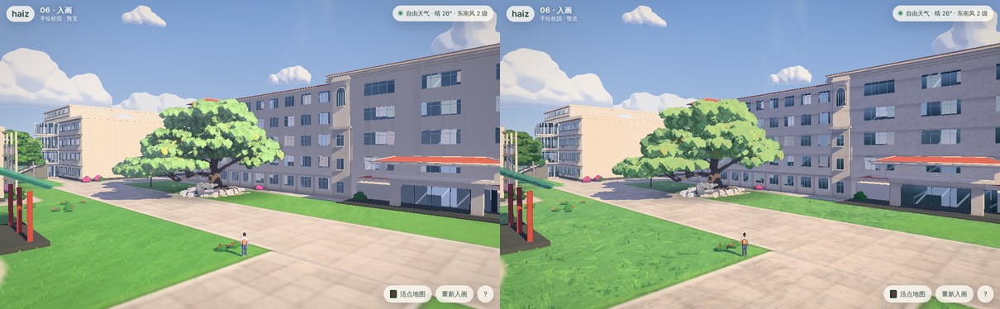
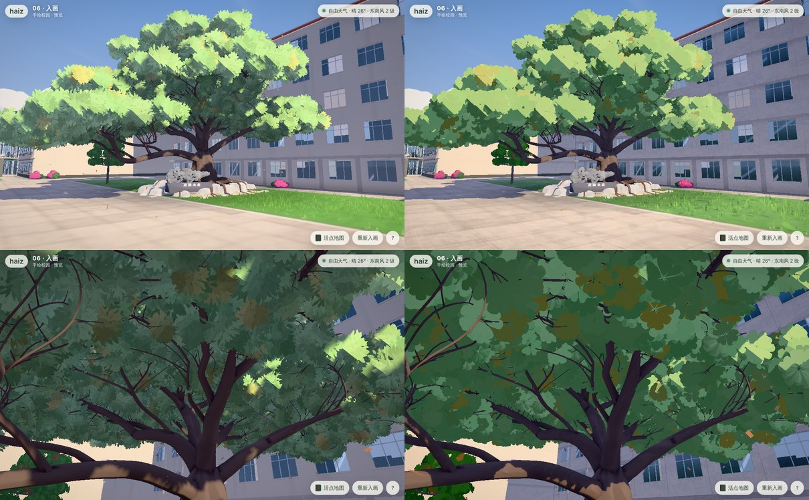
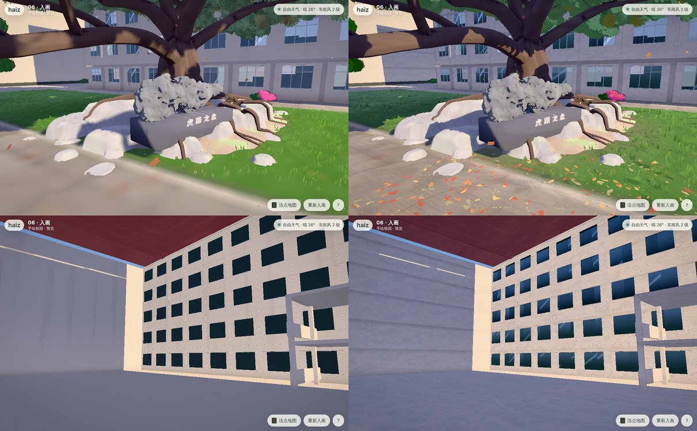
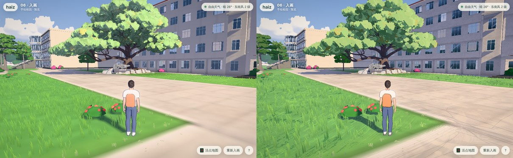
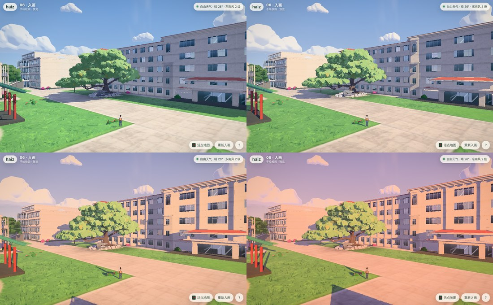
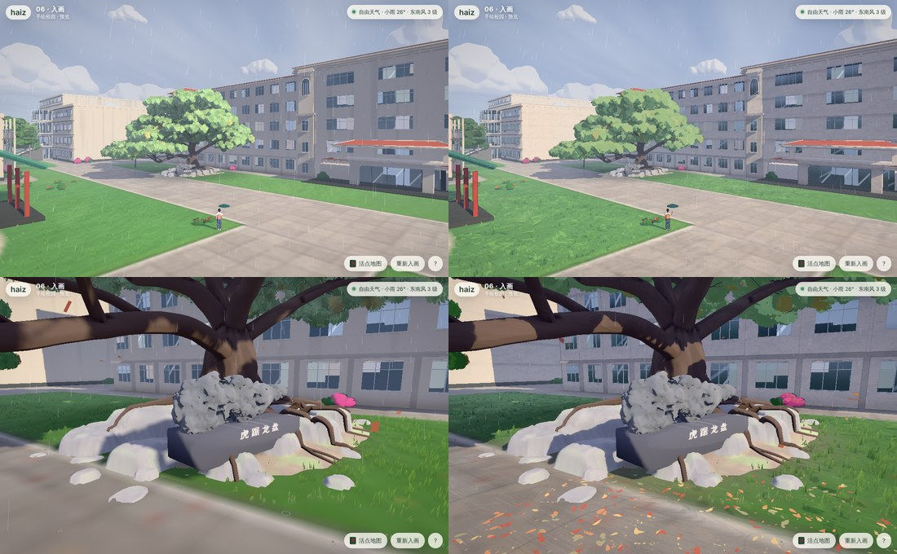
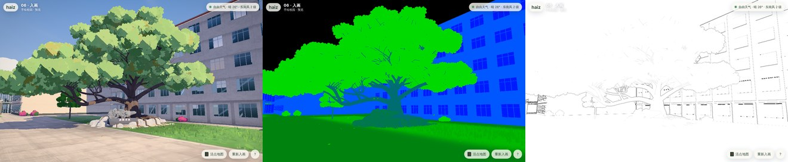
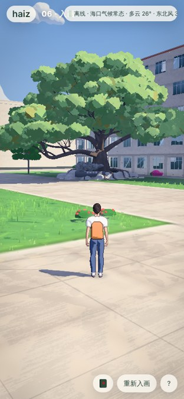
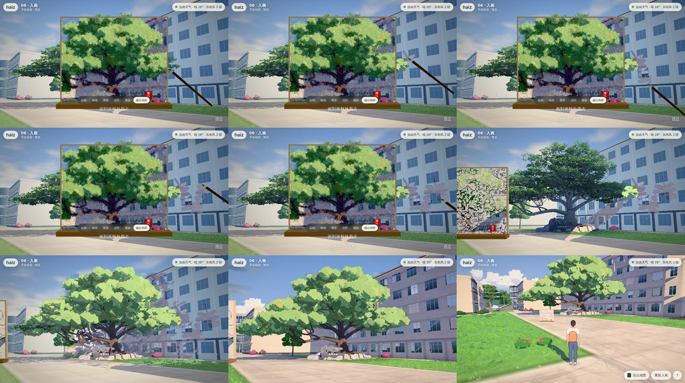

# 入画 · 手绘校园：把海南中学变成一幅可以走进去的画（2026-11-22）

> 不是给三维校园套一层卡通滤镜，而是让校园从地面、植物、天空、建筑、人物到最后一道合成，都按画家的方式被画出来——画的仍是那座校园。

**独立预览**：[`ruhua-painted.html`](../ruhua-painted.html)（与 `ruhua-alive.html` 同一套「入画 · 校园活着」体验：同一座校园、同一套建筑与碰撞、同一个行走者和校园里的人、同一段入画转场、同一张活点地图；只多了六层手绘渲染）。
`ruhua-alive.html?art=painted` 可在原页面上开启；`ruhua-painted.html?art=0` 关闭，用于对照。
代码：[`lanren/painted/`](../lanren/painted/) · 截图：[`docs/painted/`](painted/)

所有画面均来自开发环境 Chromium + SwiftShader（**软件渲染**）的逐帧截图，不是实机录屏；本文不声称任何真机帧率。

**对照截图**（每组左：原 `ruhua-alive` 的绘画世界，右：六层手绘；同一机位、同一时刻 15:36、同一天气）

| | |
| --- | --- |
|  |  |
| 远景：三种绿的草坪、体积受光的树冠、楼层节奏 | 榄仁树：枝端轮生的倒卵形大叶，叶垫分层受光 |
|  |  |
| 地面：树下泥土与落叶；墙面：两档水洗、窗的天光 | 人物：调出来的冷暗部、彩色墨线；脚边草叶不描线 |
|  |  |
| 艺术化时刻色板：正午 · 午后 · 黄金时刻 · 日落 | 小雨：克制的湿地面，真实尺寸的红叶 |
|  |  |
| 调试：最终 · 物体标记（红人物、绿绘画强度、蓝结构）· 描线 | 手机竖屏（390×844，触控模拟，窄笔刷） |

入画转场（软件渲染逐帧）：[`painted/transition.mp4`](painted/transition.mp4) · 

---

## 一、先读懂两边

### 1. HAIZ 现在实际在用什么

| 入口 | 实际模块 | 说明 |
| --- | --- | --- |
| `ruhua-alive.html`（最新的入画） | `lanren/life/main.js` 编排；`lanren/ruhua/world.js` 组装绘画世界；材质全部出自 `lanren/ruhua-stroll/atmos.js` 的 `cel()`；`lanren/life/pipeline.js` 两套世界的渲染与合成 | 本次升级的对象 |
| `ruhua.html` | `lanren/ruhua/main.js` | 入画第一版，作为对照保留，未改 |
| `campus-stroll-v2.html` | `lanren/stroll/*` | V2 漫步，未改 |
| `assets/walk/`、`assets/js/three-campus.js` | 早期第一人称漫游 | 不是入画的入口，未改 |

关键结构：所有绘画表面（地面、草、树、建筑、人物）都由 `cel(opts)` 生成——一个挂在 three 的 Lambert 程序上的赛璐璐材质，`opts` 里保存着各个着色器钩子（`vertex.begin/world`、`fragment.pre/albedo/after`），并共享同一组大气、光照、天气、风的 uniform（`U`）。转场时每个表面还会被 `paintfield.js` 复制出「记忆」与「绘画」两份，按 `paintTime(p)` 逐像素决定显示哪份。

这意味着最好的接入点不是再造一个场景，而是**在 `cel()` 的配方上追加钩子**：新材质 = 原材质的配方 + 绘画层，二者共享所有 uniform，风、天气、光照照旧同步，转场的双份复制也自动包括新材质。

### 2. Painted Valley 真正做了什么（读源码，不是读 README）

参考项目在线地址 `patch.gg` / `git.patch.gg` 在本开发环境被网络代理拒绝（403），实际阅读的是 GitHub 上同名的完整镜像（`lucienlmy/painted-valley`，含 MIT `LICENSE`、`LICENCE-NOTES.md` 与全部源码）。逐个读过的文件与学到的东西：

| 文件 | 技术 | 对 HAIZ 的结论 |
| --- | --- | --- |
| `src/lib/frame.js` | 场景 → HDR 目标；最后一道：4 象限 **软 Kuwahara**（方差四次方反比加权，「从不硬选，硬选会闪」），半径按深度分段（近处与远处小，中景大）；**人物描线**：人物每个部件在 alpha 写一个小数，相邻不同就描线，但若另一物体在前（草叶挡在脚前）则不描；线色是线下颜色变暗偏暖，「从不是黑线」；画家式高光曲线 | **算法复用**（软 Kuwahara 权重、描线的遮挡规则、线色规则）。**不照搬**：把物体编号写进颜色的 alpha——在多重采样下 alpha 会被平均，编号失真，也与透明材质冲突。HAIZ 改为 MRT 第二附件写「处理权重」，见第二节第六层 |
| `src/valley/strokes.js`、`src/lib/glsl.js` | 画布上画椭圆笔触，四周卷绕成可平铺纹理；地面在多个尺度读取；`fwidth` 让线条在任何距离都是几个像素宽；`paintCells` 的点状笔触按像素覆盖面积淡出（防闪烁的关键）；草地只用三种绿，「由色调选色」 | **方法复用**（多尺度世界空间笔触、按像素覆盖淡出、几种色调而非连续明暗）。笔触本身、通道含义和材质分类是 HAIZ 自己的 |
| `src/lib/blades.js` | 四圈实例化草叶跟随相机，草叶的一切由**世界格子编号**决定（回来还是同一根草）；每根草在淡出带里有**自己的随机时刻**，所以换圈不跳变 | **复用规则**：HAIZ 已有世界锚定的 4 m 草砖，但整圈一起变矮，淡出带像一圈下沉的草；改为每根草在带内各自消失 |
| `src/valley/trees.js` | 树冠由团块构成，每个团块的叶片卡片**按团块球体受光**（卡片法线不用），四档绿色按色调分级，冷暗的内部、暖亮的受光面；远处色阶变宽 | **复用思路**，但 HAIZ 的榄仁树不变成球形树冠：保留它的树皮网格、分层叶垫（pad）和叶簇位置，按叶垫与树冠体积受光 |
| `src/valley/clouds.js`、`sky.js` | 积云 = 球体堆，离线光线步进到立方体贴图；每个小时一组颜色（正午到日落） | HAIZ 已有绘制的积云卡片与真实天气驱动的云量；**复用**的是「按太阳高度的分时色板」这一结构 |
| `src/valley/wanderer.js`、`src/figure/cloak.js` | 人物两调赛璐璐 + 折痕深色；阴影色是「调出来的颜色」不是亮色变暗；斗篷是真实布料模拟 | **复用原则**；**不照搬**旅行者、斗篷和 Rapier 物理——HAIZ 有自己的人物、程序化步态和碰撞 |
| `src/valley/village.js`、`backdrop.js`、`farwoods.js` | 童话村庄、远山、平原 | **不采用**：海南中学没有远山和村庄，建筑不能变成童话房子 |

**授权**：代码 MIT（Copyright (c) 2026 Patch），美术 CC0；五段环境声来自 Sonniss 授权、不在仓库内。本次没有复制任何美术资产、模型或声音；算法按 MIT 借鉴，并在相应源文件注释中注明出处。

---

## 二、六层手绘渲染体系（`lanren/painted/`）

所有层都通过 `celPlus(material, hooks)` 在原材质配方上追加钩子，共享三组 uniform：`U`（大气/天气/风）、`ART`（总开关 `uArt`，四层渐显 `uArtL` = 地面 / 植物 / 建筑 / 人物，笔刷纹理 `uBrush`）。

### 笔刷（`brush.js`）

一张 512² 的程序生成纹理（确定性种子，无需加载图片），四个通道各是一种笔触，0.5 表示「没有笔触」：
- **R 水粉点**：大片薄涂 → 带干笔拖尾的饱满笔触 → 小点；有的比底色亮，有的暗。
- **G 长笔触**：沿 x 拖出的细长笔道、末端参差——草坪被风梳理、墙上的雨痕、树皮纹理、道路走向都用它。
- **B 颗粒**：旧水泥与水磨石的骨料、接缝里的砂——铺装的近景质感。
- **A 落叶**：榄仁叶的形状（倒卵形、叶尖宽圆、短叶柄）与碎叶。

### 第一层 · 地表（`ground.js`）

原地面是一整张覆盖校园的绘制画布（每像素 15–25 cm）：布局和颜色正确，但近看糊，而且道路、广场、草坪、树下泥土都是同一种平滑的颜料。现在保留画布作为颜色，按材质加上画家会画的笔触：

- **材质分类图**（1024²，由 `campus.json` 的要素实时绘制）：铺装方向（道路沿路、广场沿建筑长边，以倍角存储，插值不会翻转）、道路/广场、每棵树下的泥土与落叶密度。
- **草坪**：三种尺度的笔触（0.9 m 点、4 m 沿风拖拽的笔道、22 m 薄涂）沿风向并被缓慢的旋度弯曲；**三种绿**（冷暗、本色、暖亮）由笔触决定每处是哪一种，色阶交界在远处变宽，永不闪烁。
- **水泥**：近处骨料颗粒、陈旧斑块、两种水泥色调；**接缝沿道路自己的方向**，道路 2.4 × 3 m、广场 1.2 m 方格，线宽按 `fwidth` 恒为一个像素，板块只剩几个像素时淡出。
- **树下**：每棵树干周围更深更暖的泥土；树冠下按真实尺寸（15–25 cm）散落的榄仁落叶——11 月的红、赭、黄——成片分布，草坪上更少。
- **阴影**：所有地面阴影变成边缘清晰、由笔刷携带边缘的「形状」（世界空间，不随相机游动）。
- **湿地面**：保留原有的湿润反光与积水倒影，但亮度被分成几档、被笔触打散，克制而不像镜面。
- 道路高度、地基、碰撞、积水的屏幕空间反射：一个顶点都没有动。

### 第二层 · 同一阵海口的风（`flora.js`）

风场本来就是共享的：`windField(xz)` 是随风向推进的阵风前沿，草叶、草坪的光泽、每棵树的摇摆都读它。这一层修的是会「露馅」的地方：

- **草叶 LOD**：每根草在淡出带里有自己的消失时刻（`bladeR`），所以换圈只是密度变稀，不再是一圈随相机移动、整体变矮的草；草根颜色带上地面的新笔触，草从同样的笔触里长出来。
- **树冠**：主干与枝条的摇摆照旧（有重量感的慢摆）；近处（< 30 m）叶片卡片在阵风中细微颤动，远处只摆不颤。
- **榄仁主树**：V4 的摇摆函数保留（同一棵树在记忆与绘画中同步摇摆），每片叶簇卡片绕自己的叶簇随到达它的阵风轻颤。
- **人物衣物**：衬衫下摆与发梢读同一个风场，并滞后于行走者自身的运动（惯性）——见第五层。
- 地面落叶：沿用原来随风飘落的叶片系统。

### 第三层 · 海南的天空与时间色彩（`palette.js`）

三件事分开，界面上也分开写明：

1. **真实天气**：云量、降雨、风、湿度——Open-Meteo 预报或自由天气（`lanren/ruhua/weather`，未改）。
2. **模拟光照**：按海口此刻的真实太阳位置，物理关键帧色板（黎明、上午、正午、午后、黄金、蓝调、夜），再被云和雨压灰（`weather/model.js`，未改）。
3. **艺术化时间色板**（新）：**正午 / 午后 / 黄金时刻 / 日落** 四套画家的色调，叠在第二层之上，同样按太阳高度连续混合（50° / 27° / 11° / 2°）。画家不照抄光：阴影选一个更冷更饱和的色相；天空更干净更深，地平线是海口潮湿明亮的白；低太阳时云顶白、云底暖；阳光偏暖或偏冷。阴天、下雨时色板自动减弱（保留模型的灰），夜晚完全交给模型。

天气面板新增「午后」「黄金时刻」「日落」三个时刻按钮（海口 11 月：15:36、17:06、17:42），并写明数据来源的三层区别。因为色板改变的是 `U` 里的太阳色、天光、阴影色相、云色和曝光，所以变化的不只是天空背景，而是整个校园的光、暗部、空气感和材质反应。

### 第四层 · 榄仁树与校园建筑（`flora.js`、`build.js`）

**榄仁树**（*Terminalia catappa*）的辨识度在于分层的水平枝和枝端轮生的大叶：
- **叶簇贴图**：主树原来用的是 V2 通用的锯齿状叶团图集。现在按物种特征程序生成：每个叶簇 9–14 片倒卵形大叶（叶尖宽圆、向叶柄收窄）从一点放射，内外两轮交错，四种变体沿用原 2×2 图集布局。
- **体积受光**：叶片贴图自带的明暗被去掉，只保留为很小的色调偏移；明暗由叶垫与树冠体积决定 → **分层的叶垫读作分层**：上面受光、下面冷暗。四档绿（冷暗内部、蓝绿阴影、中间、暖亮受光），受光叶片的饱和度被控制，不是荧光绿；11 月的红叶仍按当天物候。
- 树皮：沿木纹的长笔触 + 笔刷交界的明暗（树干是圆的，笔触交界用在这里）。
- 校园里的其他树木（凤凰木、椰子、榕树……）：树冠中心由各自模型的叶片包围盒测得，按体积受光、四档绿。

**建筑**：几何、坐标、楼层、楼面、碰撞全部是 HAIZ 的 Blender V3 校园模型，没有移动任何顶点。
- **干净的明暗分区**：平整的墙整面受光或整面背光，**交界处不加笔触**（第一版这样做了，掠射光下整面墙变成碎斑，已删除）；投影是笔刷边缘清晰的形状。
- **墙面**：两档由笔触决定位置的水洗色调、近处横向抹灰、窗台下的雨痕、墙脚的暖色反光；照片纹理大部分被「画掉」（画家不会画出每块石头）。
- **节奏**：每 3.6 m 楼层线下一道柔和的暗带——楼板、屋檐、外廊投下的影子，从草坪对面看一座教学楼的节奏。
- **差异**：每栋楼（26 m 校园格）有自己轻微的色调与旧化偏移，避免重复模块的机械感。
- **窗**：天空分成几档绘制的亮度；地平线附近是校园树冠的深色参差带；每块玻璃从上往下铺天光、部分玻璃有一道斜向反光，每块玻璃的明度各不相同。

### 第五层 · 「入画」人物（`figure.js`）

人物、步态（three-procedural-locomotion）、作息、碰撞都不变，只改绘画方式：
- **赛璐璐**：衣服与头发是干净的两调交界，皮肤是更宽更柔的交界（脸是平滑的形）；暗部是「调出来」的颜色——当时天光、接近中性、拉向当时的冷阴影色相，和墙面、草坪的阴影是同一种颜色，这才让人和环境属于同一幅画。
- **同一束光**：树荫、楼影与背景来自同一张阴影图，同样清晰；云影掠过；**脚下地面的颜色反射到身体下侧**——铺装上是暖色，草坪上带绿。
- 衣褶：暗部背向视线处的深色；逆光时一道细的暖色轮廓光。
- **布料**：衬衫下摆和发梢在蒙皮之后做形状化位移，读同一个风场，并滞后于行走者的速度（惯性，几厘米）；不是布料模拟，但与草和树叶在同一阵风里。
- **描线**：由第六层根据人物写入的信息绘制；原来的外扩描边（inverted hull）在绘画模式下退役（对照模式自动恢复）。

### 第六层 · 深度感知的分层绘画合成（`finish.js`、`art.js writeInfo`）

**信息附件**：绘画世界渲染到两个附件（MRT）：颜色，和每个像素「是什么」——

| 通道 | 含义 |
| --- | --- |
| R | 人物（描线、不涂抹） |
| G | 人物的部件编码（衣服、头发、皮肤、书包之间有线） |
| B | 结构（保持边缘，描出折角） |
| A | 绘画强度（笔刷能把它圆润到什么程度：树冠 1、草 0.8、地面 0.6、建筑 0.4、玻璃 0.12、人物与天空 0） |

写的是**权重而不是编号**：多重采样解析时会得到按覆盖率加权的混合，这正是边缘处两种处理的正确混合，因此与抗锯齿兼容。透明物体（雨、云卡片、人物的软阴影）写 0，在常规混合下附件保留其后方的信息——不需要把编号塞进透明材质的 alpha。每个材质的 `main()` 被包一层写入 `gInfo`；每帧绘制前遍历一次绘画图层，任何后来加入的物体（校园里的人、雨、画架的飞行笔触）都会在可能留下未定义值之前被覆盖。

**合成**（一道全屏，同时完成原来的调色，所以绘画链只比原来多一道全屏）：
- **绘画**：软 Kuwahara（Painted Valley 的权重），作用范围 = 材质的绘画强度 × 深度带（脚下为零，叶片与草叶保留笔触；中景最大；远处减小，200 m 外的楼只有几个像素，抹平会抹掉它）。采样间距随深度连续变化且不超过约 0.8 个纹素——圆润而不成块（第一版间距更大，树叶变成了方块，已改）。
- **结构线**：深度断裂（相对）与折角（1/深度 的二阶差分，平面上为零）；只属于结构本身（树冠在墙前不描边），只在较近一侧，线色是线下颜色的更深一档，150 m 外淡出。
- **人物墨线**：人物与其后方之间、部件之间、肢体越过身体（深度）处；有东西挡在人物前面（脚边的草、一片叶子）时不描；线色是线下颜色变暗偏暖，从不是黑线；70 m 外淡出。
- **调色**：V2 的 Khronos 中性色调曲线、饱和度、冷暗暖亮分离、暗角、抖动。

**调试视图**（F9 循环，或 `?paintdebug=n`）：0 最终 · 1 原始（调色但无绘画处理）· 2 深度 · 3 物体标记（红人物、绿绘画强度、蓝结构）· 4 描线 · 5 只有绘画。F10 切换改造前后。

---

## 三、进入现有体验

- **漫游**：第三人称跟随与第一人称（V 键）使用同一个世界与同一套美术；移动、碰撞、活点地图、地点、重新入画都是原来的代码。
- **转场**：画架、作画、越出画框、画离开画布飞向树、从树向外蔓延、天空被刷成今天、退出身体——全部保留。新增的是**绘画在落下后继续成熟**：地面的笔触最先出现，约一秒后叶片聚成水粉团块，再之后建筑阴影有了节奏和线，**人物在镜头离开身体时最后被描上墨线**——转场的最后一笔仍是「站在画里的你」。画家参考图（画布上的画）在转场开始前以完整效果绘制。
- **校园生活**：校园里的人（`lanren/life/npc.js`）陆续出现时自动换上同一套人物绘画与墨线。

---

## 四、性能与工程

- **渲染目标**：绘画链多一个 RGBA8 信息附件（与颜色同尺寸、同多重采样数）。合成与调色合并为一道全屏，所以全屏道数与原来相同。Bloom 改为由合成读取，不再混回场景目标（场景目标含信息附件，混回会让附件出现未定义值）。
- **合成取样**：桌面高档 Kuwahara 半径 2（每像素 25 次取样）；**触屏设备与低档**半径 1（9 次）——同一种美术语言，约三分之一的取样。描线取样（4 深度 + 4 信息）只在需要的像素执行：天空、150 m 外（无人物）、两种线都关闭时跳过。
- **CPU**：每帧一次绘画图层遍历（已修补的材质直接跳过），实测约 0.07–0.1 ms。
- **加载**：约 40 个新程序，在加载画面里与原有两套材质一起预编译；笔刷、材质分类图、榄仁叶簇贴图都由代码生成（约 40 ms），**没有新的网络资源**。
- **低性能设备**：不退化成另一种游戏——笔触、色调分级、体积受光、调色板、墨线都在材质里，所有档位一致；变化的只有合成的笔刷半径（以及原有的阴影图、多重采样、像素比档位）。

## 五、测量与测试

### 1. 性能（Chromium + SwiftShader 软件渲染，960×540，`quality=low`；毫秒/帧，含一次模拟步进与绘制，绘制后 `readPixels` 同步）

**这是 CPU 光栅化下的相对开销，不代表任何真机 GPU 帧率。** 软件渲染器对全屏取样和额外附件的代价远比移动 GPU 敏感，所以比例只能说明「多了多少工作」，不能换算成手机帧率。

| 机位 | `ruhua-alive.html`（原） | 手绘校园，art 关 | 手绘校园，art 开 |
| --- | --- | --- | --- |
| 远景（树、教学楼、草坪） | 1660 | 1988 | 2148 |
| 榄仁树前 | 2040 | 2690 | 2870 |
| 教学楼近景 | 1451 | 1785 | 1985 |

- 相对原页面 +29–41%；其中 MRT 信息附件与合成本身（art 关）占 +20–32%，六层材质的着色器钩子只占 +6–11%。
- 高档（4× MSAA、半径 2）：art 开 4563 / 5312 / 3606 ms，art 关 4452 / 5216 / 3353 ms（材质层 +2–8%）。
- 绘制调用与三角形数量不变（约 470 次 / 3.4 M，低档含阴影）：手绘体系没有增加任何几何。
- 程序数 160（原 161）：新程序替换了旧程序，而不是叠加（转场用的双份复制仍在）。

### 2. 运动中的稳定性（闪烁的代理指标）

相机以 5 m/s（跑步）掠过草坪和榄仁树，30 fps 逐帧，统计相邻帧的平均绝对差（0–255）与「跳变」像素（差 > 40）比例：

| 路线 | art 关 | art 开 |
| --- | --- | --- |
| 草坪 | 9.29 · 6.43% | 9.48 · 6.49% |
| 榄仁树 | 10.43 · 7.86% | 9.07 · 7.12% |

绘画处理没有带来可测的额外帧间变化（树下更低：叶片卡片被体积受光统一后，逐卡片的明暗跳动减少了）。这是代理指标，真实观感仍需在真机上看。

### 3. 测试

- `node tests/life/painted-browser.cjs`（新，Chromium 软件渲染，**11/11 通过**，结果 `tests/life/painted-browser-results.json`）：六层开启且无着色器错误；信息附件内容正确（榄仁树机位：植被 28%、结构 27%）；绘画图层 562 个材质全部写入附件；A/B 与五种调试视图各自改变画面；时刻色板按太阳高度依次为正午→午后→黄金时刻→日落，全阴天时权重从 0.59 降到 0.13；校园里的人到来后被上色、外扩描边退役（6/6）；行走、撞墙停住、第一人称切换；转场分层顺序（地面→植物→建筑，人物最后）；手机竖屏启用窄笔刷；`ruhua-alive.html` 不受影响（无 art、单附件）。
- `node tests/life/alive-browser.cjs`（原页面回归）：11/12 通过。唯一失败「地图按 M 关闭」**在未修改的 HEAD 上同样失败**（同一环境，单独的 worktree 验证），与本次改动无关。
- `npm test`：除 `tests/cinematic-runtime.cjs`（`descent.html`，在 HEAD 上同样失败，入画文档已记录）外全部通过；`tests/life/life.cjs` 10/10。
- 入画转场全流程录制：[`docs/painted/transition.mp4`](painted/transition.mp4)（`tests/life/transition-capture.cjs --page ruhua-painted.html --quick`，软件渲染逐帧，4 fps）。

## 六、艺术审查（第一版之后，按动画美术导演的标准）

第一版画出来以后逐项对照，改的是结构，不是加特效：

| 问题 | 根因 | 改法 |
| --- | --- | --- |
| 树冠像一块块方格 | Kuwahara 采样间距过大，叶片变成方块 | 间距不超过约 0.8 纹素，「圆润，不成块」 |
| 掠射光下整面墙变成碎斑 | 平面墙的 N·L 处处相同，笔触交界让整面墙亮暗翻转 | 平面上取消笔触交界，只留投影边缘的笔触 |
| 墙面像花岗岩噪点 | 照片纹理被放大 | 照片纹理大部分画掉，换成两档水洗色调 |
| 树冠逐卡片明暗，读不出团块 | 叶片图集自带明暗 | 从颜色里除掉，只留作小的色调偏移；体积决定明暗 |
| 榄仁树不像榄仁 | 通用锯齿叶团图集 | 按物种生成枝端轮生的倒卵形大叶 |
| 树冠之间、树冠与墙之间到处是线 | 结构线取了邻居的结构权重 | 线只属于结构自身 |
| 草坪是一片饱和的游戏绿 | 连续明暗 + 高饱和 | 三种绿由笔触选择；受光叶片饱和度收住 |
| 窗户死黑 | 窗是 `Interior` 深色材质，不是玻璃 | 按绘制的玻璃处理：天光从上铺下、树冠带、每块不同 |

**仍然存在的差距（如实说明）**：
- 远景建筑仍然偏「干净的三维模型」：墙面处理在 30 m 内明显，远处主要靠结构线和色调；还没有 Painted Valley 远山那种「一次画好」的远景处理。
- 校园里其他树种的树冠仍用 V2 通用叶片图集（UV 布局未知，没有替换），近看不如榄仁主树。
- 布料是形状化的位移，不是模拟；跑步时下摆会动，但没有真实褶皱变化。
- 云影仍是原有的噪声投影，与积云卡片的形状没有一一对应。
- 「骑自行车」「滑板」在当前入画入口中不存在（仓库里没有相应的移动方式代码）；本次验证的是行走、跑步、转身、跳跃和第一人称。新的美术体系不依赖速度（笔触在世界空间、按像素覆盖淡出、草叶逐根交替），以后加入更快的移动方式时不需要改渲染。

## 七、已知问题与下一步

- **真机未验证**：没有在任何安卓、iPhone 或独立显卡上运行过；MRT + 4× MSAA 在部分移动 GPU 上的带宽开销需要实测。建议在一台中端安卓（Chrome）和一台 iPhone（Safari）上打开 `ruhua-painted.html`，用 F10/对照参数比较流畅度后再决定默认档位。
- 转场中两套世界的深度合成本来就没有抗锯齿（入画文档已记录），手绘体系没有改变这一点。
- 调试视图里的「描线」在 1 px 线宽下对高 DPI 屏幕偏细（已按分辨率放宽到 2 px 以上的屏幕）。
- 下一步建议：① 远景建筑与树冠的「远景一次画好」（按方向烘焙的远景卡片）；② 其他树种的程序叶簇；③ 云影与积云卡片同形；④ 真机测量后决定是否把 `ruhua-alive.html` 默认切到手绘（只需在页面 `<body>` 加 `data-art="painted"`）。

## 八、使用与回退

- 观看：`ruhua-painted.html`（本地：`python3 -m http.server 8000` 后打开 <http://localhost:8000/ruhua-painted.html>）。
- 对照：`?art=0`；在原页面开启：`ruhua-alive.html?art=painted`；调试：F9 / `?paintdebug=0..5`；F10 开关。
- 回退：手绘体系完全由 `art` 开关控制；不开启时 `lanren/life/pipeline.js` 与 `main.js` 的行为与改动前逐行等价（单附件、原调色链）。
- 线上：本分支未合并、未发布；`ruhua-painted.html` 是独立页面，首页与其他页面没有链接到它，合并到 `main` 后才会出现在 haiz.space。

## 九、署名

方法参考：Painted Valley（Patch，`patch.gg/blendi/painted-valley`，代码 MIT）——软 Kuwahara 的权重、人物描线的遮挡规则与线色规则、按像素覆盖淡出的世界空间笔触、草叶逐根交替、按太阳高度的分时色板。没有复制其任何美术资产、模型或声音。笔刷、榄仁叶簇、材质分类、色板数值均为 HAIZ 自己生成与选择。
