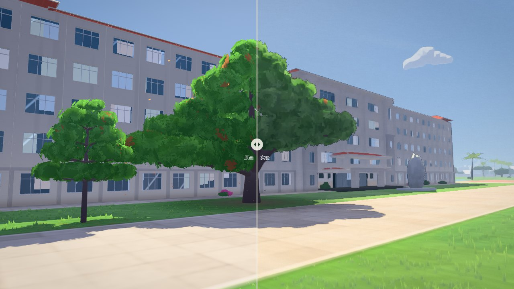
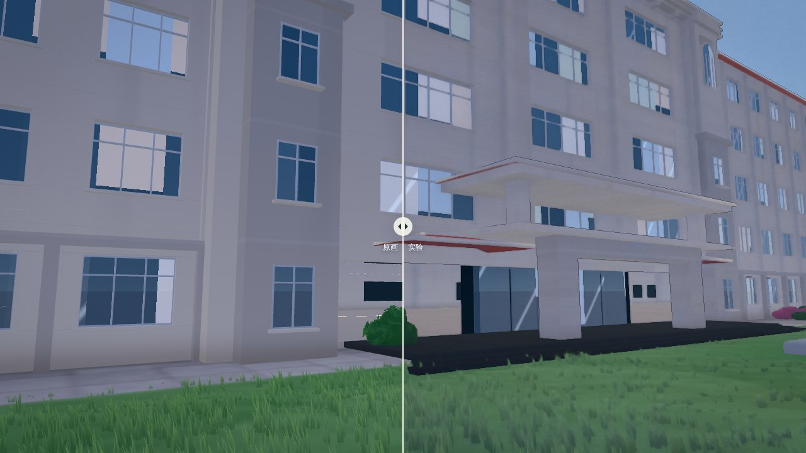
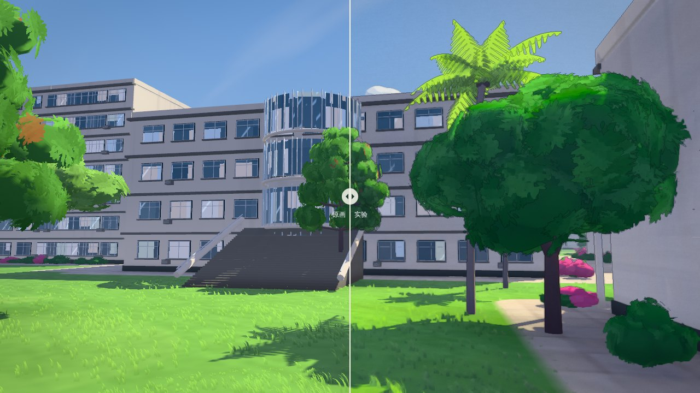
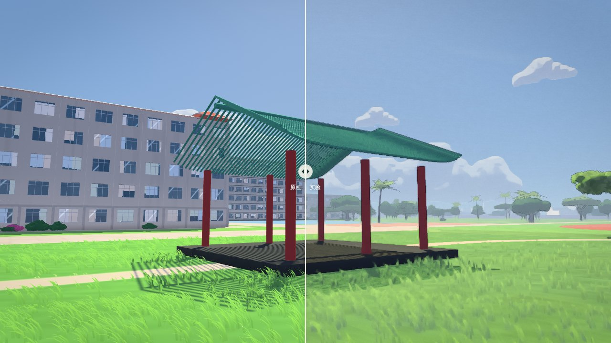
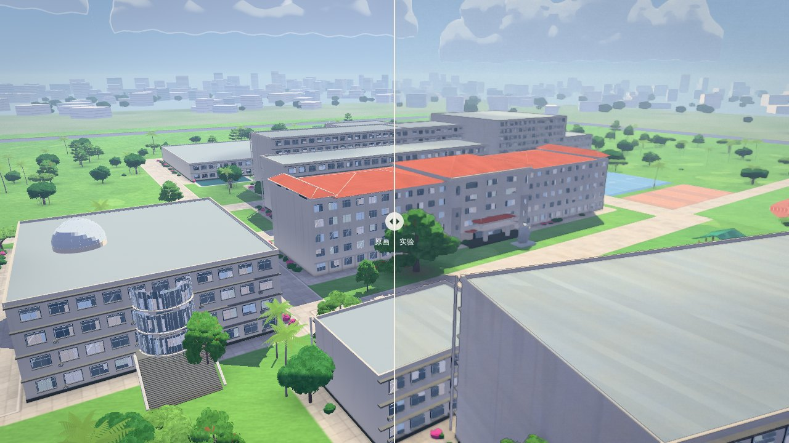
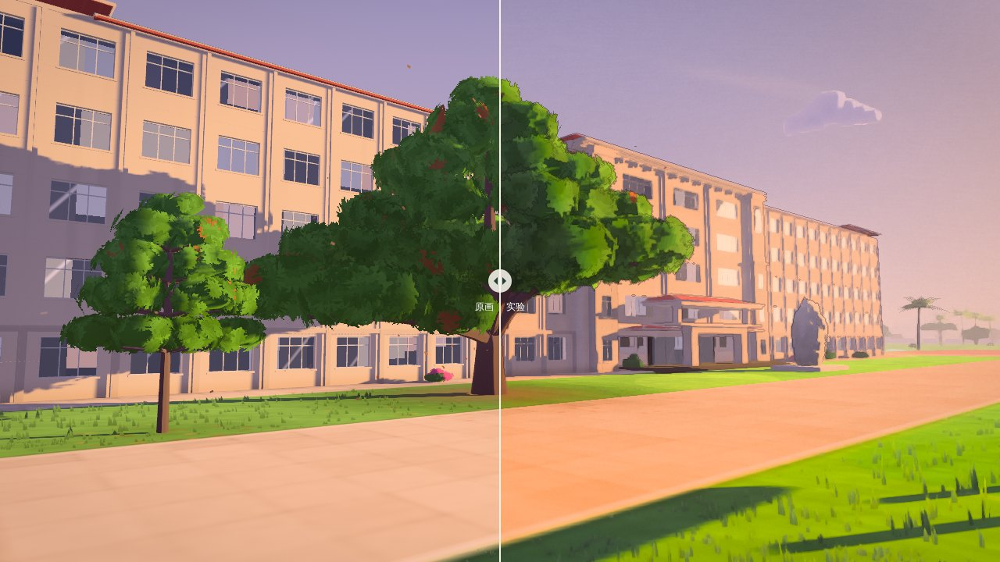
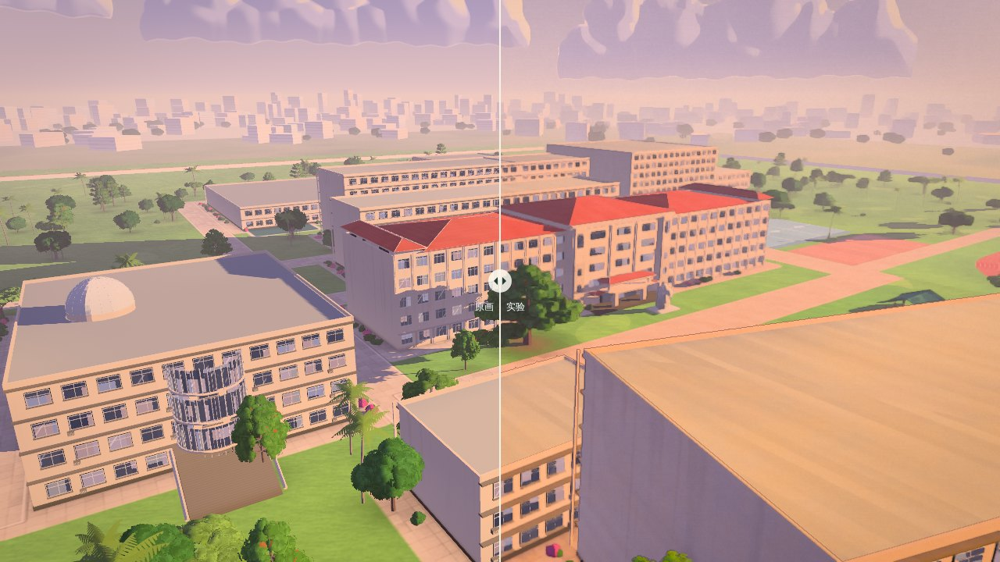
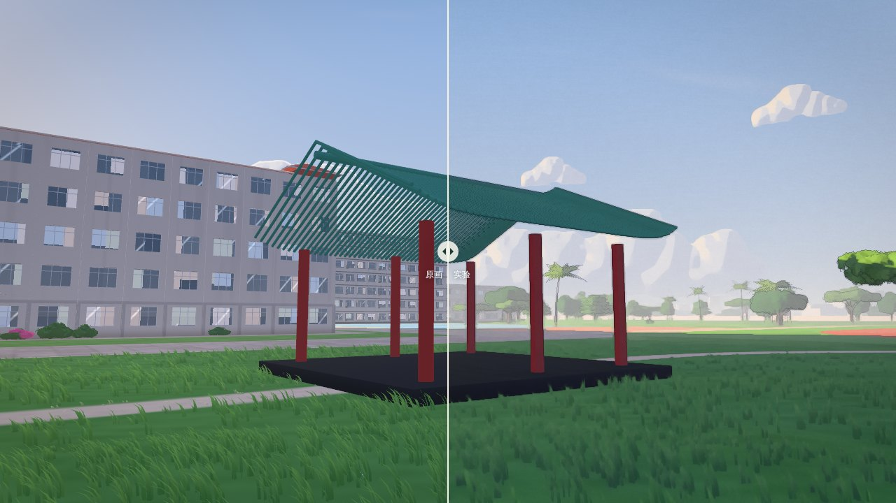

# 入画 · 画境实验室（painted-lab）

线程一「入画艺术体系」的成果：一个独立页面 `painted-lab.html`，把第六幕「入画」走进去的那个绘画校园（V2 漫步的 cel 世界）原样搭起来，然后在**材质、光、空间层次、画面**四个方向上叠加可开关的实验层，并且始终可以和原画逐像素对照。

- 页面：`painted-lab.html`（`noindex`，不进入导航，不改动任何现有页面）
- 代码：`lanren/painted-lab/`（`main.js` `material.js` `passes.js` `views.js` `orbit.js` `lab.css`，工具在 `tools/`）
- 复用但**没有修改**：`lanren/ruhua-stroll/*`（atmos / campus / sky / ground / grass / flora / horizon / daylight / post）、`lanren/map/*`、`assets/walk/campus.json`、Blender V3 建筑模型
- 分支：`claude/project-thread-h5aonb`

## 打开方式

```
python3 -m http.server 8765      # 仓库根目录
http://localhost:8765/painted-lab.html
```

| 参数 | 作用 |
|---|---|
| `?mode=split\|lab\|base` | 对照（左原画、右实验，可拖动分界）/ 只看实验 / 只看原画；键盘 `C` 循环 |
| `?view=lanshu\|yihao\|library\|fengqi\|aerial` | 五个观察点 |
| `?time=morning\|noon\|golden` | V2 的三种光（清晨 / 正午 / 傍晚） |
| `?layers=core,brush,…` | 启动时打开哪些实验层（默认全开） |
| `?quality=high\|medium\|low` | 档位（触屏默认 medium） |
| `?still` | 冻结时间、只在变化时绘制（截图与评审用） |
| `?debug` | 显示帧时间与 draw call |

`H` 隐藏界面。拖动环顾、滚轮/双指缩放、右键或 Shift 拖动平移。

## 设计原则

1. **不替换 HAIZ 的样子，只往上加。** 所有材质实验都是 V2 `cel` 材质的兄弟（`celLike`，共用同一套太阳、风、天气 uniform），画面实验都在 V2 同一条 bloom → Khronos Neutral → 分离色调 链路上插入。自检第 2 条保证：**所有实验层关掉时，实验画面 = V2 原画**（软件渲染下测得平均差 0.25/255，只差抖动噪声）。
2. **每个实验对应一个画家的习惯，而不是一个滤镜名字。** 见下表。
3. **明度不动，颜色可以动。** 光色、交界色带、碎色、遮蔽色都按「保持明度、移动色相与色度」的方式写，画面的素描关系（哪里亮、哪里暗）由 V2 的光照决定，不被实验层改写。
4. **诚实。** 建筑仍然是项目的 Blender V3 近似模型，树木、花坛、天空是绘画式表达；页面上写明，不把画面处理说成更高的「真实度」。

## 实验层

| 组 | 层 | 画家的习惯 | 做法 |
|---|---|---|---|
| 材质 | 交界色带 core | 体面转离光线的地方颜色最浓、略暖；cel 的硬边单独看像贴纸 | 用比 cel 交界更宽的光照项和阴影贴图的软边，算出交界带；在带内把颜色推向固有色色相并略暖，再按原明度归一 |
| 材质 | 笔触 brush | 墙上是一层层横向铺的颜色，近看不糊、远看不碎 | 沿表面切线的各向异性笔触噪声，两个八度按 log₂(距离) 交叉淡入，使笔触在屏幕上保持大致固定的宽度；受光处厚、阴影处薄；远处交给空气 |
| 材质 | 碎色 broken | 一面墙的颜色从来不是一种调好的颜色 | 较慢的第二个场在固有色周围冷暖交替，明度不变 |
| 光 | 光色 light | 热带的光是暖的，阴影是有颜色的，而不是更暗的灰 | 受光侧乘上太阳颜色的色相（傍晚自然更暖），阴影侧向当时的阴影色相靠拢；两侧都按原明度归一；玻璃不参与 |
| 光 | 遮蔽色 wash | 凹处用罩染：先变色，再稍微变暗；不画黑边 | 深度缓冲上的 12 样本遮蔽（半分辨率 + 深度感知模糊）；在 Neutral 曲线前把颜色推向阴影色相再轻压暗；只作用于环境光（亮部不罩），并随距离淡出 |
| 空间 | 空间层次 planes | 远景没有近景的深色；近景色度最高 | 以「画面主体」（环绕相机的目标点）距离为基准分近、中、远三层：远层明度向天色收拢，近层色度略升。基准随取景变化，所以鸟瞰和平视都成立 |
| 画面 | 油彩 paint | 笔触顺着形，近处保留细节，远处概括成形 | 各向异性 Kuwahara（Kyprianidis 等 2009；多项式扇区权重 2011）：结构张量 → 高斯平滑 → 8 扇区滤波。笔触半径随「概括程度」从约 3.2 CSS px 增到 6 px。该层以封顶的像素密度运行（高档 1.5、中档 1.0、低档 0.85 设备像素/CSS 像素），线和纸仍在全分辨率 |
| 画面 | 线 ink | 有色的线，不是黑线；近重远轻；只画在物体的近侧 | 深度跳变（剪影，需同时满足相对与绝对的米数，草叶和叶片之间不出线）+ 1/z 二阶差（折线）；离地 0.45 m 以下不画（地面交给色调）；颜色 = 当地颜色 × 阴影色相 |
| 画面 | 纸 paper | 固定在画面上的纸纹；颜料在暗部沉积、在色块交界处聚集 | 屏幕空间纸纹（不随相机游动），按明度加权；色块交界处轻压暗 |

## 观察点

按 `DESIGN.md` 的验收要求（凤栖堂、图书馆、一栋教学楼）设置，另加榄仁树和鸟瞰：

- **榄仁树** 近景树冠与一号教学楼
- **教学楼** 一号教学楼立面与门厅
- **图书馆** 南面大台阶与弧形玻璃
- **凤栖亭** 亭、草地与远处教学楼（三个空间层次）
- **鸟瞰** 高处三分之四视角

视角以各自地物的中心为基准（`views.js`），数据移动时视角跟着移动。

## 对照截图（SwiftShader 软件渲染，1280×720）

正午，左原画 / 右实验：







傍晚与清晨：





完整的原画 / 实验单张在 `shots/*-noon-base.jpg`、`shots/*-noon-lab.jpg`。手机竖屏（iPhone 13 模拟）：`shots/mobile-closed.jpg`、`shots/mobile-open.jpg`。

## 验证记录

### 实际执行过的

环境：云端容器，Chromium（Playwright 预装版本）+ SwiftShader 软件 WebGL2，无真实 GPU、无真机。

| 检查 | 命令 | 结果 |
|---|---|---|
| 自检（10 种配置 × 2 个观察点） | `node lanren/painted-lab/tools/check.cjs` | 见下 |
| 截图（5 观察点 × 3 种光 × 3 种模式） | `node lanren/painted-lab/tools/shoot.cjs` | 全部生成，无页面错误、无控制台错误 |
| 手机竖屏 390×844（iPhone 13 设备描述） | Playwright `devices['iPhone 13']`（脚本未入库，步骤：打开页面 → 截图 → 打开图层面板 → 截图 → 读 scrollWidth） | 页面无横向溢出（scrollWidth = 390），面板默认收起，可打开；medium 档，主画面 1.5×、油彩 1.0×；无错误 |

`check.cjs` 的断言：

1. 页面与建筑模型载入成功，无 pageerror / console.error
2. 所有层关闭时实验画面 = V2 原画（平均 |Δ| < 1.5/255）
3. 所有层打开时画面确实变化（平均 |Δ| > 4/255），且没有「原画不黑、实验变黑」的像素（NaN / 空洞检测）
4. 九个层各自单独打开都有效果（面板里没有失效的开关）
5. 对照模式左半 = 原画、右半 = 实验

第一次运行时第 2 条失败（平均差 4.1/255）：实验链路把 V2 的暗角放在了 sRGB 编码之后，而 V2 在线性空间里做暗角。已修正，修正后见下方最终运行结果。

最终运行结果：**38/38 通过**（榄仁树、图书馆、鸟瞰三个观察点），原始输出见 [verification.txt](verification.txt)。全关与原画的平均差为 0.25/255；全开时平均差 5.8–7.8/255。

### 没有条件执行的

- **任何帧时间 / 性能数字。** SwiftShader 是 CPU 软件渲染，一帧要几秒，数字没有意义，所以本文件不给任何性能结论。页面带 `?debug` 读数与动态分辨率调速（和 V2 漫步同一套逻辑），需要在真机上测。
- **真机与真实 GPU**（iOS Safari、安卓 Chrome、桌面独显 / 核显）上的观感与发热。
- **WebGL1 回退。** 实验层使用 WebGL2（动态循环、半浮点渲染目标、深度纹理）；不支持 WebGL2 的浏览器上页面会显示启动失败提示，没有降级路径。

### 成本估计（推算，未测）

油彩层是最贵的一步，每个油彩像素采样数约为椭圆核面积：

| 档位 | 油彩密度 | 半径（油彩像素）近→远 | 每像素采样约 |
|---|---|---|---|
| high（桌面） | ≤ 1.5 | 4.8 → 8（封顶） | 70 → 200 |
| medium（触屏默认） | ≤ 1.0 | 3.2 → 6（封顶） | 32 → 113 |
| low | ≤ 0.85 | 2.7 → 4（封顶） | 23 → 50 |

对照模式要渲染两遍场景（阴影贴图只更新一次）。这些都是估算，需要移动端性能线程或真机来量。

## 合并前仍需要的验收（来自 PR #88 的审查）

1. 真实设备：macOS GPU、安卓 Chrome、iOS Safari 的截图、交互与 GPU 帧时间，重点看半浮点渲染目标、深度纹理与多 pass 兼容性。
2. 与移动端性能线程统一口径，分别测原画 / 实验 / 对照三种模式的成本（油彩、遮蔽、对照模式的两次场景渲染）。
3. 由人对五个观察点做成对比较或盲评，判断「傍晚偏浓」「远处窗格被概括」「树冠局部过暗」。平均像素差只能证明「有变化、无破图、全关可回到原画」，不能证明画面更好。

这三项在本线程的云端容器里都无法完成。

## 已知局限与取舍

- 遮蔽色在树冠内部仍会让部分叶团偏暗；已经用「只罩环境光」减轻，但后期无法区分树叶与墙，彻底解决需要材质把类别写进一个额外通道。
- 油彩层会抹掉 1–2 px 的细节（远处窗格变成色点、屋脊细线消失），这是有意的概括；如果某个场景需要保留，降低远处半径即可（`pipe.radius`）。
- 傍晚的光色较浓（太阳本身很橙）；系数已从 0.5 降到 0.28，是否再降需要在真屏上看。
- 草地交给 V2 自己的叶片和笔触，实验层对草几乎不加东西（笔触为 0），避免把草变成噪声。

## 怎样接进第六幕（建议，未实施）

- **材质层**可以直接用于 `lanren/ruhua/`：`pairMaterials(scene)` 对任何 `cel` 场景生效，代价是每个材质多一个程序变体，几乎没有额外每像素成本。光色 + 交界色带是性价比最高的两项。
- **画面层**建议先作为「入画之后」的一个可选画法，而不是默认：油彩是最贵的一步，应等移动端性能线程给出真机数据后再决定档位。
- 本页不改任何现有页面与线上版本；是否接入、接到哪一幕，由你决定。
