# 第六幕「入画」· 让校园从一幅画中诞生（2026-11-17）

> 前五幕让我们认识一棵真实的榄仁树。第六幕，我们画下它，然后走进这幅画。画并没有因为画完而停下：它正下着海口此刻的雨。

**预览入口**：[`ruhua.html`](../ruhua.html)（独立页面，不改动六幕首页与 `campus-stroll-v2.html` 的行为）。
代码：[`lanren/ruhua/`](../lanren/ruhua/) · 人物构建脚本：[`scripts/ruhua/build_student.py`](../scripts/ruhua/build_student.py) · 截图：[`docs/ruhua/`](ruhua/)

| | |
| --- | --- |
| 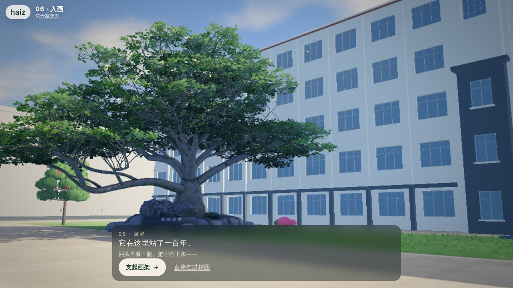 | 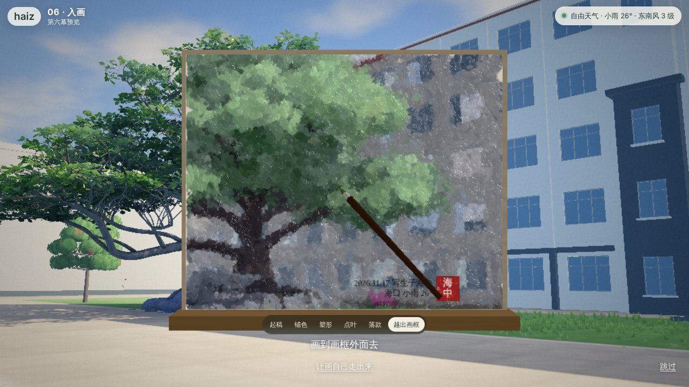 |
| 06 · 回望：写实的记忆，永远的夏日正午 | 画布在眼睛与树之间，画上是它挡住的东西——但画的是今天（这里是自由天气「小雨」） |
| 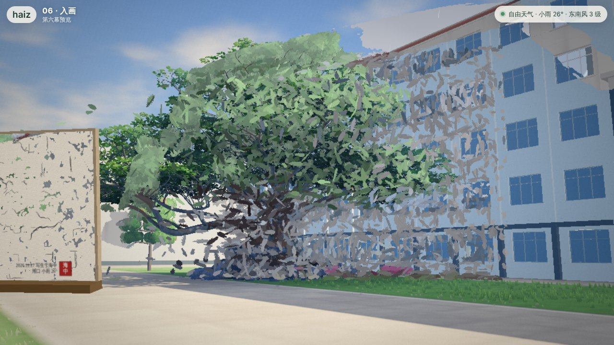 | 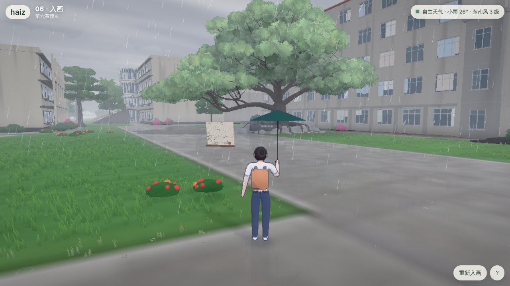 |
| 画沿着画家的视线离开画布，落到它所画的东西上 | 退出身体：你站在画里，撑着伞，画架只剩炭笔底稿和落款 |

以上均为开发环境 Chromium + SwiftShader（软件渲染）的逐帧截图，不是实机录屏。

## 一、核心艺术决策

**为什么要画这棵树。** 第六幕是「回望」。人回头看一样舍不得的东西，自然的动作是把它留下来；在一所中学里，最自然的留法是写生——美术课支起画架画校园，一号教学楼前的老榄仁树是最常被画的那一棵。所以这里不发明一个魔法道具，只让行走者做一件学生真会做的事：支起画架，对着树写生。

**画布放在哪里：sight-size。** 画架立在眼睛和树之间，画布正好挡住树的主体（这是写生里「视尺寸」的方法，也是马格利特《人类的境况》里画架与窗外风景接续的原理——我们借的是原理，不是画面）。画布上的一切都保存在画家眼睛的屏幕空间里：从画家的位置看，画与它挡住的世界逐像素对齐，所以画框外的真树和画框内的画树在边缘处是连续的；换一个位置，画布就只是一块平的、带颜料厚度的布。

**画什么：此刻。** 写实的世界是 HAIZ 的记忆：第六幕原本艺术指导的、永远的夏日正午光（`chapters.js` LIGHT[5]），树是满叶的。画里却是今天：参考图是绘画世界在今天的天气、今天的太阳月亮、今天的物候（11 月已有零星红叶）下的渲染。所以如果海口正在下雨，晴朗的记忆里，画布上就是一块灰色的雨天——一扇通往此刻的窗。之后画蔓延开来，记忆被此刻覆盖：画不再是现实的记录，它开始改变现实。

**玩家如何参与。** 不要求真实绘画：在画布上拖动，离笔刷最近的笔触先落下，每一笔沿着自己的长度画出来。顺序是画家的顺序——起稿（炭笔沿轮廓）→ 铺色（大笔，模糊的色块）→ 塑形 → 点叶（只在有细节的地方点小笔）→ 落款（印章「海中」与写生日期、海口天气）。停手五秒，笔会自己慢慢画；按住空格也可以画（键盘、无障碍）。

**画作如何改变现实：玩家自己越出画框。** 画完后提示「画到画框外面去」：笔刷越过画框边缘，落在真实世界上的那一笔，当即变成绘画（屏幕上的笔触沿视线投射到它碰到的第一个表面上，并带着湿油彩的光泽）。这一步是玩家亲手打破边界，而不是一个自动特效。

**为什么从树开始，而不是从屏幕中心。** 行走者向旁边走一步，画布上的颜料一笔一笔离开画布，沿着画家当时的视线飞出去，落在它所描绘的东西上——因为画的是树，颜料最先落到树上（近处先到，远处后到）。这正是透视的逆过程：写生时世界投影到画布上，此刻画布投影回世界。走开一步的视差让人意识到：刚才平面上的画，已经是三维里的树。画布只剩炭笔底稿和落款。

**写实与绘画可以同时存在。** 绘画版的树不是 V2 那棵更小更圆的概念树，而是**同一棵树**：同一个树皮网格、同一套叶簇位置、同一个风函数，只换材质。所以在转换中，一棵树可以半边是写实的叶片，半边是绘画的叶团，分界是一笔笔的笔触，枝干形态、尺度、位置完全连续。建筑也是同一个 Blender V3 几何，两套材质。

**分界是笔触，不是溶解。** 画从树开始向外蔓延时，每个表面上的分界由世界空间里的笔触组成：地面上的笔触环绕着树扫开，墙上的笔触水平铺开，每一笔有自己的先后，边缘是毛刷的参差。天空最后被宽笔刷一笔笔刷过。

**进入：发现自己在画里。** 最后镜头从行走者的眼睛里升起、退到身后：你看见的是一个绘画的人站在画架旁。控制权交给第三人称漫游，不跳切、不淡入淡出。

## 二、技术方案

| 部分 | 实现 |
| --- | --- |
| 同一坐标 | 首页构图 b 把校园绕树根转 90° 而保留 V4 的树与机位；漫游保持数据方位。这里反过来把 V4 的树、岛与 06 机位绕树根转 −90°（`v4.js`），所以树在校园的同一位置，面对同样的建筑 |
| 两份世界 | 每个表面两份：记忆（layer 1：V4 的树/叶/岛材质，Blender 原材质，06 光，ACES + V4 的 finish）与绘画（layer 2：V2 的 cel 材质与 grade）。两份读同一个 `paintTime(p, n)`，各自丢弃属于对方的片元（`paintfield.js`），再按深度合成（`pipeline.js`）。转换结束后只剩绘画管线；两套材质都在载入时预编译，切换不卡顿 |
| 画场 | 投影器（画家视线：每笔的出发时间 + 沿射线的飞行距离 / 34 m/s，深度图判定第一表面）∪ 蔓延前沿（从树根加速向外，世界空间笔触）∪ 天空（方向空间宽笔触） |
| 笔触规划 | `strokes.js`：参考图（绘画世界的渲染，中性 grade）→ 距离/色调边缘的炭笔线 → 四层由粗到细的曲线笔触（Hertzmann 1998 的思路：沿等色调线、遇色变止、细层只在有细节处） |
| 笔触渲染 | `easel.js`：每笔一条带状网格，程序化毛刷（圆头、拖尾、干笔），颜色/厚度/投影图三张画家屏幕空间贴图；画布材质读取它们，凸起接受光照 |
| 飞行 | 约 4 200 片（手机 2 200）中小笔触，按各自出发时间沿射线飞行、翻转、到达即消失，同一时刻该处世界被绘画 |
| 绘画的树 | `paintedtree.js`：V4 树皮网格 + 每个叶簇一张朝向眼睛的 V2 叶团卡片；风用 V4 的 `windSway`（改名后与 V2 的 uniform 共存）；颜色按 `season.js` 当日物候 |

**对 V2 漫游的改动**（`lanren/stroll/*`，默认值即原状）：天气 uniform（`uWet uPuddle uRain uNight uLamps uWindSway`）；湿地面、积水与雨滴涟漪；积水的屏幕空间反射（只在铺装积水处）；阴天层云、雨幕、星与月；晚自习亮灯的教室、城区灯火；风强弱影响树与草；`celLike()` 生成材质变体。已对比截图确认 `campus-stroll-v2.html` 默认画面不变。

## 三、真实天气

- **来源**：Open-Meteo Forecast API（非商业免费、**无需密钥**，所以静态站点没有可泄露的秘密；请求只带校园锚点坐标 19.996°N, 110.347°E，不带访客信息）。和风天气需要密钥，在纯静态的 GitHub Pages 上无法安全保存，故不采用。任何人在任何地方打开，看到的都是海口校园的天气。
- **读什么**：15 分钟 `current` 块 + 前 12 小时、后 14 小时的逐小时气温、湿度、降水、总/低/中/高云量、能见度、风速、风向、阵风、天气代码、短波辐射。
- **连续**：小时之间插值，最新 15 分钟读数的差值在之后一小时内渐隐（刷新不跳变）；视觉变量（积云、层云、卷云、雨、风……）以分钟级时间常数缓动；光照由真实太阳/月亮位置连续计算（清晨与傍晚分开取色，夜里月亮是光源），再被云与雨压灰、压软。
- **记忆**：路面的湿与积水由过去 12 小时的雨、日照、风、湿度积分得到——上午一场阵雨，中午路面仍潮，下午才干；雨停后屋檐、树冠还在滴水。用 2026-11-03/04 的真实 ERA5 逐小时数据验证（`tests/ruhua-weather.cjs`）。
- **节奏**：阵雨成阵、有间歇；连续性降雨起伏；毛毛雨几乎不变（`rainPulse`）。
- **失败与缓存**：`localStorage` 缓存 12 分钟内复用；每 15 分钟刷新；失败按 1→2→4…30 分钟退避；期间沿用 18 小时内的缓存（界面写明「稍早的预报」）；完全没有数据时用海口本月气候常态，界面写明「离线」。
- **自由天气**：晴、多云、阴、小雨、雷阵雨、大风、雨后 × 清晨/正午/傍晚/夜晚，同一套缓动（更快）；「海口此刻」一键返回。
- **如实说明**：这是模型数据（约 10 km 网格），不是校内观测；画面是「可信而有美感的表达」，不是逐像素复制天空。

## 四、生态

**架构**（`eco/habitat.js`）：栖息地服务所有物种——天气、某点日照/树荫（穿过建筑与树冠的光线，按太阳位置缓存）、遮蔽（连廊、亭顶、檐下）、蜜源（三角梅花坛与新加的龙船花丛，每朵花记得上次被访问的时间）、墙脚线段、行走者位置速度。物种只读它；注册表统一更新。以后加物种（壁虎、白鹭、八哥、雨后的蛙……）只需实现 `update(dt, ctx)`。

**蝴蝶**（`eco/butterflies.js`）：迁粉蝶（快而直）、金斑蝶（滑翔、慢）、青凤蝶（快、不安分，雨后会落到湿地面上吸水）。行为：选花（吸引力、距离、近期是否被采过、个体随机）、按物种的蛇行与振翅起伏飞过去、悬停、落下、取食、合翅/晒翅；行走者快速逼近或奔跑时惊飞；风推着它们；雨、大风、低温、夜里躲进枝叶。只模拟行走者附近 70 m 内的个体。

**猫**（`eco/cat.js`）：
- **位置核对**：`assets/walk/campus.json` 中没有名为「一堂」的建筑；有「第一食堂」与「第三食堂」。按「一堂 = 第一食堂」理解，数据中第一食堂与教学楼之间的开阔地，是图书馆以南、二号教学楼东端（x≈10）到第一食堂西墙（x≈127）、两条东西向道路之间（z≈44…92）的铺装与绿地，东侧是男生宿舍北翼。猫的活动范围就放在这里（`RANGE`，一处配置）。**这是一个需要你确认的理解**；如果「一堂」另有所指，改一行即可。
- **一天，而不是循环**：按海口真实时钟、以日期为种子生成：清晨巡视、上午晒太阳（热就去阴凉）、理毛、午饭时守在食堂门口、午睡、下午闲逛、晚饭、傍晚在亮灯的教学楼旁坐着看、夜里在檐下睡。每约 12 分钟换一处地点。**打开页面时它在它这一天该在的地方**——页面关着，它的一天照样过；今天在树荫里，明天可能在别处。
- **天气与体感**：下雨躲到檐下或连廊、看雨；大风贴墙；冷找太阳、热找最深的阴影。
- **对行走者**：慢慢走近，它会看你，有时走过来坐在旁边、慢眨眼；奔跑冲过去，它压低身子逃开，在远处坐下看你。平静相处会让它更亲近你一点（只存在这台设备上，两周内慢慢淡忘）。
- **动画**：程序化：四足步态（行走为侧序、快步为对角），腿部两骨 IK 把爪子落在地上，坐、团（揣手）、侧躺晒太阳、蜷睡、伸懒腰、理毛，尾巴姿态随情绪，耳朵抖动，慢眨眼，头追随蝴蝶或行走者。

## 五、人物：重做的模型与自然的走路

- **模型**（`scripts/ruhua/build_student.py`，Blender 无界面构建，可复现）：连续的身体（骨架图 + 半径的 Skin 修改器，细分平滑），约七头身 1.68 m；白色短袖衬衫、藏青长裤、白鞋、橙色书包；头部有下颌与下巴，发型为发帽加刘海束；A 字姿态骨架，腿在绑定姿态中竖直。
- **走路**（`walker.js`，没有任何关键帧）：脚在支撑期钉在地面上，摆动期按身体速度预测落点、走弧线（脚跟着地、脚尖离地），转弯和停步由脚决定；步长和步频随速度变化（1.4 m/s 约 1.85 步/秒；跑步约 2.8 步/秒并有腾空）；两骨 IK；骨盆在行走时于支撑腿正上方最高、跑步时最低，向支撑脚侧移，随步幅旋转并在摆动侧微降；胸椎反向旋转、手臂与对侧腿同步摆动（跑步屈肘）、随速度与加速度前倾；头部保持水平并看向玩家注视处；站立时重心左右转移、呼吸，转身或漂移时会补一小步。下雨时撑开雨伞，雨停收起。
- `?figure=v2` 可切回 V2 人物对比。

## 六、验证

- `npm run test:ruhua`：`tests/ruhua-weather.cjs`（Node，17 项）与 `tests/ruhua-browser.cjs`（Chromium：全流程、拖动作画、越界、蔓延到漫游、建筑碰撞、雨天与雨伞、猫的活动范围与蝴蝶、重新入画、手机竖屏触控、离线回退、跳过、无页面错误）。
- `node tests/ruhua-weather.cjs`：17 项（解析、插值、风向短弧、湿度记忆的四个时刻、雨节奏、日月、光照逐分钟连续、阴天去阴影、夜晚、气候常态、文字、缓存/限流/离线三种来源、自由天气平滑与返回）。
- `npm test` 中其余用例通过；`tests/cinematic-runtime.cjs`（`descent.html`）在本分支改动前即失败，与本次无关。
- 真实浏览器（Chromium + SwiftShader）逐帧检查：全流程（回望 → 支架 → 起稿 → 铺色 → 完成 → 越界 → 飞行 → 蔓延 → 退出身体 → 漫游）横屏与手机竖屏（390×844，触控）；七种自由天气与四个时刻；猫与蝴蝶近景；人物站、走、跑侧视；浏览器内 Open-Meteo 实时路径（来源、缓存、说明文字）；`campus-stroll-v2.html` 改动前后对比。
- **绘制量**（低档，含阴影通道；与 GPU 无关的计数）：回望约 320 draw calls / 4.0 M 三角形；转换中两套世界约 650 / 7.1 M；漫游约 350 / 3.2 M。转换只持续约 15 秒；动态分辨率在帧时超预算时先降分辨率。
- **没有验证**：真机 GPU 帧率与发热（开发环境只有软件渲染，**不声称任何真机帧率**）；iOS Safari / 微信内置浏览器；真实触屏手感；长时间运行的内存。

## 七、已知问题与下一步

- 转换中两套世界的深度合成在物体轮廓处没有抗锯齿（只在约 15 秒内出现）。
- 转换中改变窗口大小，画布与世界的对齐会偏移（画家视角已固定）。
- 绘画版树冠卡片近看有可见的重复；树冠在雨中没有专门的「叶面滴水」细节，只有雨后的冠下滴水。
- 猫的身体是刚性部件拼接，坐姿和侧躺在近景下仍显生硬；没有跳跃与上台阶。
- 蝴蝶为了被看见画得比实物大约 1.6 倍。
- 「一堂」的理解待确认；猫与花丛的位置是创作，不是实况。
- 合并到 `main` 前建议在一台中端安卓和一台 iPhone 上看一次转换与漫游的流畅度。

## 截图（开发环境 SwiftShader 软件渲染，逐帧）

**入画全过程**（自由天气「小雨」，回望是记忆中的晴天）

| | | |
| --- | --- | --- |
|  回望 | 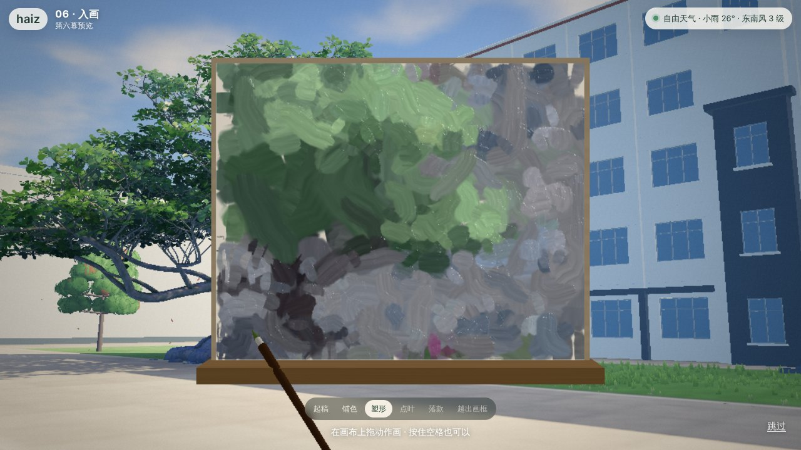 起稿与铺色 |  画完：画布上是此刻 |
| 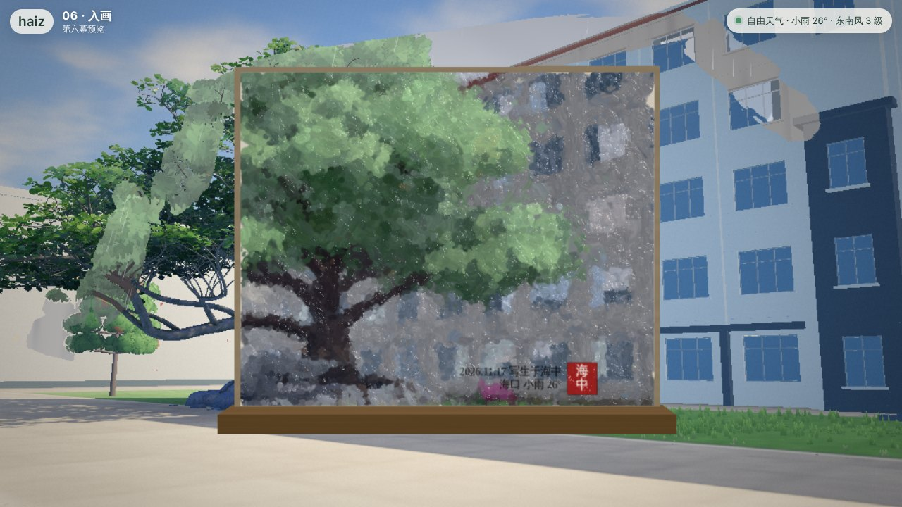 越出画框：笔落在真实世界上 |  画离开画布，落到树上 | 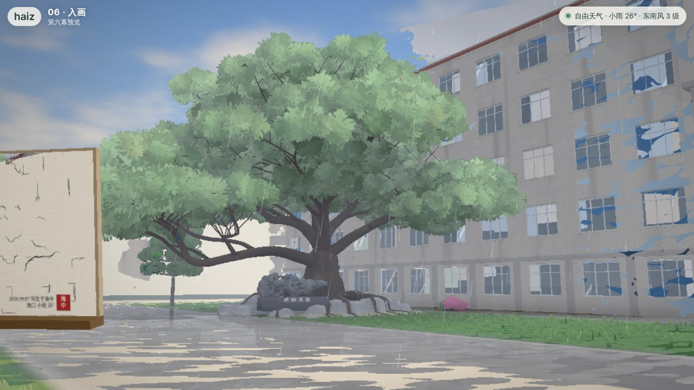 写实与绘画同在：墙上残留的「记忆」笔触 |
| 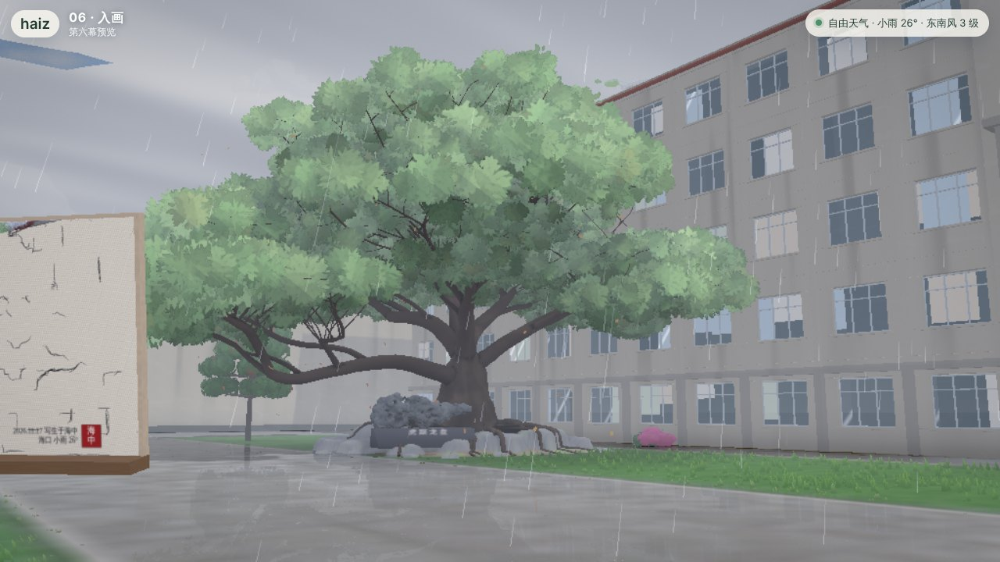 天空被一笔笔刷成今天的雨天 | 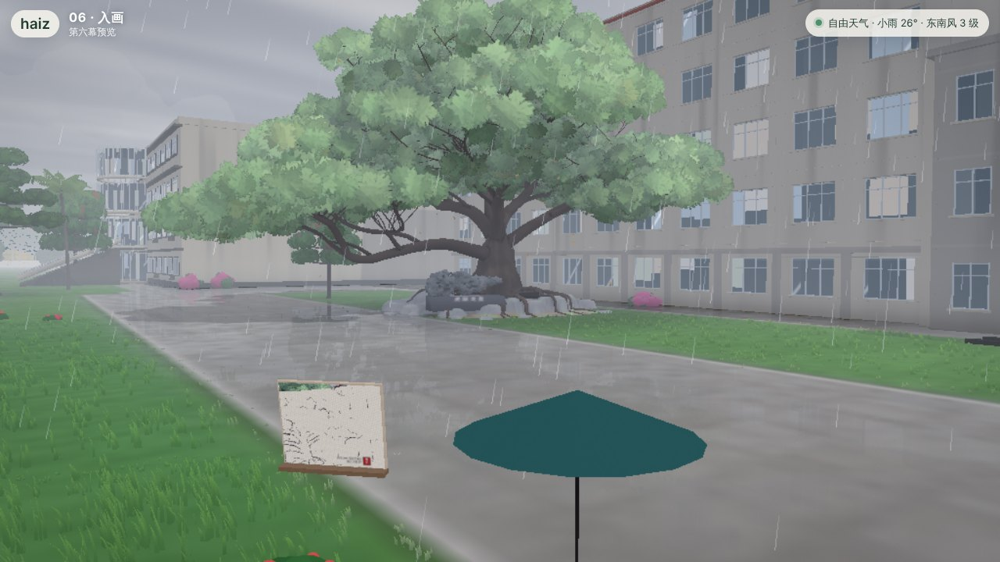 退出身体 |  在画里：画架只剩炭笔底稿与落款 |

**天气与时刻**（同一地点）

| | | |
| --- | --- | --- |
| 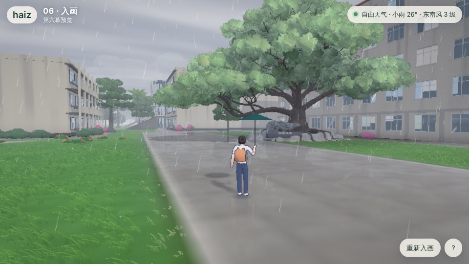 小雨：层云、湿路面、雨伞 | 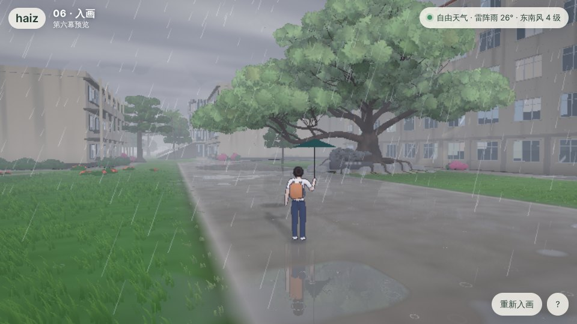 雷阵雨：积水倒影 | 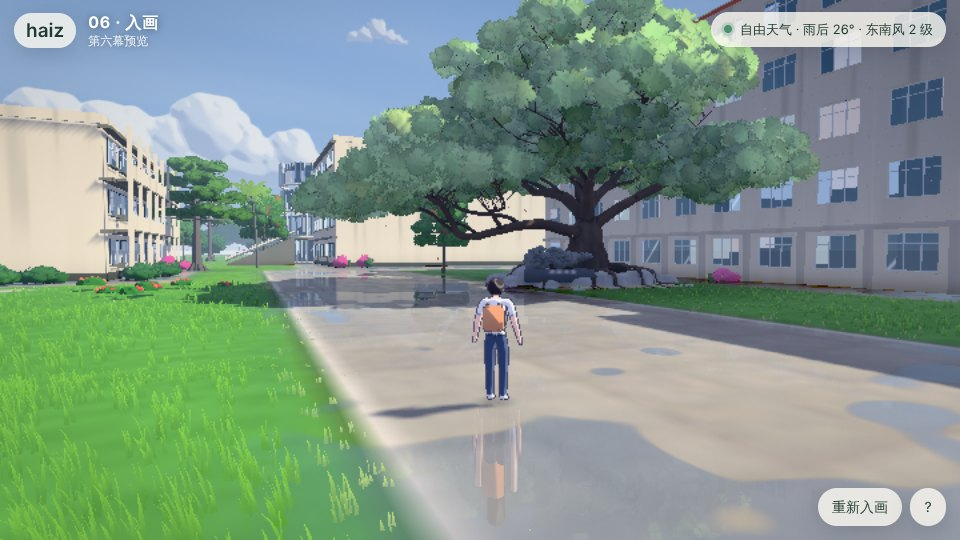 雨后：天晴而路面仍湿 |
| 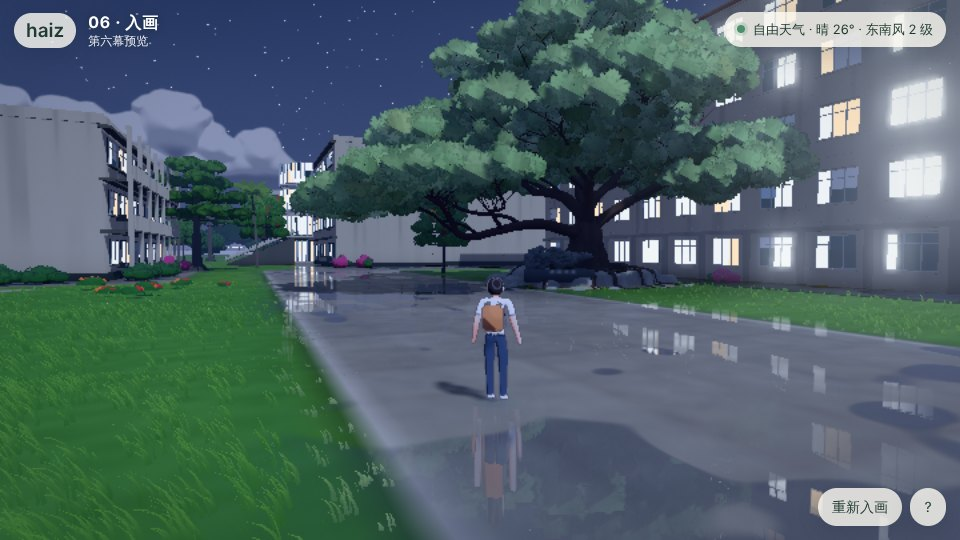 夜晚：晚自习的灯，积水里的倒影 | 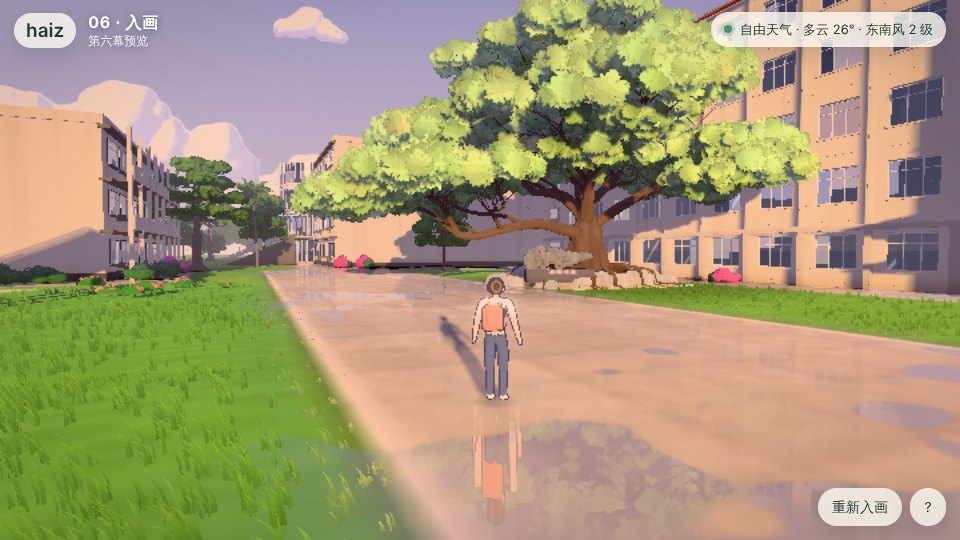 傍晚多云 | 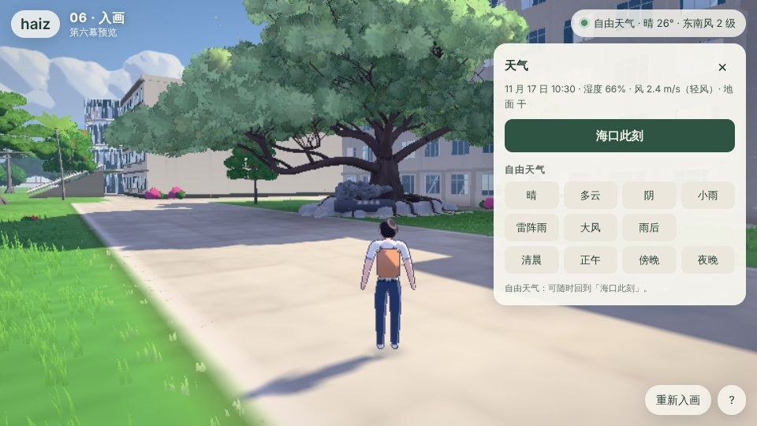 天气面板：海口此刻 / 自由天气 |

**生命与人物**

| | | |
| --- | --- | --- |
| 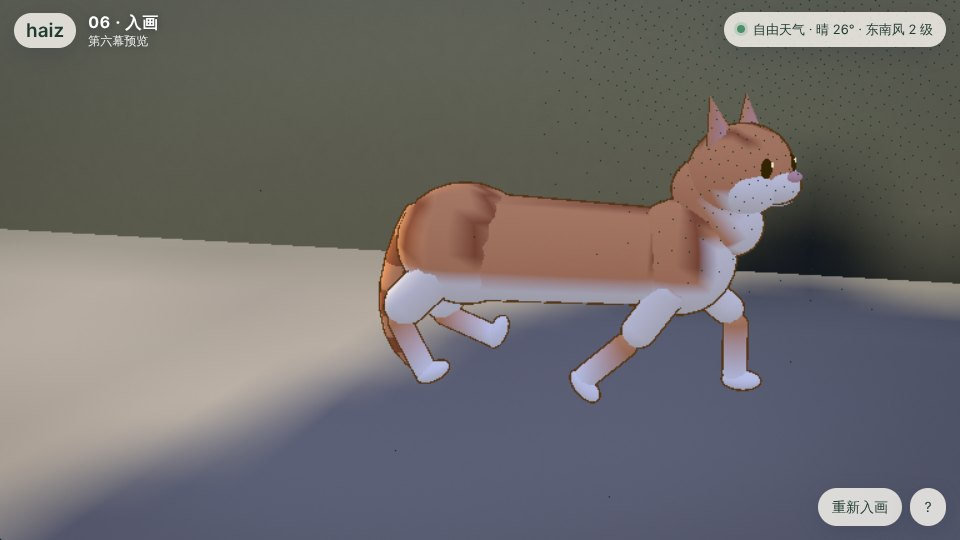 第一食堂旁的橘猫 | 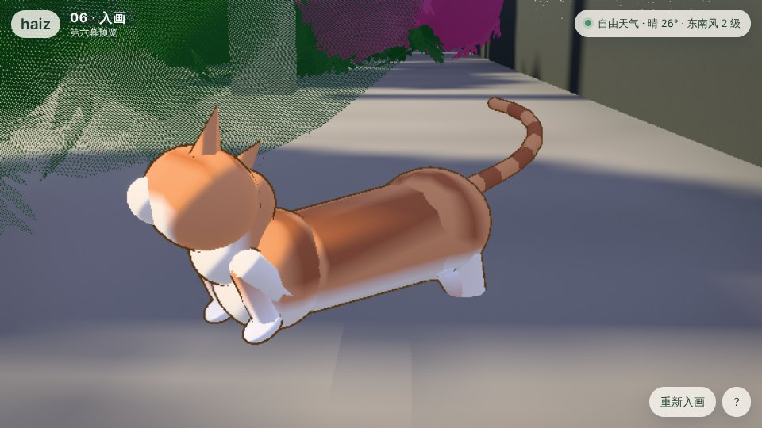 揣手 | 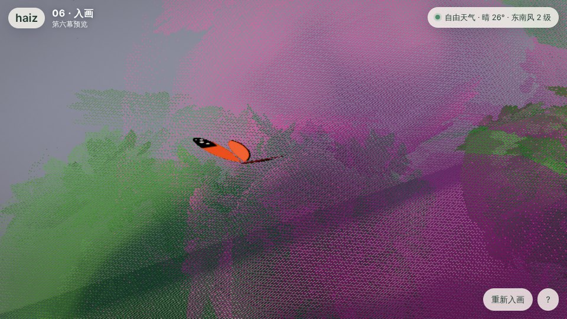 金斑蝶在三角梅上 |
| 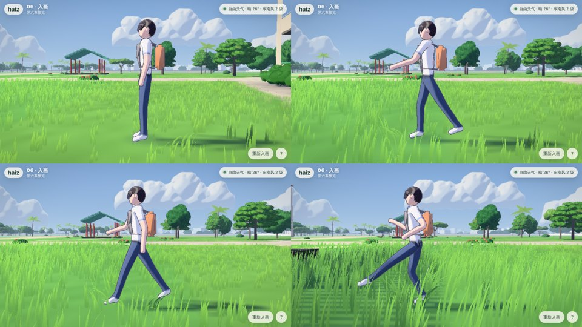 新人物：站、走（两帧）、跑 | 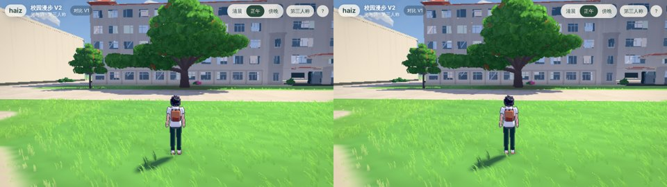 `campus-stroll-v2.html` 改动前后（默认画面不变） | |

**手机竖屏**（390×844，触控模拟）：回望 → 竖幅画布 → 画离开画布 → 漫游

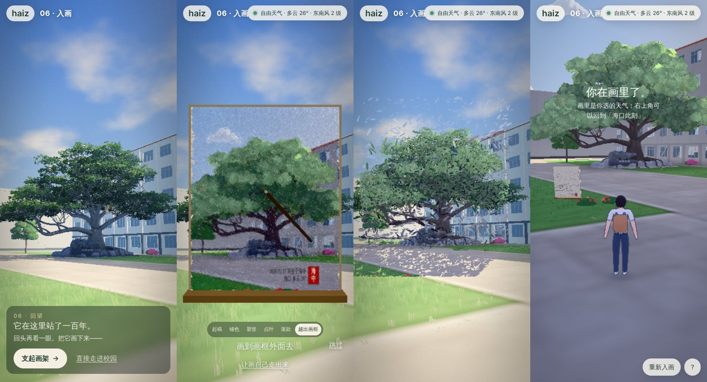

## 八、数据与署名

天气数据：Open-Meteo.com（CC BY 4.0），预报模型；测试数据为 Open-Meteo Historical Weather API 的 ERA5 再分析（见 `tests/fixtures/RUHUA-SOURCE.md`）。
