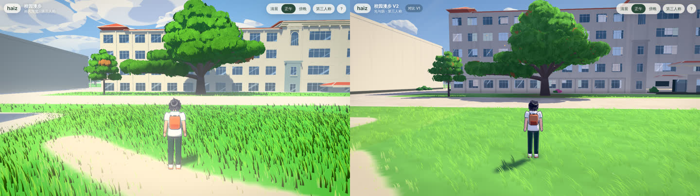
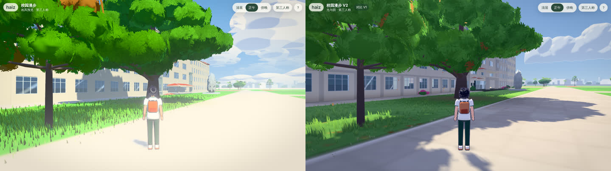
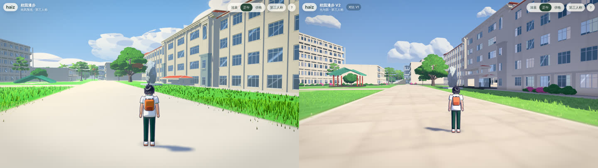
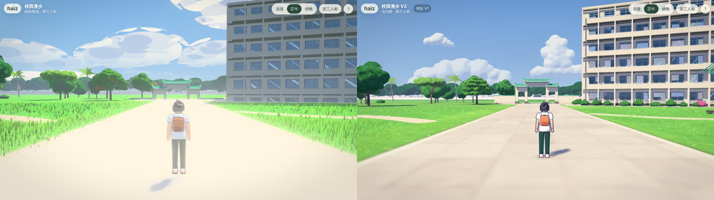
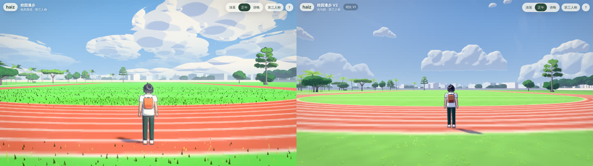
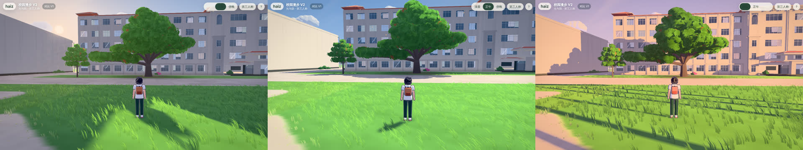
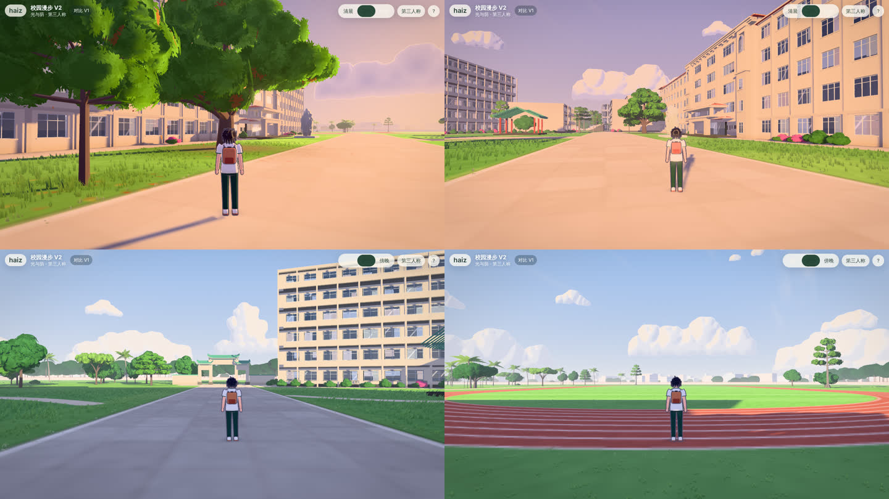
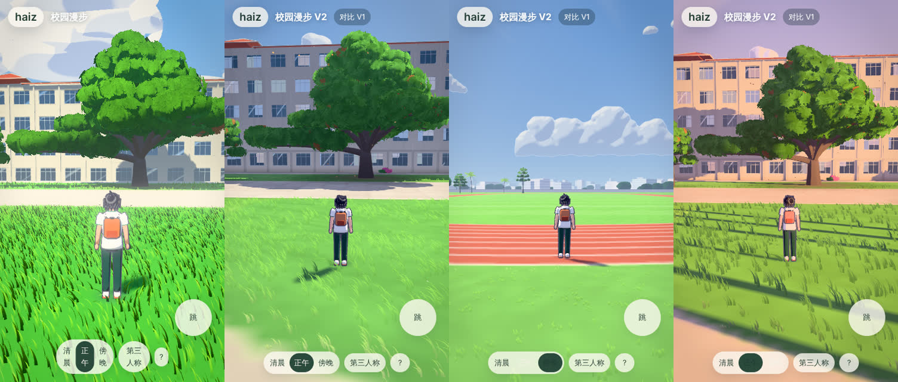

# 校园漫步 V2：从技术原型到值得停留的地方

入口：[campus-stroll-v2.html](../campus-stroll-v2.html)，与 [V1](../campus-stroll.html) 互相链接，可以直接对比。代码在 [lanren/stroll/](../lanren/stroll/)，V1 的 [lanren/toon/](../lanren/toon/) 保持不变。资产脚本：[scripts/stroll/build_clouds.py](../scripts/stroll/build_clouds.py)（积云）、[scripts/toon/build_trees.py](../scripts/toon/build_trees.py)（树木与 V2 叶片图集），`npm run build:toon` 一次重建全部资产。

## 一、为什么参考视频让人想走下去，而 V1 做不到

我把 V1 的五个机位（花园望榄仁树、榄仁树下、一二号楼间道路、北门道路、操场）与参考视频逐帧对照。V1 的问题不在于哪一个元素做得不好，而在于画面缺少组织：

1. **明度结构是平的。** 白色铺装、亮绿草地、米色墙和白色雾气都挤在高调区，泛光阈值又太低，晒亮的铺装也发光，给整个画面罩上一层奶白色（V1 北门道路一帧里人物几乎变成了半透明）。参考视频以中间调为主：树团是暗的，云顶和阳光边缘才是亮的，视线因此有地方停留。
2. **校园尺度上没有空气。** V1 的空气透视按公里计，80 米外的教学楼和眼前的人物反差一样，画面只有一个层次。
3. **大面积的表面没有被打破。** 成片的铺装、空白的山墙、连廊楼板都是平涂。
4. **天空是平均分布的。** 大小相同的圆盘云撒满天空，读起来像波点花纹；在手机竖屏里，它们被投影拉成了岩石。
5. **草是地毯。** 等距的叶片、深色的草根、硬切的边缘。远处的草地和近处没有关系。
6. **镜头只会跟随。** 人物永远在正中，镜头常常对着墙或被树冠挡住。

参考视频动人，是因为所有元素服务同一种空间感：明度有层级，空气把远处推开，风把近处和远处连成一片，天空有主次。V2 学的是这种组织方式，不搬用它的山、村庄或人物。

## 二、V2 的方向：热带的光与荫

海中是热带校园。一天里最深的体验，是从晒白的路走进榄仁树下的那一刻，所以 V2 把**光与荫**当作主题：

- **荫是一个地方。** 树荫和楼影是有颜色、有亮度的空间，偏蓝紫，但仍然透亮。人物走进树荫，画面会像眼睛适应那样稍微提亮。
- **一张画只有一个明度结构。** 以中间调为主；树团提供暗部；高光只留给云顶、阳光边缘和玻璃反光。泛光只作用于真正的光源。
- **空气分层。** 从 25 米开始就有轻微的冷色偏移和降饱和，远景融进同方向的天色。
- **天空参与构图。** 主云团放在默认视线后方，其他方向是云堤，高处是小云团，地平线上是淡远的云带。
- **草是皮毛，不是地毯。** 一套风场同时驱动近处的草叶、远处草地的光泽和树冠的摆动。

## 三、最重要的决定及其效果

| 决定 | 做法 | 效果 |
| --- | --- | --- |
| 统一的大气 | [atmos.js](../lanren/stroll/atmos.js)：所有材质共用 `skyColor()`，它同时是天空的颜色、远景淡出的颜色、玻璃和水面映出的颜色、暗部的环境光来源；共用同一个空气透视、同一个风场和同一层云影 | 天空、建筑、树、草、人物第一次像出自同一张画 |
| 有意选择的阴影颜色 | 暗部保留原来的明度，色相向每个时段指定的阴影色靠拢（正午偏蓝，傍晚偏紫）；楼墙下部加入地面反射的暖光；日光与天光之比从约 3.4:1 降到约 2:1 | 阴影面的墙从灰色变成透亮的蓝紫色；画面变得通透，而不是变灰 |
| 真实的太阳轨迹 | 按海口 11 月中旬的太阳方位：日出约 108°，正午正南、高度约 51°，日落约 252°；并假设校园坐标相对真北向西旋转 41.4°（旋转方向未经核实，见第六节） | 正午时一号楼北立面处在阴影里，树冠有逆光轮廓；傍晚的暖光从西北偏西掠过北立面，把榄仁树的影子投在楼上 |
| 绘画式积云卡片 | [build_clouds.py](../scripts/stroll/build_clouds.py) 生成 8 种积云（高耸积云、云堤、云团、小云）。轮廓是距离场，边缘在任何尺寸下都清晰；体积来自轮廓的距离场，不会在云团之间出现空洞；只在轮廓附近表现小云团的起伏，内部保持安静。实时着色按真实太阳方向计算，逆光时出现银边，云脚沉入地平线的雾气 | 云有了主次、远近和受光；手机竖屏不会再变形；比 V1 的逐像素噪声循环便宜得多 |
| 草地 | [grass.js](../lanren/stroll/grass.js)：4 米草块固定在世界坐标上，近、中、远三档草丛按距离平滑淡入淡出；每块随机旋转，看不出重复。视锥外和铺装上的草块不绘制。草根颜色与草地着色器在该点的颜色完全相同（画布颜色、风梳笔触、阵风光泽）；草尖偏黄绿；只有真实阴影会让草变暗。草的密度沿柔化的遮罩逐渐变稀，花园里的草更高 | 草从地面长出来；远处的草地带着与近处草叶相同的风；顶点数约为 V1 的七分之一 |
| 地面 | 铺装取中间调，加入 2 米分缝和色调变化；道路有路缘石；建筑脚下有柔和的遮蔽，每棵树下有一圈冷色的荫；榄仁树下的铺装上有落叶；草地上有沿风向梳理的笔触 | 大片空白不见了，每个物体都"站"在地上 |
| 建筑 | 几何、锚点、碰撞与布局完全不变。墙面有绘画式的大尺度色调变化、底部暖色反光和接地遮蔽、檐下雨痕；大面积平墙加入楼层线；每块玻璃各不相同（有窗帘、深色房间、不同的反射强度，少数有高光条纹）；屋面有瓦片层次 | 教学楼保留了校园辨识度，又不再像一个未贴图的模型 |
| 植物与环境 | 楼边花坛里是修剪整齐的绿篱和少量洋红色三角梅（海南庭院的颜色），软化墙与地面的交界；树冠随所在位置的阵风摆动；V2 叶片图集的叶子更大、按受光分组；少数榄仁叶片转红；老树上有落叶飘下；镜头附近的树叶会溶解，不会挡住视线 | 校园有了热带庭院的语言，也有了时间和风 |
| 导演式镜头 | [player.js](../lanren/stroll/player.js)：用临界阻尼弹簧代替线性插值。开阔处镜头后退、降低，让地平线进入画面；楼间镜头靠近、稍向下看，墙不会占满画面。跑步时稍微拉远、视角变宽。构图沿行进方向留出空间，并带一点肩部偏移。停下几秒后，镜头缓慢换到更安静、更开阔的构图，人物看向前方最近的地标；任何输入都会立即交还控制权。拖动视角时人物的头会跟着转，抬头看天时人物也会抬头。竖屏下镜头更远，视角更宽 | 停下来时画面仍然值得看；镜头会把视线引向远处，同时操作仍然可以预测 |
| 三种情绪 | 清晨：清透的空气、远处的低雾、逆光的金色太阳、较弱的风。正午：高而克制的太阳、短而清晰的阴影、透亮的蓝色暗部、高耸的积云、最强的阵风。傍晚：穿过树冠的暖光、紫色的阴影、粉色的空气、背光的云 | 三个时段是三个世界，而不只是三个太阳角度 |
| 后期 | Khronos PBR Neutral 色调映射，适度的饱和度，冷暗部和暖亮部的分离色调；泛光阈值提高到只有真正的光源发光；随明暗自动调整曝光；动态分辨率 | 去掉奶白色的雾罩；进入树荫时画面会稍微提亮 |

## 四、性能：拿像素换时间，不删减世界

V1 只有一个降级策略：帧时偏高时减少草叶。V2 在所有设备上绘制同一个世界：

- **按空间切分实例。** 树木和花坛的实例按 64 米网格分组，主相机和阴影相机都能做视锥剔除。V1 每帧都把全校的树画进阴影贴图。
- **草块剔除。** 草块只在可见、有草、并且在 42 米范围内时才绘制，每帧约 400 次判断。
- **便宜的天空。** 云是贴图卡片，不是逐像素循环的噪声。
- **动态分辨率。** 帧时持续超过预算时，渲染分辨率逐级降到 0.5 倍，余量充足时再回升；内容不变。画质档位只决定初始分辨率、MSAA 和阴影贴图精度。

实测数据见第五节。

## 五、验证

（截图与测量数据由 `tests/stroll-v2-browser.cjs`、`tests/stroll-perf.cjs` 生成，全部为 Chromium 中实际运行的游戏画面，不是概念渲染。）

### 同机位对比：V1（左）与 V2（右），正午

### 三种情绪

### 手机竖屏（iPhone 13 视口，触控模式）

### 回归测试

`npm run test:stroll`（[tests/stroll-v2-browser.cjs](../tests/stroll-v2-browser.cjs)）在 Chromium 中跑完整页面（含 752,666 面的建筑模型），全部通过：

| 项目 | 检查内容 | 结果 |
| --- | --- | --- |
| 默认第三人称 | 镜头在人物后上方 5.4 m、高 2.4 m，人物可见 | 通过 |
| 人物移动 | 按住 W 沿视线方向前进 | 通过 |
| 导演式镜头 | 开阔处吊杆 6.3 m、楼间 5.0–5.5 m；静止约 7 秒后俯仰从 0.16 降到 0.09（更开阔的构图） | 通过 |
| 视角切换 | V 键进入第一人称（眼高 1.56 m）并返回，按钮文字同步 | 通过 |
| 时段 | 傍晚太阳降低，清晨出现低雾 | 通过 |
| 建筑载入 | V3 模型完整载入（752,666 面） | 通过 |
| 碰撞 | 朝一号楼走 6 秒（模拟），停在墙外 0.30 m；镜头始终不在墙内（距墙 0.34 m） | 通过 |
| 草地剔除 | 只绘制可见草块（近、中、远三档分别约 13、34、58 块） | 通过 |
| 手机布局 | 390 px 宽无横向溢出，跳跃按钮与工具栏在屏幕内 | 通过 |
| 触控 | 左手摇杆出现并推动人物前进，右手拖动转动视角 | 通过 |
| 页面错误 | 控制台与页面没有错误 | 通过 |

V1 的 `npm run test:toon` 与仓库原有的 `tests/site.cjs`、`tests/lanren.cjs` 同样通过。

### 测量（`npm run perf:stroll`，[tests/stroll-perf.cjs](../tests/stroll-perf.cjs)）

环境：Linux 容器中的 Chromium + SwiftShader 软件 WebGL，1280×720，中等画质，**没有 GPU**。下表只能比较工作量，不能代表真机帧率。

| 机位（正午） | V1 绘制调用 | V1 三角面 | V2 绘制调用 | V2 三角面 | V2 草地顶点 |
| --- | ---: | ---: | ---: | ---: | ---: |
| 花园 | 246 | 3,669,586 | 389 | 2,315,397 | 154,356 |
| 榄仁树下 | 231 | 3,423,974 | 341 | 1,966,511 | 87,762 |
| 一二号楼间 | 227 | 3,436,692 | 297 | 1,805,283 | 70,866 |
| 北门道路 | 162 | 3,633,920 | 196 | 1,880,113 | 101,058 |
| 操场 | 103 | 3,044,818 | 116 | 818,121 | 124,398 |

（数字包含主画面、阴影和后期三个阶段。V1 的草地约 91 万顶点，不随视角变化。）

| 项目 | V1 | V2 |
| --- | ---: | ---: |
| 可以开始漫步（页面自身计时，软件渲染） | 7.0 s | 5.7 s（其中地面绘制 2.8 s、草地 0.4 s、人物与树木 0.2 s） |
| 建筑模型就绪 | 28.9 s | 21.7 s |
| 下载总量 | 13.5 MB | 14.0 MB（其中建筑模型 11.2 MB；V2 新增积云图集 0.57 MB、叶片图集 0.17 MB） |
| 每帧 JS（模拟、镜头、剔除，不含渲染） | 0.08 ms | 0.12 ms |
| JS 堆 | 55 MB | 63 MB |
| 几何缓冲（估算） | 32 MB | 31 MB |
| 纹理（估算，含 mipmap） | 约 95 MB（4096² 地面画布 + 1024² 草地遮罩 + 叶片图集） | 36 MB（中画质 2048² 地面画布；积云图集从 2048² 降到 1024²） |

迭代中的两处测量修正：第一版 V2 有 499 次绘制调用、23 秒才能开始漫步、116 MB 纹理。原因有三个：树木实例以 64 米格切分；25 张云卡各占一次绘制调用；4096² 地面画布在 CPU 画布上延迟栅格化时反复回放剪裁路径。改为 128 米格、所有云合成一次绘制调用、地面按画质分档并在步骤之间强制栅格化以后，降到上表的数字。

**真机风险排序：**
1. 建筑模型 11.2 MB，在弱网下需要较长时间（加载期间仍可漫步）。
2. 中低端手机上，约 300–400 次绘制调用的 CPU 开销。
3. 阴影贴图与草地的填充率。
4. iOS Safari 对半浮点 MSAA 渲染目标的支持。

动态分辨率会先拿像素换时间，但以上各项都需要真机测量。

## 六、尚未验证与诚实说明

- **没有真机数据。** 本环境没有 GPU，所有截图和测量都来自 Linux 容器中的 Chromium + SwiftShader 软件渲染。软件渲染的帧时以秒计，不能代表任何真实设备。iPhone Safari、Android Chrome、各类 GPU 的帧率、发热、内存压力和加载时长都**未经测试**。最大的风险依次是：11 MB 建筑模型在弱网下的加载；中低端手机上阴影贴图与草地的填充率；iOS Safari 对 MSAA 半浮点渲染目标的支持（失败时需要回退）。
- **太阳方位的假设。** 校园数据只说校园坐标相对真北旋转约 41.4°，没有说明方向。V2 选择了向西旋转，这一假设未经核实；如果方向相反，三个时段的太阳方位会以校园北轴为镜像。
- **解释性内容。** 楼边花坛（绿篱与三角梅）、草地覆盖、校外城市、云和落叶都是绘画式的气氛表达，不是测绘或实景；建筑沿用项目的 Blender V3 近似模型，不能进入。
- **V1 的共享资产。** V1 与 V2 共用的 `flora.glb` 重新导出时，叶片卡片的 alpha 通道加入了每片卡片的随机值，用于 V2 的单叶变化。V1 的着色器不读取这个通道，所以 V1 的画面不变。
