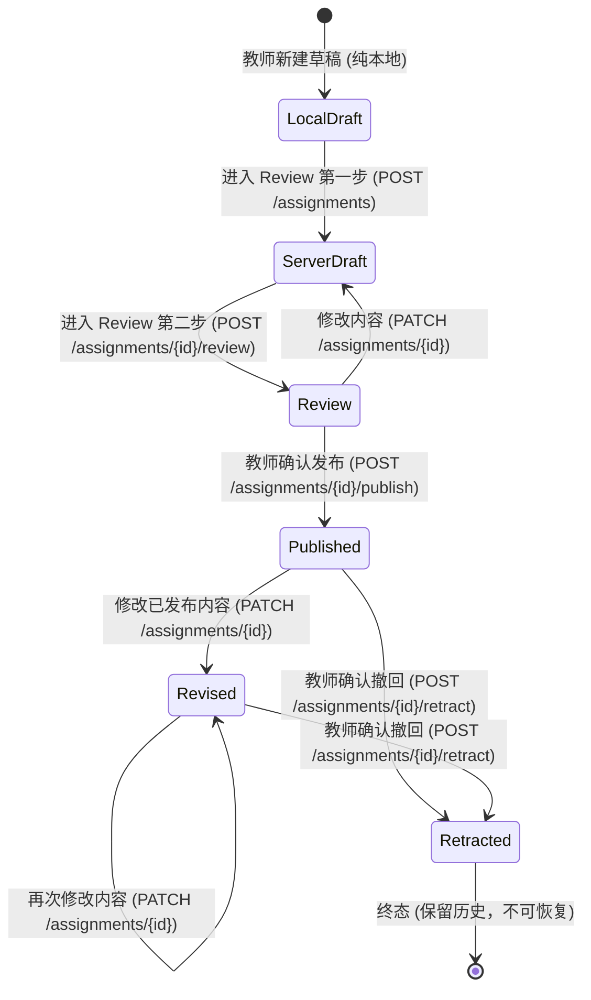

# One Publish Workflow · 统一作业发布流规范

**Version:** v1.4  
**Implementation:** `web/teacher/js/workspace.js`, `web/teacher/js/journal.js`, `web/teacher/js/api.js`  
**Backend Reference:** PR #21 (`docs/architecture/API-CONTRACT.md`, `DATA-MODEL.md`)

---

## 1. 状态机与生命周期 (Lifecycle State Machine)

One Publish 严格对齐 PR #21 Academic 权威状态模型，不允许前端自定义衍生状态破坏一致性：



| 状态 (Status) | 可见范围 (Visibility) | 含义与权限 |
|---|---|---|
| **Local Draft** | 仅当前设备浏览器 | 本机草稿，学生不可见，服务器无记录 |
| **Server Draft** | 仅教师/管理员 | 已在服务器持久化创建，学生端不可见，教室屏不可见 |
| **Review** | 仅教师/管理员 | 教师本人审核确认阶段，非独立教务审批，学生不可见 |
| **Published** | 全体获准成员 + 教室屏 | 正式发布（首次通常为 v3），学生可通过拉取或刷新获取，教室屏展示 |
| **Revised** | 全体获准成员 + 教室屏 | 已发布作业被修改（v2, v3...），学生同步最新版，历史可溯 |
| **Retracted** | 教师可见 / 学生标记不可用 | 已撤回终态，正式列表隐去，保留学生私人笔记，保留历史 |

---

## 2. 发布五步关键流程

### 第一步：整理草稿 (Authoring)
- **输入字段**：
  - 科目（`subject`，1–32 字符，支持快捷建议）
  - 班级（`classId`，必选）
  - 作业标题（`title`，1–240 字符）
  - 详细要求（`details`，最大 3000 字符，实时字数统计）
  - 截止时间与精度（`none` / `date` YYYY-MM-DD / `minute` ISO 8601 带时区偏移）
- **本地保护**：每次输入变更实时自动保存至本地草稿命名空间，意外关闭标签页绝不丢失内容。

### 第二步：发布前自审 (Review Stage)
- 教师点击“进入 Review”：
  1. 前端先行执行预校验（`validateDraft`），字段缺失或格式错误原地提示，不浪费后端调用。
  2. 向 Academic 发送 `POST /api/v1/classes/{classId}/assignments`，生成正式作业草稿（`version: 1`）。
  3. 立即带 `expectedVersion: 1` 发送 `POST /api/v1/assignments/{id}/review`，状态推进为 `review`（`version: 2`）。
- 教师在此阶段获得专属检查清单：核对班级名称、标题文字、截止日期显示、学生端真实渲染效果。

### 第三步：正式发布 (Formal Publish)
- 教师点击“确认发布”，系统弹出防误触弹窗（Modal Dialog）：
  - 提示目标班级、最新版本号。
  - 声明：“这是教师自己的检查。服务器确认后才显示已发布；学生刷新后可获取正式内容。”
- 确认后带 `expectedVersion: 2` 与专属 `Idempotency-Key` 发送 `POST /api/v1/assignments/{id}/publish`。
- **原子提交保证**：Academic 后端在同一 SQLite 事务中完成：
  1. 更新状态为 `published`，版本递增至 `3`；
  2. 记录 `assignment_revisions`（操作人、时间、快照）；
  3. 插入 `sync_events`（`assignment.published`）；
  4. 记录 `command_receipts` 幂等凭据。
- 只有收到服务器 200/201 成功返回后，工作台才打上“已发布”凭章。

### 第四步：版本修订与冲突解决 (Revision & Optimistic Concurrency)
- 教师在“已发布”列表选中作业，点击“修改内容”。
- 系统基于当前服务器版本（如 `v3`）装载编辑，提示“修改保留在本机，保存后才会生成新版本”。
- 提交修改时：发送 `PATCH /api/v1/assignments/{id}`，必须携带 `expectedVersion: 3` 与有效变更字段。
- **并发冲突防护 (409 VERSION_CONFLICT)**：
  - 若其他设备或同事已将该作业更新为 `v4`，服务器拒绝提交并返回当前版本号。
  - 工作台捕获 409 后，弹出**版本冲突对比窗口 (Conflict Diff Table)**：
    - 清晰并排呈现“你修改的内容” vs “服务器上的最新内容”。
    - 本地未提交草稿完好保留。
    - 教师核对差异后，点击“使用最新版本继续检查”，仅以 `expectedVersion: 4` 更新检查基准，不自动提交。教师必须再次点击“保存修改”。

### 第五步：安全撤回 (Safe Retract)
- 发现发布错误时，在已发布作业卡片点击“撤回”。
- 明确二次确认弹窗：“撤回这项作业？撤回会保留历史；学生的私人笔记不会删除。”
- 发送 `POST /api/v1/assignments/{id}/retract`，状态流转为 `retracted`（终态）。
- 撤回后：
  - 从普通“已发布”（Published）列表移出。
  - 归入“历史”（History）归档视图，保留全部历史修订记录。
  - 教师端只调用正式作业撤回接口，不删除学生私人数据。实际 Flutter 笔记保留与撤回呈现由 03 组验收；本组浏览器只验证了独立的虚构笔记标记。

---

## 3. 失败恢复与幂等性保障 (Failure Recovery & Idempotency)

在真实校园网络中，Wi-Fi 波动、页面卡死或代理超时时有发生。One Publish 通过前端请求日志（`Journal`）与后端凭据（`command_receipts`）提供无缝自愈能力：

```
[前端发送请求] ──(Idempotency-Key: K1)──> [后端执行并提交 SQLite]
      │                                                │
[网络中断/超时] <xxxxxxxxxxxxxxxxxxxxxxxxxxxxxxxxxxxx [响应丢失]
      │
[前端标记 Unknown] ──(保留原草稿与原请求标识 K1)
      │
[教师刷新或点击恢复] ──(携带相同 K1 重发原请求)──> [后端查询到 K1 记录]
      │                                                │
[前端更新为已发布] <───(原样返回当时执行结果，不重复创建)──┘
```

1. **写前记录 (Journaling)**：每次发起突变前，将路由、方法、有效载荷及新生成的 `Idempotency-Key`（8–100位加密随机字符）写入 `Journal`。
2. **超时绝不谎报成功**：网络无响应抛出 `UnknownOutcomeError`，作业标记为 `unknown`（结果未知），表单锁定，避免重复新建。
3. **安全恢复**：点击“恢复原请求”重放相同凭据。若后端当时已提交，后端直接重放当时结果（`replayed: true`），作业数量绝不增加；若当时未到达，后端执行首笔提交。
