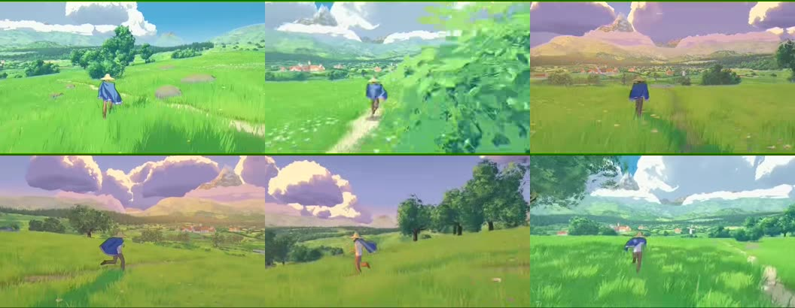
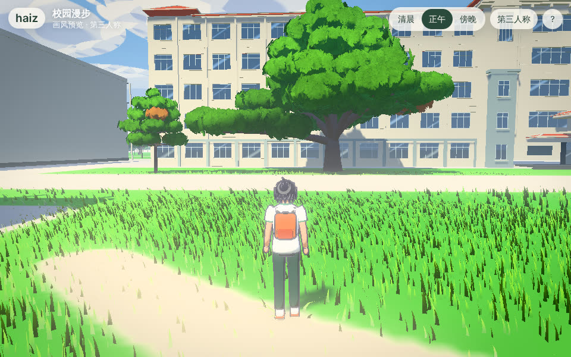
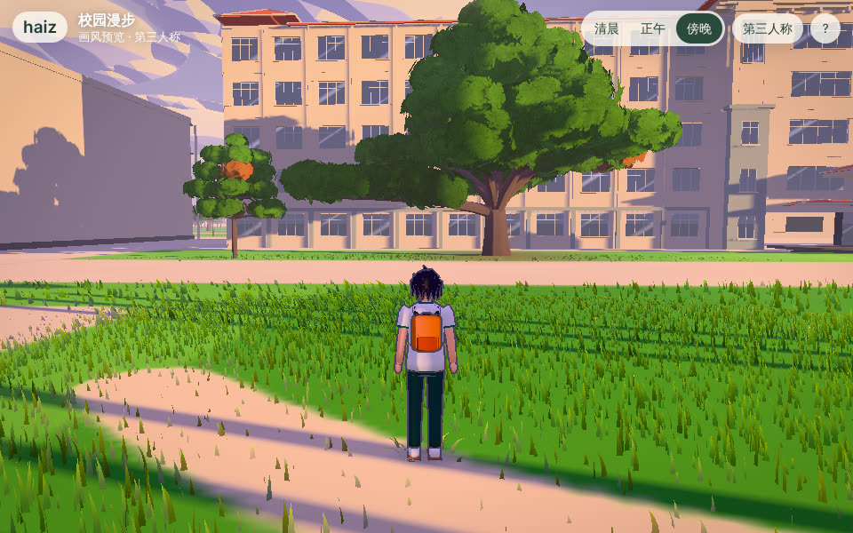

# HAIZ 新画风：第三人称校园漫步（预览）

入口：[campus-stroll.html](../campus-stroll.html)，代码在 [lanren/toon/](../lanren/toon/)，Blender 资产脚本在 [scripts/toon/](../scripts/toon/)。

本页是按参考视频的画风实现的校园漫游预览：人物默认第三人称，场景由 HAIZ 现有的校园数据、Blender V3 建筑和碰撞系统共同驱动，新的部分是光照与材质、天空、草地、树木和人物。六幕首页暂时没有改动，预览确认后再接入第五、六幕和漫游（见第六节）。

## 一、参考视频怎么读

文件：`media/references/stylized-campus-walk-reference.mp4`，时长 24.5 秒，704×410，HEVC，30 fps，共 736 帧。

方法：用 FFmpeg 每秒抽一帧（25 张），另抽镜头切换帧，并对特征画面局部放大（树冠、人物）。随后按区域（天顶、云的受光面、远山、中景树、近景与中景草地）采样平均色，记下色相、饱和度和明度。

### 1. 空间表现

- **景深分层非常清楚**：近景是齐膝高的草，中景是成团的树和小路，远景是村落与田野，最远是山和积云。每一层都比前一层更浅、更冷、更灰，最远处几乎融进天色。这是空气透视，不靠景深模糊。
- **机位**：第三人称，摄影机在人物后上方约 4–6 米，略向下看；人物在画面中下部、偏小，地平线在画面上方约 40% 处。镜头跟随有轻微滞后，人物转弯时镜头慢慢摆回身后。
- **开阔感**：前景草地几乎占满下半屏，视线被小路引向远处。

### 2. 卡通化材质

- **形体被简化成大块面**：树冠是几团软的体块，每团只有受光和背光两三个色阶，边缘才露出叶片锯齿。整棵树读成一个体积，不是成千上万片闪烁的叶子。
- **积云是平涂形状**：边缘清晰，受光的顶部是白色或暖色，底部是蓝灰色或淡紫色，朝向太阳的边缘有一道亮边。
- **草地是笔触感的长叶片**：随风成片倒伏，倒伏处颜色变浅，形成移动的光带。草叶间点缀白色、黄色小花。
- **只给人物描边**：人物有细的深色轮廓线，环境几乎不描边。

### 3. 真实光照

画风是卡通的，光照的逻辑却是物理的：

- 一个太阳，所有投影方向一致。树和人物都有投影，阴影边缘清晰。
- **阴影不是灰色**：暗部只被天空照亮，所以偏蓝（正午）或偏紫（傍晚）。
- **云影在地面移动**，草地上的亮暗随之流动。
- **两种时段**：正午的天顶约为 `#51aad4`，近景草地约 `#69b54c`，中景受光草地约 `#92d860`，远山约 `#82c2db`，饱和、清爽；傍晚的天空与远山约为 `#ccb7bd`、`#a695b6`，草地转为 `#8b9447`，太阳低而暖，云底变紫，受光边缘发粉、发金。
- 太阳附近有轻微泛光，逆光时草和树叶会透光。

### 4. 整体画风

整体接近手绘背景动画：色彩饱和而柔和，暗部带冷色，亮部带暖色，画面干净，层次全靠明度与空气感来分。

## 二、放进 HAIZ：保留什么，不照搬什么

| 参考视频 | HAIZ 的做法 |
| --- | --- |
| 田野、村庄、远山 | 海南中学府城校区：建筑、道路、球场、操场、花园都来自 `assets/walk/campus.json` 与 Blender V3 模型。海口地势平坦，**不搬用参考里的雪山**；校外是绿化带与府城的低层城市，在空气透视里淡出。远景是气氛表达，不代表真实街区。 |
| 草原 | 草只长在平面数据里的草坪、花园和植物园上；道路、铺装、球场、跑道和水面没有草，花园小路也留空。操场内场是短草。数据没有标注的地面按草坪处理，属于解释性表达。 |
| 一般阔叶树 | 树种和位置都按校园数据：榄仁 70、椰子 64、秋枫 37、红豆 27、木棉 20、榕 19、凤凰木 19、风铃木 16、灌木及混植。形态是物种概念模型，不是逐棵测绘；榄仁有少数叶团转红，对应冬季前后的红叶（HAIZ 的红叶色）。 |
| 戴草帽、披斗篷的角色 | **不复制该角色。** 新做一个 HAIZ 学生：白色校服衬衫配绿领、深绿长裤、白色球鞋配陶土色鞋底，背一只陶土橙色的书包。书包在绿色草地上形成互补色，起到参考视频里蓝色斗篷的作用。 |
| 两个时段 | 清晨、正午、傍晚三档，切换时平滑过渡（`T` 键或右上角）。 |

## 三、实现

### Blender（PyPI `bpy` 5.3，全部由脚本程序化生成）

- `scripts/toon/build_student.py`：学生模型约 3,900 个三角面、18 根骨骼，包含 Idle、Walk（1.45 m/s）、Run（4.3 m/s）、Jump 四段原地循环动画。颜色和材质类型（布料、皮肤、头发、不受光的眼睛）烘焙进 `COLOR_0`，整个人物一次绘制。脚本会用数值检查骨骼轴向约定（+X 旋转使直立骨骼前倾、下垂肢体后摆）。
- `scripts/toon/build_trees.py`：树木套件，包括 榄仁 ×2、圆冠阔叶 ×2、榕、木棉、伞形冠（凤凰木 / 风铃木）、灌木、椰子 ×2、百年榄仁树、太湖石（布尔开孔）。每棵树由树干和若干叶团组成：叶团的核心是凹凸的实体团块，外面包一层 alpha 测试的叶片卡。**所有叶片法线指向整个树冠椭球的外侧，再与所在叶团的法线混合**，所以整冠作为一个体积受光，叶团只表现为体块上的起伏，这是手绘树的读法。`COLOR_0` 存遮蔽、摆动权重和色相偏移。叶片图集 `leaf-atlas.png` 也由脚本绘制。
- `scripts/toon/pack.sh`（`npm run build:toon`）：构建后用 gltfpack 压缩。最终 `student.glb` 45 KB，`flora.glb` 0.69 MB，`leaf-atlas.png` 0.23 MB。

### three.js（r170，仓库内置版本）

| 模块 | 作用 |
| --- | --- |
| `toon.js` | 全局共享的光照与大气 uniform，以及 `toonMaterial()`：在 Lambert 着色器里替换光照，**保留 three 的太阳与阴影贴图**。受光面与背光面之间是窄的明暗交界带，另有一道宽高光；暗部只受天空光（偏蓝或偏紫）；投影经过同一交界带，再叠加漂移的云影；逆光时有边缘光；最后做高度雾形式的空气透视。所有材质共用这一套。 |
| `sky.js` | 手绘天空：天顶到地平线的渐变，地平线色与雾色相同，所以远处物体会融进天空。积云由圆盘并集构成（画家画积云的方法），边缘锐利，每团各自有球面明暗，分三个色阶，朝阳一侧有亮边。分为头顶云层和地平线云堆两层，地平线一圈恰好 36 个单元，图案首尾闭合，没有接缝。 |
| `daylight.js` | 清晨、正午、傍晚三套参数（数值来自关键帧采样，再在校园场景中目测平衡），平滑插值；阴影相机跟随人物。 |
| `ground.js` | 按平面数据在画布上绘制地面：草坪笔触、铺装、道路、球场、400 米跑道、花园小路和古树下的土圈。另画一张草地遮罩（R 为密度，G 为高度）。水面单独绘制：倒映天色，有菲涅尔效果和阳光闪点。 |
| `grass.js` | 一个 InstancedMesh 就是整片草：草根以人物为中心环绕取模（toroidal wrap），每片草的世界位置固定，草场随人物移动，不需要分块，也不需要重新上传数据，一次绘制完成。草根颜色取自下方地面绘制，草和地面因此是同一个表面。阵风是一片缓慢吹过的噪声场，草随之倒伏、变亮；人物脚下的草会向两侧分开；逆光时草透光；少量草尖带白花或黄花。近景细草与远景粗草分两层。 |
| `flora.js` | 每个树木部件一个 InstancedMesh（约 30 次绘制），按校园数据摆放并按树种着色。叶片随风摆动，阴影使用同样的摆动顶点。 |
| `campus.js` | 沿用 `lanren/map/campus-v3.js` 载入 Blender V3 建筑（752,666 个三角面），几何、锚点、碰撞体和连廊台面都不变。12 种材质换成动画背景的配色：墙面保留约 4 成纹理，其余向纹理的平均色收拢；玻璃倒映手绘天空，并加上背景美术常见的斜向高光条纹。 |
| `horizon.js` | 校园外的绿化带、府城低层城市方块和行道树，以及校园边界的矮墙（气氛表达，不是街区模型）。 |
| `student.js` | 人物：材质类型分别驱动皮肤的暖色暗部、头发的高光带和不受光的眼睛；背面外扩法线做描边，只用于人物；脚下有软接触阴影。Idle、Walk、Run 按速度混合，走与跑保持同相，变速时步伐不会重置。 |
| `player.js` | 默认第三人称：镜头吊杆在人物后上方，人物位于画面中下部。拖动或右手划动可以环顾；滚轮或双指捏合调整距离；`V` 在第一、第三人称之间切换。行走时如果不操作镜头，镜头会慢慢摆回人物身后。建筑挡在镜头与人物之间时吊杆会缩短，镜头不会低于地面。移动相对镜头方向，跑用 Shift 或把摇杆推到边缘，跳用空格。人物会平滑转向并在转弯时侧倾。碰撞沿用 `lanren/world/collide.js` 和 V3 建筑包络，连廊与亭子会把脚抬到台面高度。 |
| `post.js` | HDR 渲染，经轻度泛光后进入单个调色 pass：Khronos PBR Neutral 色调映射（保留色相和饱和度；ACES 会把绿色推黄、天空推青），轻微提高饱和度，做冷暗部、暖亮部的分离色调，加暗角和抖动，最后输出 sRGB。 |
| `walk.js` | 页面主入口：快的部分先出现，包括天空、地面、草、树和人物；11 MB 的建筑在后台加载，到达后从地面升起，所以加载期间就能走动。按设备选择高、中、低画质档，美术相同，只改变数量和缓冲区尺寸；帧时持续偏高时会自动减少草量，最低保留 45%。`?time=golden`、`?quality=low` 等参数可用于测试。 |

截图（SwiftShader 软件渲染，低画质，由测试脚本 `SHOTS` 选项生成）：

## 四、操作

- 电脑：`W A S D` 或方向键移动，`Shift` 跑，空格跳；拖动画面环顾，滚轮调整距离；`V` 切换第一或第三人称，`T` 切换时段，`H` 隐藏界面。
- 手机：左手拖动移动，推到边缘时变为跑；右手拖动环顾，双指捏合调整距离；右下角是跳跃按钮。

## 五、验证与限制

- `npm run test:toon`（`tests/toon-walk-browser.cjs`）检查以下项目：默认为第三人称且人物可见；按 W 能沿视线方向前进；切换傍晚时太阳降低；V 可在第一、第三人称之间往返；建筑模型载入完整（752,666 个三角面）；向一号教学楼走 2.5 秒不会穿墙；页面没有报错。`CAMPUS=off` 会跳过建筑，测试更快。
- 截图和测试都在 Linux 的 SwiftShader 软件渲染下完成，**不能代替真实 GPU、Safari、iPhone 或 Android 的帧率与发热验收**。软件渲染很慢（载入建筑后每帧可达数秒），这个数字不能用来推算真机表现。
- 建筑、树木形态、草地覆盖和校外城市都是近似或解释性表达，不是测绘结果；建筑不能进入。
- 中文字体在测试环境中使用回退字体。
- 新的原创资产（学生、树木套件、叶片图集、太湖石概念模型）由本仓库脚本生成。合入 `main` 后，应按 [原创成果档案](provenance/README.md) 的模板登记；本分支不改动以 `main` 为基准的登记快照。

## 六、下一步：接入六幕

预览确认后的接入方式：

1. 把 `toonMaterial()` 和共享 uniform 接到第五、六幕的世界与漫游（`lanren/world/`）：同一套建筑网格、同一套碰撞体，只更换材质与光照。第四幕的平面剖面仍使用现有的墨线与平面表达。
2. 漫游默认改为第三人称，并保留 `V` 键切换第一人称。DESIGN.md 原定的方块人物第一人称身体可以作为第一人称时的身体继续存在，或由新学生模型替代，这需要用户决定。
3. 百年榄仁树：六幕使用的是 V4 榄仁树（含生长动画）。漫游里可以给它套用新的叶片着色，也可以在漫游中改用新画风的榄仁树，这同样需要用户决定。
4. 真机测试：iPhone Safari 与中端 Android 的帧率、发热和加载时间，据此调整草量和阴影分辨率。
