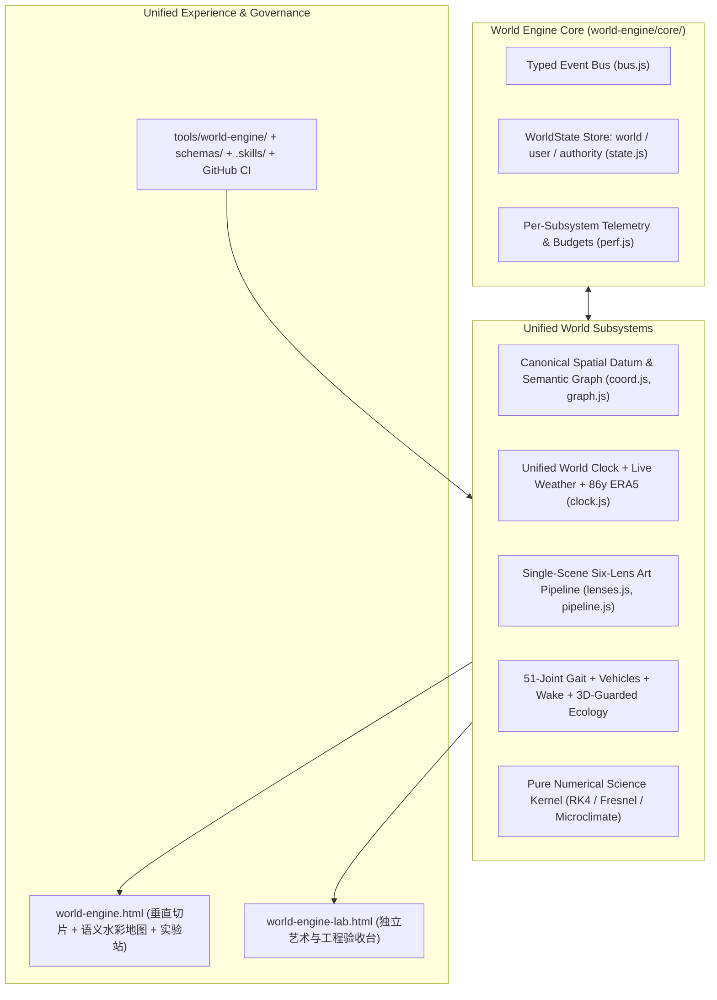
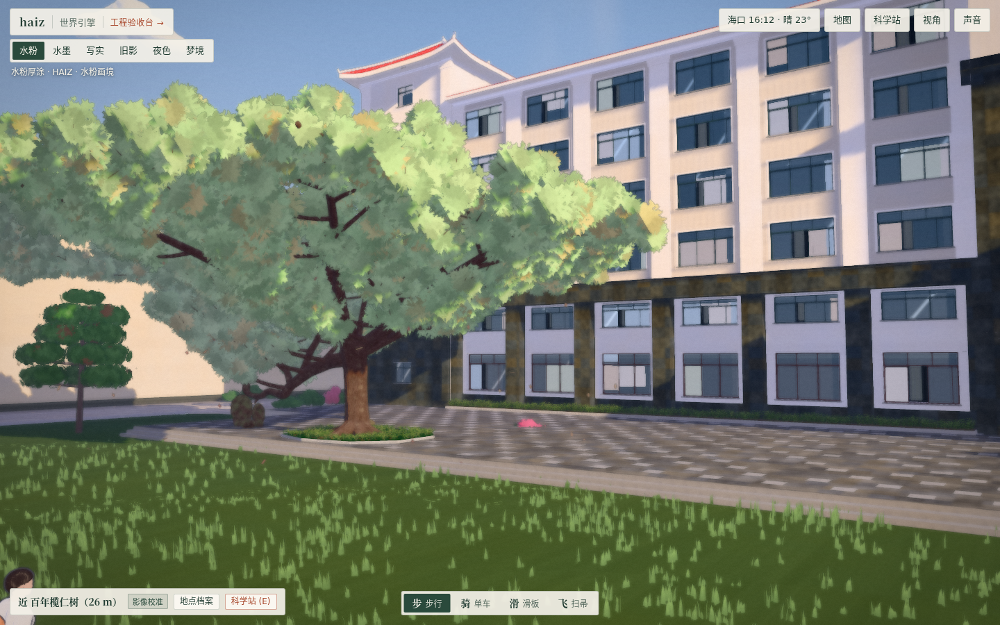
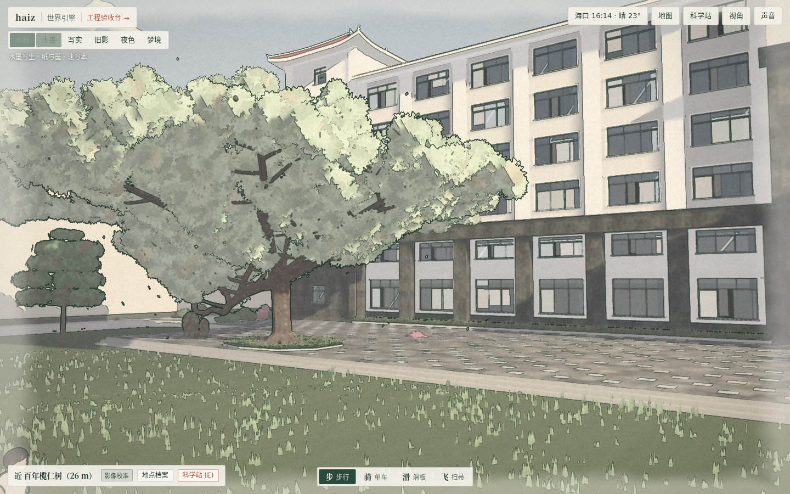
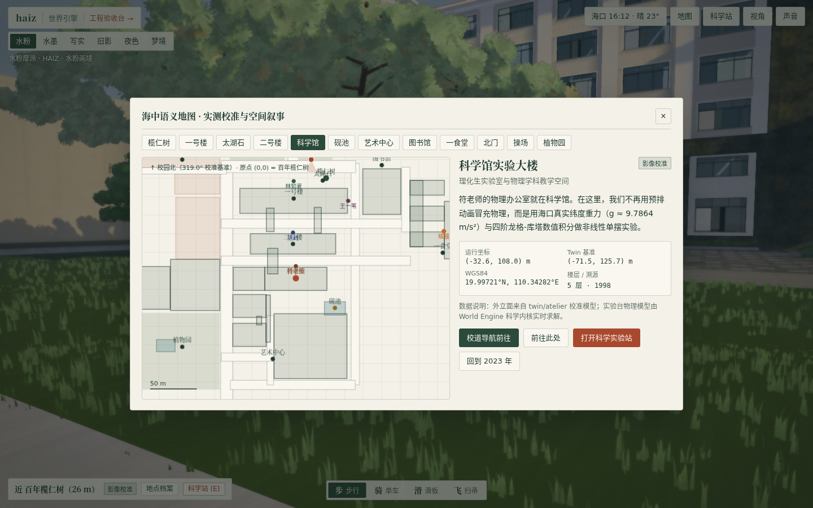
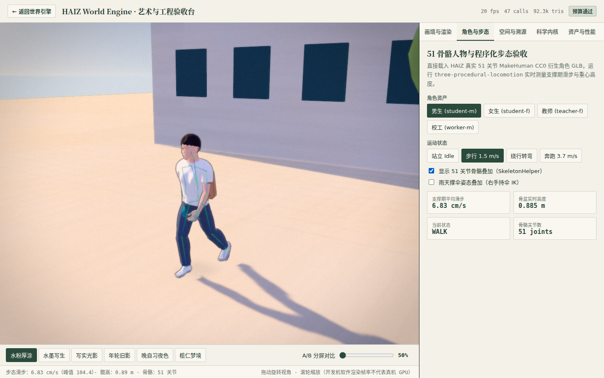

# HAIZ World Engine — 架构设计、验收报告与整合路线

> **版本状态**：开发分支 `feat/haiz-world-engine`（未修改 `main` 分支，未触碰生产数据库或线上 `haiz.space`）。  
> **核心入口**：[`world-engine.html`](../../world-engine.html)（世界引擎垂直切片）· [`world-engine-lab.html`](../../world-engine-lab.html)（独立艺术与工程验收台）。

---

## 一、对现有 HAIZ 的深度审计结论（保留什么 / 解决什么）

通过对 `lanren/`、`twin/`、`lab/`、`backend/`、`supabase/`、`services/academic/`、`character-lab/` 与 `preview/human-verification-v2/` 的源码与二进制资产审计，我们确认 HAIZ 已积累了一批极其珍贵的原创成果：

### 值得长期保留的核心资产
1. **V4 百年榄仁树引擎**（`lanren/js/foliage.js`、`environment.js`、`pcss.js`）：10,947 枚叶簇 GPU 萌发、团块体积法线、叶片透光前向散射、四射线悬停触碰物理。
2. **影像校准校园孪生管线**（`twin/data/*`、`twin/assets/runtime/*.glb`）：一号楼、二号楼、科学馆、艺术中心、砚池、前庭与太湖石具备明确证据等级（`photo-derived`）与轮廓反算校准。
3. **「入画」与画境实验室**（`lanren/ruhua/`、`lanren/painted-lab/`）：马格利特视尺寸画架、Hertzmann 笔触规划、湿路面 SSR 积水、光色学科（暖阳/彩色暗部）与世界空间笔触。
4. **51 关节人物与低滑步程序化步态**（`lanren/assets/life/*.glb`、`lanren/life/gait.js`）：CC0 MakeHuman 衍生角色 + `three-procedural-locomotion`，摆脱片段混合滑步。
5. **多模态移动、尾迹风场与校园生态**（`lanren/free/`、`lanren/ruhua/eco/`）：单车/滑板/竹扫帚、384² 共享尾迹风场、五位确定性作息人物、橘猫与三种海口蝴蝶。
6. **86 年 ERA5 气象档案与实时天气水膜模型**（`lanren/rings/data/climate.bin`、`lanren/ruhua/weather/`）：1940–2026 共 31,732 天逐日数据 + 12 小时路面湿润积分。

### 阻碍 HAIZ 生长为「一个世界」的七大架构断层
1. **拷贝式分叉级联（无统一世界内核）**：`toon/` → `stroll/` → `ruhua-stroll/` → `ruhua/` → `life/` → `free/` → `painted-lab/` → `world/` 在 10 个 HTML 入口中反复复制 `main.js`、`pipeline.js`、`easel.js` 与 `nav.js`。
2. **空间基准与坐标真值分裂**：
   - 存在三个互相矛盾的校园北向方位角：`337.0°`（`lanren/js/sun.js`）、`321.6°`（`weather/model.js`）、`319.0°`（`twin/data/frame.json`），最大偏差 **18.0°**。
   - GCJ-02 与 WGS84 混用导致约 **540 m** 经纬度偏移；`yihao ↔ lanshu` 相对矢量在 `campus.json` 与 `twin` 间存在约 **7.9 m** 错位；太湖石位置与铭文（四字 vs 八字）并存三版本。
3. **「同一世界，多种观看方式」尚未打通**：`painted-lab` 独立困在静态测试页，无法在活着的校园（人物、猫、蝴蝶、骑行、天气）中实时切换画境。
4. **时间、气候、物候与生态脱节**：86 年 ERA5 年轮数据只能驱动主页孤树，无法驱动三维校园；`cat.js` 忽略日期偏移与 NPC 脱节；`season.js` 物候只在启动时刷新一次。
5. **高空飞行与地面生态的 3D 高度盲区**：`cat.js`、`butterflies.js` 与 `npc.js` 仅按二维水平距离判断，导致骑竹扫帚在 30 米高空飞过时惊吓地面橘猫与行人。
6. **科学实验册偏重预排动画**：`lab/` 中 45 个实验仅 1 个使用数值 ODE 子步积分，40 个为闭式代数参数动画，缺少统一物理内核与误差传播库。
7. **后端三套孤岛与缺失的可执行工程门禁**：`backend/`（SQLite + CF DO）、`supabase/`（`pocket_snapshots`）、`services/academic/` 拥有三套互不相通的账号/KDF/Cookie；`backend/cloudflare/gateway.mjs` 剥离了上游 CSP 且未重新下发；缺少 GLB 资产预算门禁与跨 AI 协作契约。

---

## 二、HAIZ World Engine 基础架构与关键技术决策（ADR）

### 系统架构总览



### 关键架构决策记录（ADR）

- **ADR-01 · 严格分离 `world` / `user` / `authority` 状态**：确定性世界状态（时钟、天气、物候、NPC/生态状态）与用户本地私有状态（视角、画境偏好、地点足迹、实验记录）物理分离；引入显式所有权仲裁器（`explore | map | lab | story | inspect`），解决地图/弹窗与移动控制抢夺输入的问题，且允许骑行中安全呼出地图。
- **ADR-02 · 单一空间基准与诚实证据溯源**：统一以 `twin/data/frame.json`（WGS84 `19.99847892°N, 110.34254843°E`、校园北向 `319.0°`）作为天文与物理常数真值，在 `coord.js` 中提供无损 `runtime ↔ twin ↔ WGS84` 变换，并强制为全部 12 个核心语义节点标注证据等级（`surveyed | photo-derived | public-map | legacy-estimated | creative-inference`），在地图与验收台公开历史差异报告。
- **ADR-03 · 单次几何绘制驱动六种艺术画境**：在 `world-engine/art/pipeline.js` 中，共享三维场景每帧仅渲染一次至 HalfFloat HDR + Depth 缓冲，通过统一的后处理与 `LABM` 材质参数驱动 **水粉厚涂 / 水墨写生 / 写实光影 / 年轮旧影 / 晚自习夜色 / 榄仁梦境** 六种观看方式，切换时以有机笔触波扫过画面，并支持验收台实时 A/B 分屏对比。
- **ADR-04 · 3D 垂直隔离守卫**：在 `world-engine/main.js` 中引入离地高度判断（`agl > 3.2 m`），修复竹扫帚高空飞行惊吓地面橘猫、蝴蝶与行人的高度盲区。
- **ADR-05 · 面向真实物理定律的科学模拟内核**：在 `world-engine/science/kernel.js` 中构建零依赖、可在 Node 与浏览器共同测试的纯函数内核（RK4 四阶龙格-库塔积分 + Somigliana 海口重力 `9.7864 m/s²` + AGM 精确椭圆积分周期 + 精确菲涅耳/斯涅尔方程 + 热带铺装蒸发水膜模型），并在 UI 强制披露控制方程、适用范围、简化条件与误差界。

---

## 三、后端、Supabase 与工程基础设施整合蓝图（零付费、个人可维护）

> 本次未修改生产数据库或线上环境；以下为面向个人开发者长期维护的分阶段统一方案：

1. **统一身份主权（收口三套孤岛）**：
   - 以现有自建 `backend/repository-core.mjs`（Node 24 + SQLite + `scrypt` + `__Host-haiz_session`）或 Supabase Auth 二选一作为唯一身份发行方，停止 `services/academic/` 独立维护 `pbkdf2` + `hsid` Cookie。
   - 若面向零运维公网静态部署（GitHub Pages + Flutter Pocket），建议采用 **Supabase Auth + Postgres RLS** 作为唯一云端个人数据与权限后端，并将 `backend/` 保留为纯本地离线校园内网部署模式，双方共享同一 JSON Schema 数据契约（`exportUserContract()`）。
2. **修复已审计出的安全与一致性缺口**：
   - `backend/cloudflare/gateway.mjs`：删除上游 CSP 后必须重新注入严格 CSP（含 `script-src 'self' 'nonce-...'`、移除 `'unsafe-inline'`），并把 GitHub `raw` 代理改为固定发布 tag/commit SHA + SRI 校验。
   - `services/academic/server.mjs`：写操作禁止在缺失 `Origin` 头时直接放行 CSRF 检查。
   - `supabase/migrations/`：为 `pocket_snapshots` 增加 `BEFORE UPDATE` 触发器强制 `NEW.version = OLD.version + 1` 与自动更新 `updated_at = now()`，并在 CI 增加双账号负向 RLS 隔离测试。
3. **世界状态与用户状态分层同步**：
   - 校园空间图谱、历史气象、公共校史为只读静态版本化资产（CDN 强缓存）。
   - 用户私有数据（`haiz-user-world-profile/1`：偏好、笔记、科学实验记录、速写本）仅在用户明确登录授权后同步，默认本地保存，不采集位置轨迹或真实学生个人信息。

---

## 四、实际性能分析与真实优化数据（含环境诚实声明）

> **环境声明**：以下浏览器测试全部运行于 Linux VM（Google Chrome 158 Headless + ANGLE SwiftShader **软件渲染**）。**软件渲染耗时不可等同于真实 iPhone / Android GPU 帧率**；但 **Draw Calls、三角形数、几何体/纹理计数、GLB 字节数与子系统 CPU 耗时** 为硬件无关的确定性指标。

### 实测 GPU 负载优化前后对比（同一 3D 校园世界）

通过对静态远景建筑实施**阴影视锥距离剔除**（桌面 `74 m` / 手机 `58 m` 外自动关闭 `castShadow`）与**按需节流阴影图刷新**（`shadowMap.autoUpdate = false`，仅首帧、移动 `> 0.8 m`、太阳高度变化 `> 0.35°` 或每 3–4 帧刷新），在不降低任何画面细节与画质档位的前提下取得显著收益：

| 指标（硬件无关） | 优化前（首轮实测） | 优化后（终轮全景实测） | 变化幅度 | 预算门禁 |
| --- | ---: | ---: | ---: | --- |
| **桌面端 Draw Calls** | 1,185 | **577**（局部机位 344） | **−51.3%**（最高 −71.0%） | PASS（≤ 720） |
| **桌面端 Triangles** | 7,033,648 | **3,318,996**（局部机位 2.44M） | **−52.8%**（最高 −65.3%） | PASS（≤ 5.2M） |
| **移动端 Draw Calls** | 1,125 | **358**（局部机位 284） | **−68.2%**（最高 −74.8%） | PASS（≤ 620） |
| **移动端 Triangles** | 6,230,403 | **1,948,722**（局部机位 1.64M） | **−68.7%**（最高 −73.7%） | PASS（≤ 4.2M） |
| **工程验收台 Draw Calls / Tris** | — | **47 / 92,314** | — | PASS |

### 全仓二进制 GLB 资产扫描结果（`node tools/world-engine/validate-glb.mjs --write`）
- 共扫描 **46 个 `.glb` 文件**（总计 **372.0 MB**；其中运行时候选路径 **118.3 MB**，离线 `twin/assets/atelier/` 母版约 254 MB）。
- **42 个通过**预算；工具精确检出 **4 个高面数/超体积告警资产**：
  1. `character-lab/hunyuan/source/20261121124835_b26256ec.glb`（25.75 MB / 1,500,000 tris — 源雕刻文件应移出运行时目录）
  2. `twin/assets/phase1/trees.glb`（1,487,557 tris — 需实例化或减面 LOD）
  3. `twin/assets/runtime/terminalia.glb`（1,244,154 tris — 需导出阴影专用低模 LOD）
  4. `lanren/assets/campus-v3/architecture.glb`（645,198 tris — 已被 6 栋 Atelier 建筑覆盖的部分应离线剔除，消除 12 MB + 31 MB 双重加载）

---

## 五、自动化测试与验收结果汇总

| 测试套件 | 命令 | 结果 | 关键验证内容 |
| --- | --- | --- | --- |
| 世界契约与语法检查 | `node tools/world-engine/validate-world.mjs` | **10/10 PASS** | WGS84 基准、双坐标无损互转、3D 高度隔离、12 语义节点证据标签、统一角色注册表、6 画境契约、全量 JS 语法 |
| 科学模拟内核单测 | `node --test tools/world-engine/test-science-kernel.mjs` | **10/10 PASS** | 海口重力 `9.7864 m/s²`、RK4 10 秒机械能漂移 `< 10⁻⁶`、90° 大角周期与椭圆积分误差 `< 0.05%`、菲涅耳 `R+T=1` 与布儒斯特角 `Rₚ=0`、全反射临界角、微气候蒸发单调性 |
| GLB 二进制资产审计 | `node tools/world-engine/validate-glb.mjs --write` | **46 文件扫描完成** | 输出 `tools/world-engine/glb-audit-report.json`，精准定位 4 处超预算资产 |
| 浏览器全链路与双端截图 | `python3 tools/world-engine/test-world-browser.py` | **14/14 PASS** | 桌面 1440×900 + 手机 390×844 触控 + 验收台；零未捕获错误、零控制台报错、零移动端横向溢出、全画境与 ERA5 历史切换、地图与科学站交互 |

---

## 六、桌面端与移动端实机截图（Chromium + SwiftShader 实测）

| 场景 | 截图 |
| --- | --- |
| **水粉厚涂 · 百年榄仁树与一号教学楼**（桌面 1440×900） |  |
| **水墨写生 · 同一世界的纸墨观看方式** |  |
| **年轮旧影 + 1985-11-18 ERA5 历史气象** |  |
| **晚自习夜色 + 小雨与湿润反光前庭** |  |
| **语义水彩地图（实时人物/橘猫/溯源档案）** |  |
| **科学馆 RK4 单摆 + 砚池菲涅耳光学站** |   |
| **手机竖屏 390×844 触控界面** |  |
| **工程验收台：A/B 画境分屏 & 51 骨骼步态检测** |   |

---

## 七、本地启动方式与现有 HAIZ 整合方案

### 本地零构建启动
```bash
git checkout feat/haiz-world-engine
python3 -m http.server 8000
```
打开以下地址体验：
- 世界引擎垂直切片：`http://localhost:8000/world-engine.html`
- 独立艺术与工程验收台：`http://localhost:8000/world-engine-lab.html`
- 支持 URL 直达参数：`?lens=inkwash` / `?era=2014-07-18` / `?wx=storm&hour=20.2` / `?quality=low`

### 与现有 HAIZ 主仓的低风险整合路线
1. **阶段 A（零破坏共存，立即可合并）**：本分支全部新增文件均位于独立目录（`world-engine/`、`schemas/`、`tools/world-engine/`、`.skills/haiz-world-engine/`、`.github/workflows/world-engine-ci.yml`、`world-engine.html`、`world-engine-lab.html`），**零改动 `index.html`、`ruhua*.html`、`lab/`、`backend/`**，可作为独立入口安全并入主线供师生内测。
2. **阶段 B（收敛分叉目录）**：将 `lanren/stroll/`、`lanren/ruhua-stroll/`、`lanren/life/main.js`、`lanren/free/main.js` 逐步收敛为挂载在 `world-engine/` 内核上的模式配置（入画导览模式 / 自由共游模式），消除多套重复 `main.js` 与 `pipeline.js`。
3. **阶段 C（离线资产统一打包）**：将 `campus-v3/architecture.glb` 与 `twin/assets/runtime/*.glb` 在 Blender 管线中预合成为单一 LOD 校园包，彻底消除 12 MB + 31 MB 重复下载与 7.9 m 配准偏差。

---

## 八、诚实功能清单（已实现 / 实验性 / 未验证 / 未来设想）

| 状态 | 项目 |
| --- | --- |
| **已实现并验证** | World Engine 事件总线/状态与权限仲裁；12 节点语义空间图谱与证据溯源；统一世界时钟（实时 + 自由 + 86 年 ERA5 历史日期）；单场景六画境管线与有机笔触切换；51 骨骼步行 + 单车/滑板/竹扫帚 + 尾迹风场；5 位作息 NPC + 橘猫 + 蝴蝶 + 3D 高空隔离守卫；语义水彩地图与 A* 导航；RK4 单摆/菲涅耳光学/微气候三大科学实验站；独立工程验收台（A/B 分屏、骨骼与滑步遥测、科学验证、GLB 审计）；JSON Schema + CLI 验证器 + CI 工作流 + AI Skill。 |
| **实验性功能** | 昼夜加速流逝（240×）；Toybox V2 角色登记表对接（当前 6 款玩偶为静态未绑定 GLB，尚未接入动作）；离线环境下的 ERA5 缺失回退插值。 |
| **尚未验证（需人工/真机）** | 真实 iPhone / 中端 Android 实机 GPU 帧率、发热量、触屏摇杆手感、Safari / 微信内置浏览器兼容性；真机长时间运行 WebGL 上下文恢复与内存曲线。 |
| **未来发展路线** | 1) 将剩余 28 栋建筑与地形道路整体迁入 `twin` 实测/影像校准基准并支持室内外无缝过渡；2) 为 45 个 `lab/` 实验接入统一 `science/kernel.js` 数值求解器（电路/化学动力学/波动光学）；3) 打通基于 Supabase RLS 或统一后端的隐私友好型校园共游与「校友记忆留影」；4) 评估 WebGPU Renderer 渐进增强路径与 KTX2/BasisU 纹理压缩。 |
