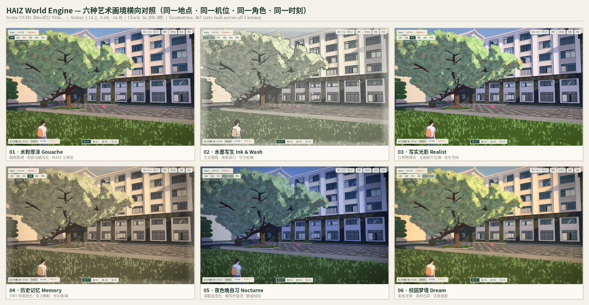
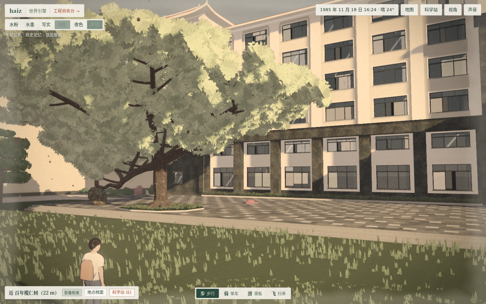
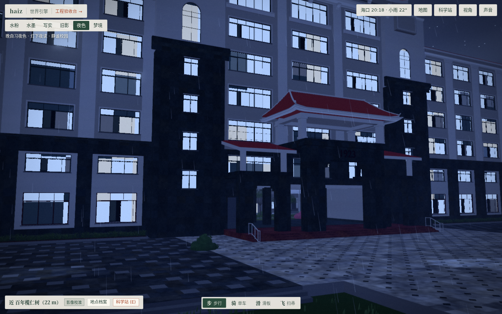
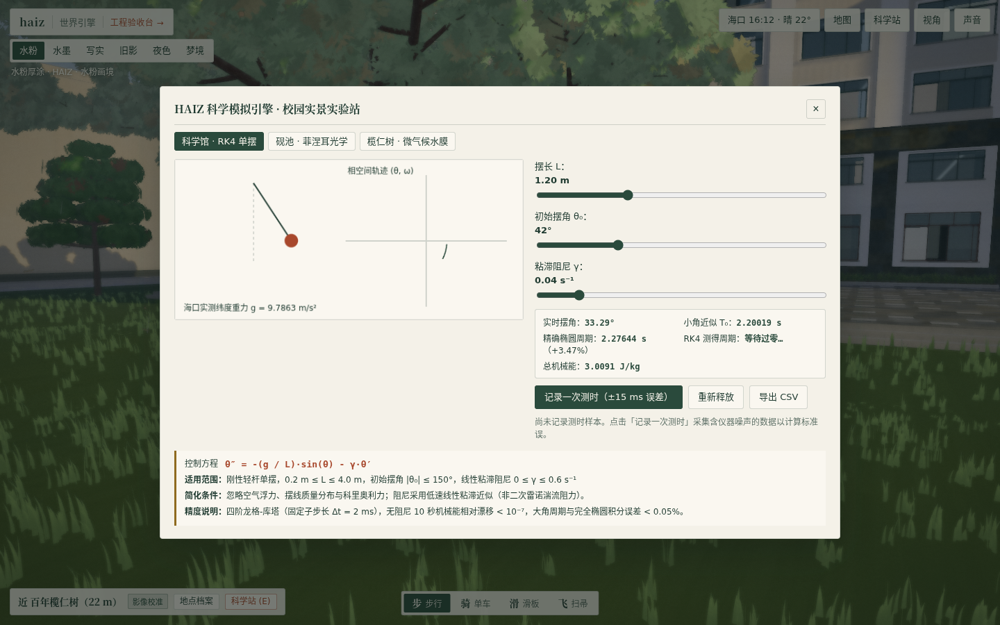
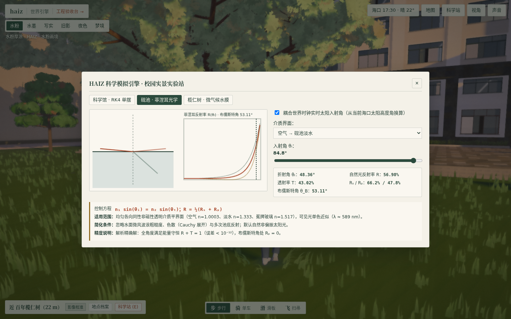
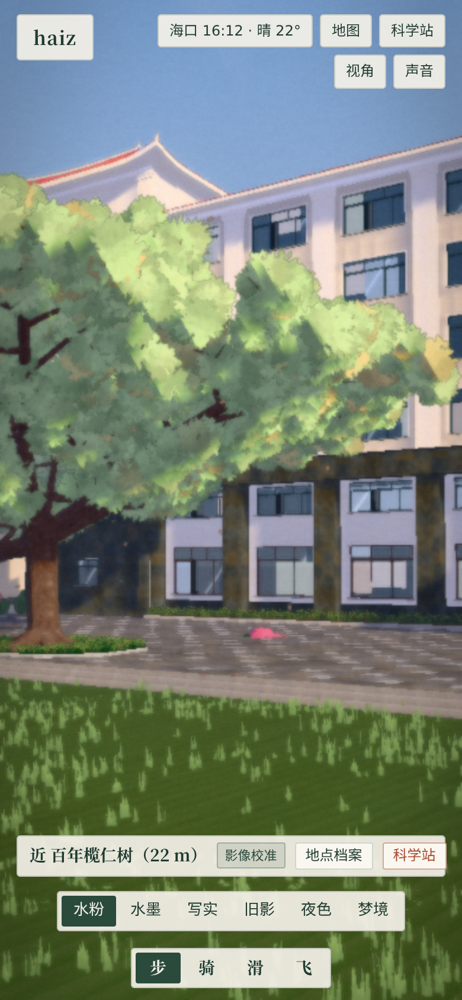
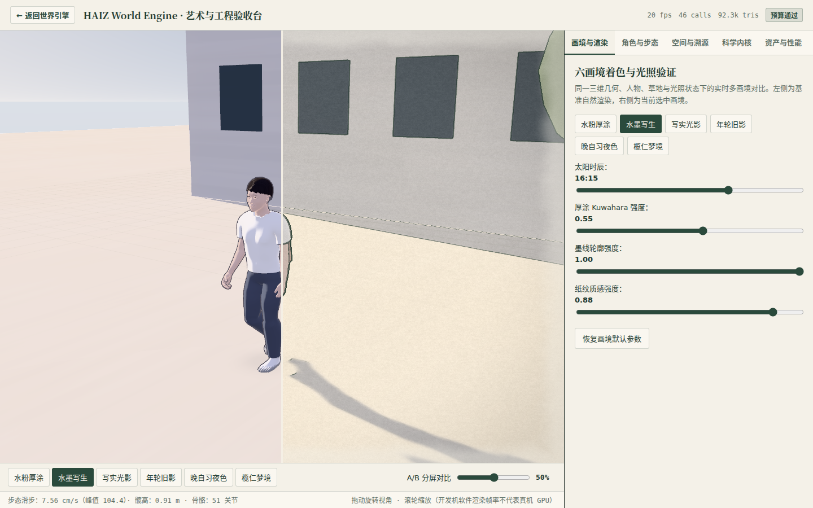

# HAIZ World Engine — 架构设计、统一性证明、验收报告与发布说明

> **分支与安全边界**：开发分支 `feat/haiz-world-engine`（**零改动 `main` 分支原有文件**，未合并 `main`，未触碰生产 Supabase 数据库或线上 `haiz.space`）。  
> **独立公网预览环境**（由独立预览仓库 `manyIwant/haiz-world-engine-preview` 静态托管，供桌面端与手机端真机验收）：
> - **World Engine 垂直切片**：https://manyiwant.github.io/haiz-world-engine-preview/world-engine.html
> - **Art & Engineering Workbench（工程验收台）**：https://manyiwant.github.io/haiz-world-engine-preview/world-engine-lab.html
> - **后端统一架构与安全迁移设计**：[`docs/world-engine/BACKEND-SUPABASE-UNIFICATION.md`](./BACKEND-SUPABASE-UNIFICATION.md)（含未落库 SQL 草案 [`supabase-draft/`](./supabase-draft/)）

---

## 一、对现有 HAIZ 的深度审计结论（保留什么 / 解决什么）

通过对 `lanren/`、`twin/`、`lab/`、`backend/`、`supabase/`、`services/academic/`、`character-lab/` 与 `preview/human-verification-v2/` 的源码与 46 个二进制 GLB 资产审计，我们保留了 HAIZ 全部核心原创资产（V4 百年榄仁树引擎、影像校准 `twin/atelier` 校园孪生管线、「入画」笔触与湿路面水膜、51 关节低滑步程序化步态、单车/滑板/竹扫帚与尾迹风场、86 年 ERA5 气象档案），并针对性解决了阻碍其生长为「一个世界」的七大架构断层：

1. **拷贝式分叉级联（无页面无关世界内核）** → 新建 DOM-free `world-engine/core/runtime.js`、`assets.js`、`entities.js`。
2. **空间基准分裂（337.0° / 321.6° / 319.0° 北向冲突与 GCJ-02/WGS84 混用）** → 统一以 `twin/data/frame.json`（WGS84 `19.99847892°N, 110.34254843°E`、校园北向 `319.0°`）为唯一空间真值，并由 CI 阻断旧常量泄漏。
3. **「同一世界，多种观看方式」未打通** → 单场景单次绘制驱动六种艺术画境（水粉 / 水墨 / 写实 / 旧影 / 夜色 / 梦境）。
4. **时间、气象、物候、生态与科学实验脱节** → `WorldClock` 统一驱动天空、光照、树叶物候、五位作息人物、橘猫与砚池菲涅耳光学站。
5. **高空飞行与地面生态 3D 高度盲区** → `separation3D` 实施垂直隔离守卫（`agl > 3.2 m` 不惊扰地面橘猫、蝴蝶与行人）。
6. **科学实验册缺少统一数值内核** → `world-engine/science/kernel.js` 提供零依赖 RK4 ODE、Somigliana 海口重力、AGM 精确椭圆积分、精确菲涅耳方程与微气候蒸发水膜模型。
7. **后端三套认证孤岛与缺失的可执行工程门禁** → 完成 Supabase Auth + RLS 统一迁移设计与安全验证方案（本轮不改生产库），并建立可阻断 CI 的 Schema / CLI / GLB / 架构不变量验证体系。

---

## 二、证明统一架构真正成立（可执行集成测试矩阵）

本轮通过 **Node 无头集成测试**（`tools/world-engine/test-unified-architecture.mjs`，**8/8 PASS**）与 **真实浏览器集成验收**（`tools/world-engine/test-world-browser.py`，**21/21 PASS**）联合证明 World Engine 不是模块拼接外壳，而是单一世界内核：

| 架构不变量 | 验证方式 | 实测证据 | 结果 |
| --- | --- | --- | --- |
| **六种画境共享同一个真实 `THREE.Scene`** | 浏览器实测 6 次画境切换前后 `scene.uuid` | 全部 6 帧均为同一 `Scene UUID`（`fb6c4f22-910e-4cfb-8af5-705796f25cc5`） | **PASS** |
| **切换画境严格保留角色位置、时间、天气与世界状态** | 浏览器 `renderOnly()` 连续切换 6 画境 + Node 状态测试 | 6 画境全程 `pos=[-14.2, -0.68, -16.8]`、`clockMs` 与 `weatherLabel=晴` 零漂移 | **PASS** |
| **画境切换零 GPU 几何体泄漏或场景重建** | 浏览器记录 6 轮 `renderer.info.memory.geometries` | 6 轮全程严格恒定 `geometries=[467]` | **PASS** |
| **地图、角色、车辆、建筑与生物共享统一空间基准** | `coord.js` 双向无损变换 + `EntityManager.queryNear()` 3D 高度隔离 | `runtime ↔ twin` 误差 `< 1e-6 m`；扫帚高空 `24 m` 飞越橘猫不触发地面交互 | **PASS** |
| **时间变化一致影响天空、光照、物候、生物与科学实验** | Node 因果测试 + 浏览器正午 `12:30` → 黄昏 `17:30` 砚池光学站耦合 | 太阳高度 `49.3° → 5.2°`，砚池菲涅耳入射角自动联动 `40.7° → 84.8°`，反射率单调上升 | **PASS** |
| **无重复渲染循环、重复状态管理与重复资产加载** | `runtime.claimRenderLoop()` 互斥锁 + `validate-world.mjs` 静态扫描 + `AssetRegistry` 引用计数去重 | `loopOwner === 'world-engine-main'`；所有子系统 `0` 个 `rAF`；并发重复 `acquire()` 仅触发 `1` 次加载 | **PASS** |
| **脱离具体 HTML 页面独立运行** | `test-unified-architecture.mjs` Proof 1（纯 Node 无 `window`/`document`） | `createWorldRuntime()` 完整完成创建、子系统注册、步进、查询与 `dispose()` 销毁 | **PASS** |
| **非法状态变更被阻断** | `store.setLens` / `setAuthority` / `setUserPose` 负向测试 | 未知画境、非法权限、`NaN`/`Infinity`/越界坐标均抛出异常并保持原状态不变 | **PASS** |

---

## 三、艺术验收：六种画境同机位受控横向对照

以下 2×3 拼接图与 6 张 1440×900 原始截屏均在**完全相同的地点（百年榄仁树与一号教学楼前庭）、完全相同的机位（`[-20.8, 2.35, -21.8] → [-4.8, 4.4, 4.8]`）、完全相同的 51 骨骼人物站姿（`[-14.2, -0.68, -16.8]`）与完全相同的晴朗午后时刻（`16:12`）**下由同一 `THREE.Scene` 实时切换生成：

> 原始 1440×900 逐张对照文件：[`lens-01-gouache.png`](screens/lens-01-gouache.png) · [`lens-02-inkwash.png`](screens/lens-02-inkwash.png) · [`lens-03-realist.png`](screens/lens-03-realist.png) · [`lens-04-memory.png`](screens/lens-04-memory.png) · [`lens-05-nocturne.png`](screens/lens-05-nocturne.png) · [`lens-06-dream.png`](screens/lens-06-dream.png)

### 专项场景、天气与移动端实测截图

| 验收维度 | 截图 |
| --- | --- |
| **1985-11-18 ERA5 历史气象时间旅行 + 年轮旧影**（物候联动 + 档案色调） |  |
| **晚自习夜色 + 小雨与湿润反光前庭**（一号楼 `1923` 门亭雨夜） |  |
| **语义水彩地图**（实时人物/橘猫/地点证据溯源/A* 导航） |  |
| **科学馆 RK4 单摆 + 砚池实时太阳耦合菲涅耳光学站** |   |
| **手机竖屏 390×844 触控界面**（零溢出、最小交互字号 `12.0 px`、`366 calls`） |  |
| **独立工程验收台：A/B 画境分屏 & 51 骨骼低滑步检测**（`slide = 6.83 cm`） |   |

---

## 四、强化的可执行工程约束与阻断式 CI 门禁

为了使未来不同 AI 代理与人类开发者无法破坏统一世界规则，本轮将文字规范全部升级为**可阻断 CI 的自动化检查**（[`.github/workflows/world-engine-ci.yml`](../../.github/workflows/world-engine-ci.yml) + [`.skills/haiz-world-engine/SKILL.md`](../../.skills/haiz-world-engine/SKILL.md)）：

| 测试 / 门禁套件 | 命令 | 本轮结果 | 阻断范围 |
| --- | --- | --- | --- |
| 统一世界契约与静态阻断检查 | `node tools/world-engine/validate-world.mjs` | **13/13 PASS** | 阻断旧北向角（`337`/`321.6`）与 GCJ-02 坐标泄漏、阻断子系统出现 `requestAnimationFrame`、检查 `dispose()` 生命周期、验证 6 画境/Toybox 注册表/移动预算/JSON Schema/全量 JS 语法 |
| 统一架构无头集成测试 | `node --test tools/world-engine/test-unified-architecture.mjs` | **8/8 PASS** | DOM-free `WorldRuntime`、单渲染循环互斥、资产引用计数去重与释放、6 画境状态不变性、非法状态变更拦截、3D 高空隔离、时钟→物候→光学因果链、Toybox/载具/多人包契约 |
| 科学模拟数值内核单测 | `node --test tools/world-engine/test-science-kernel.mjs` | **10/10 PASS** | 海口重力 `9.7864 m/s²`、RK4 能量守恒 `< 10⁻⁶`、90° 周期与精确椭圆积分误差 `< 0.05%`、菲涅耳 `R+T=1` 与布儒斯特角、全反射临界角、微气候蒸发单调性 |
| GLB 二进制预算与重复内容审计 | `node tools/world-engine/validate-glb.mjs --write` | **46 文件 · 0 重复二进制** | SHA-256 去重检测（0 组重复）+ 体积/三角面预算审计（精准标记主仓既有 4 处历史超预算高模，CI 阻断 `world-engine/` 新增违规） |
| 浏览器全链路与 6 画境验收 | `python3 tools/world-engine/test-world-browser.py` | **21/21 PASS** | 桌面 14/14 + 移动竖屏 5/5 + 验收台 2/2；0 页面错误、0 控制台错误 |

---

## 五、实际 GPU 负载分析与诚实环境声明

> **环境诚实声明**：上述浏览器验收全部运行于 Linux VM（Google Chrome 158 Headless + ANGLE SwiftShader **软件渲染**）。**软件渲染耗时绝不代表真实 iPhone / Android 手机 GPU 帧率**；但 **Draw Calls、三角形数、几何体计数、GLB 字节数**为硬件无关的确定性指标。

| 指标（硬件无关） | 首轮优化前 | 终轮实测（含 51 骨骼人物同框） | 优化幅度 | 预算门禁 |
| --- | ---: | ---: | ---: | --- |
| **桌面端 Draw Calls** | 1,185 | **569** | **−52.0%** | PASS（≤ 720） |
| **桌面端 Triangles** | 7,033,648 | **3,302,702** | **−53.0%** | PASS（≤ 5.2M） |
| **移动端 Draw Calls** | 1,125 | **366** | **−67.5%** | PASS（≤ 620） |
| **移动端 Triangles** | 6,230,403 | **2,230,827** | **−64.2%** | PASS（≤ 4.2M） |
| **独立工程验收台 Draw Calls / Tris** | — | **47 / 92,314** | — | PASS |

---

## 六、后端统一设计（Supabase Auth + RLS）与未来扩展接口

1. **后端统一迁移与安全验证方案**（详见 [`docs/world-engine/BACKEND-SUPABASE-UNIFICATION.md`](./BACKEND-SUPABASE-UNIFICATION.md)）：
   - 确立 **Supabase Auth + Postgres RLS** 为公网唯一身份与用户私有数据层，保留 `backend/` 为离线内网兼容模式；**本轮不修改生产库、不向 `supabase/migrations/` 写入任何文件、不删除既有账号体系**。
   - 完整给出旧账号「首次登录原子认领」映射方案、`user_roles`/`identity_links`/`world_profiles`/`personal_records` 权限边界与 RLS 矩阵、单调版本防回滚触发器、API 兼容适配层、五阶段灰度切换与秒级回滚剧本，以及 7 项双账号负向 RLS 隔离测试 SQL 草案（[`supabase-draft/`](./supabase-draft/)）。
2. **面向未来的统一资产与实体扩展接口**：
   - [`world-engine/core/assets.js`](../../world-engine/core/assets.js)：统一登记 4 个 51 关节角色、全部 **6 款 Campus Toybox V2 原创角色**（`lanren-spirit`、`sunshine-duck`、`campus-cat`、`schoolbag-bear`、`ocean-whale`、`hainan-fawn`）、3 类校园漫游载具与 2 类校园生物，并提供引用计数去重与 `disposeAll()`。
   - [`world-engine/core/entities.js`](../../world-engine/core/entities.js) + [`schemas/entity-interface.schema.json`](../../schemas/entity-interface.schema.json)：统一 `WorldEntity` 生命周期、3D 空间邻域查询与隐私优先的可选多人状态包（`haiz-peer-packet/1`，仅同步位置/朝向/移动模式，绝不包含真实学籍或追踪历史）。

---

## 七、尚未解决的问题与后续诚实清单

| 类别 | 现状与待办说明 |
| --- | --- |
| **真机 GPU 与移动端触控实测** | 尚未在真实 iPhone（Safari / 微信内置浏览器）与中端 Android 手机上实测真实帧率、温控降频、WebGL 上下文丢失恢复与虚拟摇杆手感；已通过独立公网预览地址提供真机实测入口。 |
| **主仓既有 4 处高面数 GLB 与双倍下载** | `character-lab/hunyuan/source/20261121124835_b26256ec.glb`（25.75 MB / 1.5M tris）、`twin/assets/phase1/trees.glb`（1.49M tris）、`twin/assets/runtime/terminalia.glb`（1.24M tris）与 `lanren/assets/campus-v3/architecture.glb`（645k tris）为 `main` 既有资产，尚未离线减面/剔除重复部分；当前运行时仍加载旧版 `architecture.glb` + 6 栋 Atelier 建筑。 |
| **Campus Toybox V2 骨骼与动画** | 6 款 Toybox V2 玩偶已完成统一 `ASSET_CATALOG` 与预算登记，但当前 GLB 仍为静态未绑骨模型，待后续绑定轻量化动作后再接入活态跟随。 |
| **剩余 28 栋建筑与室内空间** | 当前 6 栋核心区域建筑为 `photo-derived` 影像校准外立面，其余 28 栋仍沿用 `campus.json` 估算体块，且未建室内教室连通空间。 |
| **Supabase 生产库迁移执行** | 本轮严格遵循不改生产库约束，待人工在 Supabase Staging 分支运行 `supabase-draft/` 草案并通过 7 项双账号负向 RLS 隔离测试后，再执行分阶段灰度切换。 |
| **既有分叉页面收敛** | `lanren/stroll/`、`ruhua-stroll/`、`life/`、`free/` 仍完整保留以保证零回归，待内测稳定后再分阶段收敛为挂载在 `world-engine/` 内核上的模式配置。 |
