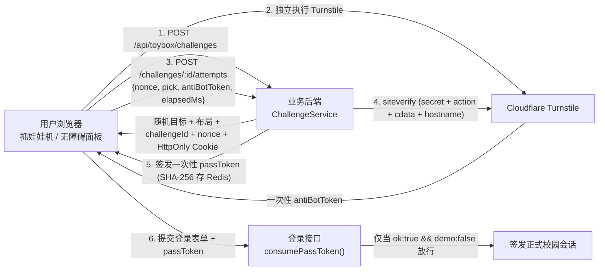

# INTEGRATION · 安全架构与正式环境集成指南

> **核心原则**：抓娃娃游戏本身**不是**可信的安全边界。它负责带来温暖的校园文化体验，而真正的防自动化与登录授权必须由 **独立反机器人验证（如 Cloudflare Turnstile）+ 服务端状态机强制校验** 共同完成。

---

## 一、双层验证架构



---

## 二、坦诚的威胁模型（Honest Threat Model）

1. **抓娃娃操作本身无法抵御现代自动化程序**：随机排列、普通指针轨迹或前端抓取动画均可被脚本模拟，因此我们**明确不采集指针轨迹**，也不将客户端计算出的「抓到了」视为可信结果。
2. **真正的防线在哪里**：
   - 服务端在校验选择前，**先**向独立反机器人服务（Turnstile）核验 `antiBotToken`，且绑定 `action` 与 `cData (= challengeId)`。
   - 挑战与一次性 `passToken` 均通过 `HMAC-SHA256(secret, sessionId)` 绑定到 `HttpOnly; SameSite=Lax; Secure` 会话 Cookie，防跨会话盗用。
   - 原子计数 + `GETDEL` 语义保证每个挑战与每枚 `passToken` 只能成功核销一次，防并发重放。
   - 按 IP 与会话双维度限流（`ToyboxRateLimiter`），防暴力枚举。
3. **中国大陆网络可达性说明**：若目标校园网络访问 Cloudflare Turnstile 存在波动，可通过实现相同的 `AntiBotProvider`（前端 `src/challenge/adapters/antibot/`）与 `verify({ token, ip, action, cData })`（后端）接口，无缝替换为阿里云验证码、腾讯云天御或 GeeTest 等国内合规反机器人服务，无需改动抓娃娃机与挑战协议。

---

## 三、HTTP 接口契约

详见 [`shared/CONTRACT.md`](./shared/CONTRACT.md)。参考实现见 [`server/index.js`](./server/index.js)：

| 方法与路径 | 说明 |
| :--- | :--- |
| `POST /api/toybox/challenges` | 创建挑战（body `{ mode: "game" \| "accessible" }`），签发 `hz_tbx_sid` 会话 Cookie |
| `POST /api/toybox/challenges/:id/attempts` | 提交抓取结果与 `antiBotToken`，返回 `passed / wrong / expired / exhausted / antibot_failed / rate_limited / invalid / error` |
| `DELETE /api/toybox/challenges/:id` | 尽力取消未完成挑战（204） |
| `GET /api/toybox/health` | 健康检查与当前模式（`demo` / `production`） |

### 服务端最终登录授权（必读）

在你的正式登录接口事务中调用 `service.consumePassToken({ passToken, sessionId })`：

```js
const verdict = await toyboxService.consumePassToken({ passToken: req.body.passToken, sessionId });
if (!verdict.ok || verdict.demo !== false) {
  return res.status(403).json({ error: 'human_verification_required', reason: verdict.reason });
}
// 只有走到这里才允许继续校验账号密码并签发登录态
```

---

## 四、Mock 模式与生产隔离

- `MockAdapter` 仅供本地开发、离线演示与艺术验收使用。
- 所有 Mock 签发的凭证均带 `demo_` 前缀且标注 `demo: true`。
- 生产环境的 `ChallengeService({ demo: false })` 会**直接拒绝**任何 `demo_` 凭证与 `MockAntiBotVerifier`，且 `server/index.js` 在 `TOYBOX_MODE=production` 下若缺少 `>= 32` 位 `TOYBOX_HMAC_SECRET`、`TURNSTILE_SITE_KEY` 或 `TURNSTILE_SECRET_KEY`，会**拒绝启动**。
- 页面处于 Mock 模式时，顶部始终显示醒目的 **`DEMO 演示模式 · 非正式授权`** 标识。

---

## 五、生产部署清单

- [ ] 将 `MemoryStore` 替换为 **Redis Store**（使用原子 `INCR` + `PEXPIRE` 实现尝试计数，使用 Redis `GETDEL` 或 Lua 脚本保证 `challenge` 与 `passToken` 严格一次性消费）。
- [ ] 配置环境变量：`TOYBOX_MODE=production`、`TOYBOX_HMAC_SECRET`（>= 32 字节随机密钥）、`TURNSTILE_SITE_KEY`、`TURNSTILE_SECRET_KEY`、`TOYBOX_ALLOWED_ORIGINS`、`TOYBOX_ALLOWED_HOSTNAMES`。
- [ ] 如部署在反向代理后，设置 `TOYBOX_TRUST_PROXY=true` 并确保代理覆盖而非透传 `X-Forwarded-For`。
- [ ] 配置 CSP：允许 `script-src https://challenges.cloudflare.com` 与 `frame-src https://challenges.cloudflare.com`。
- [ ] **隐私保护**：不采集人脸、指纹等生物识别信息，不记录鼠标轨迹，仅上传粗粒度整数 `elapsedMs` 用于基础合理性边界检查；服务端日志不得记录原始 `sessionId`、`nonce` 或 `passToken`。
- [ ] **无障碍模式等价安全**：无障碍替代面板使用完全相同的 `createChallenge({ mode: 'accessible' })`、`AntiBotProvider` 与 `submitAttempt`，具备同等安全等级。

---

## 六、本轮交付边界声明

本项目已完成完整的安全协议核心、参考 HTTP 服务端、Cloudflare Turnstile 适配器和自动化安全测试；**尚未**接入海南中学真实校园账号数据库或生产环境密钥，后续由部署工程代理对接真实登录系统与 Redis 集群。
