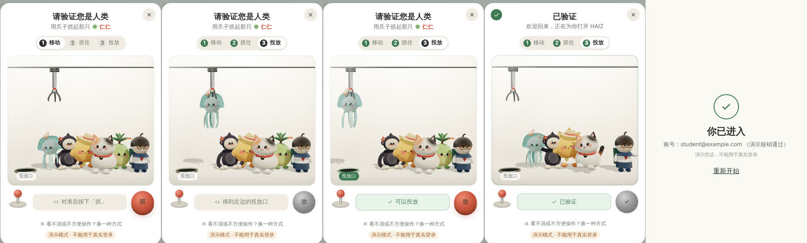

# HAIZ 验证器（抓娃娃机版 · 预览）

照着参考视频的交互节奏做的一个人类验证弹窗：一张简洁的卡片，里面是一台正面视角的小玩偶柜。

1. **移动**：拖动左边的摇杆（或直接在玩偶柜里左右拖、或按 ← →）把爪子移到目标玩偶上方。
2. **抓住**：按右边的「抓」，爪子放下、合拢、提起。
3. **投放**：把玩偶移到左下角的投放口，按「放」。投放口亮绿时可以松爪。

松爪之后才把选择交给验证服务判定。通过后卡片变成「已验证」，再回到页面显示「你已进入」。



在线预览：`/preview/haiz-verifier/`（GitHub Pages 根目录下）。

## 用了什么

- **玩偶**：`haiz-campus-toybox-original/assets/models/` 里 6 位 HAIZ 原创角色的 GLB（仁仁、午午、饭团、早早、潮潮、长长），包括它们自带的待机、被抓起、落地、欢呼动画。没有使用参考视频里的任何素材。
- **验证协议**：直接复用 `haiz-campus-toybox-original/shared/` 的 `ChallengeService` 和 `src/challenge/adapters/`（Mock / Http / Turnstile）。接口见 `haiz-campus-toybox-original/shared/CONTRACT.md`。
- **Three.js r170**：复用 `lanren/vendor/three/`，不走 CDN，无需构建。

## 安全边界

- 前端只负责交互。抓到哪只、什么时候提交，最后都要由服务端 `submitAttempt` 判定，通过后拿到一次性 `passToken`，登录/注册接口再在服务端核销。
- 默认使用浏览器内的 `MockAdapter`，挑战和凭证都带 `demo: true`，页面上有「演示模式 · 不能用于真实登录」提示，服务端会拒绝演示凭证。
- 接真实服务端：`/preview/haiz-verifier/?api=/api/toybox`（需要部署 `haiz-campus-toybox-original/server/` 或等价实现）。

## 无障碍

- 「看不清或不方便操作？换一种方式」切换到名单模式：直接点目标玩偶的名字，走同一套服务端校验。
- WebGL 不可用时自动进入名单模式。
- 支持键盘（← → 移动，空格/回车按按钮，Esc 关闭）、`prefers-reduced-motion`、页面隐藏时暂停渲染，`destroy()` 释放 WebGL 资源。

## 接入现有登录（还没做）

这次没有改动 `login/`。要接入时：

```js
import { createHaizVerifier } from '/preview/haiz-verifier/src/verifier.js';
import { createAdapterFromConfig } from '/haiz-campus-toybox-original/src/challenge/adapters/index.js';

const v = createHaizVerifier({
  container: sheetElement,
  adapter: createAdapterFromConfig({ mode: 'http', baseUrl: '/api/toybox' }),
  onVerified: ({ passToken }) => submitLogin({ ...form, passToken }), // 服务端一次性核销
  onClose: () => v.destroy(),
});
```

页面需要声明 import map（`three` → `lanren/vendor/three/three.module.min.js`，`three/addons/` → `lanren/vendor/three/addons/`），并引入 `src/verifier.css`（样式全部限定在 `.hv` 内）。

## 已知限制

- 6 个 GLB 一共约 5.7 MB，首次打开在慢网下需要几秒，期间显示「正在摆放玩偶…」。正式接入前建议压缩模型。
- 爪子「对准」的判定很宽松（以玩偶中心为准），没有物理模拟，不会出现抓到一半滑落。
