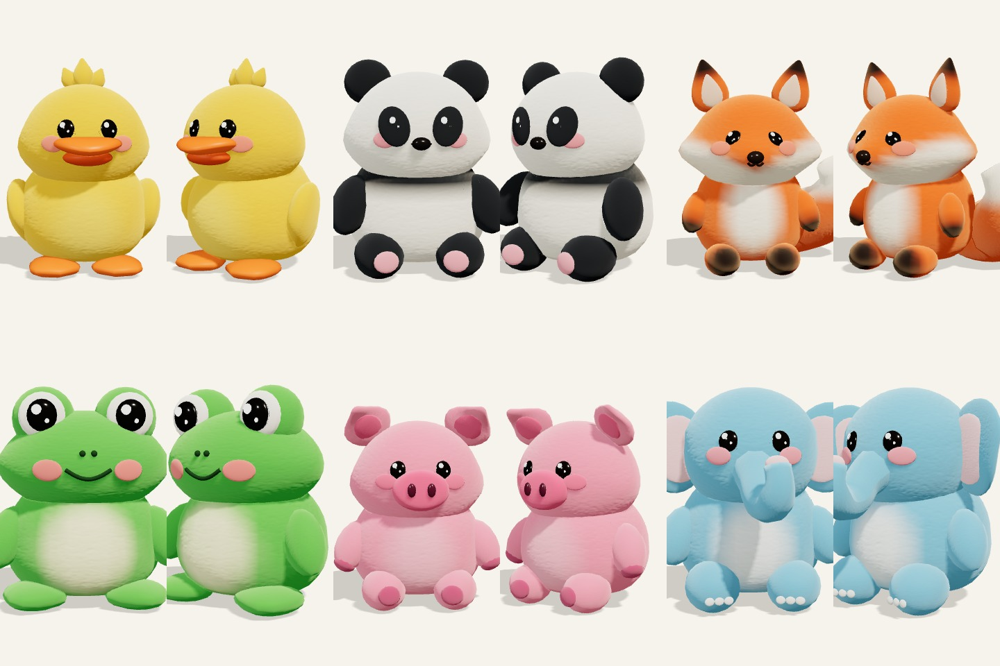

# HAIZ 动物验证码（抓娃娃机版 · 预览）

继承 PR #113 的极简卡片设计、正面玩偶柜构图、三步交互与服务端安全验证架构，将原有的 6 位校园角色替换为 6 款高辨识度 3D 毛绒动物玩偶：

| 动物 | 提示样式 | 模型文件 | 体积 | 动画片段 |
| --- | --- | --- | --- | --- |
| 黄鸭子 🐤 | `黄鸭子 🐤`（暖金黄） | `assets/models/duck.glb` | ~233 KB | `idle` / `touch` / `lifted` / `land` / `celebrate` |
| 黑白熊猫 🐼 | `黑白熊猫 🐼`（墨黑） | `assets/models/panda.glb` | ~251 KB | `idle` / `touch` / `lifted` / `land` / `celebrate` |
| 橙色狐狸 🦊 | `橙色狐狸 🦊`（狐狸橙） | `assets/models/fox.glb` | ~271 KB | `idle` / `touch` / `lifted` / `land` / `celebrate` |
| 绿色青蛙 🐸 | `绿色青蛙 🐸`（草叶绿） | `assets/models/frog.glb` | ~220 KB | `idle` / `touch` / `lifted` / `land` / `celebrate` |
| 粉色小猪 🐷 | `粉色小猪 🐷`（草莓粉） | `assets/models/pig.glb` | ~268 KB | `idle` / `touch` / `lifted` / `land` / `celebrate` |
| 浅蓝色大象 🐘 | `浅蓝色大象 🐘`（晴空蓝） | `assets/models/elephant.glb` | ~270 KB | `idle` / `touch` / `lifted` / `land` / `celebrate` |

6 款动物 GLB 合计约 **1.48 MB**（较原 5.7 MB 缩小约 **74%**），并在前端内置二进制缓存，换局与重试免重复网络加载。原有 6 位 HAIZ 校园角色资产完整保留在 `haiz-campus-toybox-original/` 中。




## 交互流程

1. **移动**：拖动左下角摇杆、直接在玩偶柜画面左右拖动/轻点，或使用键盘 `←` `→` / `A` `D`，将爪子移到任务指定的动物上方（如「用爪子抓起那只 **黄鸭子** 🐤」）。
2. **抓住**：按右下角红色「抓」（或空格/回车），三爪放下、平滑合拢抱起动物并升起。
3. **投放**：将动物移到左下角投放口上方（投放口亮绿且提示「可以投放」），按「放」松爪落入。

松爪后将选择交给验证服务判定：抓错会提示对应动物与剩余次数（如「那是粉色小猪 🐷，还可以试 4 次」）并回位；抓对后卡片变为「已验证」，再回到页面显示「你已进入」。

## 安全边界与无障碍

- **前端不决定是否通过**：完整保留 `haiz-campus-toybox-original/shared/` 的 `ChallengeService` 与 `src/challenge/adapters/`（Mock / Http / Turnstile）。协议层保持稳定 `characterId` 与 `slot` 校验，动物映射仅作用于展示层，因此可直接对接现有参考服务端（`?api=/api/toybox`）。
- **演示隔离**：默认使用浏览器内 `MockAdapter`（`demo: true`），页面显著标注「演示模式 · 不能用于真实登录」，生产服务端会直接拒绝演示凭证。
- **无障碍替代**：点击「看不清或不方便操作？换一种方式」进入 2×3 动物名单模式（带 Emoji 与对应色文字），走同一套服务端校验；WebGL 不可用时自动降级为名单模式；完整支持键盘、`prefers-reduced-motion` 与后台暂停渲染。

## 源码、模型重导与本地验收

- 动物建模与动画源码：`src/animals/`（`builders.js`、`plush-kit.js`、`glb-exporter.js`、`catalog.js`）
- 重新导出 6 个 GLB 与检视拼图：
  ```bash
  python3 preview/haiz-verifier/scripts/export-animals.py
  ```
- 运行全 6 款动物抓取/投放 + 360×740 移动端 + 无障碍端到端测试：
  ```bash
  python3 preview/haiz-verifier/scripts/verify-e2e.py
  ```
- 授权与素材来源说明：见 [`LICENSES.md`](./LICENSES.md)。
