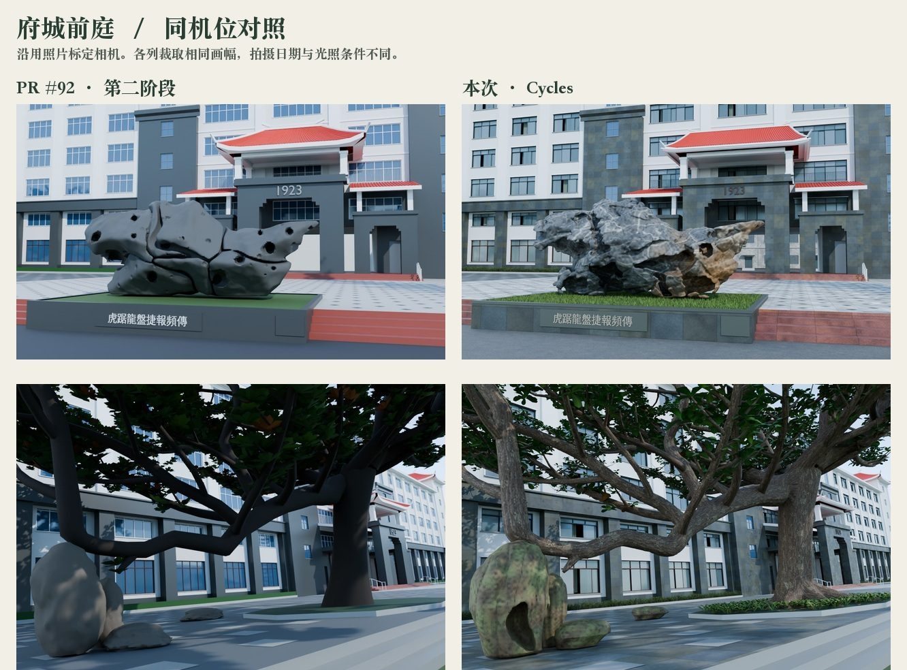

# 府城前庭 · 太湖石、榄仁树与两栋教学楼

基线为 PR #92 的 `49ed015`。这一版保留原点、标高、北门、道路和榄仁树骨架。八个可独立加载的部件位于 [assets/atelier](../assets/atelier)，可以分别导入 Blender 或 glTF 查看器，按原坐标组装。



后续对整栋一号楼、二号楼内院、科学馆和南侧教学楼群的逐面修改、影像依据和待核处见[教学区建模记录](TEACHING_COURTS.md)。

## 从图像到几何

| 对象 | 由资料确定或推断 | 本次制作与证据边界 |
| --- | --- | --- |
| 太湖石与台座 | 继承两台标定相机的外轮廓、台座位置和原题字网格。另以 `campus_taihushi.jpg` 对照石腹。 | 在 `jiaoxuelou-1600` 上逐处描了 11 个洞口与裂隙、5 块主要断面。按投影切入体积，调整悬挑下缘和洞深，移除悬浮碎屑。赭色积染、浅色矿脉、台座压顶和短草分开制作。洞腔纵深、背面和矿脉走向属于推断。[描线数据](../evidence/calibration/taihu-relief.json) |
| 百年榄仁树 | 树位、S 形低枝、承托石和数条上举枝延用第二阶段的照片反投影，树冠范围沿用影像包络。 | 沿原曲线重做树身，在根张、主干和主枝交接处合并曲面。树皮纹理顺枝铺设。叶片有弯曲的中肋、宽阔的叶端和叶脉；另建了承托石、树池草丛和落叶。枝叉背面、树冠疏密、根趾和石身凹陷深度为推断。[骨架与石位](../data/trees.json) |
| 一号楼正立面 | 原有楼层、开间、门廊和逐层窗洞继续使用。屋顶与塔楼参照 `campus_yihao`；柱廊和窗扇参照 `scenery_13`、`jiaoxuelou-1600`。 | 拉长门廊红瓦主脊，重画回转檐口和檐底；石材有接缝。前窗有双轨、上亮窗、窗台和局部开启的扇页。窗扇开启状态、窗帘、檐下灯具与细部分寸均为制作判断。 |
| 二号楼与内院 | 轮廓沿用 OSM `w1165596683@1`。航拍可辨两处连廊连接体、平屋顶和朝内院的窗墙；`campus_erhao` 提供五层、外机、栏杆和走廊参考。 | 重建朝内院的立面、底层入口与连廊接点，从一号楼门洞可看见对面的楼。具体窗数、楼层标高、设备和入口位置由照片估计。南侧敞廊作为艺术补全，单独标为 `invented`。 |
| 前庭铺装和种植 | 继承原有广场标高、铺装分区、台阶跑向与绿篱位置。 | 在原有米制 UV 上生成花岗岩和路面材料。柱下绿篱有独立枝叶，台座草皮与根际植物有实际几何。铺装缝宽、石材颗粒和植物分布为推断。 |

几何所用照片及 git blob 记录在[证据台账](../evidence/sources.json)。海南日报的百年校庆报道帮助核对榄仁树地标身份。建模中的尺度与深度仍取自仓库标定和地图。[海南日报《百年海中恰芳华》](https://news.hndaily.cn/h5/html5/2023-10/30/content_58477_16668430.htm)

## 看模型与重建

在仓库根目录运行 `python3 -m http.server 8000 --bind 127.0.0.1`，打开 [独立三维预览](http://127.0.0.1:8000/twin/viewer/forecourt.html)。所用 Three.js、控制器和加载器都随仓库提供。要查看对象依据和继承的北门、其余树木，可打开[原模型检查器的前庭版本](http://127.0.0.1:8000/twin/viewer/?edition=atelier)，该页沿用原版 CDN 依赖。

本次使用 Blender 5.2.3、其内置 Python 3.13 和 Cycles CPU。额外模块应与 Blender 的 Python ABI 匹配。在包含这些模块的环境中运行以下命令。如使用独立依赖目录，可用 `HAIZ_TWIN_PY` 指定它。

```sh
# 用 Blender 自带的 python3.13 执行这一行，将依赖放入项目临时目录
python3.13 -m pip install --target twin/scratch/py numpy scipy shapely scikit-image opencv-python-headless pillow
export HAIZ_TWIN_PY="$PWD/twin/scratch/py"

blender -b --python-exit-code 1 --python twin/blender/forecourt_atelier.py -- \
  --blend twin/scratch/HAIZ-Forecourt.blend
blender -b twin/scratch/HAIZ-Forecourt.blend --python-exit-code 1 --python twin/blender/forecourt_light.py
blender -b --python-exit-code 1 --python twin/tests/check_atelier.py
python3 twin/tools/pack_forecourt.py twin/scratch/HAIZ-Forecourt.html
```

离线 HTML 可直接双击。Blender 母版含打包纹理、米制网格、分组和检查相机。单体 `landmark.glb` 含石身、台座、题字和草皮；`terminalia.glb` 含树、四块承托与伴石、树下植被。两栋教学楼分别输出。程序生成的颜色、法线、粗糙度与基础几何分开，可更换着色方式。

## 视觉验收

- [石腹近看](../renders/atelier/limestone.jpg)、[台座反打](../renders/atelier/reverse.jpg)、[门廊檐下](../renders/atelier/portal_detail.jpg)、[东侧柱廊](../renders/atelier/colonnade.jpg)、[内院](../renders/atelier/quadrangle.jpg)用于检验进深、穿插和远近轮廓。
- [树下标定机位](../renders/atelier/lanshu.jpg)、[枝杈近看](../renders/atelier/fork.jpg)、[树冠全景](../renders/atelier/crown.jpg)用于复核承托关系与冠层空隙。另有[太湖石侧光](../renders/atelier/stone_evening.jpg)和[树下侧光](../renders/atelier/tree_evening.jpg)。
- 独立空场景复验了八个 GLB 的网格、内嵌贴图、对象标签、坐标转换和低枝与承托石的网格接触。在 Chromium 中实际操作了旋转、缩放、单看石体和各栋教学楼、机位切换和复位。修正了导出器将岩性颜色写入次要顶点色通道的问题，独立预览读取标准 `COLOR_0`。
- 沿用第二阶段投影检查，太湖石在教学楼视角与北门视角的轮廓重合度为 **0.886 / 0.861**，原记录约 **0.93 / 0.86**。第一项下降值得保留在对照里。当前指标使用填实的外轮廓作参照，会同时受外缘变化和透光孔洞影响，无法单独判断洞穴是否更忠实。

## 续作定位

1. 从太湖石背面和两端补影像，优先核对东端眉洞和西端石棚下缘，再决定是否调整石腹。台座字体仍为替代字形。
2. 从榄仁树另一侧和树冠外缘复核冠层密度、根张及主分叉。现有证据最充分的是树下正对低枝的视角。
3. 二号楼的端部、南侧及两条连廊交接标高缺少独立观测。砚池岸线与北门屋檐本轮沿用前版。正式漫游坐标转换、碰撞和设备优化仍待单独验收。
