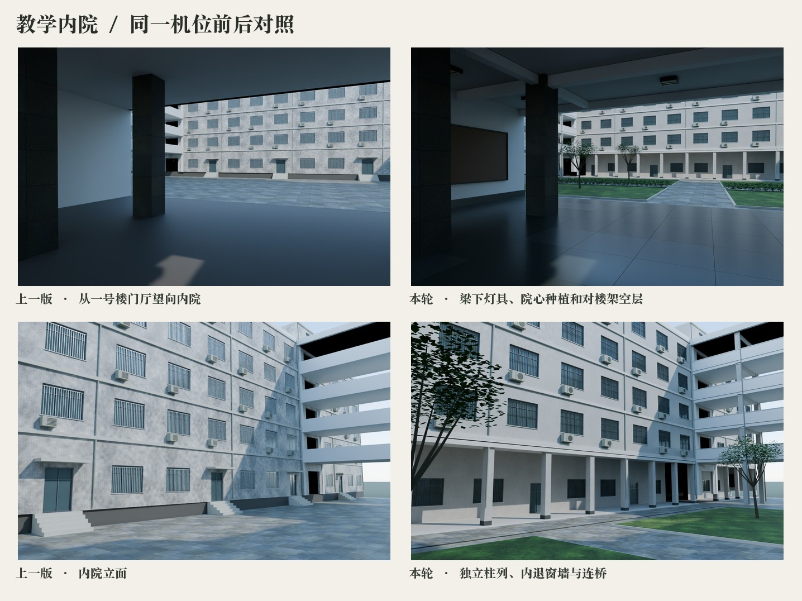
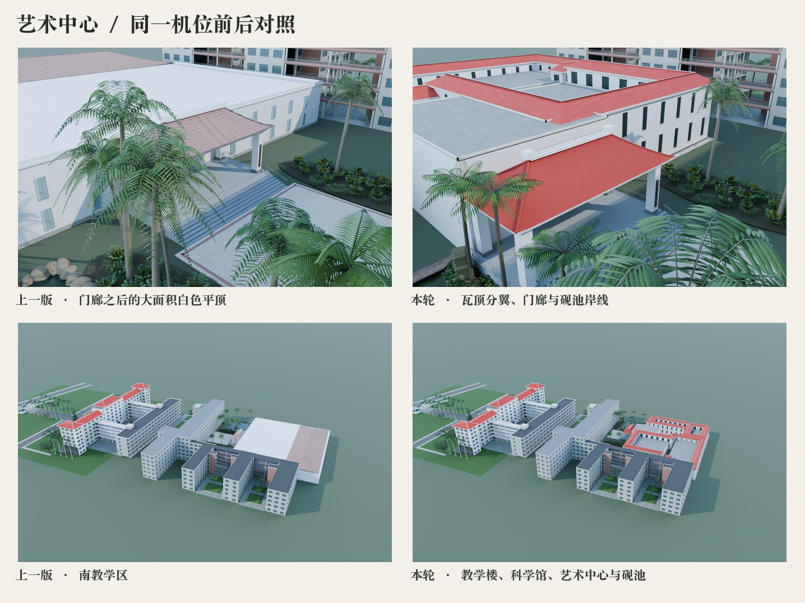
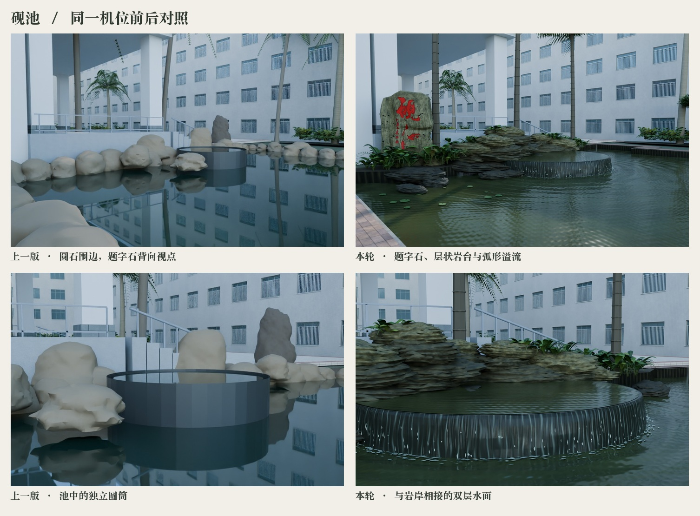
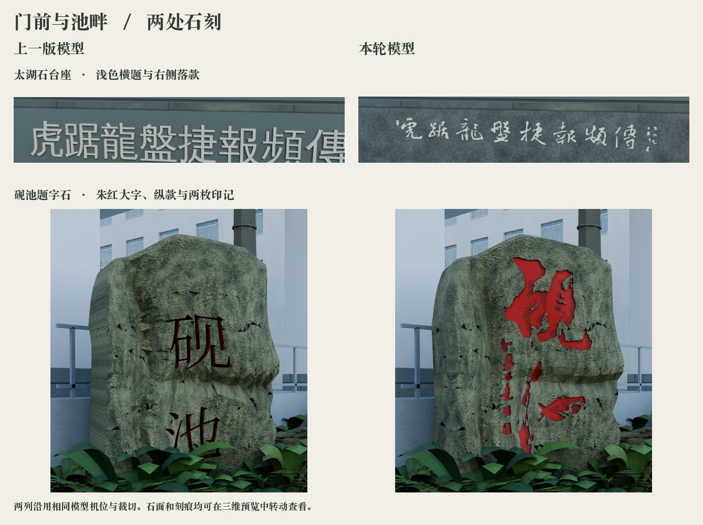

# 从一号楼门厅看后面的教学区

这一版从前庭向南扩展到二号教学楼、科学馆实验大楼及南侧教学楼群。打开[独立预览](../viewer/forecourt.html)默认从砚池题字石近景开始。在「机位」中选「一号楼门厅望内院」看两栋楼的关系，或选「南侧教学楼院内」看相对的外廊。选择「显示」可以单独旋转一个楼组。[完整重建命令](FORECOURT_ATELIER.md#看模型与重建)

## 对照依据

筛看了工作区校园相册的 57 张 JPEG，另核对网页大图、航拍、项目标定图、Atlas 教学楼双视角和 2013 年历史正面样本。相册同时包含美伦校区、生活照及其他建筑。网页裁切、Atlas 转存图和同一照片的不同分辨率按同一观察方向使用。历史照片只校核长期可辨认的轮廓与窗带。

| 影像或地图 | 可辨认的部分 | 如何落实在模型中 |
| --- | --- | --- |
| `campus_yihao`、`scenery_11/13/15`、`hero-2560`、2013 年正面样本 | 一号楼柱廊、双塔方框、圆拱上亮、深檐托座、顶层窗带、门廊与连续红瓦 | 修了翼楼屋面、檐角接缝、塔顶框、中央窗带和托座。南立面和端窗分别标记推断。 |
| `scenery_17`、`campus_erhao`、`aerial_campus` | 门厅顶梁、方灯、石地面，院心有草地和低篱，对楼底层可见独立柱，侧面是敞开连廊 | 门厅墙上保留可替换的装裱位置。二号楼改成架空门廊、内退窗墙及可从斜向观察的柱后空间。室外机有支架、圆形格栅和检修盖。照片中的临时横幅随拍摄事件变化。 |
| `campus_kexue`、航拍、地图轮廓 `w1165596687@1` | 科学馆的浅色通长外廊、深色遮阳屏、后退的教室窗和抬高的顶盖 | 东段沿地图转折处布置多层外廊，和西侧实验翼作为同一建筑重建。照片中可辨认的形式用于建模，确切朝向、开间和各段遮阳屏定位仍有误差。 |
| `campus_sanhao_sihao`、`data/buildings.json`、地图轮廓 `w1165596688@1` | 地图为带两处院落、三个横向体量和窄连接段的楼群。照片可见粉褐色墙、金属栏杆、白色廊板、棕榈和成排铺装。 | 按地图建出完整楼群和两个可观察的庭院，推定五层。照片里题字为「海南中学科技活动中心」。图名与题字不足以确定每段楼号，模型以「南侧教学楼群」呈现。 |
| `scenery_23`、`campus_yanchi`、`scenery_21/26` | 校园中还有架空楼面、浅色小砖和池边步道 | 砚池保留地图外界，题字石、集中叠石、跌水和临水步道按池岸实拍重新组装。 |

另查到作者 hkaxiong 的[2013 年一号教学楼全景条目](https://www.360cities.net/zh/image/hkaxiong-hnzx-jxl1)，未取得可核实后楼立面的展开影像。[HAIZ 学校介绍](https://haiz.space/about.html)可核对一号楼前榄仁树与砚池的地标背景。测量依据仍为项目影像和地图。

## 三轮画面检查

1. 从一号楼门厅望出去，第一轮看见对楼底层排满窗户，院心没有种植。依据 `scenery_17` 重做底层和庭院，复用原相机重新渲染。
2. 从内院斜看，连桥曾经正对一号楼窗墙。按原连桥轴线打开墙面，补过渡楼板、檐下横梁、栏板压顶和柱列。科学馆的第一稿在折角处廊深过大，改为沿外缘约 2.15 米的回转廊；此值为建模假设。
3. 从南侧庭院观察，最初的连续窗墙封住了狭窄连接段。依据平面轮廓与庭院参照，改成能够看到另一侧天光的层间连桥。土色端墙、金属栏杆、种植池与有弯曲叶轴的棕榈均为独立可再编辑构件。屋顶用约束三角剖分覆盖凹形平面。近景中粉褐色端墙曾出现整列黑块。用相机射线定位到相邻窗的背板，收回窗洞内后重新导出，并增加针对该处的几何检查。

## 文件与复核点

- `yihao.glb`、`erhao.glb`、`science.glb`、`south_classrooms.glb` 可独立导入。米制坐标与原项目前庭共用。后两项的平面边界在重新导入后与地图轮廓逐轴比对。
- `yanchi.glb` 单独输出砚池水景，并按校园坐标随教学区加载。完整组装还包含前庭、太湖石和榄仁树。离线打包时将全部部件和查看器装入同一个 HTML。
- 一号楼两条连桥分别在五个楼层与真实网格开口相接，验证脚本会从内院一侧对十处接点发射检测射线。此项只验证模型内部一致性。
- 二号楼南立面、两端山墙、科学馆东西翼转接和南侧两座院落的楼号仍待核。后续若能取得二号楼端部斜照、科学馆正面全幅，以及一张同时拍到三／四号楼号与连廊的照片，就可以集中修订这些部件。

## 艺术中心与一号楼屋顶

旧版精细门廊来自项目的 `assets/walk/atelier.js` 和 `landscape.js`。直接移入旧建筑后，同机位复查发现后部仅有一条红瓦坡顶，大部分面积是连续白盖板。当前版本保留旧作的台阶、四根方柱、门扇、牌匾、栏杆和种植，以 `campus_yishu.jpg` 的砚池侧斜视照片确定入口瓦色、曲面和浅色正脊。根据 `esri-courtyard` 影像分别描出西北折翼、后厅、东侧长廊和东南围合的屋脊。西翼朝南敞开，内侧灰色低屋面与狭长空隙沿用影像可辨认的关系。瓦垄垂直于各自的檐口，在斜脊和转角截断。可在[屋面俯视](../renders/atelier/arts_roof.jpg)和[入口斜视](../renders/atelier/arts_photo.jpg)之间切换查看。

第一轮试装时，东侧旧花床与砚池重叠。调整了花床朝向、入口广场的进深，以及门厅与西翼相接的平面转折后，再次复核台阶、坡顶和水面。模型中五株旧棕榈的根部均位于水面轮廓外。门厅外墙、楼翼标高、坡度、内院开窗和花床分布仍为推断；卫星影像无法区分灰色屋面下的室内用途。后续以艺术中心楼后斜视和院内看向屋脊的照片优先校核。[量取数据](../evidence/calibration/arts_roofs.json)

`twin/source/arts_entrance.glb` 保留 644 个来自旧作的可编辑网格节点。它可以直接作为输入，也可在包含原始漫游素材的完整仓库，以 Playwright 和与项目 Three.js 相同的 r128 GLTFExporter.js 运行 `node twin/tools/export_legacy_arts.cjs . /path/to/GLTFExporter.js twin/source/arts_entrance.glb` 重新生成。Blender 的 `atelier_arts.py` 单独建立屋面、围护和低厅，通过前庭重建入口组合输出 `arts.glb`。最终文件含 19 张内嵌贴图。此轮按母版精度保存，移动端简化留待派生版本。

一号楼中央正脊沿横向延伸。对提供的斜视照片框选 20 处建筑特征后，重新拟合了相机，微调主脊相对立面的方向、起檐标高与角部收口。497 像素宽的裁切图中，两处檐口偏差分别从 20.63 降到 6.57 像素、从 18.31 降到 8.81 像素。这个数值仅描述该机位的照片拟合。[同机位屋顶对照](../renders/atelier/yihao_roof_comparison.jpg) · [标定记录](../evidence/calibration/yihao_oblique_study.json)

## 砚池岸景

旧模型把地图水域围上一圈大小相近的卵石，题字石在主要观察方向看不见字，圆筒上缘没有溢水。新模型沿用 OSM 记录 `w1165596689@1` 的水域外界。题字石、岩台和弧形堰口在同一侧相接，其余岸段布置低步道、临水平台与浅阶。

- `campus_yanchi.jpg` 提供题字石、阔叶草本、椰干及横向岩层的近景。`wenhua_yanchi-800.jpg` 中可见弧形溢流、湿岸、对岸花钵和台阶。`campus_yishu.jpg` 用于复核池岸与艺术中心入口的关系。本地 Atlas 双视角对应前两张照片的裁切，未作为额外摄影站或测绘数据。
- 从已有 `assets/walk/models/campus-limestone.glb` 提取三个高精度石灰岩变体以及旧作题字石的外形。新模型为题字石增加纵向凹槽和层间缺口，从实拍提取红字、小款和印记，重新构造碑面及浅刻。叠石按干、湿、背阴的区别处理原有烘焙材质。[原资产制作与字体说明](../../assets/walk/models/NOTICE.md)
- 每层岩板、碑身、池盆、完整水面、弧形堰和落水分开编辑。水面网格叠加风纹和从溢口向外的短波，跌水带有沿弧长展开的独立法线及粗糙度纹理。水流保存在固定瞬间，可在 Blender 与离线预览中从不同方向观察。离线查看器沿用项目的 Water.js，对上、下两层水面分别按观察位置渲染周围建筑和植被的倒影。
- 岸边、跌水、题字石、俯视及晨光均有渲染。空场景重载验证上下水面在模型中相差约 0.6 米，东侧四级踏步逐级抬高。实际水位、池底深度、各岩台位置、题刻深度和植株数仍待实地复核。水域轮廓有地图依据，局部相机为估计视点。

[池岸](../renders/atelier/pond_bank.jpg) · [跌水近景](../renders/atelier/pond_falls.jpg) · [题字石](../renders/atelier/pond_stone.jpg) · [晨光](../renders/atelier/pond_daylight.jpg) · [砚池建模源文件](../blender/atelier_pond.py)

## 两处石刻的字形

太湖石台座使用 `jiaoxuelou-1600.jpg`，把浅色横题、旁款和端部捐赠款的可见轮廓，从照片反投影到台座正面。逐笔挖开花岗岩表面，槽底用两档矿物填色保留磨淡处，中央横题与端款刻深分别估计为 4.7 和 2.4 毫米。捐赠小字在原图只有数个像素，按可见明暗保留痕迹。

砚池题字使用 `campus_yanchi.jpg`。沿朱红颜料的边界提取宽窄、折笔、细长下行笔、左侧小款和两枚印记。颜料凹入随石面起伏的槽底，建模采用约 14 毫米的局部深度，石体缩放后实物感尺寸略有变化。碑面的透视展宽、浅刻深度与实际色值为估计。

[太湖石台座近看](../renders/atelier/taihu_script.jpg) · [砚池题字石近看](../renders/atelier/pond_stone.jpg) · [笔画采样轮廓](../evidence/calibration/stone_lettering.json) · [提取工具](../tools/trace_stone_lettering.py)
