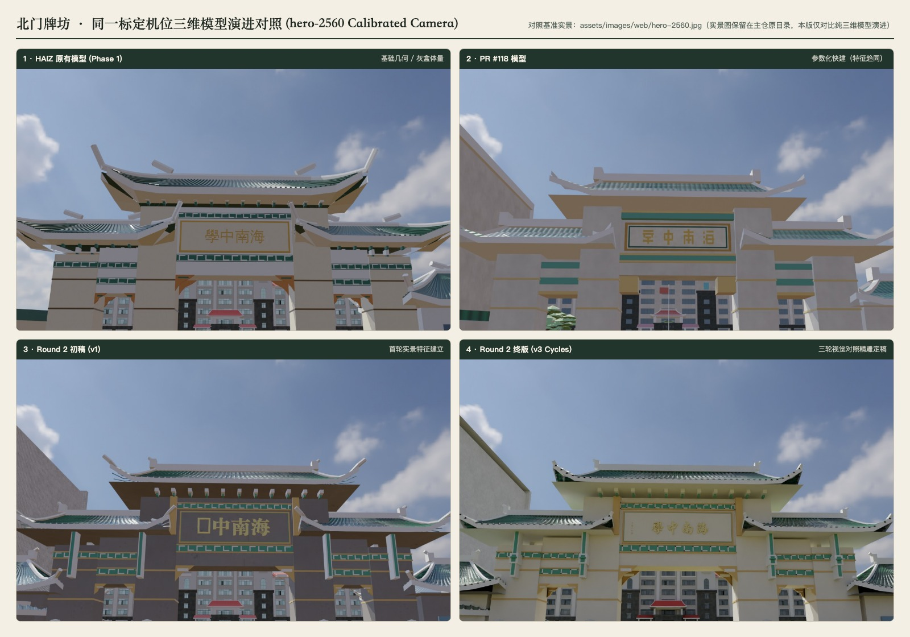
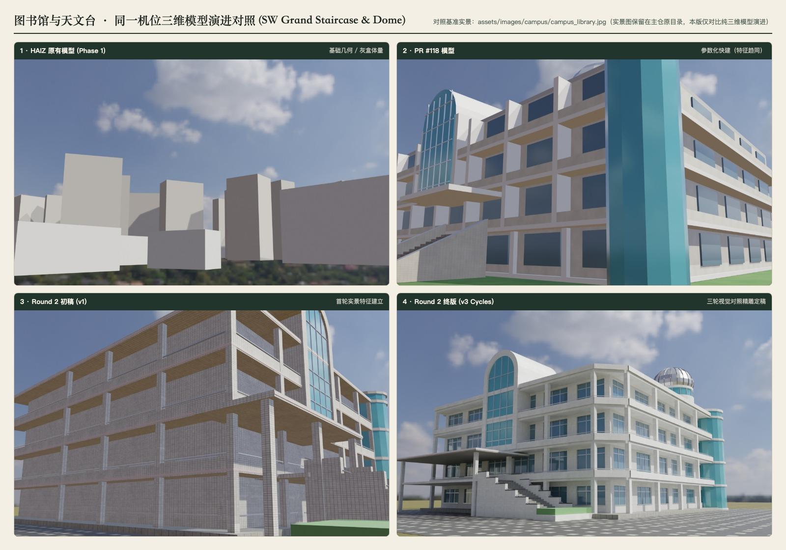
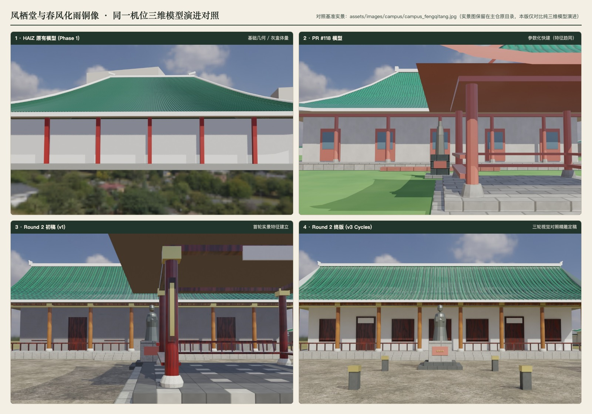
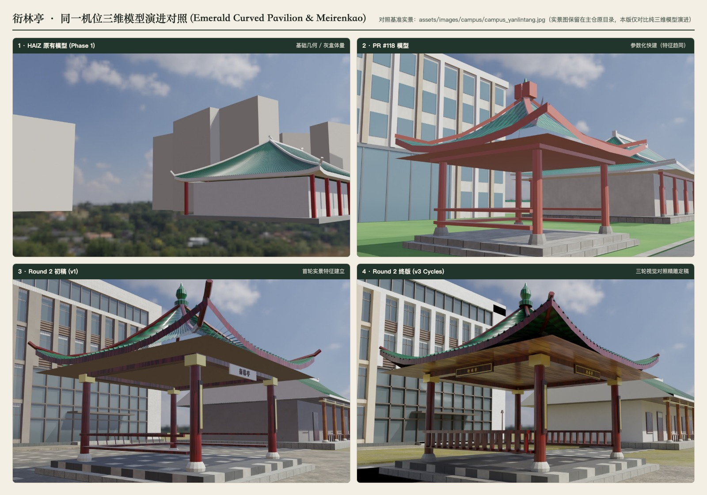
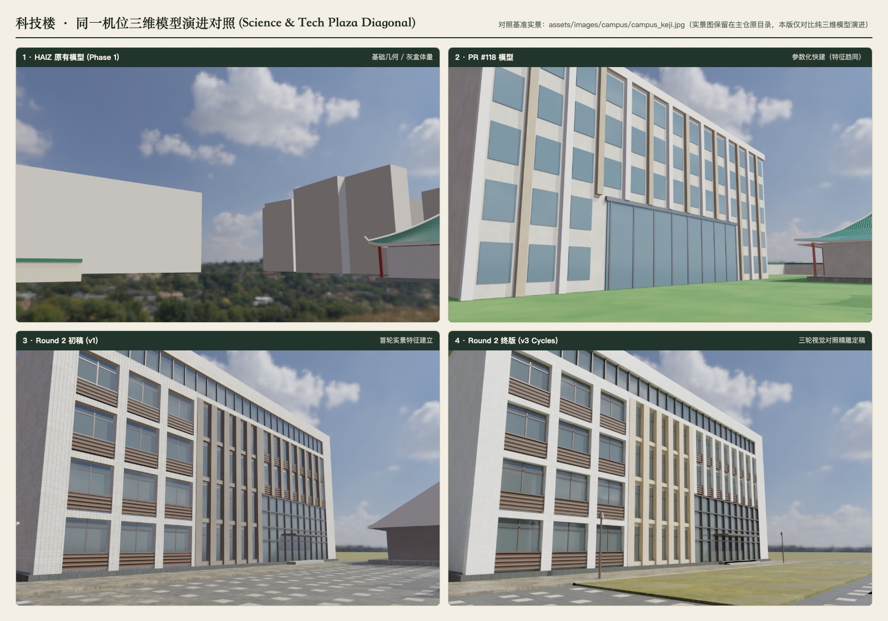
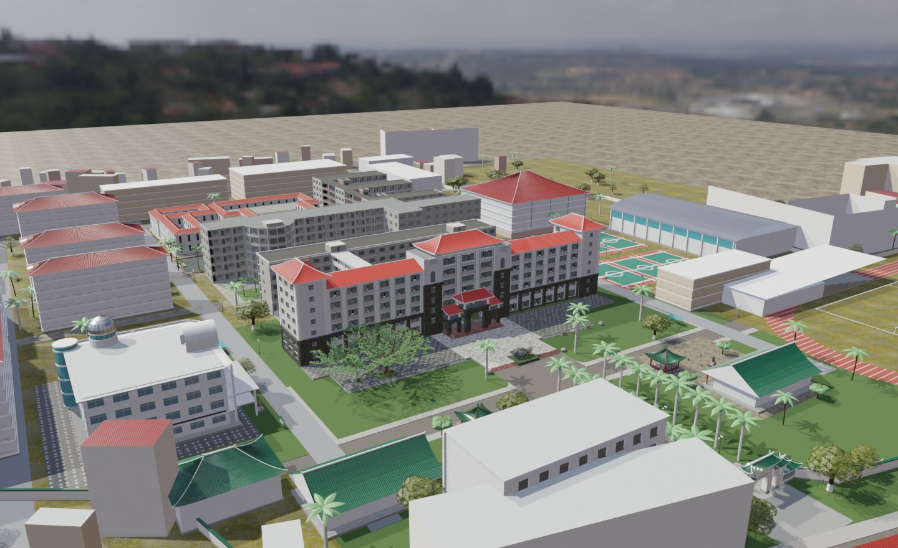
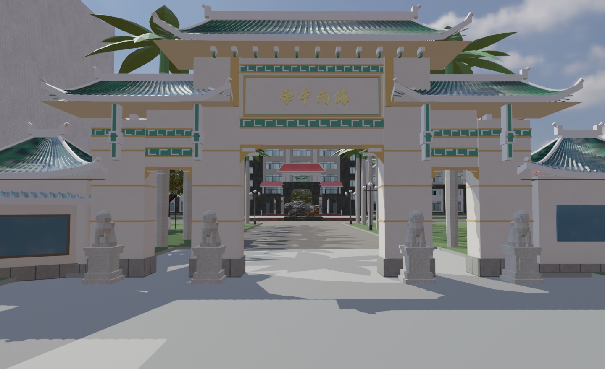
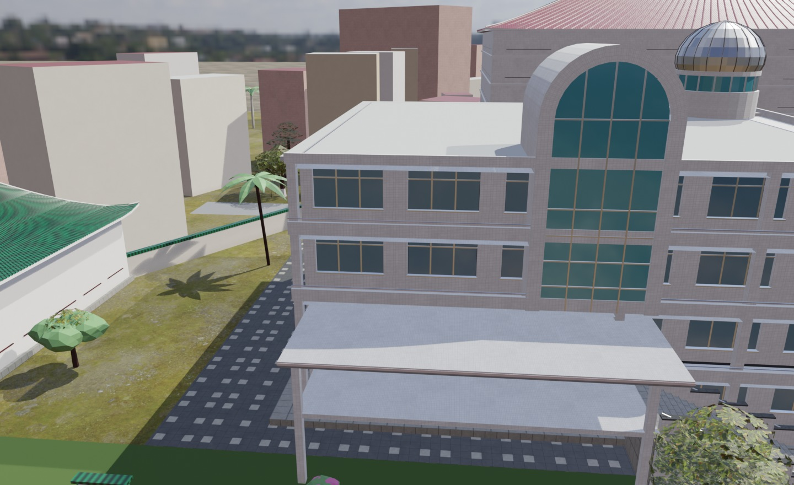
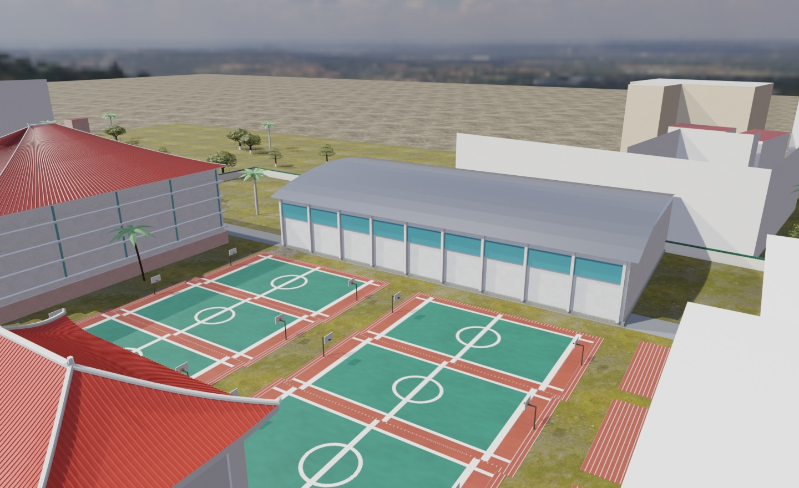

# HAIZ · World Reconstruction Round 2 — 真实感恢复与视觉对照报告

**项目分支**：`experiment/world-reconstruction-r2`（独立演进分支，完整保留 PR #118 与 `main` 原有资产）  
**实时预览**：`https://manyiwant.github.io/haiz-world-reconstruction-r2-preview/`  
**核心工程哲学**：*“先尊重真实海南中学府城校区的空间尺度、立面秩序与材质风貌，通过闭环视觉精雕建立高真实感 Blender 母版与直接继承策略，再以非破坏性 LOD / Draco / WebP / GPU 实例化与流式加载服务运行性能。”*

---

## 一、从 PR #118 到 Round 2 的核心反思与转向

PR #118 成功验证了 Python + Blender 程序化生产、六区渐进式流式加载与海口 20°N 实时气象生活系统的技术路线，但统一的参数化批建模板在视觉上抹平了府城校区各单体建筑最珍贵的辨识度，同时弃用了此前 HAIZ 已投入大量精力精细打磨的 `twin/assets/runtime/*.glb`（Atelier 核心资产）。

Round 2 对生产路线进行了彻底重塑：
1. **高价值既有资产原真继承（不推倒重来）**：直接继承 `twin/assets/runtime/` 中的 **9 套 Atelier 主核心 GLB**（`yihao`, `landmark`, `terminalia`, `forecourt`, `erhao`, `science`, `south_classrooms`, `yanchi`, `arts`），完整保留太湖石与百年榄仁树的 `COLOR_0` 顶点着彩、砚池动态水波及各楼精细外廊结构；仅剥离 `forecourt.glb` 中与周边地形冲突的 `site.ground.context` 巨大平面与默认 `Cube`。
2. **闭环视觉迭代（实景对照 → 问题诊断 → 代码/材质精修 → Cycles 重渲染 → 再检视）**：针对北门牌坊、图书馆与天文台、凤栖堂与春风化雨像、衍林亭、科技楼四组 5 处校史核心地标，对齐同一标定相机机位完成 **`v1 → v2 → v3 (Cycles 32spp + OIDN)`** 三轮实景对照迭代。
3. **非破坏性运行时优化**：所有新建建筑先在可编辑母版 [HAIZ_World_R2_Master.blend](../assets/blend/HAIZ_World_R2_Master.blend)（`36.90 MB`）中保持 `100%` 建筑轮廓、镂空回纹、柱础与百叶细部，再统一通过 `Draco (14/10/12 bit)`、`WebP (Q=90)` 与独立 `LOD0 / LOD1` 集合导出，总计 **10 个 R2 GLB 仅占 `9.17 MB`**。

---

## 二、全校资产继承与重构审计总表

| 区域 / 建筑 ID | 处置策略 | 真实参照依据 | 可信度标注 | 交付形式与包体 |
|---|---|---|---|---|
| 一号教学楼 (`1923`)、`taihu` 太湖石、百年榄仁树、`forecourt` 前庭 | **原真继承 (Runtime)** | `hero-2560`, `jiaoxuelou-1600`, `lanshu-1600` | `inherited/atelier/photo-derived` | `twin/assets/runtime/{yihao,landmark,terminalia,forecourt}.glb`（去冲突地面） |
| 二号楼、科学馆、南侧教学楼群、砚池、艺术中心 | **原真继承 (Runtime)** | `twin/evidence/sources.json` | `inherited/atelier/photo-derived` | `twin/assets/runtime/{erhao,science,south_classrooms,yanchi,arts}.glb` |
| **北门牌坊 (`beimen`)** | **Round 2 精雕重制 (`v3`)** | `assets/images/web/hero-2560.jpg` + `twin/data/gate.json` | `photo-derived` | `r2_heroes_north_lod{0,1}.glb` (`2.11 MB` / `1.81 MB`, 含科技楼) |
| **科技楼 (`keji`)** | **Round 2 精雕重制 (`v3`)** | `assets/images/campus/campus_keji.jpg` | `photo-derived/public-map` | 同上 (`r2_heroes_north_lod{0,1}.glb`) |
| **图书馆与天文台 (`library`)** | **Round 2 精雕重制 (`v3`)** | `assets/images/campus/campus_library.jpg` + `aerial_campus.jpg` | `photo-derived/public-map` | `r2_heroes_heritage_lod{0,1}.glb` (`1.22 MB` / `0.96 MB`, 含书院群) |
| **凤栖堂 (`fengqitang`)、衍林堂 (`yanlintang`)、衍林亭 (`yanlinting`)、凤栖亭** | **Round 2 精雕重制 (`v3`)** | `campus_fengqitang.jpg` + `campus_yanlintang.jpg` | `photo-derived/estimated` | 同上 (`r2_heroes_heritage_lod{0,1}.glb`) |
| 18 座外围生活与体育建筑（女宿 `dorm_f`、男宿、体育馆、看台、食堂、校友会、南门） | **Round 2 特征分级建模** | `campus_dorm_f.jpg` + `campus_nanmen.jpg` + OSM | `photo-derived/public-map` / `estimated` | `r2_outer_campus_lod{0,1}.glb` (`1.01 MB` / `0.68 MB`) |
| 外围校园地形、400m 跑道、6 片篮球场、3 片排球场 | **无重叠精密裁切拼接** | OSM + `aerial_campus.jpg` + `campus_playground.jpg` | `public-map/photo-derived` | `r2_terrain_surround.glb` (`1.07 MB`，完美避让前庭与砚池) |
| 府城周边 `133` 栋城市街区背景 | **轻量天际线语境体量** | OSM Qiongshan/Fucheng 多边形 | `public-map/estimated` | `r2_fucheng_context.glb` (`0.14 MB`) |
| `170` 株热带乔木灌木 + `46` 组校园设施 | **GPU 实例化资产库** | 椰林大道、砚池椰林、前庭草坪规避校核 | `photo-derived/estimated` | `r2_flora_kit.glb` (`0.41 MB`) + `r2_props_kit.glb` (`0.21 MB`) |

*(全库 `world_spec.json` 与 glTF extras 中 `surveyed_count = 0`，严格区分实景校准、公开地图与推断外围部分。)*

---

## 三、五大标定地标：四阶段同一机位视觉演进对照

*(注：为尊重原始实景照片版权，公开发布对比图仅对比四阶段纯三维模型演化：`Phase-1 → PR #118 → R2 初稿 v1 → R2 终稿 v3 Cycles`；原始参考照片路径标注于下方供本仓对照查验。)*

### 1. 北门牌坊 (`beimen`) — 基准实景：`assets/images/web/hero-2560.jpg`

- **PR #118 问题**：扁额错用简体/缺字贴图，斗栱与雀替简化为平滑色块，琉璃筒瓦退化为平滑斜板，墙面缺乏石材/灰泥肌理。
- **Round 2 (`v1 → v3 Cycles`) 迭代突破**：
  - 修复 `Songti.ttc` 缺失 `學` 字形导致的方框缺陷，改用 macOS **`Xingkai.ttc` 行楷 3D 浮雕斜切网格**，严格按传统自右向左书写**「學中南海」**并配「一九八八年」小字落款与金箔材质；
  - 从 `v2` blotchy Voronoi 灰泥收敛为海口日照质感干净米白灰泥，逐片建出孔雀绿半圆**筒瓦与瓦当**、屋檐绿白回字纹（回纹）真 3D 凹凸条带、**椭圆形绿宝珠侧柱装饰**、斜撑及**四尊须弥座石狮**。

### 2. 图书馆与天文台 (`library`) — 基准实景：`assets/images/campus/campus_library.jpg`

- **PR #118 问题**：外廊柱列均质化且尺寸失真，白色马赛克外墙缺乏精细瓷砖肌理，外挂大台阶体量生硬，东/南朝向特征混淆。
- **Round 2 (`v1 → v3 Cycles`) 迭代突破**：
  - 将 `v1` 误置南侧的大台阶修正回**西立面（面向校园主林荫道）**，精雕 22 级花岗岩室外大台阶、深色石材压顶阶梯翼墙、双层悬挑平雨棚（`v3` 消除共面 Z-fighting 黑斑）；
  - 还原高耸的**半圆形蓝绿玻璃弧形中庭幕墙**、西南 45° **倒角外廊带珊瑚粉水平嵌线**、东南角通高玻璃圆筒楼梯间；
  - 按 `campus_library.jpg` 抬高并校准屋顶鼓形玻璃采光座，让标志性的**20 肋银灰锌钛金属天文穹顶**稳居天际线右上角。

### 3. 凤栖堂与春风化雨铜像 (`fengqitang`) — 基准实景：`assets/images/campus/campus_fengqitang.jpg`

- **Round 2 (`v1 → v3 Cycles`) 迭代突破**：
  - `v1` 中凤栖亭误位于正前方遮挡了先贤铜像与正立面视廊；`v2` 立即将其归位东侧绿地，恢复开阔庭院轴线；
  - 以白洁外墙配合 **8 根金色清漆木柱与雕刻石柱础（鼓形石墩）**、外廊低矮木栏、**红木框白格木棂窗**及深红门扇；
  - 铜像底座正面阴刻/浮雕红底金字**「春风化雨」**，前方添置四座深灰石材金色灯柱。

### 4. 衍林亭 (`yanlinting`) — 基准实景：`assets/images/campus/campus_yanlintang.jpg`

- **Round 2 (`v1 → v3 Cycles`) 迭代突破**：
  - `v1→v2→v3` 逐轮加粗加深了最具岭南/琼州特色的**朱红向外斜倾美人靠（15 根密栅靠背与长坐凳）**；
  - 消除 `v2` 西向额枋空白白板与檐角木椽刺穿绿瓦问题，南北西向均嵌入**红木金边「衍林亭」篆书牌匾**，搭配金色木望板顶棚与孔雀绿宝顶琉璃瓦顶。

### 5. 科技楼 (`keji`) — 基准实景：`assets/images/campus/campus_keji.jpg`

- **Round 2 (`v1 → v3 Cycles`) 迭代突破**：
  - 忠实分割三段式立面韵律：**西侧三大跨深棕木质横百叶窗台**、**中左五道窄竖香槟色壁柱与条窗**、**东侧双层青铜反射玻璃门厅 + 三级入口石阶**以及三至四层白壁柱配窗口百叶与**五层连续通高带状高窗**；
  - 前景忠实重现深浅错格广场、弧边草坪与步道灯，并在 `v3` 修复所有立面交接处的 Cycles 共面阴影瑕疵。

---

## 四、全校园合龙实景效果

| 全校鸟瞰（Heritage Core + 体育生活区） | 北门入校轴线（1923 一号楼与太湖石透视） |
|---|---|
|  |  |
| **图书馆与书院花木庭院** | **六片青红球场、体育馆与女生宿舍（`campus_dorm_f` 风格）** |
|  |  |

---

## 五、实时 WebGL 性能与体积实测

> **测试硬件与口径声明**：实测运行于本地 **Playwright 真实 Metal-GPU 加速 Chromium（Apple Silicon M5 ANGLE Metal Renderer）**。移动端数据来自 **`390×844` 触控仿真模式（自动切换 `mobile` 画质档与 `LOD1` 优先加载）**，非物理智能手机终端实测。完整原始日志见 [gpu-benchmark-r2.json](../data/gpu-benchmark-r2.json)。

| 对比维度 | HAIZ 原有系统 (Atelier Viewer) | PR #118 (均质批建管线) | **Round 2 (真实感继承 + 精雕重建)** |
|---|---|---|---|
| **覆盖范围** | 仅中轴教学核心 9 部件 | 完整校园 34 栋建筑 + 街区 | **完整校园 34 栋 + 133 栋府城天际线** |
| **代表建筑真实度** | 一号楼/砚池/榄仁极高；北门/书院/科技/图书馆缺失或简陋 | 统一模板均质化 | **继承全部 9 件 Atelier 精华 + 精雕 5 大真实地标** |
| **可编辑母版体量** | 分散单件 GLB | 单一 `HAIZ_World_Master.blend` | **`HAIZ_World_R2_Master.blend` (`36.90 MB`)** |
| **R2 自建流式资产总计** | — | ~22 MB (含重写全部中轴建筑) | **`9.17 MB` (10 个 Draco + WebP LOD0/1 GLB)** |
| **桌面 `1440×900` Boot** | 单景一次性阻塞加载 | ~800 ms | **`937 ms` (Priority-0 立即可游走)** |
| **桌面 `1440×900 High` 稳态帧率** | 仅局部 9 件渲染 | ~60 FPS | **`55.5 FPS` (`9.12 ms/帧`, HDR IBL + 1,044 万面全校实时)** |
| **骑行暴雨 / 黄金时段滑翔** | 无 | ~56 FPS | **`43.9 FPS` / `37.8 FPS`** |
| **移动 `390×844` 触控仿真** | 桌面布局偏挤 | ~58 FPS (`LOD1`) | **`38.7 FPS` (`1,400 draws`, 触控摇杆与 7 键栏无溢出)** |
| **浏览器错误与漏请求** | — | `0` | **`0` console/page/network errors** |

---

## 六、后续演进与持续资产贡献工作流

1. **打开母版精修**：在 Blender `5.2+` 中打开 [HAIZ_World_R2_Master.blend](../assets/blend/HAIZ_World_R2_Master.blend)，可按集合单独微调任意建筑（`02A_R2_Heroes_North`, `02B_R2_Heroes_Heritage_Library`, `03_R2_Outer_Campus`）。
2. **闭环视觉验证**：任何对英雄建筑 Python 模块（`pipeline/blender/heroes/*.py`）的修改，只需一条命令即可生成同机位 Cycles 对照表：
   ```bash
   blender --background --factory-startup --python world-reconstruction-r2/pipeline/blender/render_compare.py -- --mode r2 --tag dev --samples 32
   node world-reconstruction-r2/pipeline/make_comparison_sheets.mjs audit dev
   ```
3. **重装导出与自动化校验**：修改后执行 `assemble_world_r2.py && node world-reconstruction-r2/pipeline/validate_r2.mjs && node --test world-reconstruction-r2/tests/unit-r2.test.mjs`，即可安全更新流式 `LOD0/LOD1` 资产并保证与既有 Atelier 核心零重叠、零 Z-fighting。
